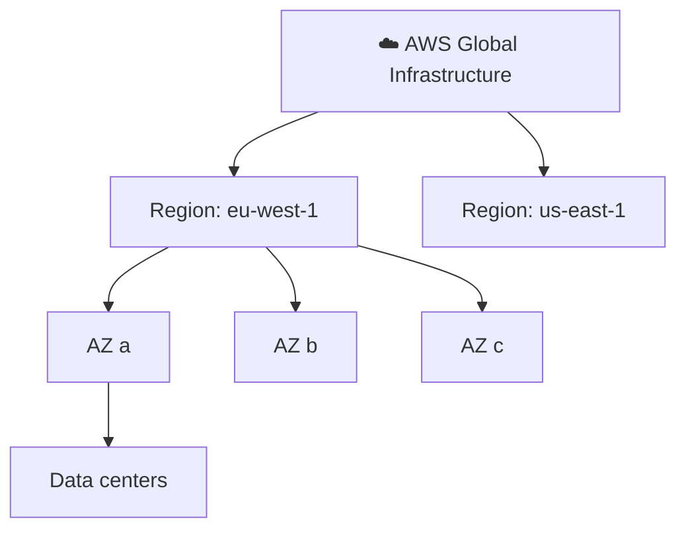
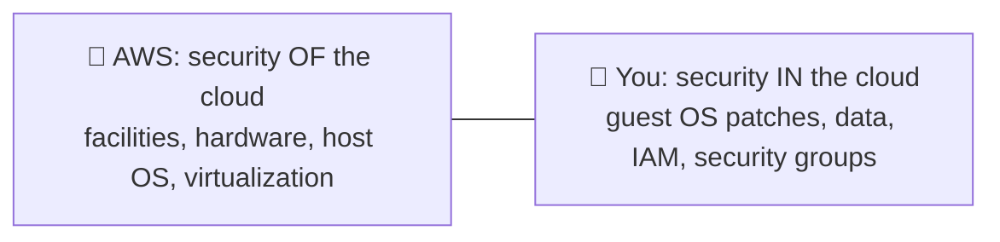

## What it is

This course teaches you to design and build systems on AWS, the way a solutions architect does at work. Passing the AWS Certified Solutions Architect - Associate (SAA-C03) exam is a side benefit, not the goal. You learn by reading short chapters with diagrams, then building labs in your own account.

```mermaid
flowchart LR
  A["1 Getting Started"] --> B["2 Identity & Access"]
  B --> C["3 Networking Basics"]
  C --> D["4 Compute & Containers"]
  D --> E["5 Storage"]
  E --> F["6 Databases"]
  F --> G["7 Scaling & Monitoring"]
  G --> H["8 Advanced Networking & Data Transfer"]
  H --> I["9 Serverless & Messaging"]
  I --> J["10 Security & IaC"]
  J --> K["11 CI/CD"]
  K --> L["12 Edge, AI, Multi-Account"]
  L --> M["13 Disaster Recovery"]
  M --> N["14 Capstone & Exam Prep"]
```

*The 14 parts, in reading order. Each part builds on the ones before it.*

By the end you can:

- Create a safe AWS account and control who can do what (IAM).
- Build a 3-tier web app: network, servers, database, storage.
- Make it scale, monitor it, and recover from failure.
- Choose the right service and explain the cost and security trade-off.
- Finish a capstone project and answer SAA-C03 style questions.

## Key concepts

### How AWS is organised

*A Region holds several isolated Availability Zones (AZs).*

| Term | Meaning |
|---|---|
| Region | A geographic area, isolated from other Regions. Resources are not copied between Regions unless you set that up. |
| Availability Zone | One or more separate data centers in a Region, with independent power and cooling, linked by fast networks. Every Region has at least three. |
| Account | The container for your resources and bills. |

- Pick a Region by latency to users, legal rules, service availability and price.
- For high availability, spread across at least two AZs.

### Who secures what

*Shared responsibility: the more managed the service, the more AWS handles.*

### Learning path and tips

- **Order:** follow the parts as listed. IAM (Part 2) and networking (Part 3) come first because every later service uses them.
- **Labs:** build each one yourself, then delete the resources to avoid charges.
- **Capstone:** a final project that combines the parts; it is your portfolio piece.
- **Certifications:** SAA-C03 checks that you can design secure, resilient, high-performing and cost-optimised architectures. The exam-prep part at the end reviews this; other certifications are optional next steps.
- **Extras:** slides, code resources and release notes are linked from the course; use them as reference, not as reading.
- **Start here:** next read [Architecting foundations](/chapters/02-architecting-foundations/), then [Create and set up your AWS account](/chapters/03-create-and-setup-your-aws-account/).

## Cheat sheet

- Goal: job-ready AWS skills first, exam second.
- 14 parts, in order; labs are hands-on, so build them.
- Region = geography; AZ = isolated data centers inside it; use 2+ AZs for availability.
- Shared responsibility: AWS secures the cloud, you secure what you put in it.
- SAA-C03 domains: secure, resilient, high-performing, cost-optimised design.

## AWS docs

- [Global infrastructure: Regions and AZs](https://docs.aws.amazon.com/global-infrastructure/latest/regions/aws-availability-zones.html)
- [Shared responsibility model](https://docs.aws.amazon.com/whitepapers/latest/aws-risk-and-compliance/shared-responsibility-model.html)
- [AWS Certified Solutions Architect - Associate (SAA-C03) exam guide](https://docs.aws.amazon.com/aws-certification/latest/solutions-architect-associate-03/solutions-architect-associate-03.html)
