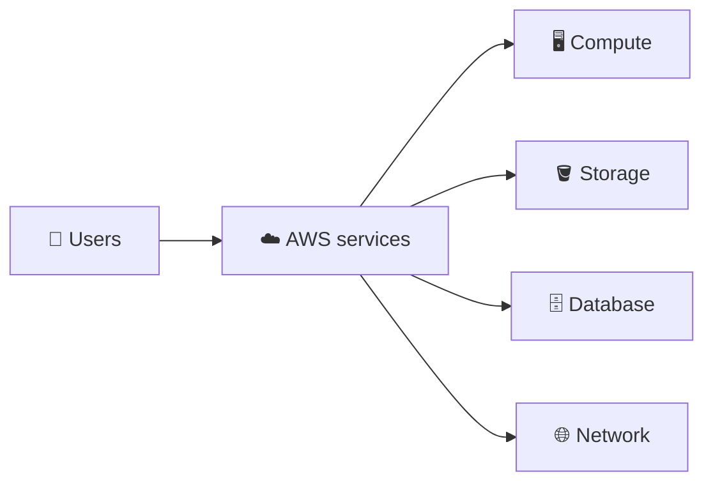
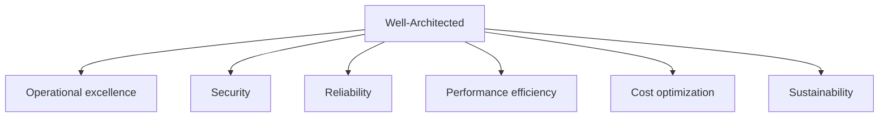
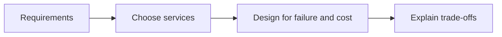
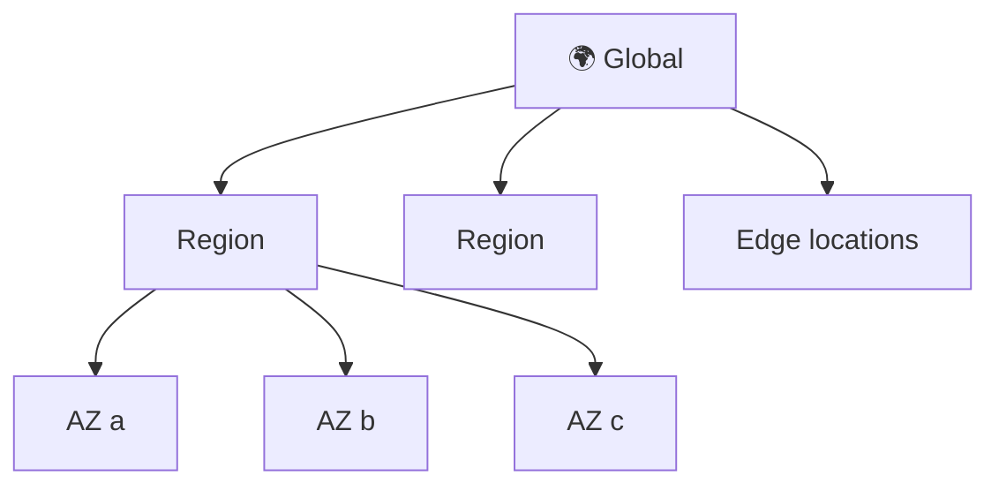
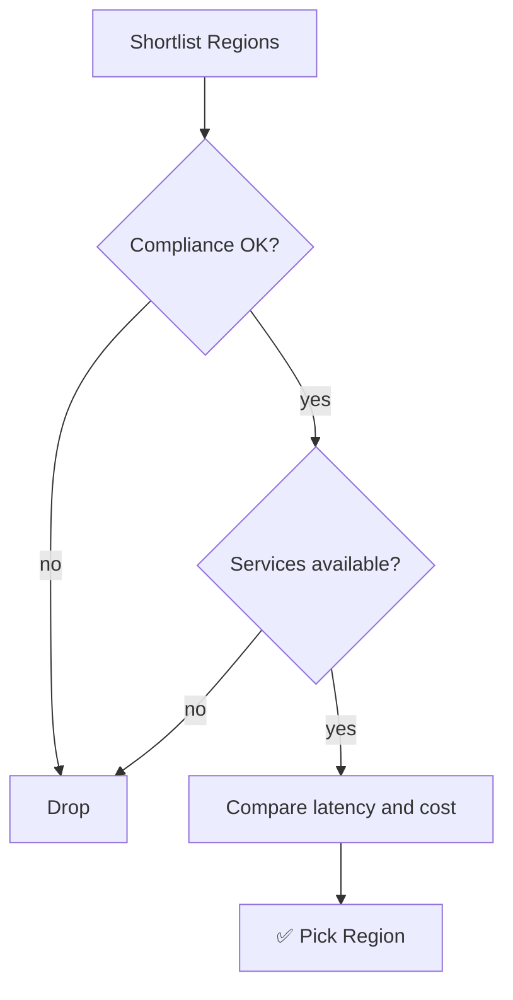
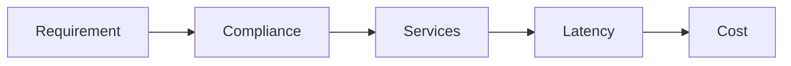

## What it is

AWS is a rented set of computing, storage, database and network services that you use over the internet and pay for by usage. You build systems from these services instead of buying servers. An architect chooses the services and how they connect.

*You rent building blocks and combine them.*

Use it when you want to launch fast, scale up or down, and avoid buying hardware.

## Key concepts

### Why cloud

| Data center | AWS |
|---|---|
| Buy hardware upfront | Pay as you go |
| Guess capacity | Scale on demand |
| Weeks to get a server | Minutes |
| You run the buildings | AWS runs the buildings |

- You still own what you put on AWS (configuration, data, access). AWS runs the physical layer.
- Delete a resource and its charge stops.

### AWS approach to building systems: Well-Architected

*Six pillars to judge any design.*

- Security: protect data and access.
- Reliability: recover from failure.
- Cost optimization: pay only for what you need.
- Ask "which pillar does this choice hurt?" for every design decision.

### Successful solution architect

*The job is decisions and trade-offs, not memorising services.*

- Ask what the business needs first: users, data, uptime, budget.
- Keep designs simple; prefer managed services.
- Write down why you chose each option.

### AWS global infrastructure

*Region contains AZs; edge locations sit near users.*

| Piece | What it is |
|---|---|
| Region | A separate geographic area, e.g. `us-east-1` |
| Availability Zone (AZ) | Isolated location inside a Region, one or more data centers |
| Edge location | Caches content close to users (CloudFront) |
| Local Zone / Wavelength Zone | Compute closer to users or to 5G networks |

- Most services are regional; resources in one Region are not visible in another.
- Spread across AZs to survive an AZ failure. Region and AZ counts change, so check the global infrastructure page.

### How to select a Region

*Filter on hard rules first, then trade latency against cost.*

- Compliance and data residency are hard rules.
- Test latency from your users; use the pricing calculator for cost, because prices differ by Region.
- Latency-insensitive work (batch, analytics) can go to the cheapest Region.

### Resources

Course slides and links are the supporting material; the docs below are the reference.

## X vs Y

| | Region | AZ | Edge location |
|---|---|---|---|
| Purpose | Geographic area | Fault isolation | Content caching |
| You deploy servers? | Yes (choose one) | Yes (choose several) | No |

Pick multiple AZs when you need high availability. Pick another Region for data residency, user proximity or disaster recovery. Use edge locations to speed up content delivery.

## Job notes

- Always check which Region the console shows before creating anything.
- Default to two or more AZs for production.
- Compare Region cost before deploying big workloads; dev/test can run in cheaper Regions if rules allow.
- Not every service or feature exists in every Region; check regional availability first.

*Order for choosing a Region.*

## Cheat sheet

- AWS = rented building blocks, pay per use.
- Six pillars: operational excellence, security, reliability, performance efficiency, cost optimization, sustainability.
- Region contains AZs; edge locations cache near users.
- Multi-AZ for availability.
- Region choice: compliance, services, latency, cost.

## AWS docs

- [AWS Regions and Availability Zones](https://docs.aws.amazon.com/global-infrastructure/latest/regions/aws-regions-availability-zones.html)
- [Well-Architected pillars](https://docs.aws.amazon.com/wellarchitected/latest/migration-lens/well-architected-framework-pillars.html)
- [Choose Regions based on cost](https://docs.aws.amazon.com/wellarchitected/latest/cost-optimization-pillar/cost_pricing_model_region_cost.html)
