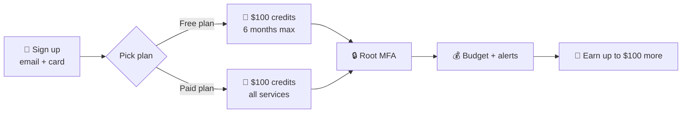
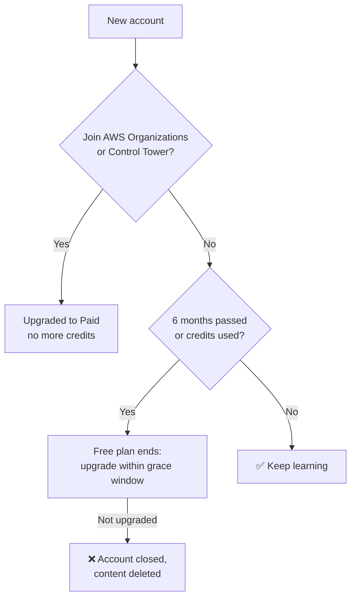
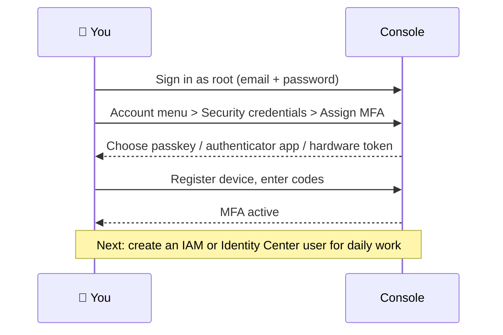
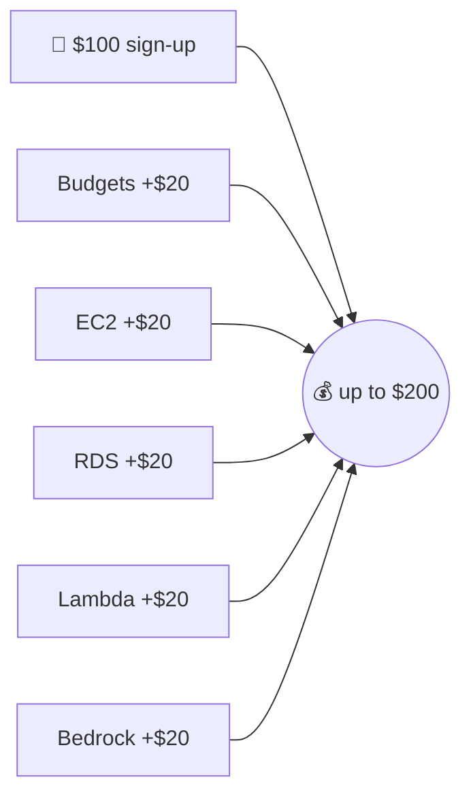
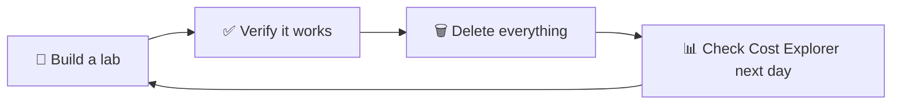

## What it is

An AWS account is the container for everything you create and the unit AWS bills. When you sign up you become the **root user** (the email + password owner), and you pick a **Free plan** (credits, no bills, limited services, 6 months) or a **Paid plan** (all services, pay for usage beyond credits).

*Day-one path: sign up, secure, set a budget, then learn by doing.*

Use it when: you start learning AWS. Do the safety steps (MFA, budget) before you build anything.

## Key concepts

### Free Tier today (check current terms)

Free Tier changed from the old "12 months free" model. The program is now credit based, and terms change, so always read the [Free Tier terms](https://aws.amazon.com/free/terms/) and [FAQs](https://aws.amazon.com/free/free-tier-faqs/) before you rely on a number.

| | Free plan | Paid plan |
|---|---|---|
| Sign-up credits | $100 | $100 |
| Extra credits | up to $100 (5 activities x $20) | up to $100 |
| Services | Some enterprise services blocked | All |
| Ends | 6 months or credits gone, first wins | Never; usage beyond credits is billed on-demand |
| Credits expire | 12 months after account creation | same |

- Free plan means no charges until you upgrade. Paid plan means credits are applied first, then you pay.
- Some services also have "always free" monthly limits for all customers.
- Example: $100 credit and a small EC2 instance running for a few days uses a few dollars of credit; a forgotten database or NAT gateway drains it for weeks.

### Eligibility traps

*Things that end the Free plan early.*

- Credits are for new customers, one account per person. Credits cannot be earned for more than one account.
- Earn-credit activities must be done within 6 months of opening the account.
- Turning on advanced features (Organizations, Control Tower) stops credit earning.

### Secure the root user (MFA)

*Root MFA setup.*

- AWS requires MFA for the root user of all account types; prefer a passkey or security key (phishing resistant).
- Keep your account email and phone current: they are the recovery path if the MFA device is lost.
- Never create root access keys. Daily work uses an admin user, covered in [IAM](/chapters/04-aws-identity-and-access-management-iam/).

### Budget alert (first $20 credit)

1. Console > **Billing and Cost Management > Budgets > Create budget**.
2. Choose **Use a template (simplified) > Monthly cost budget**.
3. Name it, set the amount (the course example uses 100), enter your email, create.
4. Check **Credits** in the billing console; it can take a few minutes to show.

- You can set several alerts per budget, for example actual above 80% and forecast above 100%.
- Budgets data refreshes a few times per day, so it is a warning, not a hard stop.

### Earn the other credits (up to $200 total)

Each activity is a guided task in the **Explore AWS** widget on the Console home. Each gives $20 when completed.

| Activity | What you do | Remember to |
|---|---|---|
| Budget | Create a monthly cost budget | Keep it |
| EC2 | Launch an instance, then terminate it | Terminate |
| RDS | Walk through launching a database (basic options) | Delete DB |
| Lambda | Build a function with a **function URL** (small web app) | Delete function |
| Bedrock | Send a prompt in the text playground | Nothing to clean |

*Credits add up: $100 plus five $20 activities.*

Activity details can change; follow the instructions the widget shows you.

### Upgrade to Paid plan

- Upgrade from the account/billing page whenever you want; you cannot downgrade back to Free.
- Unused credits still apply to eligible usage until they expire (12 months after sign-up).
- Needed for services blocked on the Free plan and for anything past the 6 months.

### Cost Explorer and mindset

- **Cost Explorer** (Billing > Cost Explorer) charts spend by service, Region and day, up to the last 13 months. The console UI is free. First use can take about 24 hours for data to appear.
- Use it daily while learning: group by **Service**, filter by **Region**, find the forgotten resource.

*The learning loop that keeps bills near zero.*

Mindset: AWS bills per use, so every lab ends with cleanup. Break things in a sandbox account; never learn on a production account.

### Console quality of life

- **Dark mode**: Console > settings (gear icon) > Unified settings > Visual mode. Also set your default Region there.
- **Region** (top right) decides where resources are created. Many things you "lost" are just in another Region.
- Course resource links are in the AWS docs section below.

## X vs Y

Free plan vs Paid plan.

| | Free plan | Paid plan |
|---|---|---|
| Risk of bill | None until you upgrade | Yes, after credits |
| Services | Limited set | All |
| Lifetime | 6 months max | Unlimited |
| Good for | Learning, labs | Job work, real projects, anything long |

Pick **Free** when you are just learning and want zero bill risk. Pick **Paid** when you need a blocked service, want to keep resources past 6 months, or run real work (with budgets on).

## Job notes

- First 15 minutes on any new account: root MFA, billing contact, budget, admin user, then stop using root.
- Real companies use multiple accounts under Organizations; credits apply to standalone learner accounts, so keep your learning account separate.
- Cost traps: running EC2/RDS left on, NAT gateways, unattached EBS volumes and Elastic IPs, data transfer out.
- Use budget alerts plus Cost Explorer; also tag lab resources (for example `env=lab`) to find them later.
- Never commit access keys to Git; never use the root user's keys.
- Budgets lag a few hours. For safety, delete resources, do not rely on alerts alone.

## Cheat sheet

- Root user = email + password owner. MFA on, no access keys, rare use.
- Free plan: $100 credits, up to 6 months, limited services. Paid plan: all services, pay beyond credits.
- Earn up to $100 more with 5 x $20 activities (Budgets, EC2, RDS, Lambda URL, Bedrock).
- Joining Organizations or Control Tower ends Free plan benefits.
- Not upgraded after expiry: the account is closed after the grace window.
- Budgets = alerts. Cost Explorer = charts. Credits page = balance.
- Every lab ends with deleting resources.
- Verify all numbers on the current Free Tier terms page.

## AWS docs

- [AWS Free Tier terms](https://aws.amazon.com/free/terms/)
- [Free Tier FAQs](https://aws.amazon.com/free/free-tier-faqs/)
- [MFA for the root user](https://docs.aws.amazon.com/IAM/latest/UserGuide/enable-mfa-for-root.html)
- [Creating a budget](https://docs.aws.amazon.com/cost-management/latest/userguide/budgets-create.html)
- [Analyzing costs with Cost Explorer](https://docs.aws.amazon.com/cost-management/latest/userguide/ce-what-is.html)
