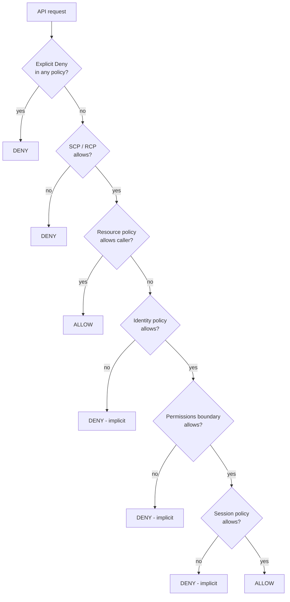
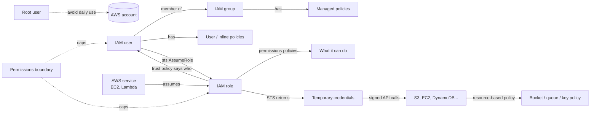

## What it is

AWS Identity and Access Management (IAM) is the service that decides **who** can call an AWS API (authentication) and **what** that caller may do with which resources (authorization). Every click in the console, every `aws` CLI command and every SDK call becomes a signed API request. IAM checks each one against policies before the request is allowed. IAM is global (not tied to a Region), and AWS does not charge extra for it.

Use it when anything (a person, a script, an EC2 instance, a Lambda function, another AWS account) needs to touch your AWS resources. So you use it every day.

## Key concepts

### Root user

When you create an AWS account you get one identity, the **root user**. It signs in with the account's email address and password, and it has full, unrestricted access to everything in the account. IAM policies inside the account cannot limit it. AWS evaluates every request as "implicitly denied" by default, **except** requests from the root user.

Because it is so powerful, AWS's advice is simple: protect it and don't use it for daily work.

- Turn on MFA for the root user. For the management account of an AWS Organization, AWS requires MFA registration.
- Do not create access keys for the root user.
- Create an administrative identity and use that instead (more on this in the setup steps below).

You still need the root user for a short list of tasks. These are the ones beginners hit most often:

| Task that needs root | Why you would meet it |
|---|---|
| Change root email, root password, or root access keys (standalone account) | Account handover, company email change |
| Close or reopen the AWS account (standalone account) | Shutting down a sandbox |
| Restore IAM permissions when the only admin locked themselves out | The classic "I detached my own admin policy" accident |
| Activate IAM access to the Billing and Cost Management console | Letting a finance user or your lab user see costs |
| Edit or delete an S3 bucket policy that denies all principals | Someone wrote a bucket policy that blocks everybody, including admins |
| Edit or delete an SQS queue policy that denies all principals | Same mistake, on a queue |
| Register as a seller in the EC2 Reserved Instance Marketplace | Rare |

The full, current list is on the root user page linked under AWS docs. In AWS Organizations, many of these tasks can be done centrally from the management account, and root credentials of member accounts can be removed completely. See [Multi-Account Strategy](/chapters/52-multi-account-strategy/).

### IAM User

An **IAM user** is an identity you create inside your account for one person or one application. It can have two kinds of **long-term credentials**:

- a **console password** (to sign in to the AWS Management Console), and
- **access keys** (an access key ID plus a secret access key) for the CLI, SDKs and direct API calls.

A new IAM user has **no permissions**. Until you attach a policy, every request it makes is implicitly denied.

The modern AWS advice is to give *humans* temporary credentials through federation (for example AWS IAM Identity Center) and *workloads* temporary credentials through roles. IAM users with long-term keys are kept for cases that really need them. You will still meet IAM users at work all the time, in older accounts, small companies and labs like this course. So learn them well, and prefer roles when you have the choice.

There are fixed caps on access keys and MFA devices per user. Check the current quota in [IAM and AWS STS quotas](https://docs.aws.amazon.com/IAM/latest/UserGuide/reference_iam-quotas.html).

### IAM Policy

A **policy** is a JSON document that grants or denies permissions. The core building block is a **statement**:

```json
{
  "Version": "2012-10-17",
  "Statement": [
    {
      "Sid": "ReadReportsBucket",
      "Effect": "Allow",
      "Action": ["s3:GetObject", "s3:ListBucket"],
      "Resource": [
        "arn:aws:s3:::acme-reports",
        "arn:aws:s3:::acme-reports/*"
      ],
      "Condition": {
        "Bool": { "aws:SecureTransport": "true" }
      }
    }
  ]
}
```

| Element | Meaning | Required? |
|---|---|---|
| `Version` | Policy language version. Always use `2012-10-17`. | Yes, in practice |
| `Statement` | One or more permission rules | Yes |
| `Sid` | A label for humans | No |
| `Effect` | `Allow` or `Deny` | Yes |
| `Action` | API actions, written `service:Operation`, wildcards allowed (`s3:Get*`) | Yes (or `NotAction`) |
| `Resource` | ARNs the statement applies to | Yes in identity-based policies |
| `Principal` | *Who* the statement applies to. Only allowed in resource-based policies (and role trust policies). | Only in resource-based policies |
| `Condition` | Extra rules: source IP, MFA used, tags, encryption in transit... | No |

Notice the two ARNs for S3. `ListBucket` acts on the bucket itself (`acme-reports`), while `GetObject` acts on objects (`acme-reports/*`). Getting this wrong is one of the most common causes of "AccessDenied" in a first job.

### Inline Policy vs Custom Policy

Identity-based policies come in three kinds. The course's "custom policy" means a **customer managed policy**.

| Type | Who writes and maintains it | Can you edit it? | Attached to |
|---|---|---|---|
| AWS managed (for example `ReadOnlyAccess`, `AmazonS3FullAccess`) | AWS | No | Many identities |
| Customer managed ("custom") | You | Yes, with version history | Many identities |
| Inline | You | Yes | Exactly one user, group or role. It is deleted with that identity. |

AWS recommends managed policies in most cases. Start with AWS managed policies to get going, then move to customer managed policies that grant only what is needed. Use an **inline** policy only when you want a strict one-to-one link, for example a permission that must never be reused by mistake and should disappear when the role is deleted.

### IAM Group

An **IAM group** is a collection of IAM users. You attach policies to the group and every member gets them. When someone changes team, you move them between groups instead of editing their personal policies.

Facts to remember:

- A group contains **only users**. Groups **cannot be nested**, and roles cannot be members.
- There is **no default "everyone" group**. If you want one, create it and add each user.
- A group is **not a principal**. You cannot name a group in the `Principal` of a bucket policy or trust policy. Groups are for handing out permissions, not for signing in.
- How many groups a user can join, and how many managed policies a group can have, are capped. Check the current quota.

### IAM Group - Demo

The demo pattern you will repeat in every account:

1. **IAM console → User groups → Create group.** Name it `Developers`.
2. Attach a policy, for example `AmazonEC2ReadOnlyAccess`.
3. **Users → Create user**, then add the user to `Developers` instead of attaching a policy directly.
4. Sign in as that user in a private window (or a second session, see Multi-Session below) and confirm that EC2 pages load but **Launch instance** fails.

CLI equivalent:

```bash
aws iam create-group --group-name Developers
aws iam attach-group-policy --group-name Developers \
  --policy-arn arn:aws:iam::aws:policy/AmazonEC2ReadOnlyAccess
aws iam create-user --user-name linh
aws iam add-user-to-group --user-name linh --group-name Developers
```

### Multi IAM Groups

A user can be in **several groups** at once. Their effective permissions are the **union** of all Allows from every group plus any policies attached directly to the user, minus anything that is explicitly denied. Example: Linh is in `Developers` (EC2 read) and `S3Readers` (S3 read), so she can read both. If a third group, `Contractors`, explicitly denies `s3:DeleteObject`, no other group can override that.

### DENY Effect

There are two kinds of "no" in IAM:

- **Implicit deny**: nothing allowed the action. This is the default for every request (except the root user's).
- **Explicit deny**: a statement with `"Effect": "Deny"` matches the request.

An **explicit deny always wins**. It overrides any number of Allows, in any policy type. That makes Deny the tool for guardrails, for example "nobody in this group may delete CloudTrail trails" or "no S3 access unless the request uses TLS".

```json
{
  "Version": "2012-10-17",
  "Statement": [
    {
      "Effect": "Deny",
      "Action": ["cloudtrail:DeleteTrail", "cloudtrail:StopLogging"],
      "Resource": "*"
    }
  ]
}
```

### DENY Effect - Demo

1. Give a test user `AdministratorAccess` (it allows `*` on `*`).
2. Add an inline or customer managed policy with the Deny above.
3. As that user, try to stop logging on a trail. You get an error that says the action was denied **with an explicit deny**. The error message tells you which kind of deny you hit, which is your first troubleshooting clue.
4. Remove the Deny statement and the action works again.

### IAM Role Intro

An **IAM role** is an identity with permissions but **no long-term credentials**. Nobody "is" a role permanently. A trusted principal **assumes** it and receives **temporary security credentials** (access key ID, secret access key and session token) from AWS Security Token Service (STS). When they expire, they are useless.

Typical uses:

- **AWS services acting for you**: an EC2 instance reading S3, a Lambda function writing to DynamoDB.
- **Cross-account access**: an engineer in the dev account working in the prod account.
- **Federation**: employees signing in with the company identity provider (SAML 2.0 or OIDC), or IAM Identity Center users, land in a role.
- **Elevated access on demand**: a user normally has read-only access and assumes an admin role (with MFA) only when needed.

### IAM Role Components

A role has two policy sides. Mixing them up is the number one role mistake.

| Component | Question it answers | Policy type |
|---|---|---|
| **Trust policy** (the "trust relationship") | *Who* may assume this role? | Resource-based policy on the role. It has a `Principal` and the action `sts:AssumeRole` (or a variant). A role has exactly one. |
| **Permissions policies** | *What* can the role do once assumed? | Identity-based (managed or inline) |
| Permissions boundary (optional) | What is the *most* the role could ever do? | Managed policy used as a boundary |
| Maximum session duration | How long sessions can last | A setting from 1 to 12 hours. The default is 1 hour. |
| Instance profile (EC2 only) | A container that hands a role to an EC2 instance | The console creates it for you |

A trust policy that lets EC2 assume the role:

```json
{
  "Version": "2012-10-17",
  "Statement": [
    {
      "Effect": "Allow",
      "Principal": { "Service": "ec2.amazonaws.com" },
      "Action": "sts:AssumeRole"
    }
  ]
}
```

On `AssumeRole`, the caller can request a session from 15 minutes up to the role's maximum session duration. If they don't ask, the session lasts 1 hour. Role chaining (using a role session to assume another role) is limited to 1 hour.

### IAM Role Demo

1. **IAM → Roles → Create role → Trusted entity: AWS service → EC2.**
2. Attach `AmazonS3ReadOnlyAccess`, name it `ec2-s3-readonly`.
3. Launch an EC2 instance (see [Amazon EC2](/chapters/06-aws-compute-services-amazon-ec2/)) and pick the role under **IAM instance profile**.
4. On the instance, run `aws s3 ls`. It works **without** running `aws configure`, because the CLI picks up the role's temporary credentials from the instance metadata automatically.
5. Run `aws sts get-caller-identity`. The ARN looks like `arn:aws:sts::123456789012:assumed-role/ec2-s3-readonly/i-0abc...`. That is a **role session**, not the role itself.

### Restricted User in Role Trust Relationship

The console's "AWS account" trusted entity creates a trust policy with `"AWS": "arn:aws:iam::123456789012:root"`. Despite the word `root`, this does **not** mean the root user. It means **"principals in that account"**. Any user or role there whose own identity policy allows `sts:AssumeRole` on this role can assume it. That is often wider than you intended.

To restrict the role to one user, name that user's ARN:

```json
{
  "Version": "2012-10-17",
  "Statement": [
    {
      "Effect": "Allow",
      "Principal": { "AWS": "arn:aws:iam::123456789012:user/linh" },
      "Action": "sts:AssumeRole",
      "Condition": { "Bool": { "aws:MultiFactorAuthPresent": "true" } }
    }
  ]
}
```

The `Condition` adds "only if Linh signed in with MFA", which is a good default for admin roles.

Who must allow what:

- **Cross-account**: *both* sides must agree. The role's trust policy must trust the user, and the user's identity policy in their own account must allow `sts:AssumeRole` on the role ARN.
- **Same account**: if the trust policy names the user's ARN directly, that trust policy is enough on its own. If it trusts the whole account (`:root`), the user also needs an identity-based Allow. At work, write both anyway so the intent is obvious to the next reader.

One more gotcha: when you save a trust policy, IAM stores the user's unique ID behind the ARN. If you delete the user and create a new one with the same name, the trust no longer matches and you must edit and save the trust policy again.

### Configure multiple users in Role Trust Relationship

`Principal` accepts an **array**, so you can list several users and roles, even from different accounts:

```json
"Principal": {
  "AWS": [
    "arn:aws:iam::222222222222:user/alice",
    "arn:aws:iam::222222222222:user/bob",
    "arn:aws:iam::333333333333:role/ci-deployer"
  ]
}
```

What you **cannot** do:

- Name an **IAM group** as a principal.
- Use a partial wildcard like `user/dev-*` in `Principal`. Instead, trust the account and add a `Condition` with `ArnLike` on `aws:PrincipalArn`.

The trust policy length has a quota. Check the current quota if you list many principals. Long lists usually mean you should trust a role (that a group of people can use) rather than individual users.

### Principle vs Identity

The lecture title says "principle", but the IAM term is **principal**. The terms overlap, so here are the precise meanings from the IAM docs:

| Term | What it covers | Example |
|---|---|---|
| **IAM identity** | Things you attach identity-based policies to: **users, groups, roles** | The `Developers` group |
| **IAM entity** | Identities that can be **authenticated**: **users and roles** (not groups) | The user `linh` |
| **Principal** | The person or workload that actually **makes the request** and can be named in `Principal` | Root user, IAM user, role session, federated user, an AWS service |

So a group is an identity but never a principal. A role is an identity, while the principal that actually calls AWS is the **role session** created when someone assumes it.

### Principle Types

Values you can put in a `Principal` element:

| Principal type | Written as | Typical use |
|---|---|---|
| AWS account | `"AWS": "123456789012"` or `"AWS": "arn:aws:iam::123456789012:root"` | Trust a whole account. That account then decides internally who may use the trust. |
| IAM user | `"AWS": "arn:aws:iam::123456789012:user/linh"` | Restrict to one person |
| IAM role | `"AWS": "arn:aws:iam::123456789012:role/ci"` | Trust a pipeline or another role |
| Role session | `arn:aws:sts::123456789012:assumed-role/role-name/session-name` | Very specific grants |
| AWS service | `"Service": "lambda.amazonaws.com"` | Let a service assume a role or write to your bucket |
| Federated (SAML / OIDC) | `"Federated": "arn:aws:iam::123456789012:saml-provider/Okta"` or an OIDC provider | Corporate SSO, GitHub Actions OIDC |
| STS federated user | `arn:aws:sts::123456789012:federated-user/name` | Sessions created with `GetFederationToken` |
| Everyone | `"AWS": "*"` or `"*"` | Public access. Avoid it unless a `Condition` narrows it down. |

### IAM Permissions Validation Order

When a request arrives, AWS gathers **every** policy that applies and works through them in a fixed order. Within a single account, simplified:

1. **Default: implicit deny.** Nothing is allowed until something allows it. The exception is the root user, which has full access unless an SCP restricts a member account.
2. **Explicit deny anywhere?** IAM looks through SCPs, RCPs, resource-based policies, identity-based policies, permissions boundaries and session policies. **One matching Deny = final Deny.**
3. **Organizations guardrails.** If the account is in an organization, the applicable resource control policies (RCPs) and service control policies (SCPs) must allow the action, or the result is Deny.
4. **Resource-based policy.** For most services, an Allow here that names the caller can grant access on its own within the same account. Role trust policies and KMS key policies are exceptions: they must explicitly allow the principal.
5. **Identity-based policies.** User, group and role policies. No Allow here (and none from step 4) means implicit deny.
6. **Permissions boundary.** If the user or role has one, it must also allow the action.
7. **Session policy.** If a session policy was passed when the role was assumed, it must also allow the action.
8. Survived everything? **Allow.**

The rule to remember: **explicit Deny > explicit Allow > implicit deny (default)**. Guardrails (SCPs, boundaries, session policies) never *grant* anything. They only cap what the other policies grant.



*How AWS decides one request inside a single account (simplified). Cross-account requests need an Allow on **both** sides: the caller's identity policy and the resource's policy. The shortcut at "Resource policy allows caller" does not apply to role trust policies or KMS keys, and a boundary or session policy can still limit grants made to a role ARN.*

### Permission Boundary

A **permissions boundary** is a managed policy that you attach to a **user or role** (not a group) as its *maximum* permissions. The effective permissions are the **intersection**:

> effective = identity-based policies ∩ permissions boundary (and nothing from either side if it is explicitly denied anywhere)

Example: the boundary allows `s3:*` and `cloudwatch:*`. The role's policy is `AdministratorAccess`. The role can only use S3 and CloudWatch. If the boundary allows `ec2:*` but the role's policy allows nothing, the role can do **nothing**, because a boundary never grants.

Why it exists: **safe delegation**. You can let a dev team create their own roles for Lambda, as long as they attach your boundary. Enforce that with a condition on `iam:CreateRole` that checks `iam:PermissionsBoundary`. Then they cannot create a role more powerful than you allow, and so they cannot escalate their own privileges. Boundaries cannot be applied to service-linked roles.

### IAM Components Relationship

How the pieces connect:



*Users get permissions from their own policies and their groups. Roles are assumed by users or services to obtain temporary credentials. Boundaries cap users and roles, and resources can carry their own policies.*

### Identity-based policy vs Resource-based policy

See the comparison table in **X vs Y** below. In short: identity-based policies say "**this identity** can do X on Y". Resource-based policies say "**this resource** lets principal P do X". Resource-based policies are always inline (there are no managed resource policies), and they must include `Principal`.

### Interacting to AWS

There are four ways to talk to AWS. They all end up as the same signed HTTPS API calls, so IAM treats them identically:

| Way | Credentials it uses | Good for |
|---|---|---|
| **AWS Management Console** (browser) | Password + MFA, or federated SSO | Exploring, one-off changes, dashboards |
| **AWS CLI** | Access keys, `aws login`, IAM Identity Center (SSO) profile, or an assumed role | Scripts, repeatable tasks, automation |
| **AWS SDKs** (Python boto3, JavaScript, Java...) | Same credential chain as the CLI. On AWS, a role. | Application code |
| **Infrastructure as Code** (CloudFormation, CDK, Terraform) | Same as the CLI | Building whole environments reproducibly |

**AWS CloudShell**, a browser-based shell inside the console, already has your console identity's credentials. It is a quick way to use the CLI without creating access keys.

### Configure AWS CLI

Install AWS CLI v2, then choose a sign-in method. In order of preference:

1. **`aws login`** uses your console sign-in in a browser and stores short-lived credentials for a profile. No access keys are needed. Use `--remote` on a machine without a browser.
2. **IAM Identity Center profile** (`aws configure sso`), if your company uses Identity Center.
3. **Access keys** (`aws configure`), the classic way and still common in labs:

```bash
$ aws configure --profile lab
AWS Access Key ID [None]: AKIA................
AWS Secret Access Key [None]: ****************************
Default region name [None]: us-east-1
Default output format [None]: json

$ aws sts get-caller-identity --profile lab   # "who am I?" - run it first, always
```

The keys go to `~/.aws/credentials` and the region and output settings to `~/.aws/config`. To make the CLI assume a role automatically, add a profile to `~/.aws/config`:

```ini
[profile prod-admin]
role_arn = arn:aws:iam::444455556666:role/Admin
source_profile = lab
mfa_serial = arn:aws:iam::111122223333:mfa/linh
```

`aws s3 ls --profile prod-admin` now calls `AssumeRole` behind the scenes, using the `lab` keys and asking for your MFA code.

### AWS CLI vs AWS Management Console

| | Console | CLI |
|---|---|---|
| Learning curve | Low: visual, guided wizards | Medium: you need command names and flags |
| Repeatability | Poor: clicks are not recorded as a script | High: commands can be saved, reviewed and versioned |
| Bulk work (100 users, 50 buckets) | Painful | A loop |
| Hidden defaults | Wizards create helpers silently (instance profiles, roles) | You see and create everything explicitly |
| Credentials | Password + MFA in browser | Access keys, `aws login`, SSO, or a role |
| Best for | Learning, inspecting, quick fixes | Automation, documentation, CI/CD |

At work you will use both. You inspect in the console, and you change things through code (CLI or IaC) so the change can be reviewed and repeated.

### Setup Hands-on IAM User - IMPORTANT

From now on, **stop using the root user for labs**. Set up an admin identity once:

1. Sign in as root, then go to **IAM → Users → Create user**. Name it something like `lab-admin`.
2. Tick **Provide user access to the AWS Management Console** and set a password.
3. Create a group `Admins`, attach `AdministratorAccess`, and add `lab-admin` to it. Permissions come through the group, not attached directly.
4. Save the **account sign-in URL** shown at the end (it contains your 12-digit account ID). You can also set an **account alias** in the IAM dashboard so the URL is easier to remember.
5. Sign out of root.

> At a company with AWS Organizations, this step is replaced by an IAM Identity Center user with an administrator permission set. The idea is the same: a named, MFA-protected admin identity instead of root.

### Setup Lab User - Continue

1. Sign in as `lab-admin` with the account ID or alias, the user name and the password.
2. **Enable MFA** for `lab-admin`: top-right menu → **Security credentials → Assign MFA device**. Passkeys, security keys and authenticator apps are supported. There is a cap on MFA devices per user, so check the current quota.
3. Only if you need the CLI with keys: **Security credentials → Create access key**. Pick the CLI use case, read AWS's suggestion of alternatives such as `aws login` or CloudShell, then download the keys once. AWS never shows the secret again.
4. Run `aws configure --profile lab` and then `aws sts get-caller-identity --profile lab`. The ARN should end in `user/lab-admin`.

### Enabling Billing info for IAM Users and Roles

By default, **no IAM user or role can open the Billing and Cost Management console**, not even one with `AdministratorAccess`. The root user must switch it on once:

1. Sign in as root → **Account** page in Billing and Cost Management.
2. **IAM user and role access to Billing information → Edit → Activate IAM access → Update.**

This setting only *unlocks* the pages. Users still need IAM policies that allow billing actions (an admin already has them, and a finance user would get a billing job-function policy). Some features are not controlled by this toggle, for example the Cost Explorer and Budgets APIs. See the billing doc below for the current list. Budgets and Cost Explorer are covered in [Create & Setup Your AWS Account](/chapters/03-create-and-setup-your-aws-account/).

### Root User Differences

| | Root user | IAM user (even with AdministratorAccess) |
|---|---|---|
| Sign-in | Email address + password | Account ID or alias + user name + password |
| Can IAM policies restrict it? | No. Only SCPs can, and only in member accounts of an organization. | Yes: policies, boundaries, SCPs |
| Root-only tasks (close account, change root email, billing IAM access, unlock "deny-all" bucket policies) | Yes | No |
| Number per account | Exactly one | Many (check the current quota) |
| Recommended for daily work | No | Acceptable for labs. At work, prefer federated or role access. |
| Access keys | Should not exist | Only if really needed, and rotated |

### Multi-Session on AWS Management Console

The console can keep **several identities signed in at once in one browser**: root, IAM users or federated roles, in the same or different accounts. Each opens in its own tab. Up to five at the time of writing, so check the console docs for the current number. This is very handy in this course: keep `lab-admin` in one tab and a restricted test user in another to watch a Deny happen live.

- Opt in with **Turn on multi-session** in the account menu. The opt-in is per browser.
- Then use the account menu → **Add session → Sign in**.
- With multi-session on, console URLs include an account-specific subdomain, so old bookmarks may need updating.
- To turn it off, choose **Disable multi-session** or clear your cookies.

### Resources

The lecture "Resources" is the course's link list. For this chapter, the useful references are collected under **AWS docs** at the bottom. Keep the IAM policy evaluation logic page and the IAM quotas page bookmarked. You will open them often.

## X vs Y

### Identity-based policy vs resource-based policy

| | Identity-based policy | Resource-based policy |
|---|---|---|
| Attached to | IAM user, group or role | A resource: S3 bucket, SQS queue, KMS key, Lambda function, role trust policy... |
| Has `Principal`? | No. The principal is whoever the policy is attached to. | Yes, it is required |
| Managed or inline? | AWS managed, customer managed or inline | Inline only |
| Cross-account | Not enough on its own. The resource side must also allow. | Grants access to other accounts' principals, though they still need their own identity-side Allow |
| Same account | An Allow here is usually enough | An Allow here naming the caller is usually enough (except role trust and KMS key policies, which must allow explicitly) |
| Typical use | "What can the Developers team do?" | "Who may read this bucket / use this key / assume this role?" |

Pick an **identity-based policy** when you describe what a person or workload can do across many resources. Pick a **resource-based policy** when you protect one sensitive resource, grant another account or an AWS service access to it, or add a deny guardrail that holds no matter what identity policies say.

### IAM user vs IAM role vs IAM group

| | IAM user | IAM role | IAM group |
|---|---|---|---|
| Represents | One person or app | A set of permissions anyone trusted can borrow | A bag of users |
| Credentials | Long-term (password, access keys) | Temporary, from STS | None |
| Can be a principal? | Yes | Yes (the role session makes the calls) | No |
| Who uses it | A named human or a legacy app | EC2, Lambda, ECS, other accounts, federated users, CI/CD | Admins, to manage users in bulk |
| Main risk | Leaked access keys | A trust policy that is too broad | Too many members get too much |

Pick a **role** for anything running on AWS, for cross-account access and for SSO. Pick a **user** only when something truly needs long-term credentials and cannot use federation. Pick a **group** to manage permissions for many users at once.

### Policy types that grant vs policy types that only limit

| Grants permissions | Only limits (never grants) |
|---|---|
| Identity-based policies, resource-based policies | Permissions boundaries, SCPs, RCPs, session policies |

## Job notes

**Daily tasks you will actually do**

- Create roles for EC2, Lambda and ECS tasks, and write least-privilege policies scoped to specific ARNs (one bucket, one table), not `*`.
- Debug `AccessDenied`. Read the error first: it names the caller ARN, the action and the resource, and it tells you whether the deny was *explicit* ("with an explicit deny") or implicit. Many services also name the policy type that denied (identity-based, SCP, permissions boundary...). Then run `aws sts get-caller-identity` to confirm *who* you really are. Half of all "permission bugs" are the wrong profile or the wrong role.
- Set up cross-account roles (dev → prod, CI → prod) with tight trust policies, often with `aws:MultiFactorAuthPresent` for humans and `sts:ExternalId` for third-party vendors.
- Review policies with IAM Access Analyzer (policy validation, unused access, external access findings) and the credential report.

**Mistakes that cause incidents**

- Access keys committed to Git or baked into AMIs and containers. Use roles. If a key leaks, deactivate it immediately, check CloudTrail for what it did (see [CloudWatch and CloudTrail](/chapters/28-aws-monitoring-amazon-cloudwatch-and-aws-cloudtrai/)), then delete it.
- Trust policies with `"AWS": "*"` or a broad `:root` principal and no conditions.
- `"Action": "*", "Resource": "*"` given to an application "just to make it work".
- Using root for daily work, or never enabling MFA on root.
- Forgetting the bucket ARN versus the object ARN (`bucket` vs `bucket/*`).
- Expecting a permissions boundary or SCP to *grant* access.

**Security defaults to apply on day one in any account**

Root MFA on and no root access keys. One admin identity with MFA. Permissions through groups or roles. Billing access activated for IAM. CloudTrail on. Access Analyzer on.

**Cost**

IAM itself has no extra charge. The real cost risk is *security*: a leaked admin key can run up crypto-mining bills in hours.

**In multi-account setups**

SCPs set the outer fence for each account, permissions boundaries fence what delegated admins can create, and identity-based policies grant the actual work. SCPs don't affect users or roles in the management account. That is one reason you run no workloads there. See [Multi-Account Strategy](/chapters/52-multi-account-strategy/).

## Cheat sheet

- **Root user**: full access, can't be limited by IAM policies (only by SCPs, in member accounts). MFA on, no access keys, use only for root-only tasks.
- **User** = long-term credentials. **Role** = temporary STS credentials. **Group** = users only, no nesting, not a principal.
- **Identities**: users, groups, roles. **Entities**: users, roles. **Principal**: whoever makes the request (root, user, role session, federated user, service).
- Policy statement = `Effect` + `Action` + `Resource` (+ `Condition`). `Principal` only appears in resource-based and trust policies.
- Managed (AWS or customer) are reusable. Inline is 1:1 and deleted with its identity. Resource-based policies are always inline.
- Evaluation: **explicit Deny > Allow > implicit deny**. SCPs, RCPs, boundaries and session policies only cap, never grant.
- Effective permissions with a boundary = identity policy ∩ boundary. Boundaries apply to users and roles, not groups.
- Role = trust policy (who) + permissions policy (what). `:root` in a trust policy means the whole account, not the root user.
- Cross-account: both the trust/resource side and the caller's identity side must allow.
- `AssumeRole` sessions: 15 minutes up to the role maximum (1–12 h, default 1 h). Role chaining is capped at 1 h.
- Billing console for IAM: root must **Activate IAM access** first, then policies apply.
- Console multi-session: several identities per browser, opt-in per browser.
- CLI: prefer `aws login` or SSO over access keys. Always run `aws sts get-caller-identity`.
- Quotas to check, not memorise: access keys per user, MFA devices per user, groups per user, managed policies per user/group/role, roles per account, trust policy length.

## AWS docs

- [What is IAM?](https://docs.aws.amazon.com/IAM/latest/UserGuide/introduction.html)
- [AWS account root user](https://docs.aws.amazon.com/IAM/latest/UserGuide/id_root-user.html) and [Root user best practices](https://docs.aws.amazon.com/IAM/latest/UserGuide/root-user-best-practices.html)
- [IAM identities](https://docs.aws.amazon.com/IAM/latest/UserGuide/id.html) and [IAM user groups](https://docs.aws.amazon.com/IAM/latest/UserGuide/id_groups.html)
- [IAM roles](https://docs.aws.amazon.com/IAM/latest/UserGuide/id_roles.html)
- [Managed policies and inline policies](https://docs.aws.amazon.com/IAM/latest/UserGuide/access_policies_managed-vs-inline.html)
- [Identity-based policies and resource-based policies](https://docs.aws.amazon.com/IAM/latest/UserGuide/access_policies_identity-vs-resource.html)
- [Policy evaluation logic (allow/deny)](https://docs.aws.amazon.com/IAM/latest/UserGuide/reference_policies_evaluation-logic_policy-eval-denyallow.html)
- [Policies and permissions, including permissions boundaries](https://docs.aws.amazon.com/IAM/latest/UserGuide/access_policies.html)
- [AWS JSON policy elements: Principal](https://docs.aws.amazon.com/IAM/latest/UserGuide/reference_policies_elements_principal.html)
- [Security best practices in IAM](https://docs.aws.amazon.com/IAM/latest/UserGuide/best-practices.html)
- [IAM and AWS STS quotas](https://docs.aws.amazon.com/IAM/latest/UserGuide/reference_iam-quotas.html) and [IAM endpoints and quotas](https://docs.aws.amazon.com/general/latest/gr/iam-service.html)
- [Sign in to the console as an IAM user](https://docs.aws.amazon.com/signin/latest/userguide/introduction-to-iam-user-sign-in-tutorial.html)
- [Signing in to multiple accounts (multi-session)](https://docs.aws.amazon.com/awsconsolehelpdocs/latest/gsg/multisession.html)
- [Getting set up with Billing (Activate IAM access)](https://docs.aws.amazon.com/awsaccountbilling/latest/aboutv2/billing-getting-started.html)
- [AWS CLI: login with console credentials](https://docs.aws.amazon.com/cli/latest/userguide/cli-configure-sign-in.html) and [CLI configuration variables (role profiles)](https://docs.aws.amazon.com/cli/latest/topic/config-vars.html)
- [Service control policies (AWS Organizations)](https://docs.aws.amazon.com/organizations/latest/userguide/orgs_manage_policies_scps.html)
