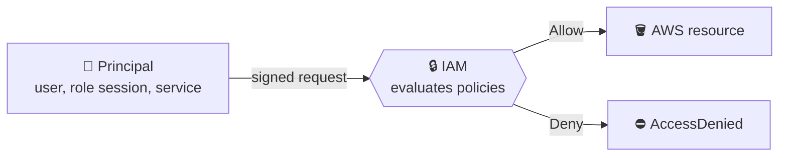
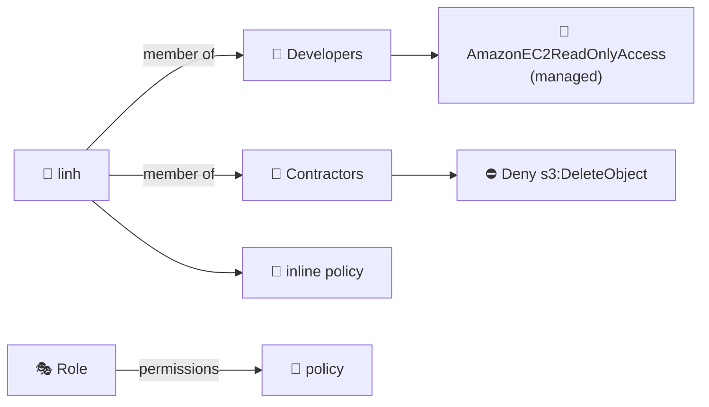
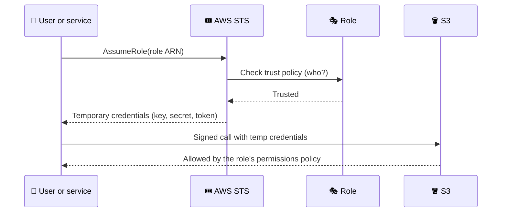
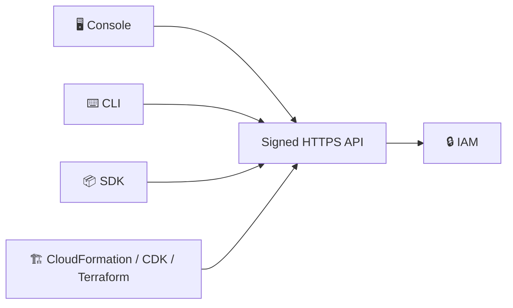

## What it is

IAM decides **who** may call an AWS API (authentication) and **what** they may do (authorization). Every console click, CLI command and SDK call is a signed API request that IAM checks against policies. IAM is global and free.


*Every request passes IAM before it touches a resource.*

Use it whenever a person, script, EC2 instance, Lambda function or another account needs your resources.

## Key concepts

### Root user and the lab admin setup

- The **root user** is the account's first identity (email + password). It has full access, and IAM policies cannot limit it.
- Do: turn on MFA, create no access keys, never use it daily.
- Root is still needed for a few tasks: close the account, change root email or password, restore IAM when the only admin is locked out, activate IAM access to Billing, fix a bucket or SQS policy that denies everyone. See the root user page for the full list.

Setup for every lab (the "IMPORTANT" lectures):

1. As root: **IAM, Users, Create user** `lab-admin`, with console access.
2. Create group `Admins`, attach `AdministratorAccess`, add `lab-admin`.
3. Save the sign-in URL (it has your account ID) or set an account alias. Sign out of root.
4. Sign in as `lab-admin` and **assign an MFA device** (Security credentials).
5. Need the CLI? Prefer `aws login`. Otherwise create an access key once, then `aws configure --profile lab` and `aws sts get-caller-identity --profile lab`.

At a company using Organizations, use IAM Identity Center instead ([Multi-Account Strategy](/chapters/52-multi-account-strategy/)).

### Users, groups, policies


*Groups hold users only. Policies attach to users, groups or roles. Roles are separate identities.*

- **User**: one person or app, with long-term credentials (console password, access keys). New users have no permissions.
- **Group**: only users, no nesting, no default "everyone" group, and **not a principal**.
- A user in several groups gets the **union** of Allows, minus any explicit Deny.
- Demo pattern: create group, attach policy, create user, add to group, sign in as that user (second browser session) and test.

```bash
aws iam create-group --group-name Developers
aws iam attach-group-policy --group-name Developers \
  --policy-arn arn:aws:iam::aws:policy/AmazonEC2ReadOnlyAccess
aws iam create-user --user-name linh
aws iam add-user-to-group --user-name linh --group-name Developers
```

A policy is a JSON document of statements:

```json
{ "Version": "2012-10-17",
  "Statement": [{
    "Effect": "Allow",
    "Action": ["s3:GetObject", "s3:ListBucket"],
    "Resource": ["arn:aws:s3:::acme-reports", "arn:aws:s3:::acme-reports/*"],
    "Condition": { "Bool": { "aws:SecureTransport": "true" } } }] }
```

- `Principal` appears only in resource-based and trust policies.
- `ListBucket` needs the bucket ARN, `GetObject` needs `bucket/*`. Mixing them up is a top cause of AccessDenied.

| Policy type | Written by | Reusable? | Notes |
|---|---|---|---|
| AWS managed | AWS | Yes | Cannot edit, e.g. `ReadOnlyAccess` |
| Customer managed ("custom") | You | Yes | Versioned, preferred for least privilege |
| Inline | You | No, one identity only | Deleted with the identity |

### Deny effect and evaluation order

Two kinds of "no": **implicit** (nothing allowed it, the default) and **explicit** (`"Effect": "Deny"`). An explicit Deny beats every Allow.


*Simplified, same-account evaluation. Cross-account needs an Allow on both sides. Role trust and KMS key policies must allow explicitly.*

- Rule: **explicit Deny > Allow > implicit deny**.
- SCPs, RCPs, boundaries and session policies only cap. They never grant.
- Deny demo: give a user `AdministratorAccess`, add a Deny on `cloudtrail:StopLogging`, try it. The error says "explicit deny", your first troubleshooting clue.

### Permissions boundary

- A managed policy attached to a **user or role** (not a group) as its maximum.
- Effective permissions = identity policy ∩ boundary. A boundary alone grants nothing.
- Use it for safe delegation: let a team create roles only if they attach your boundary (condition on `iam:PermissionsBoundary`).

### Roles and STS


*A role has no long-term keys. The caller borrows temporary ones.*

- A role has a **trust policy** (who may assume it) and **permissions policies** (what it can do). Mixing these up is the top role mistake.
- Sessions last 1 hour by default. Max session duration is 1 to 12 hours. Role chaining is capped at 1 hour.
- EC2 gets a role through an **instance profile** (the console creates it). Demo: attach `ec2-s3-readonly`, run `aws s3 ls` with no `aws configure`, then `aws sts get-caller-identity` shows `assumed-role/...`.

Trust policy for EC2:

```json
{ "Effect": "Allow",
  "Principal": { "Service": "ec2.amazonaws.com" },
  "Action": "sts:AssumeRole" }
```

**Restricting who can assume**

- `"AWS": "arn:aws:iam::123456789012:root"` means **every principal in that account**, not the root user.
- To restrict, name users in an array, optionally with an MFA condition:

```json
"Principal": { "AWS": [
  "arn:aws:iam::222222222222:user/alice",
  "arn:aws:iam::222222222222:user/bob" ] },
"Condition": { "Bool": { "aws:MultiFactorAuthPresent": "true" } }
```

- Cross-account: the trust policy **and** the caller's own identity policy must allow `sts:AssumeRole`.
- You cannot name a group, and `user/dev-*` is not allowed. Use `ArnLike` on `aws:PrincipalArn` instead.
- Deleting and recreating a user with the same name breaks the trust (IAM stores the unique ID). Re-save the policy.

### Principal vs identity

| Term | Covers | Example |
|---|---|---|
| Identity | Gets identity-based policies: users, groups, roles | `Developers` group |
| Entity | Can be authenticated: users, roles | user `linh` |
| Principal | Makes the request, named in `Principal` | root, user, role session, federated user, AWS service |

**Principal types** you can write: AWS account (`:root`), user ARN, role ARN, role session (`sts::...:assumed-role/...`), `"Service": "lambda.amazonaws.com"`, `"Federated"` (SAML/OIDC), and `"*"` (public, avoid).

### Talking to AWS


*Four ways in, one API. IAM treats them the same.*

| | Console | CLI |
|---|---|---|
| Learning curve | Low | Medium |
| Repeatable | No | Yes, scriptable and reviewable |
| Bulk work | Painful | A loop |
| Hidden defaults | Wizards create helpers silently | Everything explicit |

- Console to inspect, CLI or IaC to change. **CloudShell** gives a CLI with no keys.
- CLI sign-in order: `aws login`, then Identity Center (`aws configure sso`), then access keys.
- Role profile in `~/.aws/config`: set `role_arn`, `source_profile`, `mfa_serial`. Then `--profile prod-admin` assumes the role for you.

### Billing access, root differences, multi-session

- IAM users and roles **cannot** open Billing by default, even admins. Root must do **Account, IAM user and role access to Billing information, Activate IAM access**. After that, policies decide.
- Multi-session: opt in via account menu, **Turn on multi-session**, then **Add session**. Several identities in one browser, handy to test a restricted user next to your admin. Check the docs for the current session limit.

| | Root user | IAM user (even admin) |
|---|---|---|
| Sign-in | Email + password | Account ID or alias + user name |
| Limited by IAM policies | No | Yes |
| Root-only tasks | Yes | No |
| Count | One | Many |

The "Resources" lecture is a link list. See AWS docs below.

## X vs Y

### Identity-based vs resource-based policy

| | Identity-based | Resource-based |
|---|---|---|
| Attached to | User, group, role | Bucket, queue, key, role trust... |
| `Principal` | Not used | Required |
| Types | Managed or inline | Inline only |
| Same account | Allow is enough | Allow naming the caller is enough (not for trust or KMS) |
| Cross-account | Needs resource side too | Needs caller's identity side too |

Pick identity-based to describe what a person or workload can do. Pick resource-based to protect one resource, share it across accounts, or add a hard deny.

### User vs role vs group

| | User | Role | Group |
|---|---|---|---|
| Credentials | Long-term | Temporary (STS) | None |
| Principal? | Yes | Yes (session) | No |
| Use for | Named human, legacy app | EC2, Lambda, cross-account, SSO | Bulk permissions for users |

Pick a role for anything on AWS. Pick a user only when long-term keys are unavoidable.

## Job notes

- Write least-privilege policies scoped to ARNs, never `*` on `*`.
- Debug AccessDenied: read the message (caller, action, resource, explicit or implicit), then run `aws sts get-caller-identity`. Many bugs are the wrong profile.
- Mistakes: keys in Git, trust with `"AWS": "*"`, root for daily work, expecting a boundary or SCP to grant. If a key leaks, deactivate it, check CloudTrail ([CloudWatch and CloudTrail](/chapters/28-aws-monitoring-amazon-cloudwatch-and-aws-cloudtrai/)), delete it.
- Day-one defaults: root MFA, no root keys, one MFA admin, permissions via groups or roles, Billing access on, CloudTrail on, IAM Access Analyzer on.
- IAM costs nothing. A leaked key does.

## Cheat sheet

- Root: full access, MFA, no keys, root-only tasks only.
- User = long-term keys. Role = temporary STS credentials. Group = users only, not a principal.
- Statement = Effect + Action + Resource (+ Condition). Principal only in resource and trust policies.
- Managed is reusable. Inline is 1:1. Resource policies are inline.
- **Explicit Deny > Allow > implicit deny.** SCP, RCP, boundary, session policy only cap.
- Boundary: user or role only. Effective = identity policy ∩ boundary.
- Trust policy = who. Permissions policy = what. `:root` = whole account.
- Cross-account needs both sides. Sessions default 1 h, role chaining max 1 h.
- Billing for IAM: root activates first.
- Check quotas (keys, MFA devices, groups, policy size) instead of memorising.

## AWS docs

- [What is IAM?](https://docs.aws.amazon.com/IAM/latest/UserGuide/introduction.html)
- [AWS account root user](https://docs.aws.amazon.com/IAM/latest/UserGuide/id_root-user.html)
- [IAM roles](https://docs.aws.amazon.com/IAM/latest/UserGuide/id_roles.html)
- [Policy evaluation logic](https://docs.aws.amazon.com/IAM/latest/UserGuide/reference_policies_evaluation-logic_policy-eval-denyallow.html)
- [IAM and AWS STS quotas](https://docs.aws.amazon.com/IAM/latest/UserGuide/reference_iam-quotas.html)
