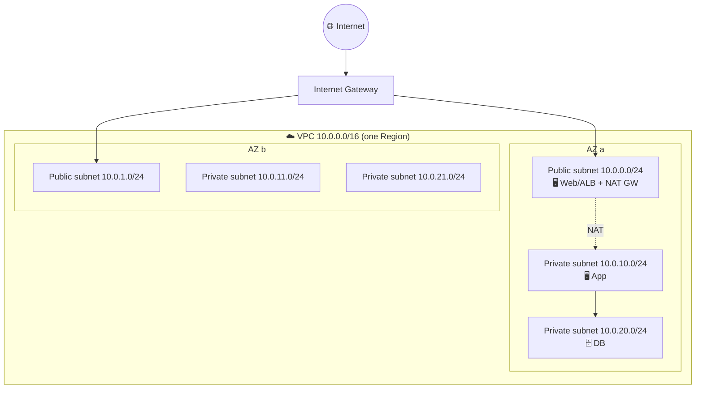
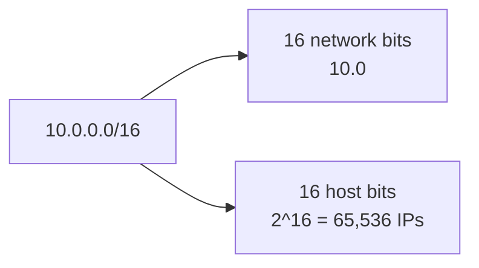
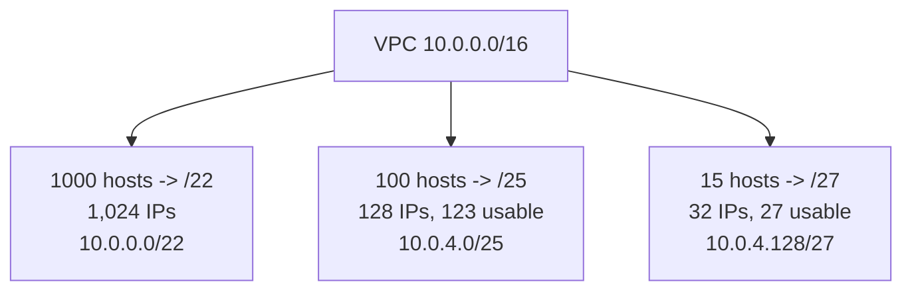
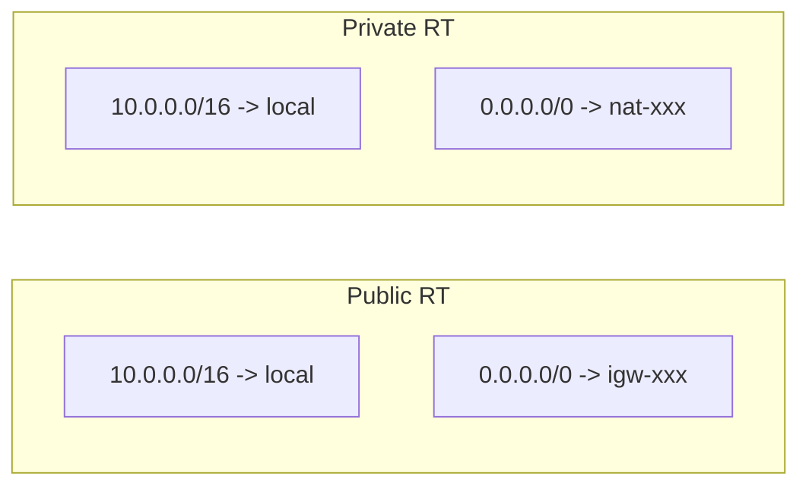
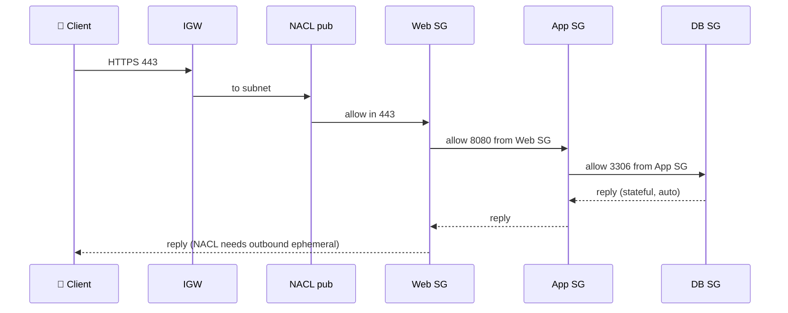
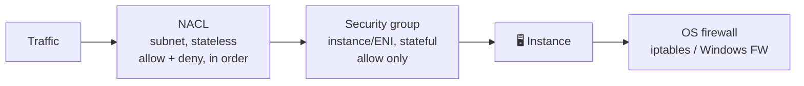
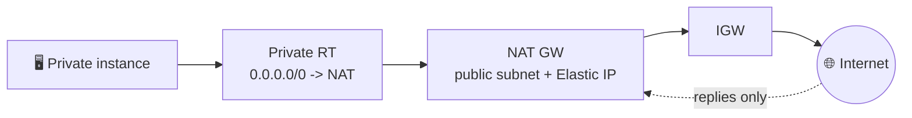

## What it is

A **VPC** (Virtual Private Cloud) is your own private network inside one AWS **Region**. You choose an IP range, cut it into **subnets** (each in one Availability Zone), and control traffic with route tables, gateways and firewalls.

Service scope: IAM is global, a VPC lives in one Region, a subnet in one AZ, an EC2 instance in one AZ.


*A 3-tier VPC: public (web), private (app), private (data), repeated in two AZs.*

Use it when: every AWS workload with servers. Start with a custom VPC, not only the default one.

## Key concepts

### IP addressing, subnet mask, CIDR (optional theory)

An IPv4 address is 32 bits, written as 4 bytes. The mask says how many leading bits are the **network**; the rest are **hosts**. CIDR writes it as `/n`.


*/16 = 255.255.0.0. Each extra bit in the prefix halves the space.*

| CIDR | Mask | Total IPs | Usable in AWS (minus 5) |
|---|---|---|---|
| /16 | 255.255.0.0 | 65,536 | 65,531 |
| /24 | 255.255.255.0 | 256 | 251 |
| /25 | 255.255.255.128 | 128 | 123 |
| /26 | 255.255.255.192 | 64 | 59 |
| /27 | 255.255.255.224 | 32 | 27 |
| /28 | 255.255.255.240 | 16 | 11 |

- Total IPs = 2^(32 - prefix). Block size of a "complex" mask: 256 - 224 = 32 (so /27 steps are .0, .32, .64 ...).
- **Broadcast** = last address of a block (sends to every host); **network address** = first. AWS VPC does not support broadcast.
- **Classful** (old): A = /8 (1-126), B = /16 (128-191), C = /24 (192-223). CIDR replaced it with any prefix length.
- Private ranges (RFC 1918): `10.0.0.0/8`, `172.16.0.0/12`, `192.168.0.0/16`. VPC CIDR must be /16 to /28.

### Subnetting examples

Rule: pick the smallest prefix whose usable size (total minus 5 in AWS) fits.


*Why: 1000 needs 2^10 (/22); 100 needs 2^7 (/25); 15 + 5 reserved = 20 needs 2^5 (/27, not /28 which gives only 11).*

Plan so subnets never overlap, and leave room (VPCs cannot easily be re-addressed; peered VPCs must not overlap).

### VPC components

| Component | Job |
|---|---|
| VPC | Private network, one CIDR |
| Subnet | Slice of the CIDR in one AZ |
| Route table | Rules: destination CIDR -> target |
| Internet gateway (IGW) | Door to the internet |
| NAT gateway | Outbound-only internet for private subnets |
| Security group | Stateful firewall on the instance (ENI) |
| Network ACL | Stateless firewall on the subnet |
| ENI / Elastic IP | Virtual network card / fixed public IP |

Create your first VPC: Console `VPC > Create VPC > VPC and more` (wizard builds subnets, route tables, IGW), or CLI:

```bash
aws ec2 create-vpc --cidr-block 10.0.0.0/16
aws ec2 create-subnet --vpc-id vpc-123 --cidr-block 10.0.0.0/24 --availability-zone us-east-1a
```

### Public vs private subnets, reserved IPs, IGW, route tables

A subnet is **public** only because its route table sends `0.0.0.0/0` to an IGW. Private subnets have no such route. Each subnet has exactly one route table; unassociated subnets use the VPC main route table.


*Route table = the only thing that makes a subnet public or private. The most specific route wins.*

- Reserved in every subnet (example 10.0.0.0/24): `.0` network, `.1` VPC router, `.2` DNS, `.3` future use, `.255` broadcast.
- IGW is horizontally scaled, no bandwidth limit to manage, no charge. It also does the 1:1 NAT between an instance's private and public IPv4.
- To be internet-reachable an instance needs: IGW attached + route to it + public/Elastic IP + SG/NACL allowing traffic.
- **3-tier app**: web (public, or behind an ALB) -> app (private) -> DB (private). Each tier only accepts traffic from the tier above.
- Keep tiers in different subnets: latency between subnets in the same AZ is negligible; separate subnets give separate NACLs and routes. Put replicas across AZs for availability, not same-subnet for latency.

### Packet path (internet to private DB)


*Chain: each security group references the previous tier's SG, not an IP range.*

### Security group vs network ACL


*Traffic is checked at subnet, then ENI, then inside the OS. All must allow it.*

| | Security group | Network ACL |
|---|---|---|
| Level | ENI (instance) | Subnet |
| State | Stateful | Stateless |
| Rules | Allow only | Allow and deny |
| Evaluation | All rules together | Lowest rule number first, first match wins |
| Default | Deny in, allow all out | Default NACL allows all |
| Source | CIDR, other SG, prefix list | CIDR only |

- **Security groups**: no rules = no inbound. Several SGs can attach to one ENI (rules merged). Reference SGs instead of IPs (`App-SG` allows 3306 from `Web-SG`).
- Default outbound is allow-all. Restrict outbound only for strict compliance (e.g. DB tier may only talk to the app tier); changing it breaks patching and `yum`/S3 access unless you add rules.
- **NACL rule order**: rules are numbered (use 100, 200, 300 to leave gaps); the first match decides; `*` last rule denies. A custom NACL starts with deny-all, so add rules both ways.
- **Ephemeral ports**: a client connects from a random port (1024-65535). Because NACLs are stateless, outbound must allow that range for replies. Use NACLs mostly to block bad CIDRs; do real filtering in SGs.
- Verify: test with `curl`/`nc`, then check VPC Flow Logs for `REJECT`. If SG and NACL look right, check the OS firewall.
- Launch with a custom SG: `aws ec2 run-instances --security-group-ids sg-123 --subnet-id subnet-123 ...`.

### Reaching private instances

| Method | Note |
|---|---|
| Traditional bastion host | Public-subnet EC2; SSH hop to private. You patch and secure it |
| SSM Session Manager | No open port, no public IP, IAM controlled (preferred) |
| EC2 Instance Connect Endpoint | SSH without public IP or bastion |

### NAT gateway


*NAT gateway translates private IPs to its Elastic IP; the internet cannot start connections inwards.*

- Managed, scales automatically (check current quotas for bandwidth and connections). Zonal NAT lives in **one AZ**: make one per AZ for high availability and avoid cross-AZ charges.
- **Regional NAT gateway**: one NAT for the whole VPC, expands to AZs where you have workloads (up to about 60 minutes to expand), automatic or manual IP mode, needs no public subnet; no private NAT support.
- Cost: hourly charge per NAT + per-GB processed (plus public IPv4 and data transfer). The processing fee applies even to S3 traffic, so use a **gateway VPC endpoint** for S3/DynamoDB.
- Create: allocate an Elastic IP, create NAT in a public subnet, add `0.0.0.0/0 -> nat-id` to the private route table.
- **Blackhole**: route status when its target (deleted NAT, IGW, peering) is gone. Traffic is dropped; repoint or delete the route.

### Public IPs and Elastic IPs

| | Auto-assign public IP | Elastic IP |
|---|---|---|
| Set on | Subnet setting or launch option | Allocated to account, then associated |
| Stop/start | Changes | Stays |
| Owner | AWS pool | You, until released |

- All public IPv4 addresses are billed hourly, in use or not (including idle EIPs). Check the VPC pricing page.
- An **ENI** is the virtual network card holding private IPs, public/Elastic IP and SGs; it can move between instances in the same AZ.
- Prefer a load balancer (one public IP) and private instances over many public IPs.

## X vs Y

| IGW (X) vs NAT gateway (Y) | Internet gateway | NAT gateway |
|---|---|---|
| Purpose | Two-way internet for public resources | Outbound-only for private resources |
| Lives | Attached to the VPC | In a public subnet, in one AZ (or regional) |
| Needs public IP on instance | Yes | No (NAT has the EIP) |
| Cost | Free | Hourly + per GB |

Pick IGW when instances must be reachable from the internet (web tier, ALB). Pick NAT when private instances only need to call out (patches, APIs).

## Job notes

- Default VPC (172.31.0.0/16) is fine for demos; build a custom VPC for production.
- Do not overlap CIDRs with on-premises or other VPCs you will peer or connect.
- Troubleshoot "cannot connect" in order: route table -> SG -> NACL (ephemeral ports) -> OS firewall -> Flow Logs.
- Cost traps: idle NAT gateways, idle Elastic IPs, NAT carrying S3 traffic, cross-AZ traffic.
- Security default: databases in private subnets, SG-to-SG references, no `0.0.0.0/0` on SSH.
- Cleanup order: terminate EC2 -> delete NAT gateway (wait) -> release Elastic IP -> detach and delete IGW -> delete subnets, custom route tables, NACLs, SGs -> delete VPC.

## Cheat sheet

- VPC = Region; subnet = one AZ; /16 to /28; AWS reserves 5 IPs per subnet.
- Public subnet = route `0.0.0.0/0 -> IGW`. Private = no IGW route.
- SG: stateful, allow-only, on ENI. NACL: stateless, allow+deny, numbered, on subnet.
- NACL needs ephemeral ports 1024-65535 for replies.
- NAT GW: outbound-only, sits in public subnet, per-AZ (or regional), costs per hour + GB.
- Deleted target = blackhole route.
- Elastic IP = static public IPv4; all public IPv4 are billed.
- S3/DynamoDB from private subnets: use gateway endpoints, not NAT.
- Prefer SSM Session Manager over bastion hosts.

## AWS docs

- [Subnet CIDR blocks](https://docs.aws.amazon.com/vpc/latest/userguide/subnet-sizing.html)
- [Regional NAT gateways](https://docs.aws.amazon.com/vpc/latest/userguide/nat-gateways-regional.html)
- [NAT gateway pricing](https://docs.aws.amazon.com/vpc/latest/userguide/nat-gateway-pricing.html)
- [Control traffic with security groups and NACLs](https://docs.aws.amazon.com/vpc/latest/userguide/vpc-security-best-practices.html)
- [Amazon VPC pricing](https://aws.amazon.com/vpc/pricing/)
