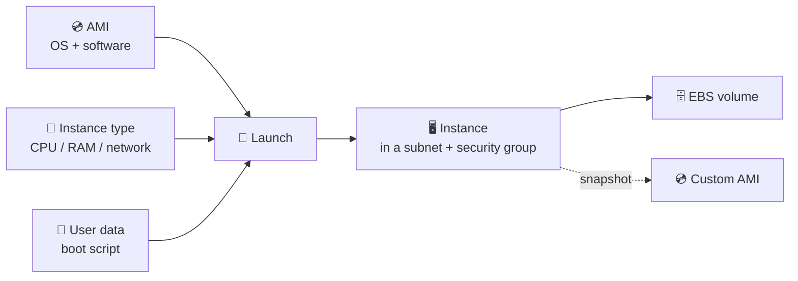
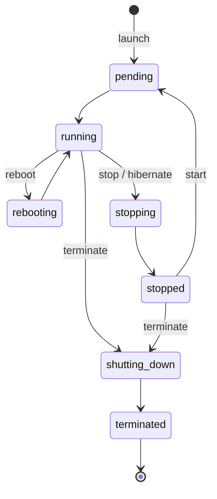
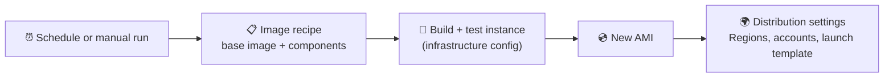
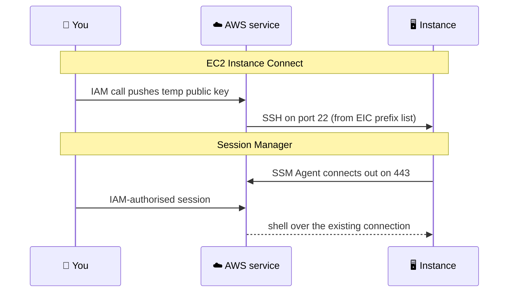
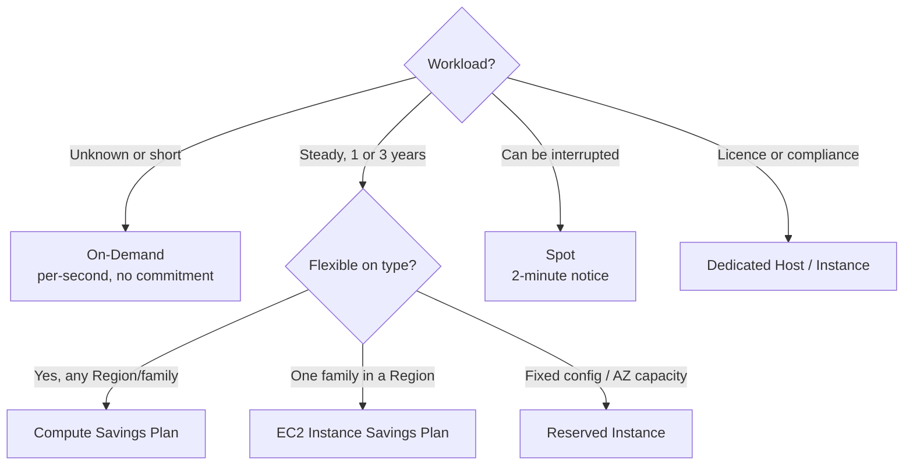
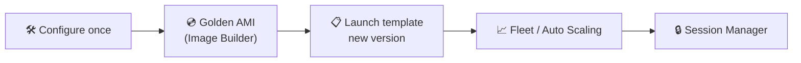

## What it is

Amazon EC2 rents you virtual servers (instances) in a Region. You choose an image (AMI), a size (instance type), a network and a way to log in, and AWS starts the machine.


*An instance is an AMI plus a type plus settings; a custom AMI is made from a running instance.*

Use it when you need full control of the OS, long-running servers, licensed software or custom networking. For event-driven code or containers see [Lambda and containers](/chapters/08-aws-computes-aws-lambda-and-containers/).

## Key concepts

### Instance lifecycle and termination protection


*Compute billing applies in `running` only; a terminated instance cannot be restarted.*

- Stopped instances keep their EBS volumes (you still pay for storage). Stop and start may move the instance to new hardware and change a non-Elastic public IPv4.
- **Termination protection** (`DisableApiTermination`) blocks API/console termination. It does not stop an OS shutdown when shutdown behaviour is "terminate", does not stop Auto Scaling scale-in, and is not available for Spot Instances.
- **Change instance type**: stop, change type, start. Not possible for Spot Instances; plan for downtime.

### AMI, custom AMI and snapshots

- An AMI is the template (OS, software, volume layout). Creating an AMI from an instance snapshots its EBS volumes; by default the instance reboots for consistency (`NoReboot` risks filesystem integrity).
- Instance store data is not copied into the AMI.
- **Cost**: you pay for the snapshots behind an AMI until you deregister the AMI and delete the snapshots. Check current snapshot prices on the [EBS pricing page](https://aws.amazon.com/ebs/pricing/).
- Hands-on flow: launch, install packages, create image, launch a new instance from the custom AMI, then clean up AMI and snapshots.


*EC2 Image Builder automates the custom-AMI loop as a pipeline.*

- **Image Builder** pipeline = recipe (base image + build/test components) + infrastructure configuration (where the build runs) + distribution settings (where the AMI goes, e.g. other Regions or accounts) + optional schedule.

### Instance types and Graviton

| Name part | Meaning | Example |
| --- | --- | --- |
| First letter | Series: M general, C compute, R memory, T burstable, I storage, G/P GPU | `m` |
| Number | Generation | `7` |
| Option letters | `g` Graviton, `a` AMD, `i` Intel, `d` local disk, `n` network | `g` |
| After the dot | Size | `large`, `4xlarge` |

- `m7g.large` is general purpose, 7th generation, Graviton (Arm). Pick an Arm64 AMI for Graviton; your software must support Arm.
- Pick by bottleneck: CPU (C), RAM (R), balanced (M), spiky and cheap (T).

### User data and troubleshooting

- User data is a script or cloud-init config passed at launch. On Linux cloud-init runs it, by default only on the first boot.
- It runs as root and its output goes to OS logs, not to the EC2 console.

```bash
#!/bin/bash
dnf install -y nginx
systemctl enable --now nginx
# debug: sudo cat /var/log/cloud-init-output.log
```

- Troubleshooting order: check status checks, **Monitor and troubleshoot > Get system log / screenshot** in the console, then cloud-init logs on the box.

### Launch templates

- A launch template stores AMI, type, key, security groups, user data and tags as numbered versions.
- Console and Auto Scaling can pick a specific version, `$Latest` or `$Default`. If you do not specify a version, the default is used.
- To roll forward: create a new version, then **Set default version**. See [Auto Scaling](/chapters/26-aws-auto-scaling/).

### Ways to access an instance


*Instance Connect needs inbound port 22; Session Manager needs no inbound port.*

- **Instance Connect** needs a supported Linux with the package installed, IAM permission to push the key, and port 22 allowed from the service range.
- **AWS-managed prefix list**: a named set of CIDRs maintained by AWS, for example `com.amazonaws.<region>.ec2-instance-connect`. Use it as a security group source instead of typing IP ranges. You cannot edit it, and a referenced list counts toward the rule quota by its weight (see the VPC docs).
- **Session Manager** needs: SSM Agent, an instance profile with the `AmazonSSMManagedInstanceCore` policy, and outbound HTTPS to the `ssm`, `ssmmessages` and `ec2messages` endpoints.
- **Private instances**: give them a route through a NAT gateway, or create the three VPC interface endpoints (no internet needed). See [Networking basics](/chapters/05-networking-basic/).
- **Cost**: Session Manager has no extra charge for EC2 instances (check the [pricing page](https://aws.amazon.com/systems-manager/pricing/)); a NAT gateway or interface endpoints do cost money.
- The Systems Manager console UI has been redesigned; the same features exist, so search by name (Session Manager, Fleet Manager) if menus differ from a tutorial.

### Pricing models


*Commit for what is steady, use Spot for what can stop, pay On-Demand for the rest.*

| Option | You commit to | Notes |
| --- | --- | --- |
| On-Demand | Nothing | Per-second billing on Linux; flexible |
| Savings Plans | $ per hour for 1 or 3 years | Compute SP spans Region, family, OS, tenancy and also covers Fargate and Lambda; EC2 Instance SP is one family in a Region with a larger discount |
| Reserved Instances | Instance configuration and Region, 1 or 3 years | Standard or Convertible; All, Partial or No Upfront |
| Spot | Nothing | Spare capacity, can be interrupted with a two-minute notice; default action is terminate |

- Discount percentages change; read them on the [EC2 pricing page](https://aws.amazon.com/ec2/pricing/).
- **Spot demo flow**: request a Spot Fleet, check its instances, then cancel the request. Cancelling can also terminate the instances (`--terminate-instances`) or leave them running (`--no-terminate-instances`).

### Dedicated Hosts and Dedicated Instances

| | Dedicated Instance | Dedicated Host |
| --- | --- | --- |
| Hardware | Single-tenant, per customer | Whole physical server |
| Billing | Per instance (plus a per-Region fee) | Per host, whatever runs on it |
| Sockets, cores, host ID visible | No | Yes |
| Placement control and affinity | No | Yes |
| Bring server-bound licences | No | Yes |

- Release a Dedicated Host only after every instance on it is stopped or terminated; billing for an On-Demand host stops on release.
- Dedicated Instances can share hardware with your own non-dedicated instances.
- Prices: see the [Dedicated Hosts](https://aws.amazon.com/ec2/dedicated-hosts/pricing/) and [Dedicated Instances](https://aws.amazon.com/ec2/pricing/dedicated-instances/) pages.

### Cost estimation practice

Estimate with the [AWS Pricing Calculator](https://calculator.aws/): instance hours x rate, plus EBS volumes, snapshots, public IPv4 addresses, NAT gateway and data transfer. Compare On-Demand against a Savings Plan for the steady part.

## X vs Y

| Access method | Inbound port | Key pair | Needs internet/NAT | Audit | Best for |
| --- | --- | --- | --- | --- | --- |
| SSH with key | 22 from your IP | Yes | Public IP or VPN | Weak | Quick tests |
| EC2 Instance Connect | 22 from the EIC prefix list | No (temp key) | Public reachability | IAM + CloudTrail | Browser access to public instances |
| Session Manager | None | No | Outbound 443 or VPC endpoints | Session logging options | Private instances, no bastion |

Pick Session Manager when the instance is private or the rules forbid open ports. Pick Instance Connect for quick browser access to a public Linux instance. Use SSH keys only when a tool needs raw SSH.

## Job notes


*Bake software into an AMI, launch from a template, log in with Session Manager.*

- Prefer bake-in (AMI) for slow installs and user data for small, instance-specific config.
- Attach roles through an instance profile, never keys in the instance. See [IAM](/chapters/04-aws-identity-and-access-management-iam/).
- Stop idle instances, but remember EBS, snapshots and Elastic IP/public IPv4 still cost money.
- Delete old AMIs and their snapshots; deregistering the AMI alone leaves the snapshots billing.
- Turn on termination protection for important single servers.
- Cannot SSH? Check security group, route to the internet gateway, key pair and the instance's status checks.
- Session Manager instance missing from the console? Check the instance profile, the three endpoints or NAT route, and that SSM Agent runs.
- Change type, change user data and similar edits need the instance to be stopped.

## Cheat sheet

- Lifecycle: pending, running, stopping, stopped, shutting-down, terminated; compute billed when running.
- AMI = snapshots + metadata; snapshots keep billing until deleted.
- Type name `m7g.large`: series, generation, option, size.
- User data: first boot only by default; logs at `/var/log/cloud-init-output.log`.
- Launch template: versions, with a default version.
- Resize: stop, modify, start.
- Access: Instance Connect (port 22, prefix list), Session Manager (no inbound port, IAM + SSM Agent + endpoints).
- Pricing: On-Demand, Savings Plans, Reserved, Spot (2-minute warning).
- Dedicated Host = licence and compliance, per host; Dedicated Instance = isolation, per instance.
- Always check current prices and quotas on the AWS pages.

## AWS docs

- [Amazon EC2 billing and purchasing options](https://docs.aws.amazon.com/AWSEC2/latest/UserGuide/instance-purchasing-options.html)
- [Instance type naming conventions](https://docs.aws.amazon.com/ec2/latest/instancetypes/instance-type-names.html)
- [Run commands at launch with user data](https://docs.aws.amazon.com/AWSEC2/latest/UserGuide/user-data.html)
- [Change the instance type](https://docs.aws.amazon.com/AWSEC2/latest/UserGuide/change-instance-type-of-ebs-backed-instance.html)
- [Termination protection](https://docs.aws.amazon.com/AWSEC2/latest/UserGuide/Using_ChangingDisableAPITermination.html)
