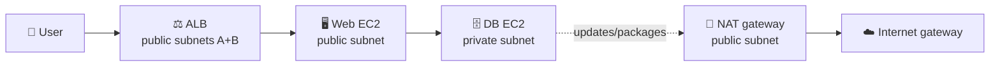
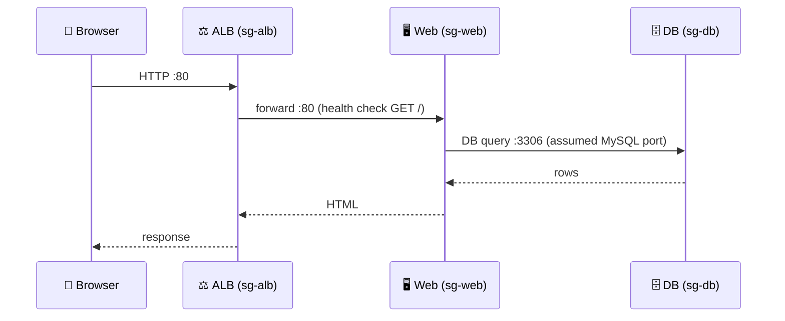
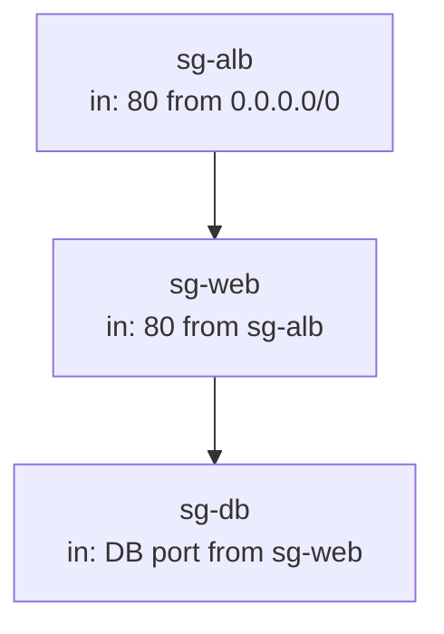
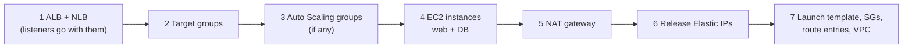

## What you build

A classic three-tier app: browser, a public web tier, and a database that is never reachable from the internet. You first run one web server directly, then put it behind an Application Load Balancer, then swap in a Network Load Balancer with static IPs.



_Caption: users reach only the load balancer; the database talks out only through the NAT gateway._

Prerequisite: a VPC with public and private subnets and an internet gateway (see [Networking Basic](/chapters/05-networking-basic/)). Instance basics are in [Amazon EC2](/chapters/06-aws-compute-services-amazon-ec2/). The course provides the app code in a GitHub repository; clone the URL the lab gives you in the web instance's user data.

## Architecture



_Caption: each hop is allowed by a security group that names the previous tier as its source._



_Caption: security group chaining. No tier is open to anything but the tier in front of it._

- **Public subnets (2 AZs):** ALB nodes, the NAT gateway, optionally the web instances. An ALB needs at least two subnets in different AZs.
- **Private subnet:** the database instance. Its route table sends `0.0.0.0/0` to the NAT gateway.
- **NAT gateway:** outbound-only internet for private instances. It lives in a public subnet and uses an Elastic IP.
- **Target group:** the list of web instances plus the health check the ALB uses to decide who gets traffic.
- **Launch template:** saved instance settings (AMI, type, security group, user data) so you can create identical web servers.

## Steps

**Part 1: network and database**

1. **NAT gateway.** Console: VPC > NAT gateways > Create. Choose a public subnet, connectivity type Public, allocate an Elastic IP. Then VPC > Route tables > private table > add `0.0.0.0/0` to the NAT gateway.
   ```bash
   aws ec2 create-nat-gateway --subnet-id <public-subnet> --allocation-id <eipalloc>
   aws ec2 create-route --route-table-id <private-rtb> --destination-cidr-block 0.0.0.0/0 --nat-gateway-id <nat-id>
   ```
2. **Launch the database instance.** EC2 > Launch instance > private subnet, auto-assign public IP disabled, security group `sg-db` with the database port allowed from `sg-web` only.
3. **Configure `dbadmin` and authentication.** Connect (Session Manager or from the web instance), install the DB server, create an admin user (`dbadmin`) with a password, and create the app database and a limited app user. Allow the app user to connect only from the web tier's address range. The exact commands are in the course repo.
4. **Launch the web instance.** Public subnet, public IP enabled, `sg-web` allowing HTTP from your IP for now. Paste the setup script into Advanced details > User data (install web server, clone the repo, point it at the DB's private IP).
5. **Verify.** Open `http://<public-ip>` and check that the page reads and writes data. If it is blank, read `/var/log/cloud-init-output.log` on the instance.

**Part 2: ALB**

6. **Create the target group.** EC2 > Target groups > Create: type Instances, protocol HTTP :80, health check path `/`, register the web instance.
7. **Create the ALB.** EC2 > Load balancers > Create > Application Load Balancer, internet-facing, pick two subnets in different AZs, security group `sg-alb`, listener HTTP :80 forwarding to the target group.
   ```bash
   aws elbv2 create-load-balancer --name web-alb --subnets <subnet-a> <subnet-b> --security-groups <sg-alb>
   aws elbv2 create-target-group --name web-tg --protocol HTTP --port 80 --vpc-id <vpc> --target-type instance
   aws elbv2 create-listener --load-balancer-arn <alb-arn> --protocol HTTP --port 80 --default-actions Type=forward,TargetGroupArn=<tg-arn>
   ```
8. **Lock the web tier.** Edit `sg-web`: replace the open HTTP rule with port 80 from `sg-alb`.
9. **Check health.** Target group > Targets: wait for status `healthy`, then browse to the ALB DNS name. Tune interval/threshold only if you need faster failover.

**Part 3: NLB, launch template, Elastic IPs**

10. **Launch template.** EC2 > Launch templates > Create: AMI, instance type, `sg-web`, the same user data. Launch a web instance from it.
11. **Create an NLB.** Load balancers > Create > Network Load Balancer, internet-facing, TCP :80 to a new target group holding the template-built instance.
12. **Static IPs.** In the NLB's network mapping, select an Elastic IP for each AZ subnet. Without your own choice, AWS assigns one Elastic IP per AZ.
13. **Verify.** Browse to the NLB DNS name and to each Elastic IP. NLB targets can keep the client's source IP, so check `sg-web` allows the client range, or allow the NLB's security group if it has one (add it at creation; it cannot be added later if you created without one).

Expected result: the app works via ALB DNS and via NLB DNS/Elastic IPs; the database has no public IP.

| | ALB | NLB |
|---|---|---|
| Layer | 7 (HTTP/HTTPS) | 4 (TCP/UDP/TLS) |
| Static IP | No, use DNS name | One Elastic IP per AZ |
| Typical use | Websites, path routing | Fixed IPs, non-HTTP |

## Common mistakes

- **Same route table for public and private subnets.** Traffic then does not route to the internet; use separate tables.
- **NAT gateway placed in a private subnet.** It must be in a public subnet with an internet-gateway route.
- **Target stays unhealthy.** Check that the web server is running, the health check path returns 200, and `sg-web` allows the ALB on the health check port too.
- **ALB in one AZ or tiny subnets.** It needs two AZ subnets, each with at least 8 free IPs (a /27 or larger is recommended).
- **User data not re-running.** By default it runs only at first launch; changing it later does nothing for a running instance. Scripts run as root, so skip `sudo`.
- **NLB without a security group.** A security group cannot be added to an NLB created without one.

## Cleanup

Delete in this order so nothing blocks deletion and no charges remain. ELB charges per hour, NAT gateways per hour plus per GB, and public IPv4 addresses (including Elastic IPs) are billed too.



_Caption: load balancers first, NAT gateway and its Elastic IP last among billable items._

1. Delete the ALB and the NLB (EC2 > Load balancers).
2. Delete both target groups.
3. Terminate web and database instances (and confirm no EBS volumes remain).
4. Delete the NAT gateway and wait until it is `deleted`. This disassociates its Elastic IP but does not release it, and the private route stays as a blackhole until removed.
5. Release every Elastic IP (VPC > Elastic IPs > Release), including the ones used for the NLB.
6. Delete the launch template, then remove the extra security groups (`sg-web`, `sg-alb`, `sg-db`).
7. Delete the lab VPC if you created it only for this lab.

Check Billing > Bills afterwards for NAT, ELB, and public IPv4 lines.

## On the job

- Put only load balancers and NAT gateways in public subnets; keep web and DB in private subnets where possible. The lab's public web instance is for learning.
- A NAT gateway costs money even with no traffic (hourly plus per GB processed). For a one-AZ lab, remember to delete it the same day. Check the [VPC pricing](https://aws.amazon.com/vpc/pricing/) and [ELB pricing](https://aws.amazon.com/elasticloadbalancing/pricing/) pages for current rates.
- ALB bills hours plus LCUs (charged on whichever of new connections, active connections, bytes, or rule evaluations is highest).
- Use security group chaining instead of IP ranges between tiers.
- Use a launch template so every instance is identical; this is the base for Auto Scaling later.

## AWS docs

- [NAT gateway use cases](https://docs.aws.amazon.com/vpc/latest/userguide/nat-gateway-scenarios.html)
- [Security groups for your Application Load Balancer](https://docs.aws.amazon.com/elasticloadbalancing/latest/application/load-balancer-update-security-groups.html)
- [Health checks for ALB target groups](https://docs.aws.amazon.com/elasticloadbalancing/latest/application/target-group-health-checks.html)
- [Update the Availability Zones for your Network Load Balancer](https://docs.aws.amazon.com/elasticloadbalancing/latest/network/availability-zones.html)
- [Run commands at launch with EC2 user data](https://docs.aws.amazon.com/AWSEC2/latest/UserGuide/user-data.html)
