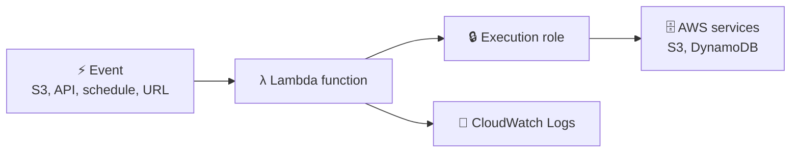
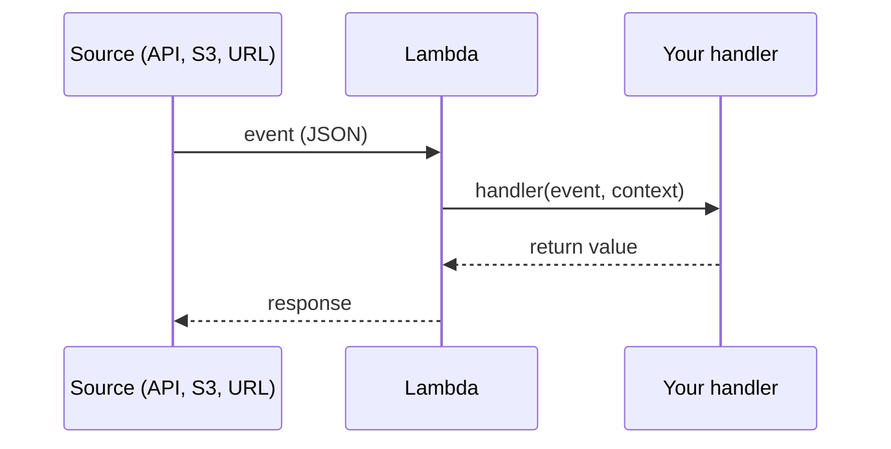
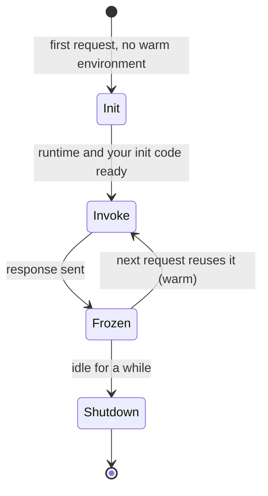
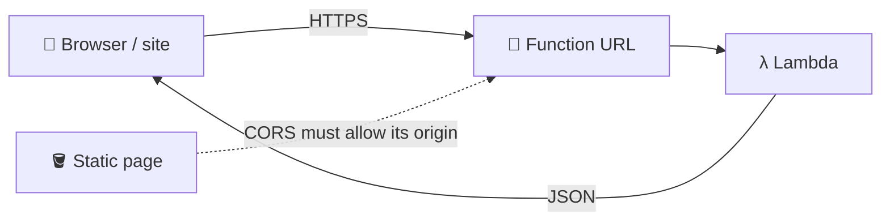
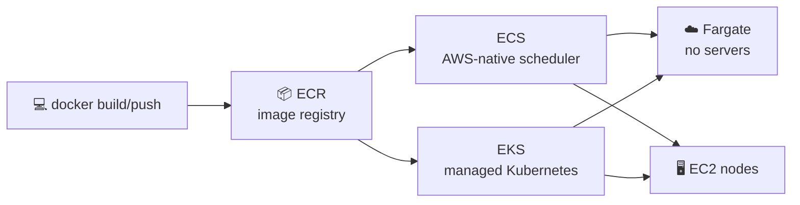
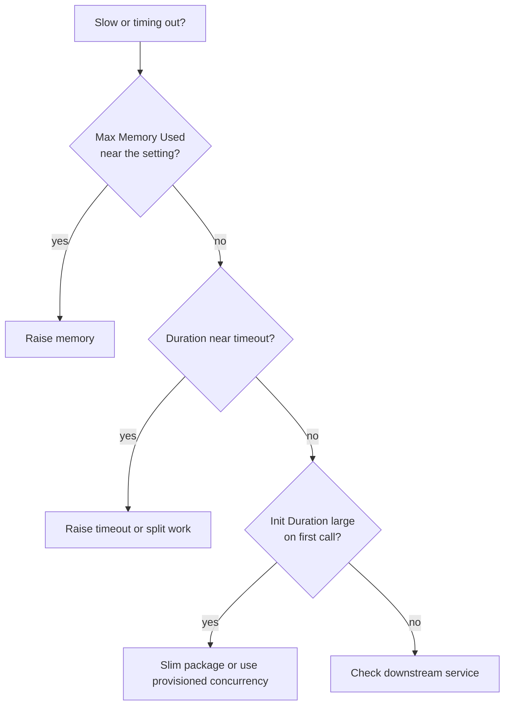

## What it is

**AWS Lambda** runs your code in response to an event, with no servers to manage. You upload a function, pick memory and a timeout, and pay only while it runs. **Containers** (ECS, EKS, Fargate, ECR) are for apps you package as a Docker image and keep running.


*An event starts the function; the execution role decides what it may touch; logs go to CloudWatch.*

Use Lambda for short, event-driven jobs and small APIs. Use containers when you need a long-running process, a custom runtime or a lift-and-shift of an existing image.

## Key concepts

### Building a function

Console path: **Lambda > Create function > Author from scratch**, pick a runtime, and Lambda also creates an execution role. Edit the code in the inline editor, press **Deploy**, then **Test** with a JSON event. Edits do nothing until you deploy.

```python
def lambda_handler(event, context):
    a, b = event["a"], event["b"]
    return {"sum": a + b}
```

Calculator example: the event carries the numbers and the operation, the handler returns the result. For more than one file, upload a `.zip` (or deploy via SAM/CDK); the handler setting points to `file.function`, and helper modules sit next to it and are imported normally.

### Event and context


*Lambda passes two arguments to every call.*

| Argument | What it holds |
|---|---|
| `event` | The input data. Its shape depends on the source (an S3 notification differs from a Function URL request). |
| `context` | Facts about this invocation: function name, request ID, memory setting, log group and `get_remaining_time_in_millis()` for time left. |

Log the `event` once while developing to see its real shape.

### Memory, timeout, pricing

| Setting | Fact |
|---|---|
| Memory | 128 MB to 10,240 MB in 1 MB steps. CPU grows in proportion to memory; about 1,769 MB equals one vCPU. |
| Timeout | Default 3 seconds, up to 900 seconds (15 minutes) for normal functions. |
| Price | Per request plus duration in GB-seconds (memory x time, billed per millisecond). A free tier exists. Check the [Lambda pricing page](https://aws.amazon.com/lambda/pricing/) for current rates. |

More memory means more CPU, so a bigger setting can make a function faster and sometimes cheaper. The **Lambda Power Tuning** tool and Compute Optimizer help find the sweet spot.

Pricing example (illustrative; the rates were published as $0.20 per million requests and $0.00001667 per GB-second, plus a free tier of 1 M requests and 400,000 GB-seconds a month; rates vary by region and architecture):

```text
3 M requests x 0.5 GB x 0.2 s = 300,000 GB-s   -> inside the free 400,000 GB-s
Requests: (3 M - 1 M free) x $0.20 per M       -> about $0.40 for the month
```

### Cold start and concurrency


*A cold start is the Init step; warm requests skip it.*

- **Concurrency** is how many requests are in flight at once. Each concurrent request needs its own environment. Estimate it as requests per second x average duration in seconds.
- Each Region has an account-level concurrency quota (1,000 by default for most accounts; new accounts may start lower). Check the current quota in [Lambda quotas](https://docs.aws.amazon.com/lambda/latest/dg/gettingstarted-limits.html).
- **Reserved concurrency** sets a guaranteed and maximum number for one function. It is free and protects downstream databases, but it does not pre-warm.
- **Provisioned concurrency** keeps a set number of environments initialized. It cuts cold starts, costs extra, and works on a published version or alias, not `$LATEST`.

### Logs and the execution role

- Lambda sends output (`print`, `console.log`) to **CloudWatch Logs** in the group `/aws/lambda/<function-name>`. Each environment writes its own log stream.
- Every call writes START, END and REPORT lines. REPORT shows duration, billed duration, memory size, max memory used and init duration. Use it to right-size memory.
- The **execution role** is the IAM role the function assumes at runtime; its trust policy names `lambda.amazonaws.com`. Give it log permissions plus only the actions the code needs (for example `s3:GetObject` on one bucket). See [IAM](/chapters/04-aws-identity-and-access-management-iam/) for roles and trust policies.

### Function URL and layers


*A Function URL gives a function its own HTTPS endpoint, no API Gateway needed.*

- **Function URL**: auth type `AWS_IAM` (callers must sign requests) or `NONE` (public). Fixing the calculator page to call the function means: create the URL, set auth to `NONE` for the demo, enable **CORS** for the page's origin, and call it with `fetch`.
- Treat `NONE` as publicly callable by anyone: add validation, and prefer `AWS_IAM` for anything real.
- **Layers** are zip archives of libraries or data, extracted into `/opt`. A function can use up to five layers, and the unzipped function plus layers must stay under the package quota (250 MB at the time of writing; check quotas).
- Layers are immutable versions. To change content, publish a new version and update each function to point at it.

### Containers: ECR, ECS, Fargate, EKS


*ECR holds images; ECS or EKS schedule them; Fargate or EC2 provide the compute.*

- **ECR** stores images. Docker needs a login token (valid 12 hours) before push or pull; an ECS task definition references `account.dkr.ecr.region.amazonaws.com/repo:tag`.
- **ECS** is AWS's own orchestrator. A **task definition** describes containers, CPU and memory; a **service** keeps N tasks running.
- **EKS** runs the Kubernetes control plane for you, across multiple Availability Zones. You then use standard Kubernetes tools.
- **Fargate** runs tasks or pods without you managing instances. Each task gets its own isolation boundary.

### Compute Optimizer and Trusted Advisor

- **Compute Optimizer** reads CloudWatch utilization and recommends right sizes for EC2, Auto Scaling groups, EBS, Lambda memory and ECS on Fargate. Opt in once (account or organization) from the console; first results can take up to about 12 hours. Basic recommendations are free; enhanced infrastructure metrics are a paid add-on. See the [pricing page](https://aws.amazon.com/compute-optimizer/pricing/).
- **Trusted Advisor** runs best-practice checks in categories: cost optimization, performance, security, fault tolerance, service limits and operational excellence. Some checks (over- and under-provisioned Lambda memory, EBS volumes) take their data from Compute Optimizer. The set of checks you see depends on your Support plan.

## X vs Y

EC2 vs Lambda vs ECS/Fargate vs EKS:

| | EC2 ([chapter 6](/chapters/06-aws-compute-services-amazon-ec2/)) | Lambda | ECS on Fargate | EKS |
|---|---|---|---|---|
| You manage | OS, patches, scaling | Code only | Container image, task sizing | Kubernetes objects, add-ons, nodes (unless Fargate) |
| Run time | Unlimited | Up to 15 min per call (normal functions) | Unlimited | Unlimited |
| Billing | Per instance time | Requests + GB-seconds | vCPU and memory per second | Cluster fee per hour plus compute |
| Scales to zero | No | Yes | Service can be set to 0 tasks, but not automatic | No for control plane |
| Best for | Full control, steady load | Events, glue code, spiky small APIs | Long-running web apps, workers | Kubernetes skills or portability |

**ECS vs EKS** in short: ECS is simpler and deeply integrated with IAM, CloudWatch and VPC; EKS gives the Kubernetes ecosystem and portability at the price of more concepts and a per-cluster fee (check [EKS pricing](https://aws.amazon.com/eks/pricing/)).

Pick Lambda when work is short, bursty and event-driven. Pick Fargate when it runs continuously or is already a container. Pick EKS only when the team needs Kubernetes. Pick EC2 when you need host-level control.

## Job notes


*A quick Lambda troubleshooting path using the REPORT line.*

- Throttling (`TooManyRequestsException`) means concurrency ran out: check reserved settings and the Regional quota.
- Provisioned concurrency is billed while configured, even with no traffic. Use it only for latency-sensitive paths.
- Never give a function `*` permissions; scope its role to named resources.
- Public Function URLs and stray CORS wildcards are common leaks.
- Fargate bills for requested vCPU and memory; right-size tasks. Add ECR lifecycle policies to delete old images.
- Turn on Compute Optimizer early; it needs metric history before it can recommend.

## Cheat sheet

- Lambda: event in, code runs, pay per request and GB-second. Memory 128 to 10,240 MB; timeout default 3 s, max 900 s.
- `handler(event, context)`: event is input, context is invocation info.
- Permissions come from the execution role, not from you.
- Cold start = Init phase; reduce with smaller packages or provisioned concurrency.
- Reserved concurrency = guarantee and cap, free. Provisioned = pre-warmed, paid.
- Function URL: `AWS_IAM` or `NONE`; configure CORS for browsers.
- Layers: up to five, unpacked into `/opt`, immutable versions.
- ECR stores images; ECS and EKS schedule them; Fargate removes servers.
- ECS = simpler, AWS-native. EKS = Kubernetes.
- Compute Optimizer = rightsizing (opt in). Trusted Advisor = best-practice checks.
- Check current prices and quotas on the AWS pages before estimating.

## AWS docs

- [Configure Lambda function memory](https://docs.aws.amazon.com/lambda/latest/dg/configuration-memory.html)
- [Lambda function scaling and concurrency](https://docs.aws.amazon.com/lambda/latest/dg/lambda-concurrency.html)
- [Adding layers to functions](https://docs.aws.amazon.com/lambda/latest/dg/adding-layers.html)
- [Using Amazon ECR images with Amazon ECS](https://docs.aws.amazon.com/AmazonECR/latest/userguide/ECR_on_ECS.html)
- [What is AWS Compute Optimizer?](https://docs.aws.amazon.com/compute-optimizer/latest/ug/what-is-compute-optimizer.html)
