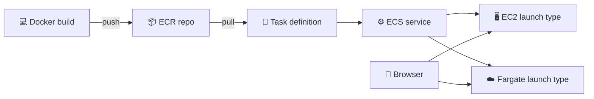
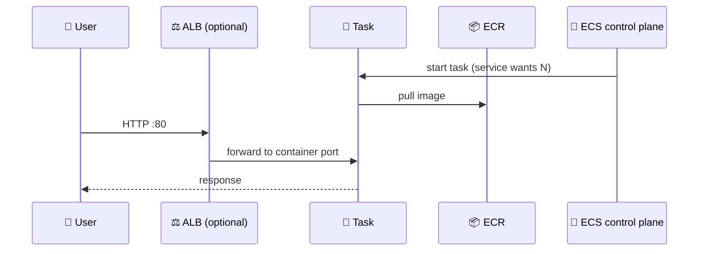
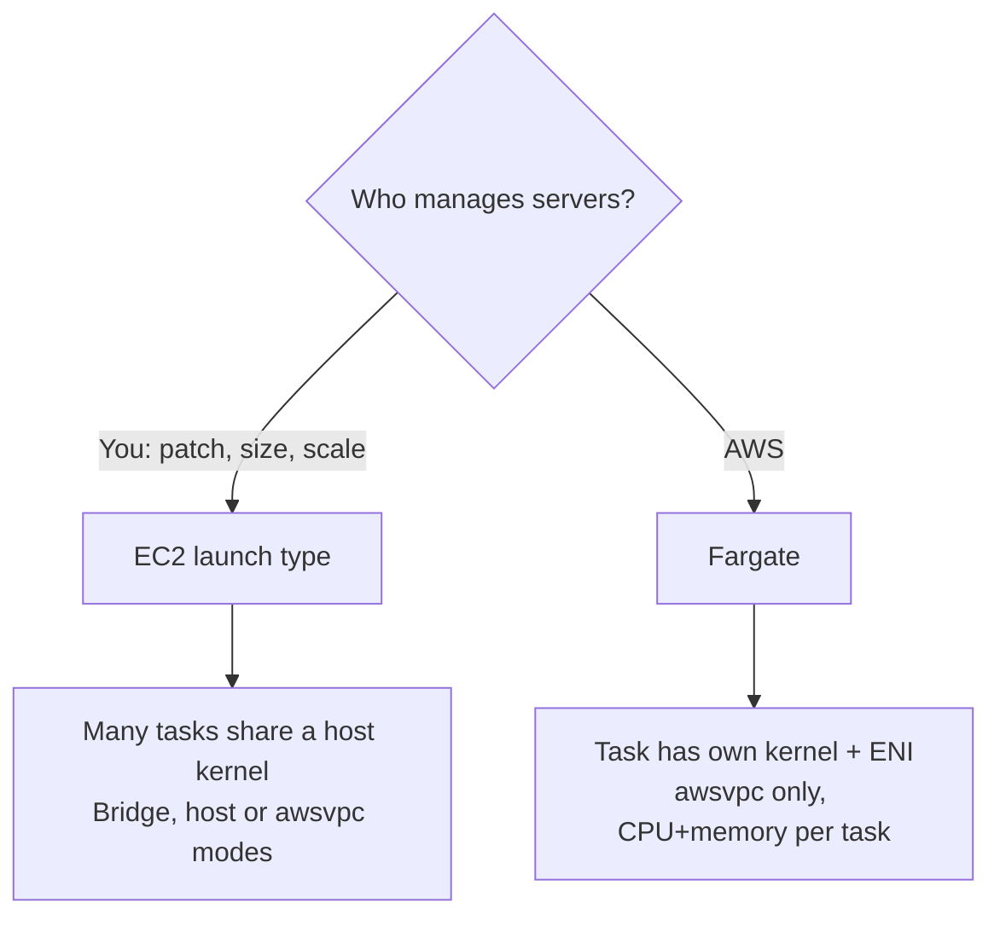

## What you build

You package a small web app as a Docker image, store it in ECR, and run it in an ECS cluster first on EC2 (x86, then Graviton) and then on Fargate.


*Same image, two ways to run it.*

## Architecture


*A service keeps N tasks running; an ALB spreads traffic over them.*

| Component | Role |
|---|---|
| Cluster | Logical group of capacity where tasks run |
| Task definition | Blueprint: image, CPU/memory, ports, env, roles |
| Task | One running copy of the blueprint |
| Service | Keeps N tasks alive; can attach a load balancer |
| Container instance | EC2 host running the ECS agent (EC2 launch type only) |
| ECR | Private image registry |


*Fargate vs EC2 launch type.*

## Steps

Docker basics (on your machine) come first.

1. Build: `docker build -t myapp:1.0 .` (reads the Dockerfile in the current folder).
2. Run and expose: `docker run -d -p 8080:80 myapp:1.0`. `-p host:container` publishes the container port; open `http://localhost:8080`.
3. Daily commands: `docker ps`, `docker logs <id>`, `docker stop <id>`, `docker images`, `docker rm <id>`, `docker rmi <image>`.
4. **ECR**: console ECR > Create repository (private). Name it with a namespace prefix, for example `lab/myapp`. The namespace is just a slash-separated prefix in the repository name that groups repos; names must start with a letter and use lowercase letters, numbers, `-`, `_`, `/`.
5. Open the repo and choose **View push commands**. They log Docker in to ECR, then tag and push:

```bash
aws ecr create-repository --repository-name lab/myapp
# then run the 4 commands shown by "View push commands"
```

6. **Cluster**: ECS console > Clusters > Create cluster. Name it, choose infrastructure. The console builds the needed resources through a CloudFormation stack. For the EC2 variant pick EC2 instances (it creates an Auto Scaling group and launch template with the latest ECS-optimized AMI). For Fargate the console attaches the Fargate and Fargate Spot capacity providers automatically.
7. **Task definition (EC2)**: ECS > Task definitions > Create new. Launch type EC2, image URI from ECR (`<account>.dkr.ecr.<region>.amazonaws.com/lab/myapp:1.0`), container port 80, set memory (required for EC2). Host port 0 gives dynamic port mapping when behind an ALB in bridge mode.
8. **Container instance**: if you launch EC2 yourself, use the ECS-optimized AMI, attach an ECS instance role, and put this in user data so the agent joins your cluster:

```bash
#!/bin/bash
echo ECS_CLUSTER=my-cluster >> /etc/ecs/ecs.config
```

   Check ECS > Cluster > Infrastructure: the instance should appear as registered.
9. **Service**: Cluster > Services > Create. Pick the task definition, desired tasks = 1 or 2. Optionally attach an Application Load Balancer (needs a target group; the ECS service-linked role registers tasks for you).
10. **Verify**: service status Active, tasks RUNNING, then open the instance public IP (or ALB DNS name) in a browser. Make sure the security group allows the port.
11. **Graviton**: create a second capacity or instance using the ECS-optimized **arm64** AMI and a Graviton type such as `c6g.large`. Your image must be built for arm64 (multi-arch image, or build on an arm machine). Run the task and compare in the console.
12. **Fargate**: create a task definition with launch type Fargate (CPU and memory set at task level, network mode awsvpc), then a service on the Fargate cluster, choosing subnets and a security group. No instances to manage.

Expected result: the same page loads from an EC2-backed task, a Graviton-backed task and a Fargate task.

## Common mistakes

| Mistake | Fix |
|---|---|
| Instance never joins the cluster | Set `ECS_CLUSTER` in user data and attach the instance role |
| Task stuck in PROVISIONING or PENDING | Check capacity, image pull access and subnet/security group |
| Image fails to start on Graviton | Build for arm64; mismatched architecture exits immediately |
| ALB target group with awsvpc tasks | Target type must be `ip`, not `instance` |
| Page not reachable | Open the port in the security group; with dynamic ports allow the ephemeral range from the ALB |
| Fargate task cannot pull image | Give it a route (public IP or NAT/endpoints) and a task execution role |

## Cleanup

Do it in this order. A cluster cannot be deleted while it has services, active tasks or registered container instances.

1. Services: update desired count to 0, then delete each service (or delete with force). Confirm tasks are stopped.
2. Load balancer: delete the ALB, then its target group.
3. EC2 capacity: delete the Auto Scaling group (terminates instances) or terminate manually launched instances, then deregister them from the cluster.
4. Cluster: delete it. If created in the console, confirm its CloudFormation stack is gone too.
5. ECR: delete images, then the repository (stored images are billed).
6. Optional: deregister old task definition revisions, delete CloudWatch log groups, release unattached Elastic IPs, delete any VPC you created for the lab.

```bash
aws ecs update-service --cluster my-cluster --service web --desired-count 0
aws ecs delete-service --cluster my-cluster --service web
aws ecs delete-cluster --cluster my-cluster
aws ecr delete-repository --repository-name lab/myapp --force
```

## On the job

- Default to Fargate for new services; use EC2 when you need host control, GPUs, or cheaper steady, packed capacity.
- Graviton cuts cost per unit of work for many workloads, but you must ship arm64 images.
- Put images in ECR with namespaces per team or project, and scope IAM by repository prefix.
- Never put secrets in user data or the image; use task-level secrets and roles.
- Always tag lab resources so cleanup is one search.

## AWS docs

- [Creating an Amazon ECS cluster for Fargate workloads](https://docs.aws.amazon.com/AmazonECS/latest/developerguide/create-cluster-console-v2.html)
- [Creating an Amazon ECS cluster for Amazon EC2 workloads](https://docs.aws.amazon.com/AmazonECS/latest/developerguide/create-ec2-cluster-console-v2.html)
- [Task definition differences for Fargate](https://docs.aws.amazon.com/AmazonECS/latest/developerguide/fargate-tasks-services.html)
- [Use an Application Load Balancer for Amazon ECS](https://docs.aws.amazon.com/AmazonECS/latest/developerguide/alb.html)
- [Pushing an image to an Amazon ECR private repository](https://docs.aws.amazon.com/AmazonECR/latest/userguide/image-push.html)
