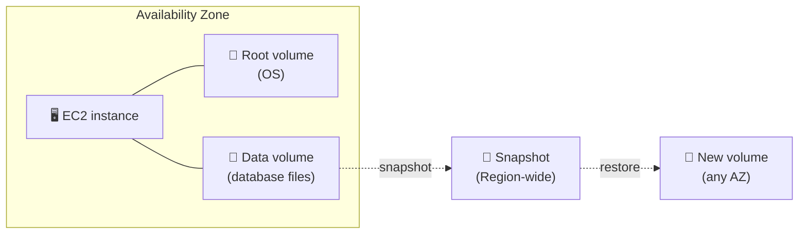
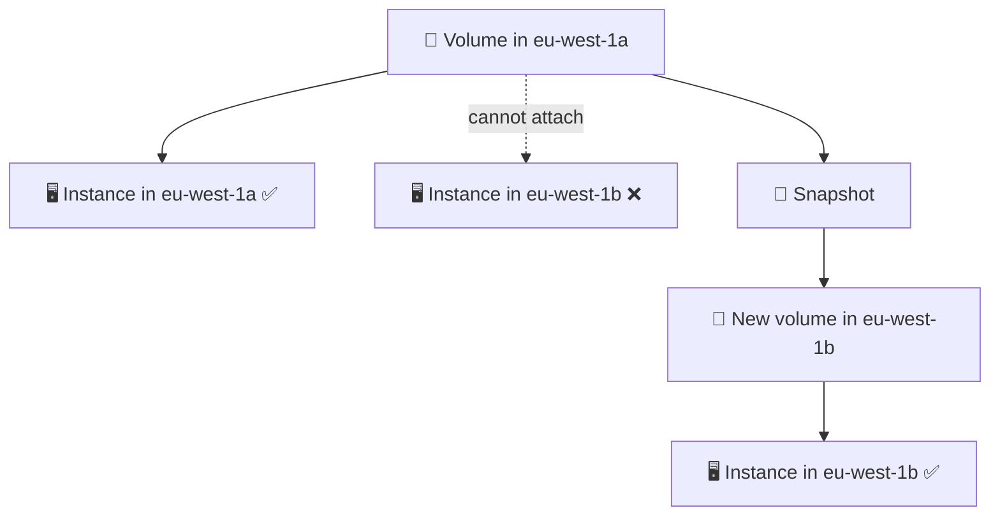
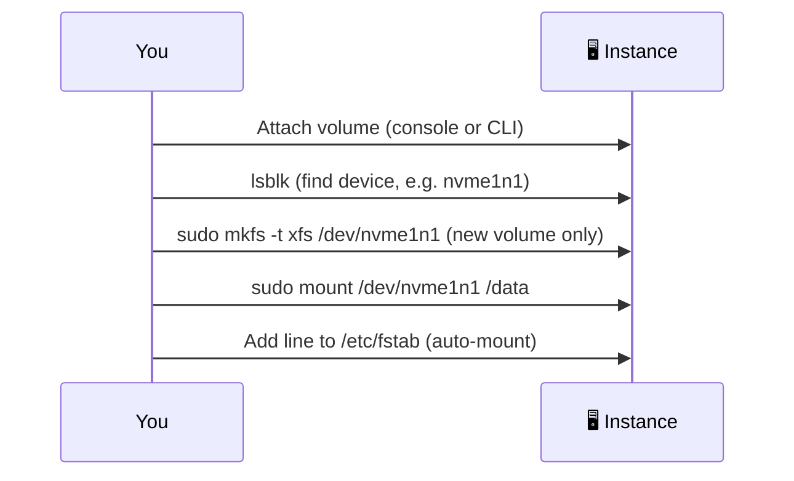
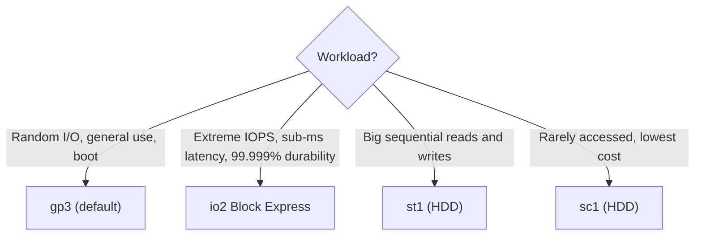
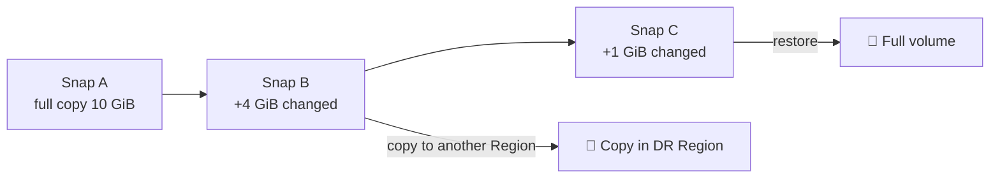
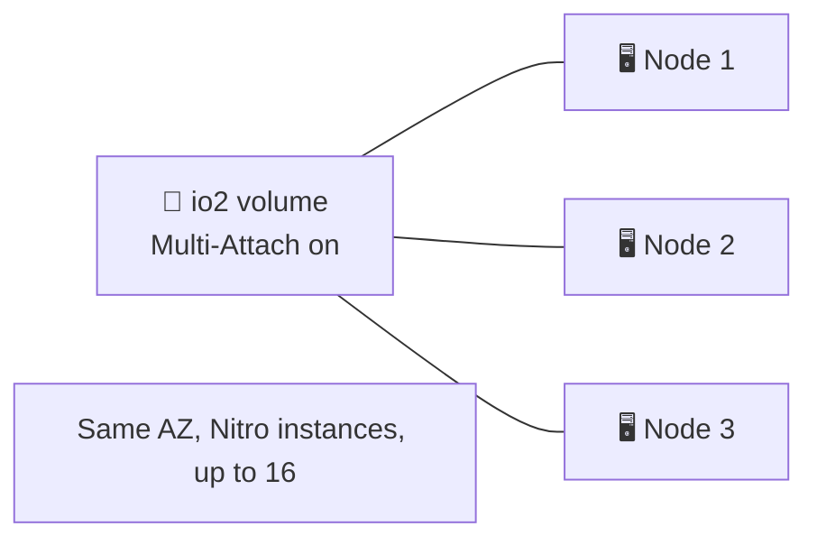
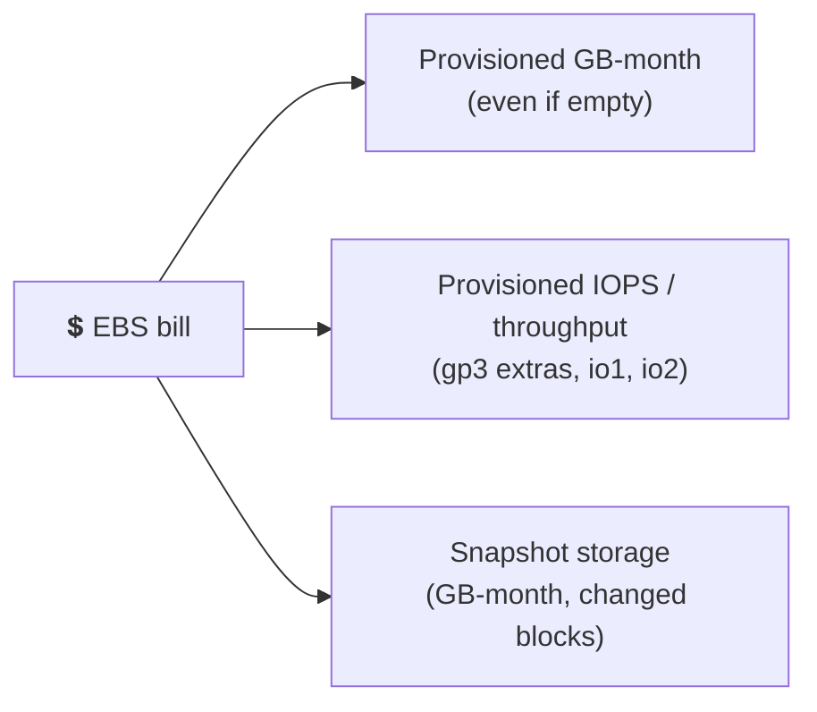
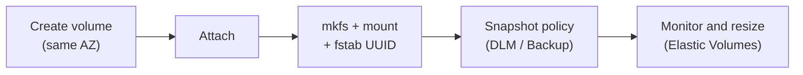

## What it is

Amazon EBS (Elastic Block Store) gives an EC2 instance a virtual hard disk over the network. The disk (a **volume**) lives independently of the instance, so you can detach it, snapshot it and attach it elsewhere. The OS sees it as a raw block device, so you format it and mount it like a local disk.


*A volume is tied to one AZ; snapshots carry data across AZs and Regions.*

**Use it when** an EC2 instance needs a disk that survives stop and terminate, such as an OS disk, a database, or a file system you manage.

## Key concepts

### Block vs object storage

| | Block (EBS) | Object ([S3](/chapters/14-aws-storage-services-amazon-s3/)) |
|---|---|---|
| Unit | Fixed-size blocks, you add a file system | Whole object plus metadata |
| Access | Mounted on one instance, like a disk | HTTP API, from anywhere |
| Update | Change a few blocks in place | Replace the whole object |
| Best for | OS, databases, low latency | Files, backups, static sites, data lakes |

Shared file systems (many instances at once) are a third type, covered in [EFS and FSx](/chapters/12-aws-storage-services-amazon-efs-and-fsx/).

### Scope: one volume, one AZ


*To move a volume to another AZ, snapshot it and restore in the target AZ.*

- A normal volume attaches to **one instance at a time** (see Multi-Attach below for the exception).
- One instance can have **many volumes**. The maximum depends on instance type and size.
- The root volume has `DeleteOnTermination` set to true by default, so terminating the instance deletes it. Set it to false to keep the disk.

### Attach, mount and auto-mount

Attaching only connects the disk. You still must format (first time only) and mount it.


*An existing volume that already holds data skips the `mkfs` step; formatting erases it.*

```bash
aws ec2 attach-volume --volume-id vol-0abc --instance-id i-0abc --device /dev/sdf
lsblk -f                                   # find the device and its UUID
sudo mount /dev/nvme1n1 /data
# /etc/fstab: mount by UUID so a device rename does not break boot
UUID=<uuid-from-lsblk>  /data  xfs  defaults,nofail  0  2
```

- Use the **UUID** in `/etc/fstab`, not the device name. Device names can change.
- Add `nofail` so a missing volume does not block the instance from booting.
- Attaching an existing volume to another instance: stop using it, detach, attach in the **same AZ**, then mount (no format).
- Nitro instances show EBS volumes as NVMe devices (`/dev/nvme1n1`), whatever name you chose at attach time.

### Volume types


*SSD types are for IOPS (small random I/O); HDD types are for MB/s (large sequential I/O).*

The full side-by-side table is in the X vs Y section below.

- **gp3** gives a baseline of 3,000 IOPS and 125 MiB/s in the price of storage. You can buy more IOPS and throughput without growing the disk.
- **gp2** is the older type: speed grows with size and uses burst credits. Prefer gp3 for new volumes.
- Only **SSD** types can be boot volumes. st1 and sc1 cannot.
- You can change type, size and IOPS on a live volume with **Elastic Volumes** (`aws ec2 modify-volume`). Size can only grow; afterwards extend the file system.

### Snapshots


*Only the first snapshot is full; later ones store changed blocks. Deleting an old one never breaks a newer one.*

- Snapshots are stored by AWS in S3 (you do not see the bucket) and are Region-scoped. Copy them to another Region for disaster recovery.
- Automate with **Amazon Data Lifecycle Manager** or AWS Backup, not cron jobs.
- **Recycle Bin** retention rules let you recover accidentally deleted snapshots.
- The **archive tier** is cheaper for rarely used snapshots, with a 90-day minimum and a restore time of up to 72 hours. Use it for monthly or yearly copies, not daily ones.

### Encryption

- Encrypted volumes protect data at rest, data moving between the volume and the instance, all snapshots, and all volumes restored from those snapshots.
- Uses AES-256 keys from AWS KMS. The default is the AWS managed key `aws/ebs`; use a customer managed key if you need to control rotation, disabling or sharing.
- Turn on **EBS encryption by default** per Region (EC2 console, Settings). It affects only new volumes.
- Unencrypted snapshot to encrypted volume: copy the snapshot with encryption on, or choose encryption when restoring.
- You can share a snapshot with another account only if it is encrypted with a **customer managed key**, and you must share the key too.

### Multi-Attach


*One shared disk for a cluster. Your software, not EBS, must coordinate writes.*

- Only Provisioned IOPS SSD (**io1/io2**). Same AZ. Up to 16 Nitro instances. Not for boot volumes.
- Linux supports io1 and io2; Windows supports io2 only.
- XFS and ext4 are not designed for several writers. Use a cluster-aware file system or application.
- For a shared file system that needs no special software, use EFS instead.

### Pricing


*You pay for what you provision, not what you use.*

- Billing is per GB-month of provisioned size. A 100 GiB volume holding 10 GiB still costs 100 GiB.
- Unattached volumes still cost money. Delete what you do not need.
- Snapshots are billed by stored data, and deleting one may not cut cost if later snapshots reference its blocks.
- Prices differ per Region and change. Check [EBS pricing](https://aws.amazon.com/ebs/pricing/) for current values.

## X vs Y

### EBS volume types vs instance store

Volume types (use the [volume types page](https://docs.aws.amazon.com/ebs/latest/userguide/ebs-volume-types.html) for current limits):

| | gp3 | io2 Block Express | st1 | sc1 |
|---|---|---|---|---|
| Media | SSD | SSD | HDD | HDD |
| Optimised for | IOPS, general use | IOPS, latency, durability | MB/s, sequential | MB/s, cold data |
| Max IOPS per volume | 80,000 | 256,000 | 500 | 250 |
| Max throughput | 2,000 MiB/s | 4,000 MiB/s | 500 MiB/s | 250 MiB/s |
| Size | 1 GiB to 64 TiB | 4 GiB to 64 TiB | 125 GiB to 16 TiB | 125 GiB to 16 TiB |
| Durability | 99.8-99.9% | 99.999% | 99.8-99.9% | 99.8-99.9% |
| Multi-Attach | No | Yes | No | No |
| Boot volume | Yes | Yes | No | No |
| Typical use | Boot, dev/test, most databases | Largest, latency-critical databases | Logs, data warehouse, Kafka | Infrequent, cheapest |

EBS vs instance store:

| | EBS volume | Instance store |
|---|---|---|
| Location | Network-attached, separate from host | Disks physically in the host server |
| After reboot | Kept | Kept |
| After stop / terminate | Kept (root volume deleted on terminate by default) | Lost |
| Detach and move | Yes | No, only attached at launch |
| Snapshots | Yes | No |
| Size and type | Choose, resize when running | Fixed by instance type |
| Cost | Pay for provisioned volume | Included in instance price |
| Use for | OS, databases, anything to keep | Cache, buffers, scratch, replicated data |

**Pick gp3 when** you do not have a special reason; it is the default for boot and databases. **Pick io2** when you need more than gp3 limits, sub-millisecond latency, higher durability, or Multi-Attach. **Pick st1/sc1** for large streaming data where cost per GB matters, never for boot. **Pick instance store** when data is disposable or replicated elsewhere and you want local speed.

## Job notes


*Typical life of a data disk.*

- **Default choice:** gp3, encrypted, with a scheduled snapshot policy.
- **Cannot attach?** Check AZ first, then that the volume state is `available`.
- **Out of space?** Modify size, then extend partition and file system. Shrinking is not possible; create a smaller volume and copy data.
- **Slow disk?** Check the instance limit too: instance type caps EBS throughput. Use EBS-optimised instances to reach full IOPS.
- **Cost traps:** unattached volumes after terminating instances, old snapshots, over-provisioned io2 IOPS.
- **Security:** enable default encryption, never make snapshots public, and share only with named accounts.
- **Do not store** the only copy of important data on instance store.

## Cheat sheet

- EBS = network disk for EC2. One AZ. Survives stop. Snapshot to move across AZs or Regions.
- Default type: **gp3** (3,000 IOPS and 125 MiB/s included). SSD for IOPS, HDD (st1/sc1) for throughput, HDD is never a boot volume.
- **io2** for top IOPS, latency, durability and **Multi-Attach** (same AZ, Nitro, up to 16, clustered software).
- Snapshots: incremental, Region-scoped, copy for DR, archive tier for long retention, Recycle Bin for mistakes.
- Encryption: KMS, AES-256, enable by default per Region. Covers volume, snapshots and restored volumes.
- Mount flow: attach, `lsblk`, `mkfs` (new only), `mount`, `/etc/fstab` with UUID and `nofail`.
- Billing: provisioned GB-month plus provisioned IOPS and throughput extras plus snapshots.
- Instance store = temporary, lost on stop and terminate, kept on reboot.

## AWS docs

- [What is Amazon EBS?](https://docs.aws.amazon.com/ebs/latest/userguide/what-is-ebs.html)
- [Amazon EBS volume types](https://docs.aws.amazon.com/ebs/latest/userguide/ebs-volume-types.html)
- [Make an EBS volume available for use](https://docs.aws.amazon.com/ebs/latest/userguide/ebs-using-volumes.html)
- [Attach a volume to multiple instances (Multi-Attach)](https://docs.aws.amazon.com/ebs/latest/userguide/ebs-volumes-multi.html)
- [Amazon EBS pricing](https://aws.amazon.com/ebs/pricing/)
