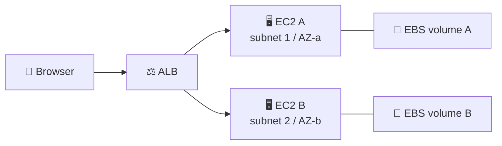
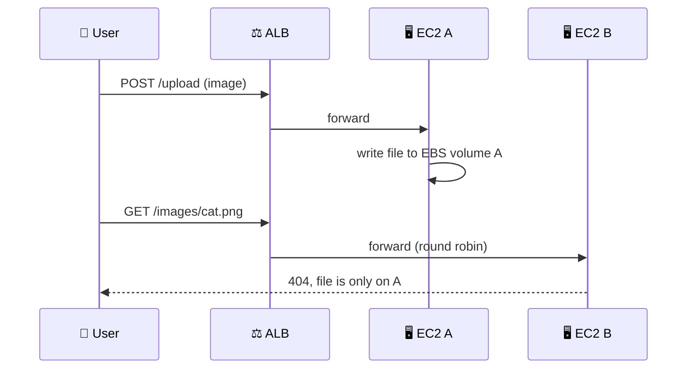

## What you build

A small web app that accepts image uploads and stores them on an EBS volume of an EC2 instance, behind an Application Load Balancer. You then add a second instance in another subnet to see why instance-local disks do not share data, and practise draining a target.


*Each instance has its own EBS disk; the ALB spreads requests over both.*

## Architecture


*The "missing image" lesson: local EBS is not shared storage.*

- **EC2 instance**: runs the web app (Launch Application step).
- **EBS volume**: block disk, formatted and mounted on the instance; it lives in one Availability Zone and attaches to one instance (a Multi-Attach exception exists for some volume types, check the docs).
- **ALB**: layer 7 entry point in at least two subnets in different AZs.
- **Target group**: the list of instances the ALB sends to, with a health check path.
- **Security groups**: internet to ALB on 80; ALB security group to instances on the app port.

## Steps

1. **Launch instance A**: EC2 > Launch instance, pick a Linux AMI, choose subnet 1, a security group allowing the app port, and user data that installs and starts the app.
2. **Add an EBS data volume**: EC2 > Volumes > Create volume in the same AZ as A, then Actions > Attach volume. On the instance run `lsblk`, `sudo mkfs -t xfs /dev/nvme1n1`, `sudo mkdir /data`, `sudo mount /dev/nvme1n1 /data` (device name varies). Point the app's upload folder at `/data`.
3. **Target group**: EC2 > Target Groups > Create, type Instances, protocol HTTP, set the health check path (for example `/`), register instance A.
4. **ALB**: EC2 > Load Balancers > Create Application Load Balancer, internet-facing, choose subnets in two AZs, listener HTTP:80 forwarding to the target group.
5. **Upload images**: open the ALB DNS name, upload a few images, and confirm files appear in `/data` on A.
6. **Launch instance B** in a different subnet (second AZ) with the same app, register it in the target group, wait for Healthy.
7. **Verify**: refresh the gallery several times. Images uploaded to A show only when the ALB picks A; B has its own empty disk.
8. **Drain**: Target Groups > Targets > select B > Deregister. Status goes `draining`, then `unused` after the deregistration delay (default 300 seconds).

```bash
aws elbv2 deregister-targets --target-group-arn <tg-arn> --targets Id=<instance-b-id>
aws elbv2 describe-target-health --target-group-arn <tg-arn>
aws elbv2 modify-target-group-attributes --target-group-arn <tg-arn> \
  --attributes Key=deregistration_delay.timeout_seconds,Value=60
```

Expected result: the app works through the ALB, images exist only on the instance that received them, and B drains cleanly.

## Common mistakes

| Mistake | Fix |
|---|---|
| Volume will not attach | It must be in the same AZ as the instance |
| Uploads vanish after reboot | Add the mount to `/etc/fstab` (use the UUID); an unmounted `/data` is just the root disk |
| Target stays Unhealthy | Check the health check path and port, and that the instance security group allows the ALB |
| ALB creation fails | Select subnets in at least two AZs |
| Uploads lost when instance is replaced | Do not keep user data on instance-local disks; use S3 or EFS |
| Users get 5xx during maintenance | Deregister and wait for draining before stopping |

## Cleanup

Do it in this order.

1. Delete the ALB (listeners go with it).
2. Delete the target group.
3. Terminate instances A and B.
4. EC2 > Volumes: delete any data volume left in state `available` (a data volume may survive termination depending on its Delete on termination setting).
5. Delete any snapshots or AMIs you created.
6. Delete the security groups you created, and any VPC or subnets made only for the lab.

```bash
aws elbv2 delete-load-balancer --load-balancer-arn <alb-arn>
aws elbv2 delete-target-group --target-group-arn <tg-arn>
aws ec2 terminate-instances --instance-ids <a> <b>
aws ec2 delete-volume --volume-id <vol-id>
```

## On the job

- Treat web servers as replaceable: keep uploads in S3, or EFS when a shared file system is needed.
- Use EBS for one instance's boot disk, databases and low-latency block needs; snapshot it for backups and for moving data across AZs.
- Always drain before maintenance, and tune the deregistration delay to your longest request.
- Spread targets over at least two AZs so one AZ failure does not take the app down.
- Unattached volumes keep billing, so check Volumes after every lab.

## AWS docs

- [Register targets with your Application Load Balancer target group](https://docs.aws.amazon.com/elasticloadbalancing/latest/application/target-group-register-targets.html)
- [Edit target group attributes for your Application Load Balancer](https://docs.aws.amazon.com/elasticloadbalancing/latest/application/edit-target-group-attributes.html)
- [Make an Amazon EBS volume available for use](https://docs.aws.amazon.com/ebs/latest/userguide/ebs-using-volumes.html)
