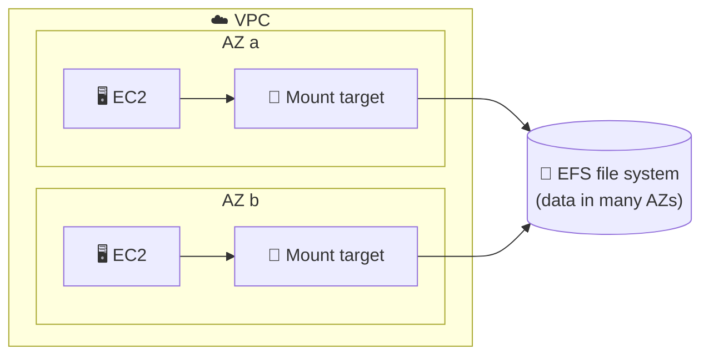
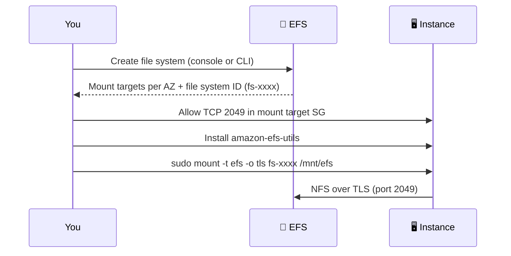
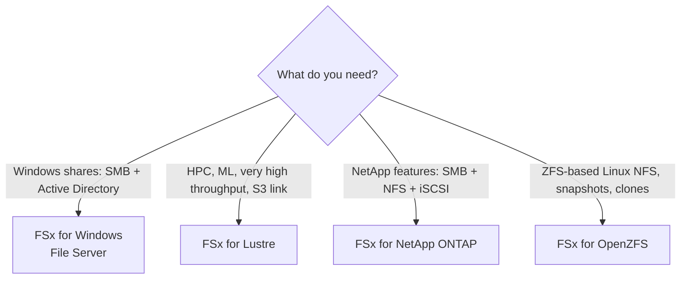
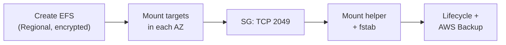

## What it is

**Amazon EFS** (Elastic File System) is a shared network file system for Linux. Many EC2 instances, containers and Lambda functions mount the same folder at once over NFS. You do not choose a size: it grows and shrinks as you add and delete files. **Amazon FSx** is a family of managed file servers for cases EFS does not cover: Windows (SMB), HPC (Lustre), NetApp ONTAP and OpenZFS.


*Every instance sees the same files, whichever AZ it runs in.*

**Use it when** several servers need the same files at the same time (shared content, home folders, CMS uploads, container volumes) or you need a managed file server.

## Key concepts

### Creating EFS and mount targets (demos 1-2)

Create a file system, pick a VPC, and EFS creates a **mount target** (a network endpoint with a private IP) in each AZ. Clients reach it through the mount target's security group.


*Security group, then mount helper, then mount.*

```bash
sudo yum install -y amazon-efs-utils            # Amazon Linux; other distros: build from GitHub
sudo mkdir /mnt/efs
sudo mount -t efs -o tls fs-0123456789abcdef0 /mnt/efs
# /etc/fstab (auto-mount on boot)
fs-0123456789abcdef0:/ /mnt/efs efs _netdev,tls 0 0
```

- One mount target per AZ. Instances in any subnet of that AZ share it.
- The mount helper (`mount -t efs`) mounts by file system ID and sets recommended NFS options. The `tls` option encrypts data in transit.
- The mount target security group must allow inbound **TCP 2049** from your instances.
- Initially only root can write. Fix folder ownership and permissions with normal Linux `chown` and `chmod`, or use access points (below).

### File system types and storage classes (demo 3)

| Choice | Options | Notes |
|---|---|---|
| File system type | **Regional** (data in multiple AZs, recommended) or **One Zone** (single AZ) | One Zone is not resilient to loss of its AZ, so it is cheaper |
| Storage class | **Standard** (SSD, hot), **Infrequent Access (IA)**, **Archive** | IA for data touched a few times per quarter, Archive for a few times a year or less |
| Lifecycle policy | Moves files to IA or Archive after a set idle time | Files are tiered automatically; paths stay the same |


*Lifecycle management trades access speed for cost. Return-to-Standard on access is a policy option.*

- Archive needs **Elastic** throughput (see below).
- One Zone has one mount target, in the file system's AZ. Clients in other AZs pay data access charges.
- Enable AWS Backup for protection. One Zone file systems are backed up automatically.

### Throughput and performance (demo 4)

| Throughput mode | Behavior | Choose when |
|---|---|---|
| **Elastic** | Scales up and down automatically; you pay per GiB transferred | Spiky or unpredictable load |
| **Provisioned** | You fix MiB/s regardless of stored size | Steady, known load |
| **Bursting** | Scales with stored data using burst credits, no extra fee | Dev/test, light use |

- Watch the CloudWatch metrics `BurstCreditBalance` and `ThroughputUtilization`. If burst credits trend to zero, switch to Elastic or Provisioned.
- Elastic requires the **General Purpose** performance mode.
- For many small files, remember that each operation is metered at a minimum size, so small I/O can cost more than expected.

### Security and access points

- **At rest:** encryption with KMS, chosen at creation.
- **In transit:** TLS via the mount helper.
- **Network:** mount target security groups.
- **Identity:** IAM authorization for NFS clients, and **access points** that force a folder root and a POSIX user per application.

### Amazon FSx


*Pick the FSx flavor by protocol and workload.*

| | Windows File Server | Lustre | NetApp ONTAP | OpenZFS |
|---|---|---|---|---|
| Protocols | SMB | POSIX (Lustre client) | SMB, NFS, iSCSI | NFS |
| Clients | Windows, Linux, macOS | Linux | Windows, Linux, macOS | Windows, Linux, macOS |
| Strength | AD integration, ACLs | Throughput, S3 import/export | Multi-protocol, tiering, SnapMirror | Low latency, snapshots, clones |
| Deployment | Single-AZ, Multi-AZ | Single-AZ (Scratch or Persistent) | Single-AZ, Multi-AZ | Single-AZ, Multi-AZ |

- You choose size, storage type (SSD or HDD where supported) and throughput. FSx is not auto-sizing like EFS.
- Lustre **Scratch** is for temporary data with no replication; **Persistent** is for longer-lived data.
- Lustre links to an S3 bucket, so training data loads from S3 and results go back.

## X vs Y

### EFS vs FSx flavors vs EBS vs S3

| | EFS | FSx (Windows / Lustre / ONTAP / OpenZFS) | EBS | S3 |
|---|---|---|---|---|
| Type | Shared file (NFS) | Shared file (SMB / Lustre / NFS / iSCSI) | Block disk | Object (HTTP API) |
| Shared by many clients | Yes | Yes | One instance (Multi-Attach: io1/io2 only, one AZ) | Yes |
| Capacity | Automatic | You provision | You provision | Automatic |
| Scope | Region (or One Zone) | Single-AZ or Multi-AZ | One AZ | Region |
| Typical use | Linux shared content, containers | Windows shares, HPC, ML, ONTAP/ZFS migrations | OS, databases | Backups, static sites, data lakes |

**Pick EFS when** Linux clients need a simple, elastic, shared POSIX file system. **Pick FSx for Windows** for SMB and Active Directory, **FSx for Lustre** for extreme throughput with S3, **ONTAP or OpenZFS** when you migrate from those systems. **Pick EBS** ([chapter 10](/chapters/10-aws-storage-services-aws-ebs/)) for one instance's disk, and **S3** ([chapter 14](/chapters/14-aws-storage-services-amazon-s3/)) for objects served by API.

## Job notes


*Typical EFS rollout.*

- **Mount hangs or times out:** security group (port 2049), no mount target in the instance's AZ, or the wrong VPC or DNS setting.
- **Permission denied:** NFS permissions. Only root has access at first. Use access points to give each app its own folder and user.
- **Cost traps:** keeping cold data in Standard, Provisioned throughput set higher than needed, many tiny files with Elastic throughput, cross-AZ access to One Zone.
- **Slow EFS:** check burst credit balance and move to Elastic or Provisioned.
- **Default choice:** Regional, encrypted, Elastic throughput, lifecycle policy on, AWS Backup on.
- **Windows needs shares?** Do not use EFS. Use FSx for Windows.
- **Prices and quotas** change. Check [EFS pricing](https://aws.amazon.com/efs/pricing/), [FSx pricing](https://aws.amazon.com/fsx/pricing/) and the current EFS and FSx quota pages.

## Cheat sheet

- EFS = managed NFS for Linux. Shared by many clients and AZs. Pay for what is stored; capacity is automatic.
- Mount target per AZ, SG allows TCP 2049, mount with `mount -t efs -o tls fs-xxxx`.
- Regional (multi-AZ) is recommended; One Zone is cheaper but not AZ-resilient.
- Classes: Standard, IA, Archive, moved by lifecycle policy. Archive needs Elastic throughput.
- Throughput: Elastic (spiky), Provisioned (steady), Bursting (small and light).
- Security: KMS at rest, TLS in transit, SGs, IAM, access points.
- FSx: Windows (SMB + AD), Lustre (HPC/ML + S3), ONTAP (multi-protocol), OpenZFS (NFS + clones).
- EBS = one instance's disk. S3 = objects over API.

## AWS docs

- [What is Amazon EFS?](https://docs.aws.amazon.com/efs/latest/ug/whatisefs.html)
- [Features of Amazon EFS (file system types, storage classes)](https://docs.aws.amazon.com/efs/latest/ug/features.html)
- [Managing mount targets and mounting file systems](https://docs.aws.amazon.com/efs/latest/ug/accessing-fs.html)
- [Encrypting data in transit for EFS](https://docs.aws.amazon.com/efs/latest/ug/encryption-in-transit.html)
- [Choosing an Amazon FSx file system](https://aws.amazon.com/fsx/when-to-choose-fsx/)
