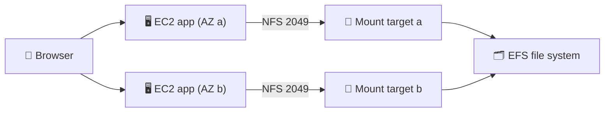
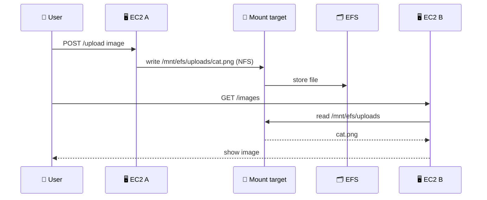

## What you build

A small web app that accepts image uploads. Two EC2 instances run it, and both store the uploaded files on one shared Amazon EFS file system.


*Many instances, one shared folder.*

## Architecture


*A write on one instance is readable on the other.*

- **EFS file system**: managed, elastic NFS storage; it grows and shrinks with your data.
- **Mount target**: a network interface in a subnet. One per Availability Zone; instances in any subnet of that AZ share it.
- **Security groups**: the mount target allows inbound TCP 2049 from the instance security group. The instance needs outbound access to it and inbound SSH (22) for you.
- **EC2 app instances**: run the web app and mount EFS at a path such as `/mnt/efs`.
- **Mount tools**: the EFS mount helper (`amazon-efs-utils`, `mount -t efs`) or plain NFS (`nfs-utils` / `nfs-common`).

## Steps

1. **Network**: use a VPC with subnets in at least two AZs. Create two security groups: `app-sg` (HTTP 80 and SSH 22 from your IP) and `efs-sg` (inbound TCP 2049 from `app-sg`).
2. **File system**: EFS console > Create file system. Pick the VPC. In Network, put one mount target in each AZ you use and attach `efs-sg` (otherwise the VPC default security group is used).
3. **Launch the app**: EC2 > Launch instance (Amazon Linux, `app-sg`, a subnet in AZ a). Use user data or SSH to install the web server and the uploader code from the course.
4. **Mount EFS manually** on the instance:

```bash
sudo yum install -y amazon-efs-utils
sudo mkdir -p /mnt/efs
sudo mount -t efs fs-0123456789abcdef0:/ /mnt/efs
# plain NFS alternative (use the mount target DNS name):
# sudo mount -t nfs4 -o nfsvers=4.1,rsize=1048576,wsize=1048576,hard,timeo=600,retrans=2,noresvport <mount-target-dns>:/ /mnt/efs
```

5. **Permissions**: at first only root can write. Make the upload folder writable by the app user, for example `sudo mkdir /mnt/efs/uploads && sudo chown <appuser> /mnt/efs/uploads`.
6. **Point the app at the mount**: set the app's upload directory to `/mnt/efs/uploads` and restart it.
7. **Second instance**: repeat steps 3 to 6 in AZ b.
8. **Verify**: open instance A's public IP, upload an image, then open instance B's public IP. The image must appear. Also check `df -h /mnt/efs` and `ls /mnt/efs/uploads` on both.

Expected result: an image uploaded through one instance is shown by the other, and it survives terminating either instance.

## Common mistakes

| Mistake | Fix |
|---|---|
| Mount hangs or times out | Allow TCP 2049 inbound on the mount target security group from the instance security group |
| Mount target uses the VPC default security group | Replace it with `efs-sg` |
| `mount: unknown filesystem type 'efs'` | Install `amazon-efs-utils`, or use `-t nfs4` |
| Permission denied when uploading | Fix ownership or mode on the EFS folder; root owns it first |
| Files vanish after reboot | The manual mount is not persistent; add an `/etc/fstab` entry (with `_netdev`) |
| App still writes to a local folder | Check the app's upload path points under `/mnt/efs` |
| No mount target in an AZ | Create one there; cross-AZ access works only through another AZ's mount target and can add data charges |

## Cleanup

Order matters. The mount target's security group references the instance's, so delete in this sequence.

1. Terminate both EC2 instances.
2. Delete all mount targets of the file system (EFS > file system > Network). Wait until they are gone.
3. Delete the file system. This deletes your files.
4. Delete `efs-sg` first, then `app-sg`.
5. Optional: delete any key pair or VPC created only for the lab.

```bash
aws ec2 terminate-instances --instance-ids i-aaa i-bbb
aws efs describe-mount-targets --file-system-id fs-0123456789abcdef0
aws efs delete-mount-target --mount-target-id fsmt-0123456789abcdef0
aws efs delete-file-system --file-system-id fs-0123456789abcdef0
```

## On the job

- Use EFS when several Linux instances, containers or Lambda functions need the same POSIX folder. For one instance's disk use EBS; for web-scale object storage use S3.
- Create a mount target in every AZ you run in, and mount through the local one.
- Give security groups minimal rules: reference the client security group, not a wide CIDR.
- Make mounts persistent with `/etc/fstab` or let your launch template or user data run the mount at boot.
- Store uploads on EFS or S3, never on one instance's local disk, or you cannot scale out.

## AWS docs

- [Using VPC security groups with EFS](https://docs.aws.amazon.com/efs/latest/ug/network-access.html)
- [Creating mount targets](https://docs.aws.amazon.com/efs/latest/ug/manage-fs-access-create-delete-mount-targets.html)
- [Tutorial: create an EFS file system and mount it on EC2 (CLI)](https://docs.aws.amazon.com/efs/latest/ug/wt1-getting-started.html)
- [Mount or unmount an EFS file system (Knowledge Center)](https://repost.aws/knowledge-center/efs-mount-automount-unmount-steps)
