## What it is

Amazon S3 (Simple Storage Service) stores **objects** (a file plus metadata) in **buckets**, accessed over HTTP APIs. It scales without limit, is highly durable, and you pay per GB stored plus requests and data transfer. It is the default place for files, backups, logs, static sites and data lakes.

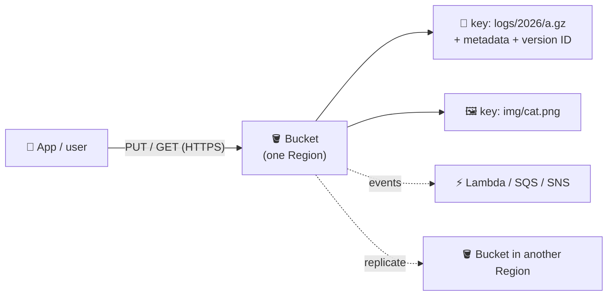
*Flat keys, not folders: `img/cat.png` is one key; the console just shows `img/` as a folder.*

**Use it when** you store files or blobs that do not need a disk (block) or a shared file system. For those see [EBS](/chapters/10-aws-storage-services-aws-ebs/) and [EFS/FSx](/chapters/12-aws-storage-services-amazon-efs-and-fsx/).

## Key concepts

### Buckets, namespace and uploading

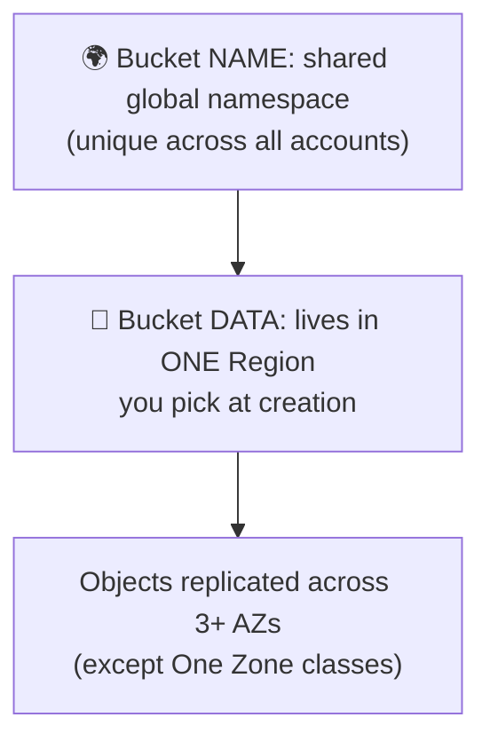
*Names are global; data is regional.*

- **Global name, regional data:** a general purpose bucket name must be unique across everyone, but objects stay in the Region you chose. An optional account regional namespace (`name-<account-id>-<region>-an`) reserves names for your account only.
- Object max size is 48.8 TiB; one `PUT` is limited to 5 GiB (see multipart below).
- Upload paths: console drag-and-drop, `aws s3 cp/sync`, SDKs, and from EC2 using the **instance role** (no access keys on the instance).

```bash
aws s3 mb s3://my-unique-bucket-123 --region eu-west-1
aws s3 cp report.pdf s3://my-unique-bucket-123/reports/
aws s3 sync ./site s3://my-unique-bucket-123/site --delete
# on EC2: attach an IAM role with s3:PutObject, then run the same commands, no keys needed
```

### Versioning

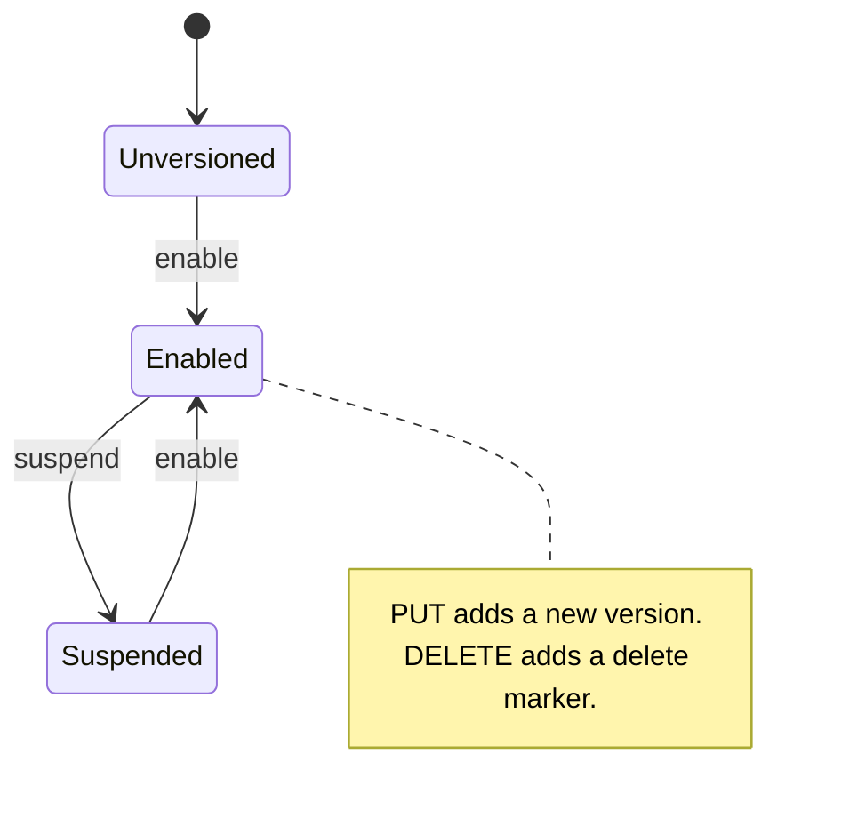
*You can never go back to Unversioned, only suspend.*

- Every overwrite keeps the old version; a plain delete only adds a **delete marker** (undo by removing it).
- Deleting a specific version ID is permanent. Optional **MFA Delete** protects that.
- Every version is billed, so pair versioning with a lifecycle rule. Replication requires versioning.

### Storage classes, Glacier and retrieval cost

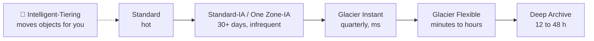
*Colder means cheaper storage but a retrieval fee, a minimum storage duration and slower access.*

- The full table is in **X vs Y** below. Pick the class at upload (`--storage-class`) or let lifecycle move objects.
- **Glacier types:** Instant Retrieval (milliseconds), Flexible Retrieval (expedited, standard, bulk), Deep Archive (cheapest, longest wait).
- **PCU (Provisioned Capacity Unit):** a monthly purchase that guarantees capacity for Glacier **Expedited** retrievals. One unit gives at least three expedited retrievals per 5 minutes and up to 150 MB/s. Without it, expedited is usually accepted but not guaranteed.
- **Retrieval cost vs data transfer cost** are two different bills:

| Charge | What triggers it | Applies to |
|---|---|---|
| Retrieval fee | Reading from IA or Glacier classes (per GB) | Cold classes only, not Standard |
| Data transfer out | Bytes leaving AWS to the internet or another Region | Every class |
| Data transfer in | Uploading | Free (except Transfer Acceleration) |
| Same-Region to EC2 or via a gateway endpoint | Reading | Free transfer |

- Cheap cold storage turns expensive if you read it often. Moving to a colder class early also triggers the minimum-duration charge.

### Lifecycle rules

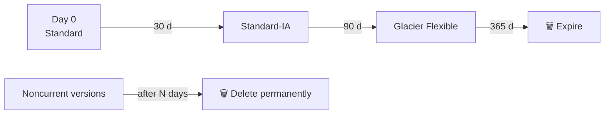
*A rule applies to a bucket, prefix or tag, and runs automatically once a day.*

- Two kinds of action: **transition** (change class) and **expiration** (delete).
- **Noncurrent version rule:** act on old versions only, e.g. delete noncurrent versions after 30 days.
- **Keep a minimum number of versions:** the noncurrent rule can retain the newest N noncurrent versions, so you always have a few to roll back to.
- Also clean up expired delete markers and **incomplete multipart uploads**.
- Objects have a minimum size (128 KB) and time before some transitions make sense. Check [transition constraints](https://docs.aws.amazon.com/AmazonS3/latest/userguide/lifecycle-transition-general-considerations.html).

### Transfer Acceleration and multipart upload

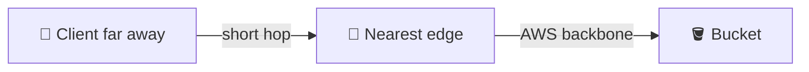
*Transfer Acceleration (S3TA) uses the closest edge location and the AWS network instead of the public internet.*

- Enable per bucket, then use `bucket.s3-accelerate.amazonaws.com`. The bucket name cannot contain dots. You pay extra for accelerated transfer; test with the speed comparison tool first.
- **Multipart upload:** split a big file into 5 MiB to 5 GiB parts (up to 10,000), upload in parallel, retry only failed parts, then S3 assembles them. Use it from about 100 MB; CLI and SDKs do it automatically.
- Abort stale uploads with a lifecycle rule, because unfinished parts are billed.

### Access control and presigned URLs

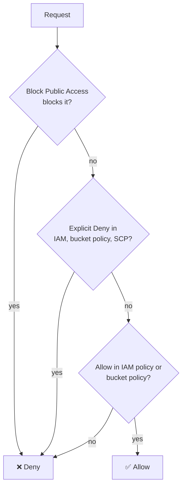
*Same account: an Allow from either IAM or the bucket policy is enough. Cross-account needs both sides to allow.*

- **Block Public Access** is on by default for new buckets and overrides policies and ACLs. Leave it on unless you really host public content.
- **Bucket policy:** a JSON resource policy on the bucket. Use it for cross-account access, forcing HTTPS, or limiting to a VPC endpoint.
- **ACLs** are legacy. New buckets default to ACLs disabled (Object Ownership: bucket owner enforced). Keep them off.
- **Encryption:** every new object is encrypted with SSE-S3 by default. Choose SSE-KMS for key control and audit.

```json
{
  "Version": "2012-10-17",
  "Statement": [{
    "Sid": "ReadFromPartnerAccount",
    "Effect": "Allow",
    "Principal": {"AWS": "arn:aws:iam::111122223333:root"},
    "Action": "s3:GetObject",
    "Resource": "arn:aws:s3:::my-bucket/shared/*"
  }]
}
```

- **Presigned URL:** a time-limited link signed with your credentials. The holder acts with your permissions until expiry, and the link stops working if the signer loses access.

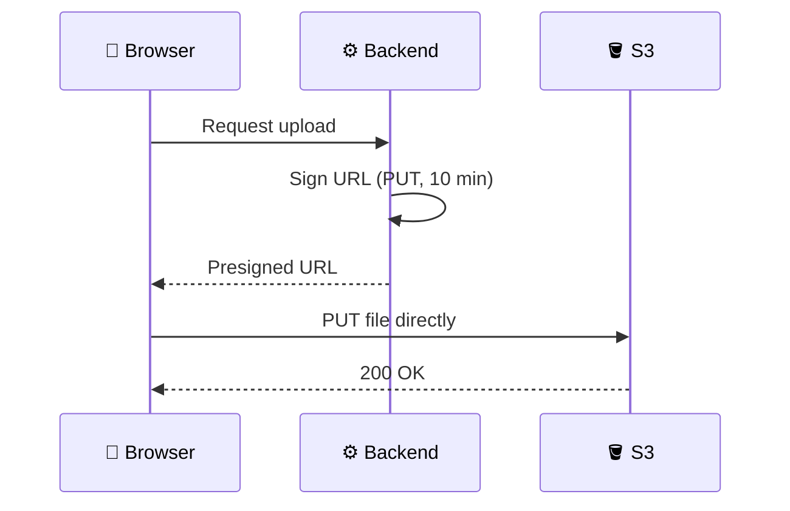
*The file never goes through your server.*

```bash
aws s3 presign s3://my-bucket/reports/a.pdf --expires-in 600
```

### Static website hosting

- Enable **Static website hosting** on the bucket, set an index (and error) document, and allow public reads with a bucket policy (after turning off Block Public Access for that bucket).
- The website endpoint serves **HTTP only**. For HTTPS and a custom domain, put CloudFront in front and keep the bucket private with origin access control.

### Replication (SRR, CRR, Batch)

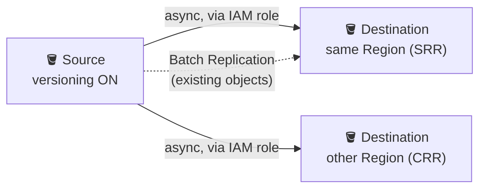
*Replication copies new objects automatically; Batch copies the old ones.*

| | SRR | CRR |
|---|---|---|
| Destination Region | Same | Different |
| Typical use | Log aggregation, prod/test copies, data sovereignty, other account | Disaster recovery, lower latency for far users, compliance |
| Extra cost | Destination storage, requests | Plus inter-Region transfer |

- **Requirements:** versioning on both buckets, and an **IAM role** that S3 assumes. The role needs read on the source, replicate/write on the destination, and KMS permissions if objects are encrypted with KMS. The console can create it for you.
- Replication is asynchronous and only covers objects written after the rule exists. Delete-marker replication is a setting; permanent version deletes are not replicated.
- **Replication pricing:** you pay for the destination storage, replication requests, inter-Region transfer for CRR, and optional extras such as Replication Time Control. Check [S3 pricing](https://aws.amazon.com/s3/pricing/).
- **S3 Batch Operations / Batch Replication:** run one job over a manifest (an S3 Inventory report or list) to replicate existing objects, copy, tag, restore or invoke Lambda at scale.
- Demo flow (SRR): create two versioned buckets, create the rule on the source, upload a file, see it appear. **Clean up:** delete all versions and delete markers in both buckets, delete the replication rule, then delete the buckets and the role.

### Access Points and Multi-Region Access Points

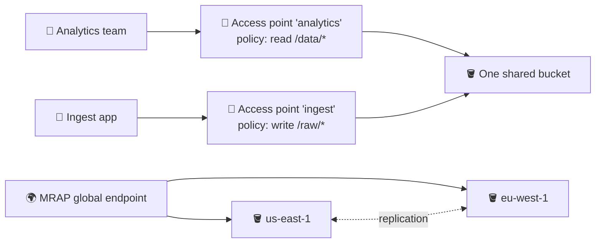
*An access point is a named door with its own policy. A MRAP is one global door in front of buckets in several Regions.*

- **Access point:** its own DNS name and policy per team or app, so you avoid one giant bucket policy. It can be limited to a VPC.
- **MRAP:** routes each request to the closest Region over the AWS network. It supports active-active or active-passive with failover (about 2 minutes to shift traffic). You set up replication between the buckets yourself (use two-way rules for failover).
- **MRAP pricing:** a data routing charge per GB plus normal S3 costs, so check the [pricing page](https://aws.amazon.com/s3/pricing/).

| | Access Point | Multi-Region Access Point |
|---|---|---|
| Scope | One bucket, one Region | Buckets in many Regions |
| Solves | Per-app permissions and network rules | Latency and Regional failover |
| Extra setup | Policy per access point | Replication, failover config |

### S3 Vectors

- **S3 Vectors** adds a **vector bucket** that holds **vector indexes** for similarity search, used for RAG and semantic search with embeddings. It is a cheap store for large, less latency-sensitive vector sets.
- On creating an index you set the dimension (1 to 4,096), the distance metric (cosine or Euclidean) and any non-filterable metadata keys. **These cannot be changed later**; you must create a new index and re-load.
- Limits (index count, vectors per index, request sizes) are in the [limitations page](https://docs.aws.amazon.com/AmazonS3/latest/userguide/s3-vectors-limitations.html); check them before design.

### Event notifications

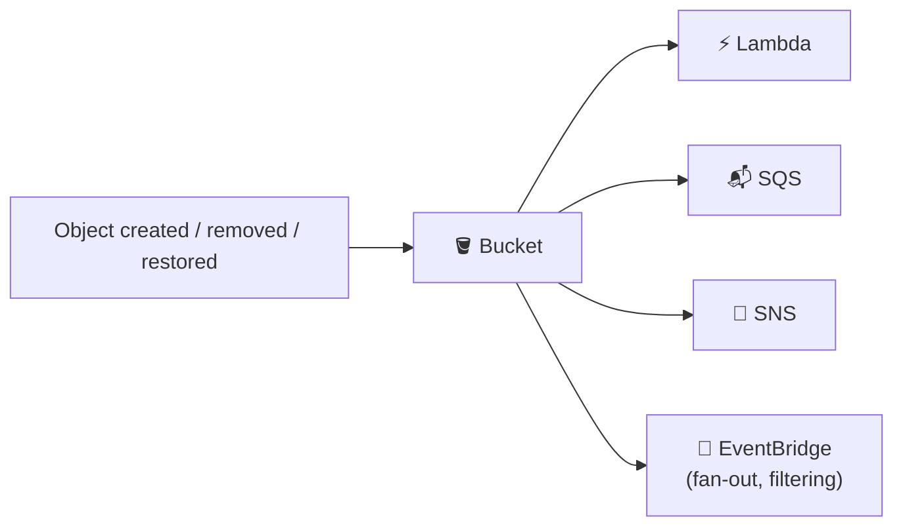
*Typical: upload an image, trigger Lambda to make a thumbnail.*

- Filter by key prefix or suffix. The destination must allow S3 to call it (resource policy).
- Writing results back into the **same bucket and prefix** that triggers the event causes loops.
- There is no extra S3 charge; you pay for the destination service.

### Pricing in one picture

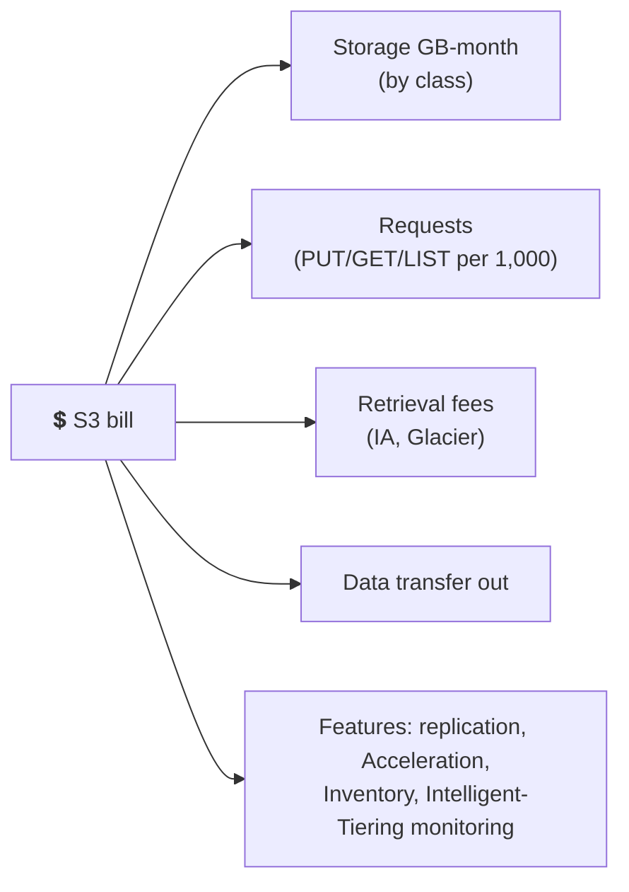
*Example: 500 GB Standard + 1 million GETs + 50 GB out = three lines (storage, requests, transfer).*

- Worked example method: GB x storage price, plus requests / 1,000 x request price, plus transfer GB x transfer price (the first free allowance applies). Use the [AWS Pricing Calculator](https://calculator.aws/) with current Region prices.
- Biggest savings: right class, lifecycle rules, deleting old versions and incomplete uploads, fewer small objects in IA classes.

### Moving data in: DataSync, Storage Gateway, Snow

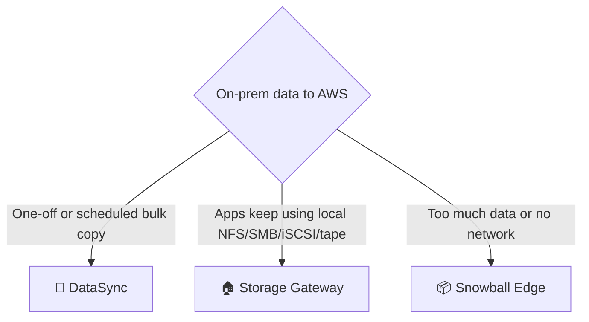
*Pick by how the data is used, not by how big it is.*

- **DataSync:** an agent copies data between NFS/SMB/object storage and S3, EFS, FSx on a schedule, with verification and bandwidth control. It is a transfer tool; nothing stays mounted.
- **Storage Gateway:** a VM or appliance on premises that gives local protocols backed by AWS. Types: **S3 File Gateway** (NFS/SMB to S3 objects), **Volume Gateway** (iSCSI), **Tape Gateway** (virtual tapes).
- **How it works:** your app writes to the gateway, the gateway caches locally and uploads to S3 asynchronously.

| Volume Gateway mode | Primary copy | Local disk holds | Use when |
|---|---|---|---|
| Cached | S3 | Hot data only | Dataset is bigger than local disk |
| Stored | On premises | Entire dataset | You need low latency for all data; AWS is the backup |

Both modes keep point-in-time snapshots as EBS snapshots.

| | DataSync | Storage Gateway |
|---|---|---|
| Purpose | Move / sync data | Hybrid access, ongoing |
| Local protocol | Reads source, no mount | NFS, SMB, iSCSI, VTL |
| Pattern | Scheduled or one-time jobs | Always-on bridge |

- **Snowball Edge:** ruggedised devices you ship, for offline data transfer or edge compute. The family has storage-optimised and compute-optimised models. Check current availability and sizes in the [Snow docs](https://docs.aws.amazon.com/snowball/); see also [AWS data transfer](/chapters/34-aws-data-transfer/).

## X vs Y

### S3 storage classes

| Class | Access | Min. duration | Min. size | AZs | Retrieval | Use for |
|---|---|---|---|---|---|---|
| Standard | Frequent | None | None | 3+ | Instant, no fee | Hot data, websites |
| Intelligent-Tiering | Unknown or changing | None | Small objects not auto-tiered | 3+ | Instant tiers, optional archive tiers | Unpredictable patterns |
| Standard-IA | Infrequent | 30 days | 128 KB | 3+ | Instant, per-GB fee | Backups, DR copies |
| One Zone-IA | Infrequent, re-creatable | 30 days | 128 KB | 1 | Instant, per-GB fee | Secondary copies |
| Glacier Instant Retrieval | About quarterly | 90 days | 128 KB | 3+ | Milliseconds | Medical images, archives read rarely |
| Glacier Flexible Retrieval | Yearly | 90 days | None | 3+ | Minutes to hours (expedited, standard, bulk) | Backups |
| Glacier Deep Archive | Almost never | 180 days | None | 3+ | Hours (up to about 48 h for bulk) | Compliance, 7-10 year retention |

Express One Zone (directory buckets, single-digit-millisecond access in one AZ) exists for latency-critical workloads. Durability is designed for 11 nines in all classes; availability and prices differ, so check the [storage classes page](https://aws.amazon.com/s3/storage-classes/).

**Pick Standard** for active data. **Pick Intelligent-Tiering** when you cannot predict access. **Pick IA** for data read monthly or less. **Pick One Zone-IA** only if losing an AZ is acceptable. **Pick Glacier Instant** for rarely read data that must be instant, **Flexible** if hours are fine, **Deep Archive** for the cheapest long-term retention.

## Job notes

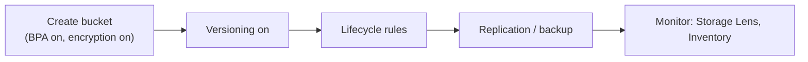
*A sensible baseline for any new bucket.*

- **Default setup:** Block Public Access on, ACLs disabled, SSE-S3 or SSE-KMS, versioning on for important data, lifecycle for old versions.
- **Access denied?** Check, in order: explicit Deny (bucket policy, SCP), Block Public Access, the IAM policy, the KMS key policy, and whether the object is owned by another account.
- **Public leaks** are the classic breach. Keep Block Public Access on at account level.
- **Cost traps:** many versions, incomplete multipart uploads, tiny objects in IA/Glacier, reading cold data, cross-Region transfer, NAT gateway traffic to S3 (use a gateway VPC endpoint).
- **Cannot delete a bucket?** It must be empty, including all versions and delete markers.
- Strong read-after-write consistency applies to all S3 operations, so no waiting after upload.
- Prefer roles and presigned URLs to long-lived access keys.

## Cheat sheet

- S3 = object storage, flat keys, bucket name global, data in one Region, unlimited size, 48.8 TiB per object.
- Classes: Standard, Intelligent-Tiering, Standard-IA, One Zone-IA, Glacier Instant, Glacier Flexible, Deep Archive. Colder: cheaper storage, retrieval fee, minimum duration (30/90/180 days).
- PCU = paid guarantee for Glacier Expedited retrieval capacity.
- Versioning: delete adds delete marker; can only be suspended; replication needs it.
- Lifecycle: transition + expiration; noncurrent version rules; keep a minimum number of newer versions; abort incomplete uploads.
- Multipart from about 100 MB (5 MiB to 5 GiB parts, up to 10,000). S3TA = edge upload, no dots in name.
- Access: Block Public Access, bucket policy (JSON, cross-account), IAM, ACLs off, presigned URL for temporary access, access points per app, MRAP for global/failover.
- Static site = HTTP only; add CloudFront for HTTPS.
- Replication: SRR/CRR, versioning on both, IAM role, async, new objects only, Batch Replication for existing.
- Events: Lambda, SQS, SNS, EventBridge. S3 Vectors: index settings fixed after creation.
- Hybrid: DataSync (copy), Storage Gateway (File/Volume/Tape; cached vs stored), Snowball Edge (offline).

## AWS docs

- [What is Amazon S3?](https://docs.aws.amazon.com/AmazonS3/latest/userguide/Welcome.html)
- [Understanding and managing storage classes](https://docs.aws.amazon.com/AmazonS3/latest/userguide/storage-class-intro.html)
- [Managing your storage lifecycle](https://docs.aws.amazon.com/AmazonS3/latest/userguide/object-lifecycle-mgmt.html)
- [Replicating objects within and across Regions](https://docs.aws.amazon.com/AmazonS3/latest/userguide/replication.html)
- [Sharing objects with presigned URLs](https://docs.aws.amazon.com/AmazonS3/latest/userguide/using-presigned-url.html)
