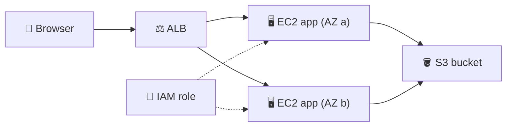
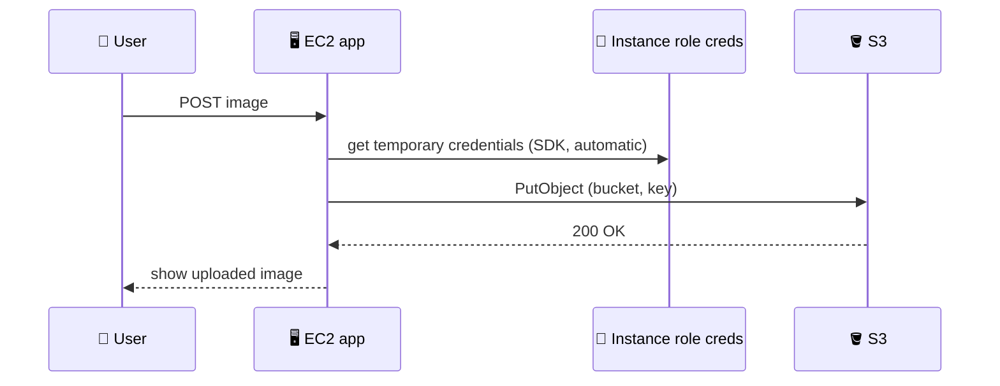
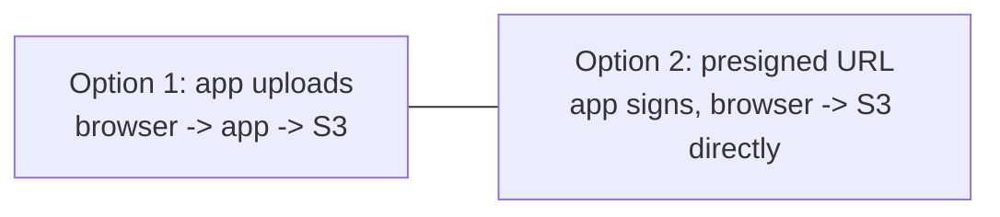

## What you build

A small web app on EC2 that lets users upload images into an S3 bucket, then you scale it with a launch template and an Application Load Balancer.


*Stateless app servers; all images live in S3.*

## Architecture


*The SDK picks up role credentials by itself; no keys in code.*

- **S3 bucket**: durable object store. New buckets have Block Public Access on by default; keep it on.
- **IAM role + instance profile**: trusted entity EC2, policy allowing only the needed actions on `arn:aws:s3:::BUCKET/*`. The console creates the instance profile for you when you create an EC2 role.
- **EC2 instance**: runs the app; the role is attached to the instance.
- **Launch template**: saved instance settings (AMI, type, role, security group, user data) to start identical copies.
- **ALB**: spreads HTTP traffic across instances and checks their health.


*Two upload patterns; the lab uses option 1, option 2 is the common upgrade.*

## Steps

1. **Intro**: pick one Region and stay in it for every resource.
2. **Bucket**: S3 > Create bucket, globally unique name, keep Block Public Access on.
3. **Launch application**: EC2 > Launch instance, Amazon Linux, a small type, a security group that allows HTTP (80) from the internet, and user data that installs and starts the app.
4. **Configure role to S3**: IAM > Roles > Create role > AWS service > EC2, attach a custom policy, then attach the role to the instance (Actions > Security > Modify IAM role).

```json
{
  "Version": "2012-10-17",
  "Statement": [{
    "Effect": "Allow",
    "Action": ["s3:PutObject", "s3:GetObject"],
    "Resource": "arn:aws:s3:::my-upload-bucket/*"
  }]
}
```

5. **Verify application**: open the instance public IP, upload an image, then check it appears in the bucket (S3 console or `aws s3 ls s3://my-upload-bucket/`).
6. **Launch template**: EC2 > Launch templates > Create from the working settings (AMI, type, role, security group, user data).
7. **Load balancer**: EC2 > Load Balancers > Create Application Load Balancer, internet-facing, two subnets in different AZs, listener HTTP:80 forwarding to a new target group (type instance, health check path `/`). Launch instances from the template into that group (directly or with an Auto Scaling group).
8. **Verify ALB**: wait until targets are Healthy, open the ALB DNS name, upload again, and confirm images show up regardless of which instance answers.
9. **Code base**: read the app. The pattern is: receive file, build an object key, call S3 `PutObject` through the SDK with default credentials, then return or list objects.

Expected result: uploads through the ALB DNS name land in the bucket and display on every instance.

## Common mistakes

| Mistake | Fix |
|---|---|
| AccessDenied on upload | Role not attached, or policy resource lacks `/*` for object actions |
| Role missing from launch dropdown | Role made by CLI has no instance profile; create one |
| ALB targets Unhealthy | Check health check path, app port, and that the instance security group allows the ALB |
| ALB unreachable | Listener and ALB security group must allow port 80 inbound |
| Keys pasted into the app | Remove them; rely on the instance role |
| Images lost after replacing an instance | Store them in S3, never on local disk |

## Cleanup

Do it in this order.

1. Auto Scaling group (if used): delete it, which terminates its instances. Otherwise terminate the EC2 instances.
2. ALB: delete the load balancer, then the target group.
3. Launch template: delete it.
4. S3: empty the bucket, then delete it.
5. IAM: detach and delete the policy, delete the role (and its instance profile if you made it separately).
6. Security groups: delete the lab ones; release any Elastic IP.

```bash
aws s3 rm s3://my-upload-bucket --recursive
aws s3 rb s3://my-upload-bucket
```

## On the job

- Instance roles beat access keys everywhere on EC2; scope them to one bucket and the needed actions.
- For large or many uploads, have the app return a presigned URL so browsers send files straight to S3. A presigned URL is time-limited and carries the signer's permissions.
- Keep servers stateless so an Auto Scaling group can replace them freely.
- Keep buckets private; serve images through the app, presigned GET URLs, or CloudFront.
- Tag lab resources so cleanup is one search.

## AWS docs

- [Creating a general purpose bucket](https://docs.aws.amazon.com/AmazonS3/latest/userguide/create-bucket-overview.html)
- [Blocking public access to your S3 storage](https://docs.aws.amazon.com/AmazonS3/latest/userguide/access-control-block-public-access.html)
- [IAM roles for Amazon EC2](https://docs.aws.amazon.com/AWSEC2/latest/UserGuide/iam-roles-for-amazon-ec2.html)
- [Create a presigned URL for S3 using an AWS SDK](https://docs.aws.amazon.com/code-library/latest/ug/s3_example_s3_Scenario_PresignedUrl_section.html)
- [What is an Application Load Balancer?](https://docs.aws.amazon.com/elasticloadbalancing/latest/application/introduction.html)
