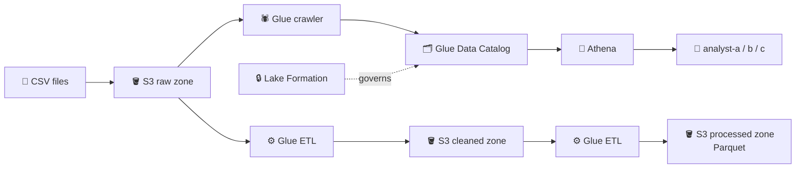
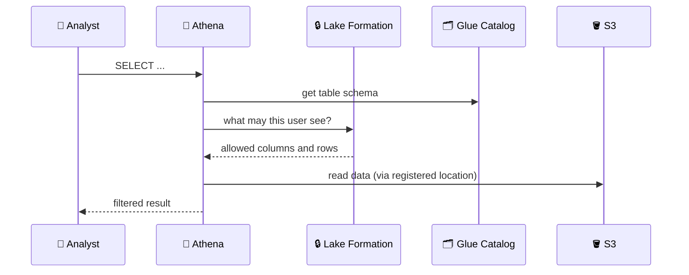

## What you build

A small data lake: raw files land in S3, Glue discovers their schema, Athena queries them, Glue ETL cleans them into Parquet, and Lake Formation controls what each analyst sees.


*Three S3 zones, one catalog, one query engine, one permission layer.*

Big data is usually described by the 5 Vs: Volume, Velocity, Variety, Veracity (is the data trustworthy?) and Value. Veracity is why the lake has zones: raw data is kept as it arrived, and only copies are cleaned. The lab's "golden rule" lecture is not in the docs I checked; read it as: never edit the raw zone, fix data in later zones.

## Architecture


*Lake Formation sits between Athena and S3 and hands out only the allowed columns and rows.*

| Component | Role |
|---|---|
| S3 zones | Raw (as received), cleaned (fixed quality), processed (Parquet, query-ready) |
| Glue crawler | Scans a path, infers schema, writes a table in the Data Catalog |
| Data Catalog | Metadata only: databases, tables, columns |
| Athena | Serverless SQL on S3, pay per data scanned |
| Lake Formation | Central grants: table, column, row and cell level on catalog tables |

## Steps

Stages follow the lecture order.

**Stage 1: Concepts and setup**

1. Read the lab repo (the GitHub lecture) and download the sample data (employee-style CSV with salary and gender columns).
2. Create one bucket with three prefixes: `raw/`, `cleaned/`, `processed/`. Upload the sample CSV to `raw/`.

```bash
aws s3 mb s3://my-datalake-123456
aws s3 cp employees.csv s3://my-datalake-123456/raw/employees/
```

**Stage 2: Catalog and query**

3. Glue console > Crawlers > Create. Source: the raw path. Give it an IAM role and a target database. Run it; a table appears under Tables.
4. Athena: set a query result location in S3 first. Run `SELECT * FROM <table> LIMIT 10;`. Unsaved queries are tabs that vanish; use Save as to keep one.
5. Add another file to `raw/`, rerun the crawler, and verify the table still reads all rows. Delete a file and see rows disappear: the table is only a view over the S3 path.
6. Rename the table in Glue (Tables > Edit) if the crawler named it after a folder you do not like. A crawler rerun may recreate it, so rename after the final run.
7. Service naming ("Amazon" vs "AWS" prefix) is only branding; I could not verify the lecture's explanation.

**Stage 3: Improve quality and format**

8. Glue Studio > create an ETL job: read the raw table, fix bad values (nulls, duplicates, wrong types), write to `cleaned/`. Crawl it and query it in Athena.
9. Second ETL job: read cleaned, write to `processed/` as Parquet. Crawl and query.
10. Compare "data scanned" in Athena for the CSV table and the Parquet table.

**Stage 4: Govern with Lake Formation**

11. Create three IAM users (or roles): `analyst-a`, `analyst-b`, `analyst-c`, each allowed to use Athena and its result bucket. Do not give them S3 access to the lake.
12. Lake Formation > Administration > Data lake locations > Register location for your bucket path with an IAM role that can read it.
13. Grant `analyst-a` SELECT and DESCRIBE on the whole table (full read).
14. Grant `analyst-b` SELECT on selected columns only; leave out salary or gender as the lab requires (column-level).
15. Create a data filter for `analyst-c` with a row filter expression, for example `department='Sales'`, and grant SELECT on that filter (row-level).
16. Log in as each analyst, run the same query in Athena, and compare results.

```text
Row filter expression example:  country='VN'
```

Expected result: analyst-a sees everything, analyst-b sees fewer columns, analyst-c sees fewer rows. If analysts still see all data, the catalog table may still grant `IAMAllowedPrincipals`; remove it so Lake Formation grants apply.

## Common mistakes

| Mistake | Fix |
|---|---|
| Athena says no output location | Set a result bucket in Athena settings |
| Crawler makes one table per file | Keep each table in its own folder under `raw/` |
| Analysts see everything | Revoke `IAMAllowedPrincipals` on the database and tables |
| Analyst gets access denied | Grant DESCRIBE on the database plus SELECT on the table; register the S3 location |
| Giving analysts S3 permission | Bypasses Lake Formation; use catalog grants only |
| Querying CSV every time | Convert to Parquet in the processed zone |

## Cleanup

Order matters. Lake Formation and Glue are not deleted with S3.

1. Lake Formation: revoke analyst grants, delete the data filter, then deregister the data lake location.
2. Glue: delete ETL jobs, then crawlers, then tables, then databases.
3. Athena: delete saved queries (free) and empty the query results bucket or prefix.
4. S3: empty the lake bucket (all three zones) and delete it; delete the Glue script and temp buckets too.
5. IAM: delete analyst users and the roles created for Glue and Lake Formation.
6. Confirm in Cost Explorer next day that no Glue, Athena or S3 charges remain.

```bash
aws glue delete-crawler --name lake-crawler
aws glue delete-database --name lake_db
aws s3 rb s3://my-datalake-123456 --force
```

## On the job

- Pricing in one table. Check the current pages for rates.

| Service | You pay for |
|---|---|
| Glue | Crawlers and ETL jobs per DPU-hour, billed per second (crawlers have a 10-minute minimum per run); Data Catalog has a free tier, then monthly fee |
| Athena | Data scanned per query ($5/TB in the AWS docs I read, 10 MB minimum); DDL and failed queries are free |
| Lake Formation | Nothing extra; you pay for S3, Glue, Athena and others |

- Cut Athena cost with Parquet, compression and partitioning.
- Keep raw immutable; rebuild cleaned and processed from it.
- Grant to roles or groups, not single users, and use Lake Formation as the only data door.
- Use LF-tags for large catalogs instead of per-table grants.

## AWS docs

- [Data filtering and cell-level security in Lake Formation](https://docs.aws.amazon.com/lake-formation/latest/dg/data-filtering.html)
- [Securing data lakes with row-level access control](https://docs.aws.amazon.com/lake-formation/latest/dg/cbac-tutorial.html)
- [Use columnar storage formats in Athena](https://docs.aws.amazon.com/athena/latest/ug/columnar-storage.html)
- [AWS Glue pricing](https://aws.amazon.com/glue/pricing/)
- [Amazon Athena pricing](https://aws.amazon.com/athena/pricing/)
