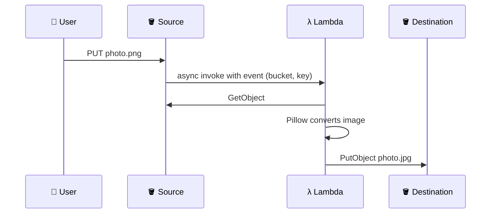

## What you build

You upload an image to a source bucket. S3 calls a Lambda function, which converts the image (for example PNG to JPG or a resize) with the Pillow library and saves the result in a second bucket.


*Event-driven: no servers, you pay only when an image arrives.*

## Architecture


*The event carries only the bucket and key; the function fetches the file itself.*

- **Source and destination buckets**: two separate buckets in the same Region as the function.
- **Lambda function**: Python handler that reads the event, downloads the object, converts it, uploads the result.
- **Pillow layer**: a zip with the library, attached so the function code stays small.
- **Execution role**: permission to read the source, write the destination, and write logs.
- **S3 event notification**: the trigger that points at the function.

Avoid recursive triggers:

| Setup | Result |
|---|---|
| Output to a different bucket | Safe, the recommended pattern |
| Output to the same bucket, no filter | Infinite loop |
| Same bucket with prefix `in/` trigger and output to `out/` | Works, but easy to misconfigure |

## Steps

1. **Get the code**: clone the course GitHub repo for this lab (handler code and layer build script). Read the handler first.
2. **Create two buckets**: S3 > Create bucket, for example `img-src-<id>` and `img-dst-<id>`. Keep Block Public Access on.
3. **Build the Pillow layer**: install Pillow into a `python/` folder, zip it, and publish. Build on Linux that matches the function (same Python version and architecture, x86_64 or arm64), otherwise the native code will not load.

```bash
mkdir -p layer/python
pip install pillow -t layer/python
cd layer && zip -r ../pillow-layer.zip python
aws lambda publish-layer-version --layer-name pillow \
  --zip-file fileb://../pillow-layer.zip --compatible-runtimes python3.12
```

4. **Create the function**: Lambda > Create function > Author from scratch, Python runtime matching the layer. Paste the handler.
5. **Attach the layer**: function > Layers > Add a layer > Custom layers > `pillow`.
6. **Permissions**: add to the execution role `s3:GetObject` on the source and `s3:PutObject` on the destination, scoped to the bucket ARNs.
7. **Set timeout and memory**: raise the default 3 s timeout and memory for larger images.
8. **Add trigger**: function > Add trigger > S3 > source bucket > event type All object create events. Optionally set a suffix such as `.png`.
9. **Test**: upload an image to the source bucket. Check the destination bucket and CloudWatch Logs.

Expected result: a converted copy appears in the destination bucket within seconds of the upload.

```python
def handler(event, context):
    rec = event["Records"][0]["s3"]
    bucket = rec["bucket"]["name"]
    key = rec["object"]["key"]   # URL-encoded in the event
```

## Common mistakes

| Mistake | Fix |
|---|---|
| Same bucket for input and output | Use a separate destination bucket |
| `No module named PIL` or import error on `_imaging` | Rebuild the layer for the right runtime and architecture; check the layer is attached |
| Trigger never fires | Check filters, and that function and bucket share a Region |
| `AccessDenied` in logs | Fix the execution role: read on source, write on destination |
| Key with spaces or symbols not found | URL-decode the key from the event (`urllib.parse.unquote_plus`) |
| Timeout on big images | Raise timeout and memory |

## Cleanup

1. S3 source bucket: remove the event notification (Properties > Event notifications).
2. Lambda: delete the function, then delete the layer versions.
3. Empty both buckets (including all versions if versioning was on), then delete them.
4. IAM: delete the execution role and its policy.
5. CloudWatch: delete the function log group `/aws/lambda/<name>`.

```bash
aws s3 rb s3://img-src-<id> --force
aws s3 rb s3://img-dst-<id> --force
aws lambda delete-function --function-name converter
aws lambda delete-layer-version --layer-name pillow --version-number 1
```

## On the job

- S3 to Lambda is the standard file-processing pattern: thumbnails, virus scans, metadata extraction.
- Put third-party libraries in layers to keep deployments small and share them across functions.
- Scope IAM to exact buckets; never use wildcard S3 access.
- For retries and bursts, consider sending events through SQS in front of Lambda.
- Always filter and separate buckets so a bug cannot create a cost loop.

## AWS docs

- [Tutorial: Using an Amazon S3 trigger to create thumbnail images](https://docs.aws.amazon.com/lambda/latest/dg/with-s3-tutorial.html)
- [Working with layers for Python Lambda functions](https://docs.aws.amazon.com/lambda/latest/dg/python-layers.html)
- [Configuring event notifications using object key name filtering](https://docs.aws.amazon.com/AmazonS3/latest/userguide/notification-how-to-filtering.html)
