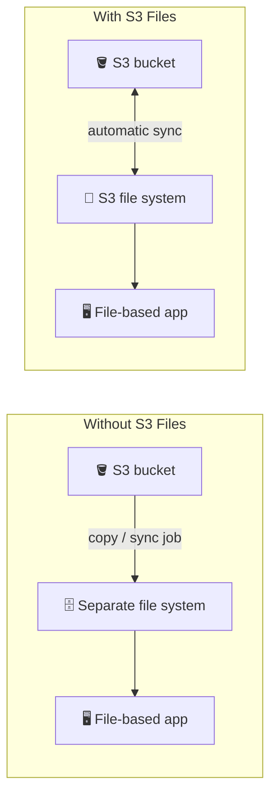
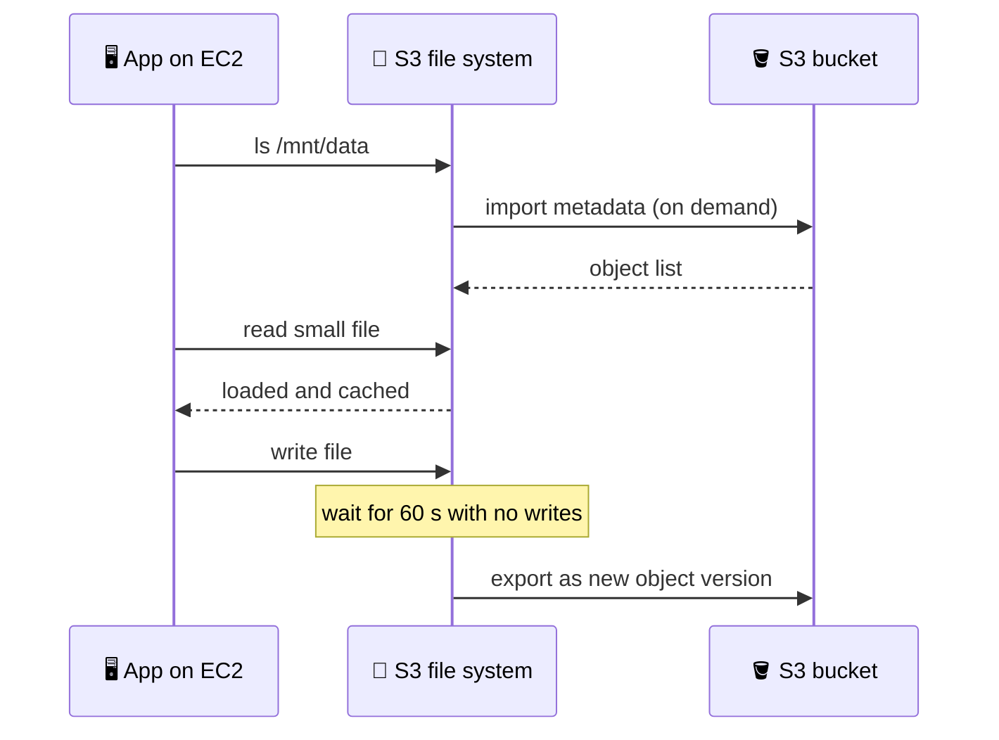
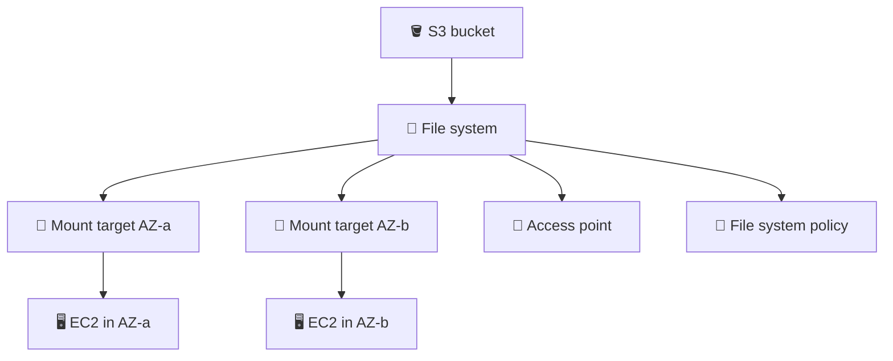
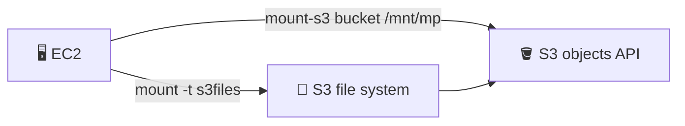
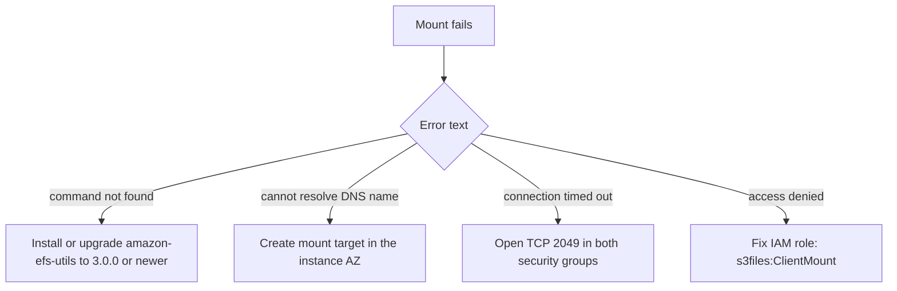

> **This feature is new (announced April 2026).** This chapter only states what the AWS docs confirm. Always check the current docs for Regions, limits and prices before you build.

## What it is

Amazon S3 Files gives you a shared file system whose files and folders mirror an S3 bucket. It is built on Amazon EFS: it keeps your active data on fast storage, and S3 stays the authoritative copy. Apps that only know files (shell scripts, Python libraries, ML tools) can work on S3 data without code changes.

Without it, you copy data between S3 and a file system by hand and keep both in sync.


*Before: two copies and a sync job. After: one bucket, a file view of it.*

Use it when file-based tools or several compute resources need to share S3 data as files, with full file system behaviour such as locking.

## Key concepts

### How it works


*Metadata and data come in lazily on access. Changes go back to S3 after a quiet period.*

- The file system starts empty and imports object metadata when you list or open things.
- Per the FAQ, small files (under 128 KiB) are pre-loaded when a directory is first accessed. Data for larger files is read directly from S3.
- Writes go to fast storage first, then are exported to S3: new file = new object, edit = new object version, delete = delete marker.
- POSIX owner, group and mode are stored as user-defined object metadata.
- Data not accessed for a configurable window (1 to 365 days, default 30) expires from the file system. S3 keeps it, so you pay only for the working set.
- Import and expiry rules are tunable with `PutSynchronizationConfiguration` or the S3 console.

### Building blocks


*One file system, one mount target per AZ, optional access points and policy.*

| Piece | What it does |
|---|---|
| File system | The shared file view linked to your bucket |
| Mount target | Network entry in one AZ of your VPC. Max one per AZ. Create one in each AZ you use |
| Access point | App-specific entry that can force a user identity and a root directory. Console creates one for you |
| File system policy | Optional IAM resource policy for NFS client access |

### Create and mount (the demo steps)

1. S3 console: create a file system on your bucket. The console creates a mount target in every AZ of your default VPC (CLI: create them yourself).
2. Launch an EC2 instance in an AZ that has a mount target. Attach an instance profile with S3 Files client permissions (the managed policies `AmazonS3FilesClientFullAccess` or `AmazonS3FilesClientReadOnlyAccess`, or at minimum `s3files:ClientMount`).
3. Security groups: allow TCP 2049 from the instance to the mount target and back.
4. Install the client `amazon-efs-utils` (supported: Amazon Linux 2/2023, RHEL 8/9, Ubuntu 20.04/22.04/24.04, SLES 15, openSUSE Leap; no Windows or macOS).
5. Mount and verify:

```bash
sudo dnf install -y amazon-efs-utils
sudo mkdir -p /mnt/s3files
sudo mount -t s3files fs-0abc123def456 /mnt/s3files
df -h /mnt/s3files
ls /mnt/s3files            # your bucket objects appear as files
```

6. Verify the round trip: create a file in the mount, wait a couple of minutes, then see the new object in the bucket (and the reverse: upload an object, then list the directory).
7. Auto-mount after reboot with an `/etc/fstab` line: `fs-0abc123def456 /mnt/s3files s3files _netdev 0 0`.

### The Mountpoint part of the course

The lectures also install `mount-s3` and use Mountpoint for Amazon S3 with the flags `--allow-overwrite` and `--allow-delete`. Mountpoint is a separate open-source client that talks to the bucket directly, not through an S3 file system.


*Two different paths to the same bucket.*

- By default Mountpoint can list, read, create new files, but not change existing files or remove them (docs: it cannot modify existing files or delete directories; no file locking).
- `--allow-overwrite` and `--allow-delete` are the opt-in flags that relax this. The search of the docs did not return their exact reference text here, so check the Mountpoint docs and the GitHub semantics page for the current behaviour.
- Mountpoint example from the docs: `mount-s3 amzn-s3-demo-bucket ~/mnt`.

### Clean up

Delete in this order so nothing keeps billing: unmount (`sudo umount /mnt/s3files`), terminate the EC2 instance, delete access points and mount targets, delete the file system, then delete the bucket if it was only for the demo. Deleting the file system does not itself remove the bucket (check the docs for the exact delete behaviour).

## X vs Y

| | S3 Files | Mountpoint for S3 | Amazon EFS | FSx for Lustre (linked to S3) |
|---|---|---|---|---|
| Data lives in | S3 bucket (cached on fast storage) | S3 bucket | EFS storage | FSx storage, linked to S3 |
| How it connects | NFS mount via mount target | FUSE file client, direct to S3 API | NFS mount via mount target | Lustre client |
| Shared file features (locking, edit in place) | Yes (file system semantics) | No locking, no editing existing files by default | Yes | Yes (full POSIX) |
| Best for | File tools on S3 data, shared by many compute resources | Read-heavy, large sequential workloads from one writer | General shared files not tied to S3 | HPC / high-performance with S3 link |

Pick **S3 Files** when you want your bucket to behave like a shared file system, with both file and S3 API access to the same data.
Pick **Mountpoint** when the workload mostly reads big datasets and does not need shared-file features.
Pick **EFS** when the data does not need to live in S3, and **FSx for Lustre** when you need the high-performance Lustre file system. Compare these two in [the EFS and FSx chapter](/chapters/12-aws-storage-services-amazon-efs-and-fsx/).

## Job notes

- **Both APIs work:** the file system and S3 can be used at the same time. Plan for the delay of about a minute plus export time before file changes show up as objects.
- **Versioning effect:** each export creates a new object version. Deletes become delete markers, so check lifecycle and cost on versioned buckets.
- **Other compute:** the docs say you can mount on EC2, EKS (efs-csi-driver add-on), ECS, Fargate, Batch and Lambda.
- **Cost:** you pay for the file system storage of the active working set, plus S3 requests and storage. Shorten the expiry window to cut cost. Check the pricing page for the numbers.
- **Security:** IAM instance profile, security groups, optional file system policy and access points.


*Mount troubleshooting, from the AWS troubleshooting page.*

## Cheat sheet

- S3 Files = shared file system view of an S3 bucket, built on EFS. New feature, verify in the docs.
- Writes export to S3 after 60 s of no writes. New file = object, edit = new version, delete = delete marker.
- Active data expires from the file system after 1 to 365 days idle (default 30).
- One mount target per AZ, instance must be in an AZ with one. Port 2049.
- Mount: `mount -t s3files <fs-id> <dir>`, client `amazon-efs-utils`, Linux only.
- Mountpoint (`mount-s3`) is a different client: no locking, no edits to existing files by default.
- Clean up: unmount, terminate instance, delete mount targets and file system, then bucket.

## AWS docs

- [What is Amazon S3 Files](https://aws.amazon.com/s3/features/files/)
- [Creating and managing S3 Files resources](https://docs.aws.amazon.com/AmazonS3/latest/userguide/s3-files-resources.html)
- [Mounting S3 file systems on Amazon EC2](https://docs.aws.amazon.com/AmazonS3/latest/userguide/s3-files-mounting.html)
- [Understanding how synchronization works](https://docs.aws.amazon.com/AmazonS3/latest/userguide/s3-files-synchronization.html)
- [Troubleshooting S3 Files](https://docs.aws.amazon.com/AmazonS3/latest/userguide/s3-files-troubleshooting.html)
