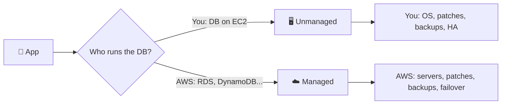
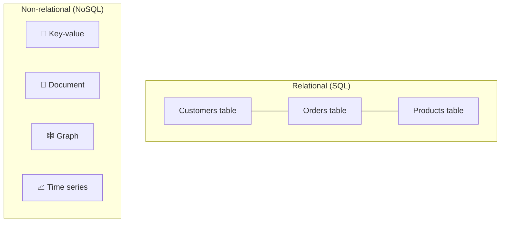
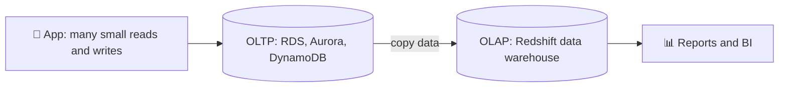
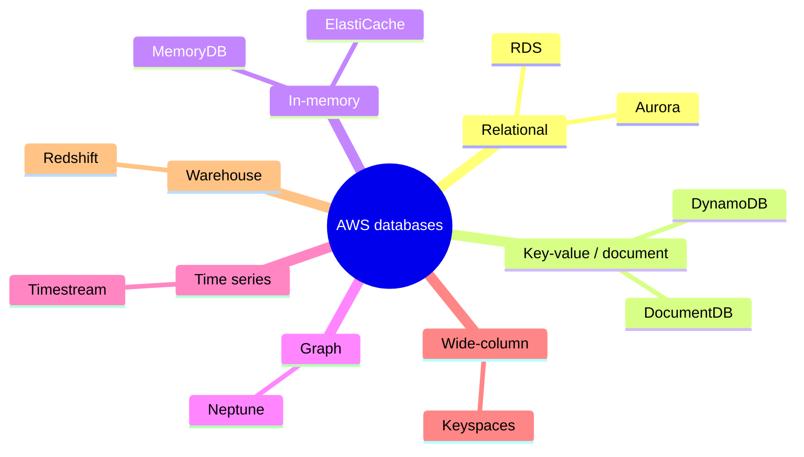
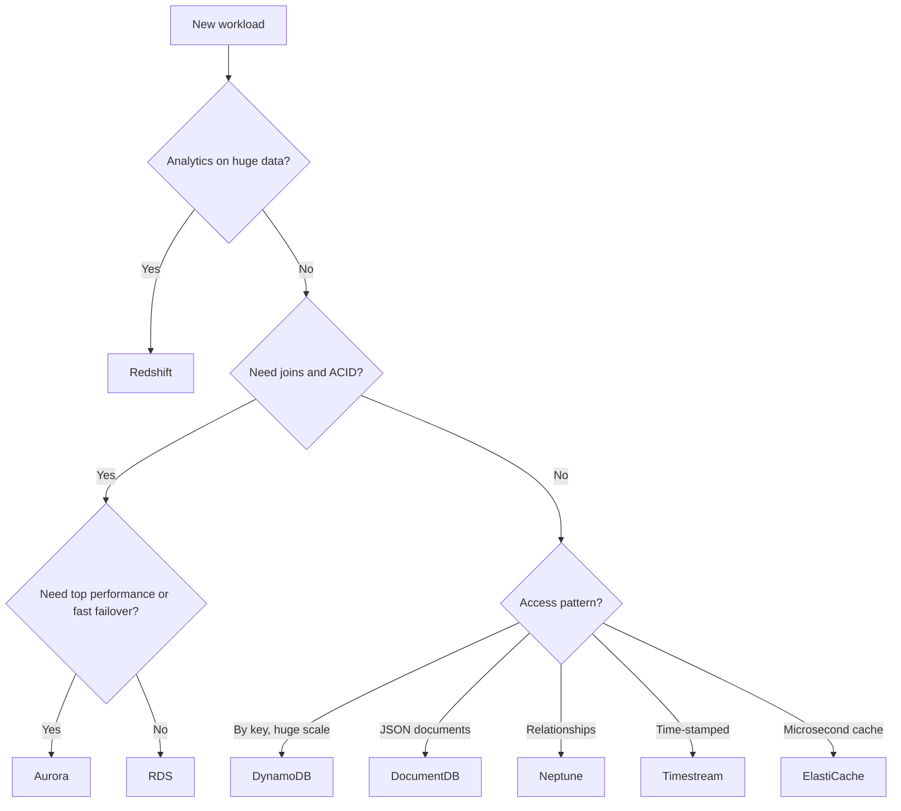

## What it is

A **database** is software that stores data and lets applications read and change it safely. On AWS you can run one yourself on a server, or use a **managed** service where AWS runs the servers, patching, backups and failover. AWS offers many database types because no single engine is best for every job.

*Managed means AWS takes over the routine admin work; you keep the data and the schema.*

Use it when: you start with a managed service by default, and run your own database on EC2 only when you need OS-level control.

## Key concepts

### Unmanaged vs managed

| Task | Self-managed on EC2 | Managed (e.g. RDS) |
| --- | --- | --- |
| Hardware and OS | You | AWS |
| DB software install and patching | You | AWS |
| Backups and restore | You build it | Automated, you configure retention |
| High availability and failover | You design it | Option such as Multi-AZ |
| Schema, queries, indexes, access rules | You | You |

- RDS offers these engines: Aurora MySQL-compatible, Aurora PostgreSQL-compatible, MySQL, MariaDB, PostgreSQL, Oracle, SQL Server and Db2.
- You still own your data design and who can access it. "Managed" is not "no work".
- Trade-off: less control over the OS and engine internals. RDS Custom exists for cases that need more access.

### SQL vs NoSQL

*Relational data lives in linked tables; NoSQL covers several other data models.*

| | Relational (SQL) | Non-relational (NoSQL) |
| --- | --- | --- |
| Model | Tables, rows, columns, fixed schema | Key-value, document, graph, wide-column, time series |
| Relationships | Joins and foreign keys | Usually modelled in the item or by key |
| Transactions | Strong ACID support | Varies by service |
| Scaling | Mostly vertical, plus read replicas | Designed for horizontal scale |
| Query | SQL, flexible ad hoc | Access by key or defined patterns |

- ACID means a transaction is atomic, consistent, isolated and durable: all of it happens, or none of it.
- NoSQL does not mean "no structure"; it means a model chosen for a specific access pattern.

### OLTP vs OLAP

*Operational data is copied to a warehouse so heavy reports do not slow the live app.*

- **OLTP** (online transaction processing): many small, fast operations such as "place order". Data is stored in rows.
- **OLAP** (online analytical processing): few, big queries that scan and aggregate lots of data. Redshift stores data in columns for this.
- Most companies use both together.

### The AWS database family

*Purpose-built engines: pick by data model and access pattern.*

- AWS describes the families as relational, key-value, document, in-memory, graph, time series and ledger.
- Warehouse (Redshift) is for analytics, not application traffic.

## X vs Y

Which AWS database for which workload:

| Workload | Service | Why |
| --- | --- | --- |
| Classic app with tables, joins, transactions | RDS or Aurora | Familiar SQL engines, managed |
| Same, but needs higher performance and fast failover | Aurora | Cloud-built MySQL/PostgreSQL-compatible engine |
| Huge scale, low latency, access by key | DynamoDB | Managed key-value and document |
| MongoDB-style JSON documents | Amazon DocumentDB | Document database, MongoDB compatibility |
| Cache, sessions, leaderboards | ElastiCache (or MemoryDB) | Data in memory, very fast |
| Highly connected data (social, fraud) | Neptune | Graph model |
| Metrics, IoT, time-stamped data | Timestream | Time series |
| Cassandra-compatible wide-column | Amazon Keyspaces | Managed Cassandra-compatible |
| Analytics over huge data | Redshift | Columnar OLAP warehouse |

*Start from the access pattern, not from the product name.*

Pick relational (RDS/Aurora) when data is structured and you need joins and transactions. Pick NoSQL when one access pattern dominates and you need scale or a special model.

## Job notes

- Default for a new app that needs SQL: RDS or Aurora, Multi-AZ for production.
- Mistake: forcing everything into one database. Many systems use several, for example RDS for orders plus ElastiCache for sessions.
- Mistake: running reports on the production OLTP database. Copy data to a warehouse.
- Mistake: choosing NoSQL "because it scales" without knowing the access patterns first.
- Security default: place databases in private subnets and allow access only from the app's security group.
- Cost trap: instances that run all day, over-sized instances and forgotten snapshots. Check current pricing on each service page.

## Cheat sheet

- Managed = AWS runs servers, patching, backups, failover. You own schema and access.
- SQL = tables, joins, ACID. NoSQL = key-value, document, graph, wide-column, time series.
- OLTP = many small transactions. OLAP = big analytic queries (Redshift).
- RDS/Aurora: relational. DynamoDB: key-value. DocumentDB: documents. Neptune: graph.
- ElastiCache/MemoryDB: in-memory. Timestream: time series. Keyspaces: Cassandra-compatible. Redshift: warehouse.
- Choose by data model and access pattern.

## AWS docs

- [What is Amazon RDS?](https://docs.aws.amazon.com/AmazonRDS/latest/UserGuide/Welcome.html)
- [Choosing an AWS NoSQL database](https://docs.aws.amazon.com/whitepapers/latest/choosing-an-aws-nosql-database/types-of-nosql-databases.html)
- [OLTP vs OLAP](https://aws.amazon.com/compare/the-difference-between-olap-and-oltp/)
- [Well-Architected: Database](https://docs.aws.amazon.com/wellarchitected/2022-03-31/framework/perf-db.html)
