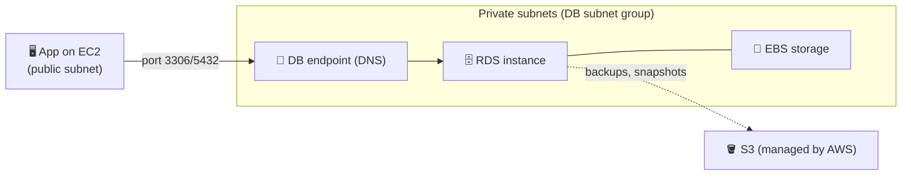
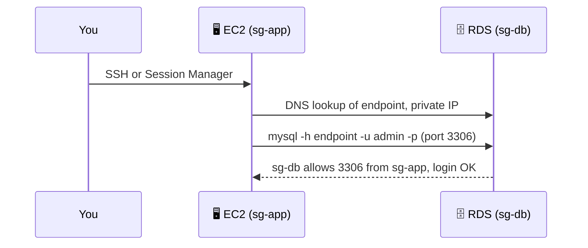
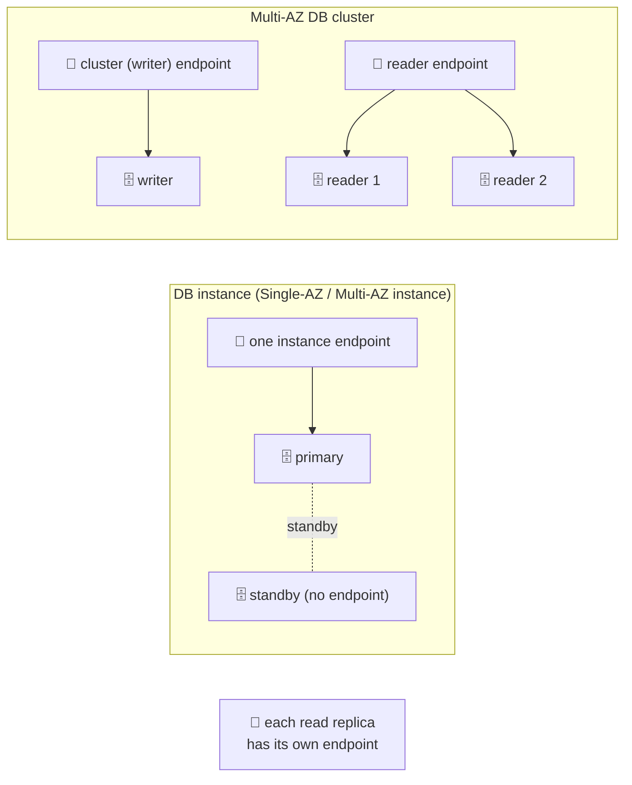
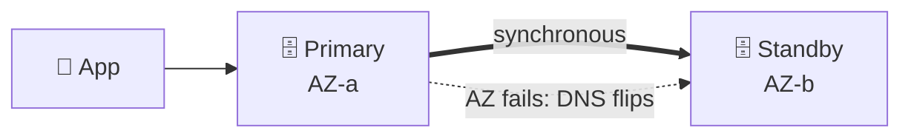
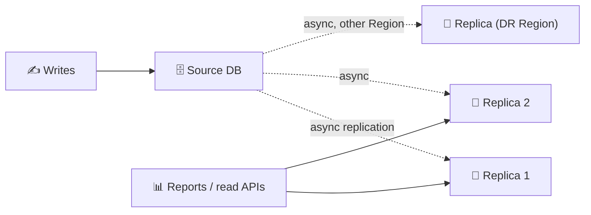
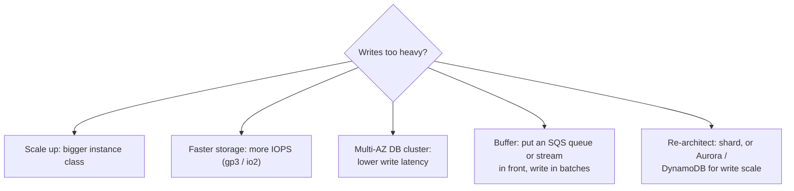
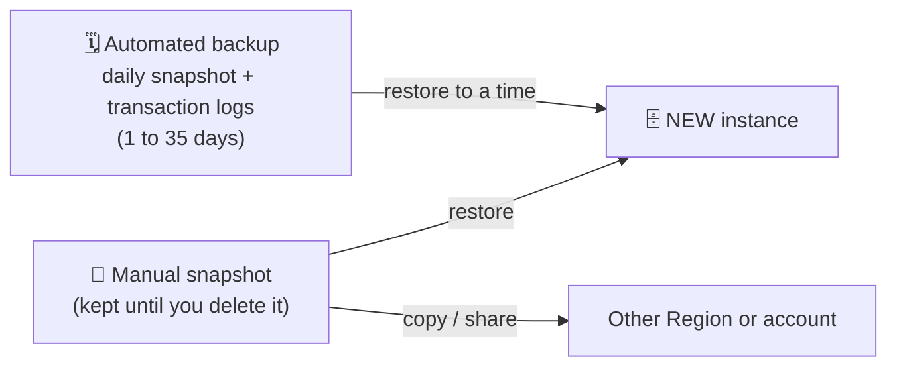
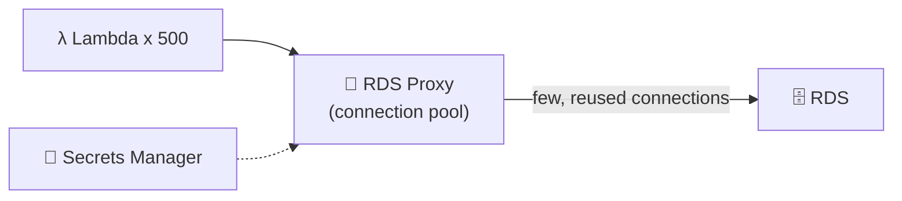
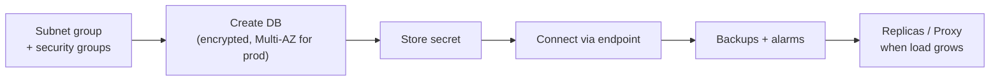

## What it is

Amazon RDS (Relational Database Service) runs a database engine for you: AWS handles the OS, patching, backups, failover and storage, and you handle schema, queries and tuning. You connect with a normal DB client through a DNS endpoint. You cannot SSH into the host.


*Your app talks to a DNS name; RDS manages the instance, disk and backups behind it.*

Engines: Aurora (own chapter), MySQL, MariaDB, PostgreSQL, Oracle, SQL Server and Db2.

**Use it when** you need a relational (SQL) database with joins and transactions and want AWS to run it. Use [DynamoDB](/chapters/23-aws-database-services-amazon-dynamodb/) for key-value access at huge scale.

## Key concepts

### Instance classes and storage

| Part | What to know |
|---|---|
| Instance class | `db.t*` burstable (dev/test), `db.m*` general purpose, `db.r*`/`db.x*` memory optimised (big databases). A "g" suffix means Graviton. |
| Storage | EBS-backed. General Purpose SSD (gp3) is the usual default; Provisioned IOPS SSD (io1/io2) for heavy I/O. |
| Auto scaling | Set a **maximum storage threshold** and RDS grows the disk when space runs low. |
| Limits | You can grow storage but not shrink it. After a storage change you must wait (about 6 hours) before the next one. |

- Scaling up the instance class causes a short outage (a reboot). Storage scaling usually does not.
- Not every class exists for every engine and Region. Check the [instance class page](https://docs.aws.amazon.com/AmazonRDS/latest/UserGuide/Concepts.DBInstanceClass.Support.html).

### Free tier instance and connecting from EC2

Create it: RDS console, **Create database**, **Standard create**, pick MySQL or PostgreSQL, template **Free tier**, `db.t3.micro` or `db.t4g.micro`, Single-AZ, set the master user and password, choose the VPC.


*Security group of the DB allows the port only from the app's security group.*

```bash
mysql -h mydb.abc123xyz.eu-west-1.rds.amazonaws.com -u admin -p     # MySQL
psql  -h mydb.abc123xyz.eu-west-1.rds.amazonaws.com -U postgres      # PostgreSQL
```

- Free-tier rules changed in 2025. Accounts created after that use a Free plan with credits, older accounts keep 12 months of 750 hours. Free tier is Single-AZ only. Check the [RDS free tier page](https://aws.amazon.com/rds/free/).
- Keep **Public access = No**. Let the DB security group accept the DB port from the app security group, not from `0.0.0.0/0`.
- **Using CloudShell:** open AWS CloudShell, then run the client command only if the DB is reachable from it. A private DB is not, so run it from the EC2 instance. CloudShell is handy for `aws rds` CLI commands (create replica, failover, snapshot) with no local setup.

### Endpoints


*Always connect by DNS name. After a failover the name points to the new primary; the IP changes.*

- A Multi-AZ DB instance exposes one endpoint. Failover flips the DNS record (CNAME) to the standby, so keep **retry logic** and a low DNS cache TTL in your app.
- A Multi-AZ DB cluster has a writer endpoint, a reader endpoint, and per-instance endpoints.
- Each read replica has its own endpoint. RDS does not balance reads across replicas for you; the app (or [RDS Proxy](#rds-proxy)) chooses.

### Multi-AZ (high availability)


*Multi-AZ is for availability, not for scaling.*

- Two deployment shapes. **Multi-AZ DB instance**: one standby, serves no reads. **Multi-AZ DB cluster**: two readable standbys (see the comparison below).
- Failover triggers include an AZ outage, loss of network to the primary, compute failure or storage failure. It can also be forced by rebooting with failover.
- In-flight queries are cut during failover, so the app must reconnect.
- Enabling it on an existing instance is a modify action: RDS snapshots, builds the standby, then syncs.

### Handle heavy reads: read replicas


*Replicas copy changes from the source (asynchronously) and answer SELECT queries only.*

- Up to 15 replicas for MySQL, MariaDB and PostgreSQL; Oracle and SQL Server up to 5; Db2 up to 3. Check the [current limits](https://docs.aws.amazon.com/AmazonRDS/latest/UserGuide/USER_ReadRepl.html).
- The source needs automated backups on (retention above 0).
- Replicas can be in another AZ or Region, and can be promoted to a standalone DB (a DR option, a manual step).
- Replication lag is possible: only send reads that tolerate slightly old data.
- Other read fixes: add a cache such as ElastiCache ([caching chapter](/chapters/24-aws-database-caching-and-migration/)), or move to Aurora.

### Handle heavy writes

Replicas never absorb writes. Options, cheapest first:


*Writes go to a single primary, so you scale it up, speed it up, smooth the spikes, or change the engine.*

- Check CloudWatch first: CPU, `WriteIOPS`, `WriteLatency`, queue depth, and whether the instance class caps EBS throughput.
- A Multi-AZ DB cluster typically has lower write latency than a Multi-AZ DB instance.

### Backups, PITR and snapshots


*Restores always create a new instance with a new endpoint; the original stays.*

- Automated backups are on by default. Retention is 1 to 35 days; 0 turns them off. Point-in-time recovery (PITR) restores to any second in that window (latest restorable time is about 5 minutes ago).
- For longer retention, take manual snapshots or use AWS Backup. Manual snapshots do not expire.
- After restoring, repoint the app to the new endpoint (or rename instances).
- Backup storage up to the size of your database is not charged extra in a Region; beyond that it is. Check [RDS pricing](https://aws.amazon.com/rds/pricing/).

### Parameter groups, option groups, maintenance

| Item | Purpose | Gotcha |
|---|---|---|
| Parameter group | Engine settings (`max_connections`, character set, timeouts) | Default groups are read-only: create a custom one. **Static** parameters need a manual reboot; **dynamic** apply at once. |
| Option group | Extra engine features (for example Oracle and SQL Server options, MariaDB/MySQL plugins) | Mainly for those engines. PostgreSQL uses extensions instead. |
| Maintenance window | Weekly slot for patches and pending changes | Minor version upgrades can be automatic; major upgrades are your choice. |

- A "pending-reboot" parameter status does not reboot the DB by itself. Reboot it when you accept the downtime.
- Multi-AZ reduces maintenance downtime because RDS patches the standby first, then fails over.

### Security and encryption

- **Network:** private subnets via a DB subnet group, a security group per tier, no public access.
- **Encryption at rest:** KMS (AES-256); covers storage, backups, replicas and snapshots. Decide at creation. You cannot switch an existing unencrypted instance: copy a snapshot with encryption on, then restore it.
- **In transit:** use TLS to the endpoint.
- **Authentication:** master password stored in Secrets Manager, or IAM database authentication (a short-lived token instead of a password).
- Oracle and SQL Server also support their own Transparent Data Encryption (TDE).

### RDS Proxy


*The proxy keeps a warm pool of DB connections and shares them among many short-lived clients.*

- Solves "too many connections", typically from Lambda or autoscaled fleets.
- Speeds up failover for the app because it holds connections and routes to the new primary.
- Clients can authenticate with IAM; the proxy reads DB credentials from Secrets Manager (or uses end-to-end IAM).
- It runs in your VPC and is billed on top of the database. Check [RDS Proxy pricing](https://aws.amazon.com/rds/proxy/pricing/).

## X vs Y

### Multi-AZ vs read replica

| | Multi-AZ (instance) | Read replica |
|---|---|---|
| Purpose | High availability | Read scaling, DR |
| Replication | Synchronous | Asynchronous |
| Serves reads | No | Yes |
| Failover | Automatic (DNS flip) | Manual promote |
| Region | Same Region, other AZ | Same AZ, other AZ or other Region |
| Own endpoint | No, shares the primary's | Yes |
| Data loss on failure | None | Possible (lag) |

They are not exclusive: a Multi-AZ source can also have read replicas.

### Multi-AZ DB instance vs Multi-AZ DB cluster

| | Multi-AZ DB instance | Multi-AZ DB cluster |
|---|---|---|
| Nodes | 1 primary + 1 standby | 1 writer + 2 readable standbys |
| AZs | 2 | 3 |
| Replication | Synchronous (storage level) | Semi-synchronous (needs 1 reader to acknowledge) |
| Standby serves reads | No | Yes (reader endpoint) |
| Typical failover | 1 to 2 minutes | Under 35 seconds |
| Write latency | Higher | Typically lower |
| Engines | All RDS engines | Fewer: MySQL and PostgreSQL |
| Endpoints | One | Writer, reader, per instance |

For MySQL clusters, give every table a primary key to avoid replication errors.

### RDS vs Aurora

| | RDS (MySQL, PostgreSQL ...) | Aurora |
|---|---|---|
| Storage | EBS volume per instance, you size it | Shared cluster volume, six copies across 3 AZs, grows automatically |
| Replicas | Up to 15 (engine-dependent), async | Up to 15 Aurora Replicas on the same storage |
| Engines | 6 or more incl. Oracle, SQL Server | MySQL- and PostgreSQL-compatible only |
| Cost | Usually lower for small workloads | Higher floor, better at scale |

Details are in the [Aurora chapter](/chapters/21-aws-database-services-amazon-aurora/).

**Pick Multi-AZ when** the database must survive an AZ failure. **Pick read replicas when** reads are the bottleneck or you need a cross-Region copy. **Pick the Multi-AZ cluster when** you want HA plus readable standbys and faster failover on MySQL or PostgreSQL. **Pick the Multi-AZ instance when** you need Oracle, SQL Server or Db2, or simpler and cheaper HA. **Pick Aurora when** you need more scale, faster failover or storage that grows on its own.

## Job notes


*Typical life of a production database.*

- **Production default:** Multi-AZ, encrypted, private, automated backups of 7 days or more, deletion protection on, final snapshot on delete.
- **Cannot connect?** Check in order: endpoint name, security group on the DB port, route and subnet, public access setting, credentials.
- **Cost traps:** Multi-AZ doubles instance cost; idle instances still bill; Provisioned IOPS; manual snapshots left behind; replicas nobody uses; cross-Region replication data transfer. A stopped instance is restarted by AWS after 7 days.
- **Slow after failover?** App is holding the old connection; add retry and use the DNS name, never an IP.
- **Test failover** before launch: reboot with failover, or `aws rds failover-db-cluster` for a Multi-AZ cluster.
- **Cleanup lab resources:** delete the instance (skip the final snapshot only if it is disposable), then delete leftover manual snapshots.
- **Monitor:** CloudWatch `CPUUtilization`, `FreeStorageSpace`, `DatabaseConnections`, `ReplicaLag`.

## Cheat sheet

- RDS = managed SQL: no OS access, AWS runs patches, backups and failover.
- Engines: Aurora, MySQL, MariaDB, PostgreSQL, Oracle, SQL Server, Db2.
- Always connect through the DNS endpoint; never an IP.
- Multi-AZ = HA, synchronous standby, automatic failover. Read replica = scale reads, asynchronous, manual promote, up to 15 (5 for Oracle/SQL Server).
- Multi-AZ cluster = 1 writer + 2 readable standbys, 3 AZs, failover typically under 35 s. Multi-AZ instance = 1 unreadable standby, failover 1 to 2 min.
- Writes scale up, not out: bigger class, more IOPS, queue in front, or move to Aurora/DynamoDB.
- Automated backups: 1 to 35 days, PITR creates a new instance. Manual snapshots stay until deleted.
- Static parameters need a reboot; dynamic apply now. Default parameter groups cannot be edited.
- Encryption must be chosen at creation (or via encrypted snapshot copy). KMS, AES-256.
- RDS Proxy pools connections (Lambda!) and can use IAM plus Secrets Manager.
- Storage can grow (auto scaling with a maximum), never shrink.
- Free tier: Single-AZ `db.t3.micro` / `db.t4g.micro`, check current terms.

## AWS docs

- [What is Amazon RDS?](https://docs.aws.amazon.com/AmazonRDS/latest/UserGuide/Welcome.html)
- [Multi-AZ deployments for Amazon RDS](https://docs.aws.amazon.com/AmazonRDS/latest/UserGuide/Concepts.MultiAZ.html)
- [Working with read replicas](https://docs.aws.amazon.com/AmazonRDS/latest/UserGuide/USER_ReadRepl.html)
- [Backing up and restoring an RDS DB instance](https://docs.aws.amazon.com/AmazonRDS/latest/UserGuide/CHAP_CommonTasks.BackupRestore.html)
- [Amazon RDS Proxy](https://docs.aws.amazon.com/AmazonRDS/latest/UserGuide/rds-proxy.html)
