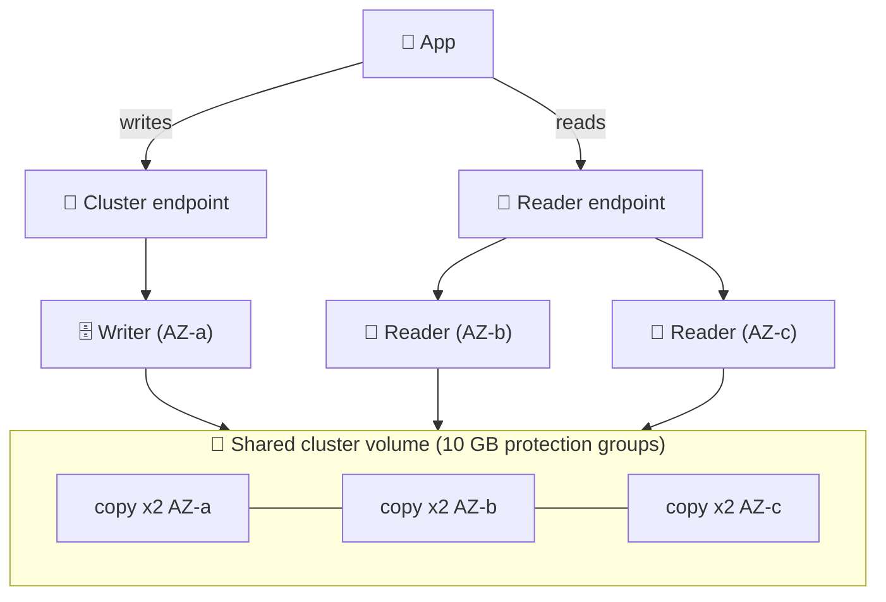
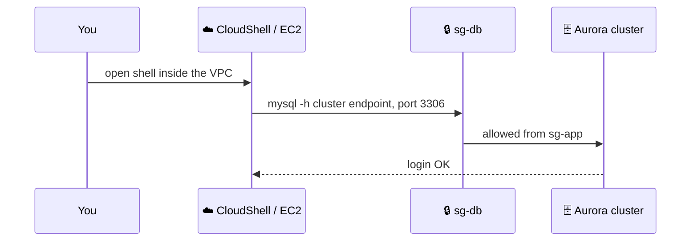
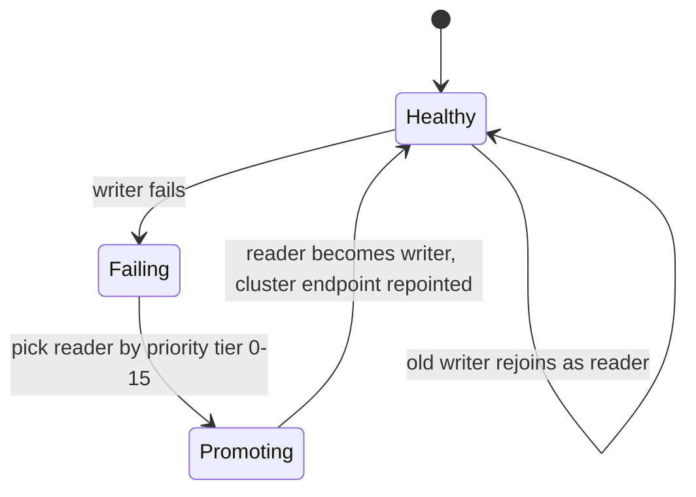
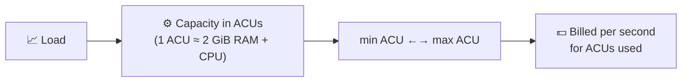
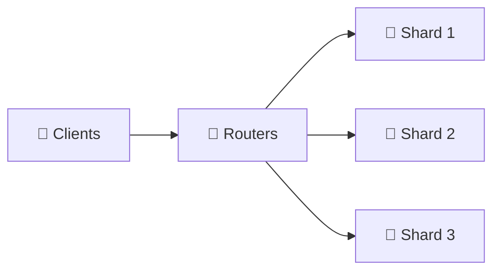
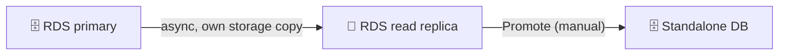
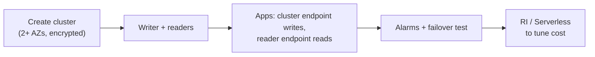

## What it is

Amazon Aurora is a MySQL- and PostgreSQL-compatible database built by AWS. Compute (DB instances) is separate from a shared storage layer that keeps six copies of your data across three AZs and grows automatically (up to 128 TB). One instance is the writer, the others are read-only Aurora Replicas that read the same volume.


*Instances are compute only; every instance reads one distributed volume with six copies over three AZs.*

**Use it when** you need a relational database with more read scale, faster failover and self-growing storage than plain RDS. Aurora is part of the RDS service: you manage it in the RDS console.

## Key concepts

### Create a cluster and connect

Console path: RDS, **Create database**, **Standard create**, engine **Aurora (MySQL Compatible)** or **Aurora (PostgreSQL Compatible)**, pick a template (Dev/Test or Production), set the master user, choose a VPC and security group, instance class (or Serverless), and optionally a reader. Public access stays No.


*Connect to the cluster endpoint, never an IP; the DB security group admits only your app's group.*

```bash
mysql -h mycluster.cluster-abc123.eu-west-1.rds.amazonaws.com -u admin -p     # Aurora MySQL, port 3306
psql  -h mycluster.cluster-abc123.eu-west-1.rds.amazonaws.com -U postgres     # Aurora PostgreSQL, port 5432
```

- A private cluster is reachable only from inside its VPC. Run the client from an EC2 instance, or from a CloudShell **VPC environment** placed in the same VPC and subnet with a security group that the DB allows. A plain CloudShell cannot reach a private DB, but it works for `aws rds` commands.
- Storage has two billing modes: **Aurora Standard** (pay per million I/O requests) and **Aurora I/O-Optimized** (no per-I/O charge, higher instance and storage price). The docs suggest I/O-Optimized when I/O is 25% or more of your Aurora spend. Check [Aurora pricing](https://aws.amazon.com/rds/aurora/pricing/).

### Endpoints

| Endpoint | Points to | Use for |
|---|---|---|
| Cluster (writer) | Current primary | Writes, DDL; follows failover |
| Reader | One of the replicas, balanced per connection | Read-only queries |
| Instance | One specific instance | Diagnosis, tuning |
| Custom | A set of instances you choose | Different reader groups |

- With no replicas, the reader endpoint points at the primary.
- Verify them: console **Databases**, open the cluster, tab **Connectivity**, or `aws rds describe-db-cluster-endpoints --db-cluster-identifier mycluster` (types `WRITER`, `READER`, `CUSTOM`). A `-ro-` in the name marks the reader endpoint.
- **Custom endpoint:** RDS console, cluster, **Actions**, **Create custom endpoint**. Choose a **static list** of members, or an **exclusion list** (all instances except those listed, so it grows with new instances). Up to five per cluster. Use it when readers differ, for example big instances for production dashboards and small ones for analysts. You then normally stop using the reader endpoint.

```bash
aws rds create-db-cluster-endpoint --db-cluster-identifier mycluster \
  --db-cluster-endpoint-identifier analysts --endpoint-type READER \
  --static-members mycluster-reader-small-1 mycluster-reader-small-2
```

### Aurora Replicas and failover


*Failover promotes an existing reader; no data is copied because the storage is shared.*

- Up to 15 Aurora Replicas per cluster. They lag the writer by roughly 100 ms or less and add no extra storage or write I/O cost.
- Each replica has a **priority tier (0-15)**; the lowest number is promoted first, ties go to the instance of the same size as the old primary.
- Failover typically completes in about 30 seconds. Test it with `aws rds failover-db-cluster`.
- Put replicas in different AZs. Without any replica, Aurora has to create a new instance, which takes longer.
- Cross-Region: an Aurora cluster can have Aurora Global Database secondary Regions with a replication lag you monitor, and you can promote a secondary Region in a disaster.

### Aurora Serverless (v2, now called "Aurora serverless")


*You set a range; Aurora moves capacity inside it as load changes.*

- The range is 0.5 to 256 ACUs. A minimum of 0 ACU enables automatic pause when idle, but some features need more (Performance Insights needs a minimum of at least 2).
- Create it with the same wizard: choose **Serverless** as the instance class and set min and max ACU. A cluster may mix serverless and provisioned instances, and readers can be serverless too.
- Serverless readers in tier 0 or 1 stay at least as large as the writer so they can take over. Tiers 2-15 scale on their own.
- Good for dev/test, spiky or unpredictable traffic. A steady 24/7 load is often cheaper provisioned with a reserved instance.

### Aurora Limitless Database


*Routers accept SQL and send it to shards; each shard stores a slice of the sharded tables.*

- Horizontal write scaling for **Aurora PostgreSQL** only: data is spread over many writers (shards), yet you query it as one database.
- Create a cluster with the Limitless engine version, then add a **DB shard group** and set its maximum capacity in ACUs (the docs give a range of 16 to 6144; check the [limits page](https://docs.aws.amazon.com/AmazonRDS/latest/AuroraUserGuide/limitless-reqs-limits.html)).
- Table types: **sharded** (split by a shard key), **reference** (copied to every shard), **standard** (all on one shard).
- Limits include no serializable isolation and no UPDATE of shard key values. Use it only when one writer is the bottleneck, not as the default.

### Replicas on RDS (for contrast)


*An RDS replica has its own volume; promoting it breaks replication for good.*

- **Create RDS replica:** console, source DB, **Actions**, **Create read replica** (same or other Region). Automated backups must be on at the source.
- **Promote:** **Actions**, **Promote** or `aws rds promote-read-replica`. RDS stops replication and reboots the replica, which takes a few minutes. Then it is a normal DB; optionally make it Multi-AZ. Use it for DR or to split off a copy, not for routine failover.
- **RDS failover:** Multi-AZ switches DNS to the synchronous standby automatically (typically 1 to 2 minutes for an instance, under 35 seconds for a Multi-AZ cluster). See the [RDS chapter](/chapters/20-aws-database-services-amazon-rds/).
- **Replicas and Multi-AZ:** a Multi-AZ DB instance can also have read replicas, so you get HA (standby) plus read scale (replicas). A Multi-AZ DB cluster already has two readable standbys and can have up to 15 replicas of its own. Max replicas per engine (RDS): see the [RDS chapter](/chapters/20-aws-database-services-amazon-rds/) and check the current limits.

### Extended Support and reserved instances

- **RDS Extended Support:** after the community end of life of an engine major version, RDS keeps giving critical security fixes for up to 3 years for a fee. Aurora MySQL and RDS MySQL/PostgreSQL are covered. Charged per vCPU-hour (per ACU-hour on Serverless v2), and the rate rises after the first two years. Cluster setting `EngineLifecycleSupport`; turning it off on a version already past end of support forces an upgrade. Check the [pricing page](https://aws.amazon.com/rds/pricing/).
- **Reserved DB instances (RI):** a 1- or 3-year commitment for a lower hourly rate, matched to engine, Region and instance class family. They are size-flexible within the family for Aurora, MySQL, MariaDB, PostgreSQL, Db2 and Oracle BYOL, and apply to Single-AZ and Multi-AZ. Not size-flexible for SQL Server and Oracle License Included. For Aurora they cover instances, not storage or I/O.

### Cloning, backtrack, Global Database

| Feature | What it does | Note |
|---|---|---|
| Cloning | New cluster sharing the same storage pages (copy-on-write), fast and cheap to start | Good for test copies of prod |
| Backtrack | Rewind the whole cluster in place, window up to 72 hours | Aurora MySQL only; enable at creation |
| Global Database | One primary Region plus read-only secondary Regions | DR, low-latency global reads |

## X vs Y

### Aurora vs RDS

| | Aurora | RDS (MySQL / PostgreSQL) |
|---|---|---|
| Storage | Shared cluster volume, 6 copies in 3 AZs, auto-grows to 128 TB | EBS volume per instance, you size it |
| Replicas | Up to 15, shared storage, lag around 100 ms or less | Up to 15 (MySQL, MariaDB, PostgreSQL), own copy, async |
| Failover | Typically about 30 s, no data copy | Multi-AZ instance 1 to 2 min |
| Engines | MySQL- and PostgreSQL-compatible only | Also MariaDB, Oracle, SQL Server, Db2 |
| Extras | Serverless, Limitless, Global Database, backtrack (MySQL), fast clones | Simpler, lower floor cost |
| Billing | Instances + storage used + I/O (or I/O-Optimized) | Instances + provisioned storage + IOPS |

### Aurora Replica vs RDS read replica

| | Aurora Replica | RDS read replica |
|---|---|---|
| Storage | Shared with the writer | Its own copy |
| Replication | Redo log stream to a shared volume, ms lag | Engine async replication |
| Failover target | Yes, automatic by priority tier | No, manual promote |
| Cross-Region | Via Global Database | Cross-Region replica |
| Endpoint | Shared reader endpoint + custom | One endpoint per replica |

### Provisioned vs Serverless vs Limitless

| | Provisioned | Serverless | Limitless |
|---|---|---|---|
| Capacity | Fixed instance class | ACU range, auto | Shard group ACUs, auto |
| Scales | Up (resize) and reads out | Up/down in place, reads out | Writes and storage out |
| Best for | Steady load, RI discount | Spiky, dev/test | Writes beyond one writer |
| Engines | MySQL, PostgreSQL | MySQL, PostgreSQL | PostgreSQL |

**Pick Aurora when** you want fast failover, many readers, or growing storage on MySQL/PostgreSQL. **Pick RDS when** you need Oracle, SQL Server, MariaDB or Db2, or a small, cheap database. **Pick Serverless when** load is unpredictable. **Pick Limitless only when** one writer cannot keep up. Final rule of thumb: start with RDS for small or fixed workloads, go Aurora once HA, read scale or growth matter.

## Job notes


*Typical Aurora rollout.*

- **Production default:** at least one reader in another AZ, encryption on, private subnets, backups of 7+ days, deletion protection.
- **App rule:** writes go to the cluster endpoint, reads to the reader endpoint, and reconnect with retry after failover. Add RDS Proxy for Lambda.
- **Cost traps:** idle readers, I/O charges on Standard (consider I/O-Optimized), Serverless minimum ACU left high, Extended Support surprise on old engines, clones and snapshots left behind, cross-Region transfer. Prices change: check current pricing.
- **Cannot connect:** check the endpoint name, security group on the DB port, VPC and subnets, public access, credentials.
- **Cleanup (avoid charges):** delete custom endpoints, delete readers, then the writer (which removes the cluster), delete or keep a final snapshot on purpose, delete leftover manual snapshots and any RDS lab instances and replicas. Delete the CloudShell VPC environment if you made one. Stopping a cluster is temporary (AWS restarts it after 7 days).
- **Monitor:** `CPUUtilization`, `DatabaseConnections`, `AuroraReplicaLag`, `ServerlessDatabaseCapacity`, `VolumeBytesUsed`.

## Cheat sheet

- Aurora = MySQL/PostgreSQL-compatible; compute separate from a shared storage volume (6 copies, 3 AZs, auto-grows to 128 TB).
- One writer plus up to 15 Aurora Replicas, all on the same volume; failover typically about 30 s by priority tier 0-15.
- Endpoints: cluster (writer), reader (balanced), instance, custom (up to 5, static or exclusion list).
- Serverless = ACU range (0.5-256, 0 enables pause), billed per second; Limitless = sharded writes, Aurora PostgreSQL only.
- Standard billing pays per I/O; I/O-Optimized has no I/O charge (think 25% I/O spend).
- RDS replica: own storage, async, manual Promote (reboots, breaks replication). Aurora replica: shared storage, automatic failover target.
- Multi-AZ instance can also have read replicas; Multi-AZ cluster has 2 readable standbys.
- Extended Support: paid, up to 3 years past community EOL, per vCPU-hour, price rises later.
- RIs: 1 or 3 years, size-flexible within an instance family for Aurora, MySQL, PostgreSQL and more; not SQL Server.
- Clone = fast copy-on-write copy; backtrack = in-place rewind (Aurora MySQL, max 72 h); Global Database = cross-Region DR.
- Always clean up: readers, writer, snapshots, endpoints.

## AWS docs

- [Amazon Aurora endpoint connections](https://docs.aws.amazon.com/AmazonRDS/latest/AuroraUserGuide/Aurora.Overview.Endpoints.html)
- [Custom endpoints for Amazon Aurora](https://docs.aws.amazon.com/AmazonRDS/latest/AuroraUserGuide/Aurora.Endpoints.Custom.html)
- [Amazon Aurora storage](https://docs.aws.amazon.com/AmazonRDS/latest/AuroraUserGuide/Aurora.Overview.StorageReliability.html)
- [Adding Aurora Replicas to a DB cluster](https://docs.aws.amazon.com/AmazonRDS/latest/AuroraUserGuide/aurora-replicas-adding.html)
- [Aurora PostgreSQL Limitless Database requirements and considerations](https://docs.aws.amazon.com/AmazonRDS/latest/AuroraUserGuide/limitless-reqs-limits.html)
- [Amazon RDS Extended Support](https://docs.aws.amazon.com/AmazonRDS/latest/UserGuide/extended-support.html)
- [Reserved DB instances for Amazon RDS](https://docs.aws.amazon.com/AmazonRDS/latest/UserGuide/USER_WorkingWithReservedDBInstances.html)
- [Promoting a read replica](https://docs.aws.amazon.com/AmazonRDS/latest/UserGuide/USER_ReadRepl.Promote.html)
