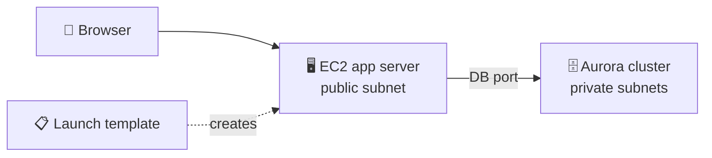
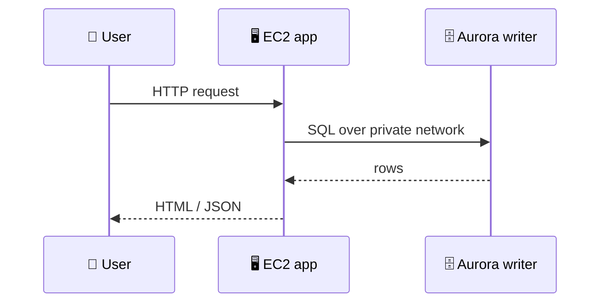

## What you build

You run one application on an EC2 instance that stores its data in an Amazon Aurora database, first by hand, then repeatably from a launch template.


*One app tier, one database tier; the launch template makes the server reproducible.*

The course's exact app, repo and database engine are not specified in the syllabus, so the steps below are generic. Follow the repo's README for the real commands.

## Architecture


*The browser never talks to the database; only the app server does.*

- **EC2 instance**: runs the app code, in a public subnet with a security group opening web traffic.
- **Aurora DB cluster**: managed database with a cluster endpoint your app connects to.
- **Security groups**: the DB group allows the database port only from the app's security group.
- **Launch template**: saved launch settings (AMI, instance type, security group, instance profile, user data).
- **User data**: a startup script that installs and configures the app on first boot.

| Setting | Manual instance | Launch template |
|---|---|---|
| Repeatable | No, you click each time | Yes |
| Config stored | In your head | Versioned template |
| Needed later by | Nothing | Auto Scaling groups |

## Steps

1. **Intro and code**: clone the course GitHub repo for this lab and read its README (app, DB schema, settings).
2. **Create Aurora**: RDS > Create database > Aurora, pick the engine the repo needs, a small instance class, and put it in the same VPC as the app. Note the master user, password and cluster endpoint. Keep it not publicly accessible.
3. **Security groups**: create an app group (HTTP in) and a DB group that allows the DB port from the app group only.
4. **Launch the app manually**: EC2 > Launch instance > Amazon Linux, small type, app security group. Connect with EC2 Instance Connect or Session Manager.
5. **Install the app**: install runtime and dependencies, then copy the app from the repo onto the instance.
6. **Configure the app**: set the DB endpoint, user, password and database name (config file or environment variables) as the README says. Start the app and open the instance public address in a browser.
7. **Make it a launch template**: EC2 > Launch Templates > Create. Enter the AMI, instance type, security group, an IAM instance profile if needed, and your install commands as user data.
8. **Launch from the template**: Launch instance from template, wait for the status checks, and test the new instance the same way.
9. Expected result: the page loads from both instances and reads and writes data in Aurora.

```bash
# the user data idea: a script that runs on first boot
#!/bin/bash
# install dependencies, fetch the app, write DB settings, start the service
```

Aurora also has a console shortcut: RDS > Databases > select cluster > Actions > Set up EC2 connection. It wires the security groups for you (console only, not the CLI).

## Common mistakes

| Mistake | Fix |
|---|---|
| App cannot reach the DB (timeout) | Allow the DB port in the DB security group from the app security group; check the same VPC |
| Connection refused or auth error | Check endpoint, user, password, database name |
| Using the instance endpoint instead of the cluster endpoint | Use the cluster (writer) endpoint so failover works |
| Password hard-coded in the repo or user data | Keep secrets in AWS Secrets Manager or Parameter Store |
| Template instance starts but app is down | Read the user data log on the instance and fix the script |
| Database made publicly accessible | Keep it private; reach it only from the app group |

## Cleanup

Delete in this order, so nothing blocks deletion and no charge remains:

1. EC2: terminate every instance, including those launched from the template. Only running instances bill compute, but terminate anyway.
2. EC2: delete the launch template.
3. RDS: delete the Aurora DB instance(s), then the cluster. Remove deletion protection first if it is on. Untick the final snapshot and retained backups for a throwaway lab, otherwise delete them afterwards.
4. EC2: delete the security groups (the DB group first, since it references the app group), and any key pair or Elastic IP you created (an Elastic IP only disassociated still costs; release it).
5. IAM: delete the instance profile role if you made one for the lab.

## On the job

- Two-tier design: app servers are replaceable, the database holds state.
- Never open the database to the internet; reference security groups, not IP ranges.
- Launch templates are the building block of Auto Scaling; the next step up is several instances behind a load balancer.
- A final snapshot is the safe default for real databases; skip it only in labs.

## AWS docs

- [Automatically connecting an EC2 instance and an Aurora DB cluster](https://docs.aws.amazon.com/AmazonRDS/latest/AuroraUserGuide/ec2-rds-connect.html)
- [IAM role for applications that run on Amazon EC2 instances (launch templates)](https://docs.aws.amazon.com/autoscaling/ec2/userguide/us-iam-role.html)
- [Tutorial: connect using EC2 Instance Connect](https://docs.aws.amazon.com/AWSEC2/latest/UserGuide/ec2-instance-connect-tutorial.html)
