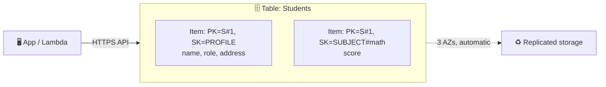
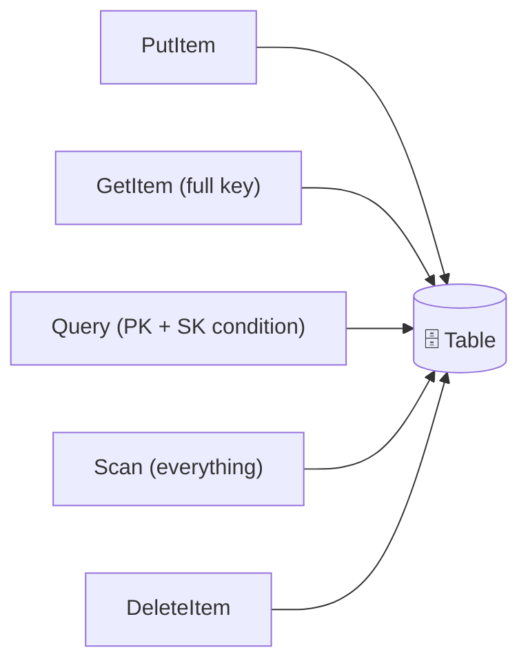
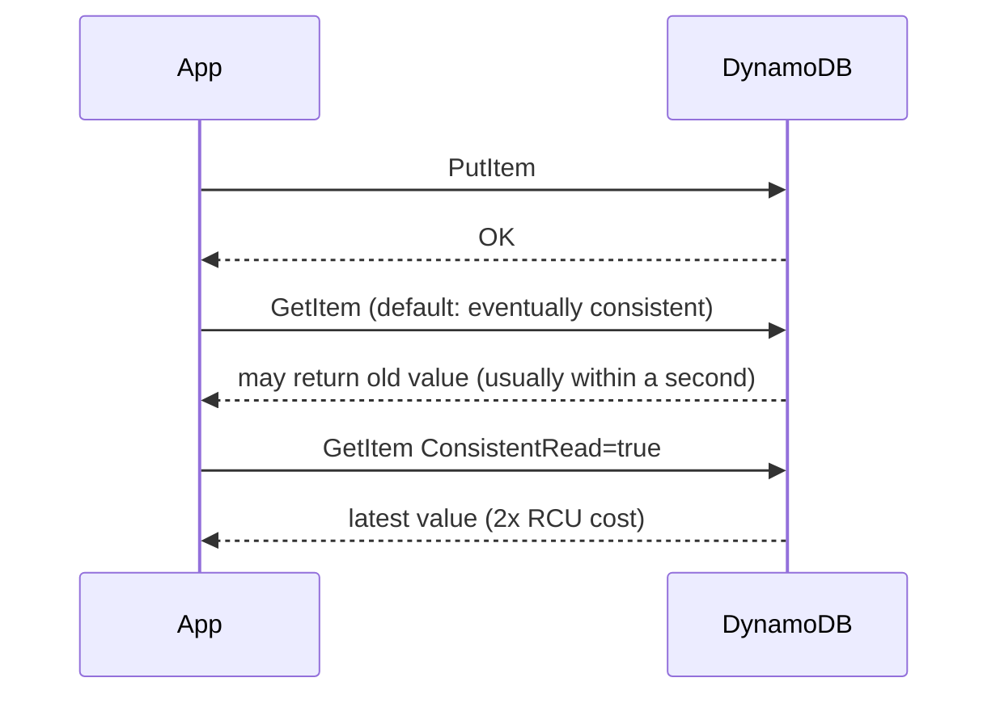
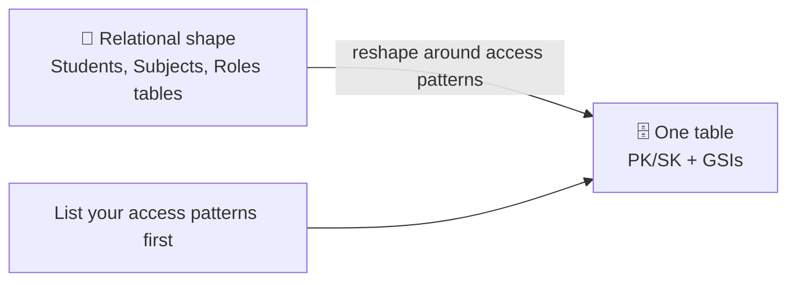
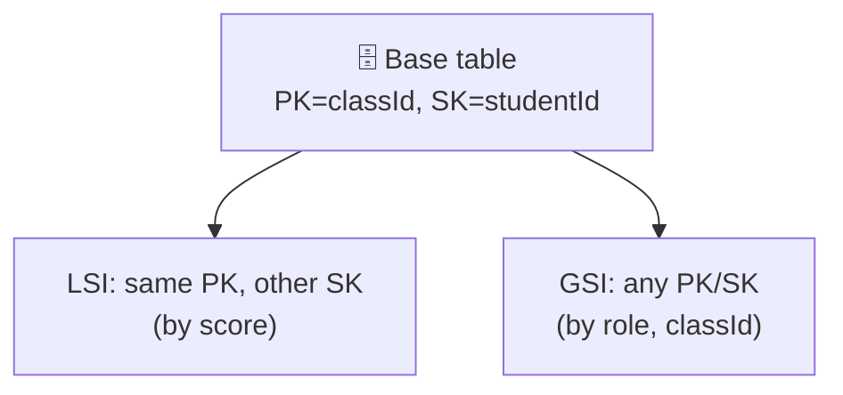
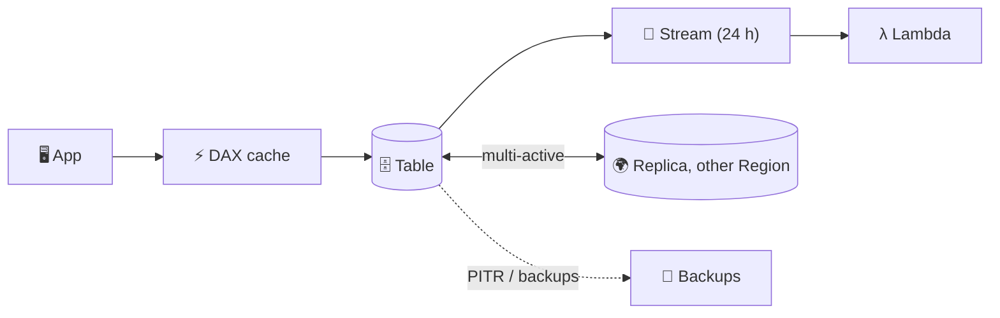
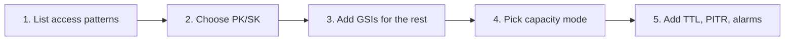

## What it is

Amazon DynamoDB is a fully managed NoSQL key-value and document database. There are no servers, no joins and no SQL schema: you create a table, pick a key, and get single-digit millisecond reads and writes at any scale. You design the table around your queries, not around the data shape.

*A table holds items (rows); each item is found by its key and can have different attributes.*

**Use it when** you know your access patterns and need huge scale, low latency and zero server management. Use [RDS](/chapters/20-aws-database-services-amazon-rds/) when you need joins and ad-hoc SQL.

## Key concepts

### Tables, items, keys

| Term | Meaning |
|---|---|
| Table | Collection of items; only the key attributes are fixed |
| Item | One record, max 400 KB (attribute names count too) |
| Partition key (PK) | Hashed to pick the storage partition; required |
| Sort key (SK) | Optional; orders items inside one PK so you can range-query |
| Primary key | PK alone (simple) or PK + SK (composite); must be unique |

- Creating the first table (console: DynamoDB > Create table): name, PK, optional SK, capacity mode. Done in seconds.
- Items over 400 KB: store the blob in S3 and keep the S3 key in the item.
- Pick a PK with many distinct, evenly used values, otherwise one "hot" partition gets throttled.

### Operations

*GetItem and Query use the key and are cheap; Scan reads the whole table.*

- **PutItem** creates or replaces the item. To stop duplicates, add a condition such as `attribute_not_exists(PK)`; the write fails if the key already exists.
- **GetItem** needs the full primary key. **Query** needs the PK and optionally an SK condition.
- **Scan** reads every item (1 MB per page) and a `FilterExpression` only filters after reading, so you still pay for all of it. Use Scan for small tables, exports or one-off jobs.
- **DeleteItem** removes by key.

### Capacity units: WCU and RCU

| Unit | Covers | Rounding |
|---|---|---|
| 1 WCU / write request unit | One write of up to 1 KB | Up to next 1 KB |
| 1 RCU / read request unit | One strongly consistent read of up to 4 KB, or two eventually consistent | Up to next 4 KB |
| Transactional | Costs 2x the normal unit | |

- Example: write a 2.5 KB item = 3 WCU. Read a 10 KB item strongly = 3 RCU; eventually consistent = 1.5 RCU.
- Capacity modes (on-demand and provisioned) are compared below.

### Consistency

*Default reads can be slightly stale; strong reads cost double.*

- Strongly consistent reads are not supported on GSIs, and are single-Region only unless a global table uses multi-Region strong consistency.

### Data modeling

*Start from the questions the app will ask, then shape the keys.*

- **Shape vs reshape**: do not copy your SQL tables. Denormalise so one Query returns what a screen needs.
- **Single table design**: several entity types in one table, grouped by shared PK (an item collection). Benefits: one call for related data, fewer tables to manage. Cost: steeper learning curve and shared backup/encryption.
- **Worked patterns** (typical school example):

| Access pattern | How |
|---|---|
| Student profile / address | `PK=STUDENT#id, SK=PROFILE` with GetItem |
| Subjects of a student | `PK=STUDENT#id, SK begins_with SUBJECT#` with Query |
| Students by role | GSI with `role` as PK |
| Students by role and class | GSI with `role` as PK, `classId` as SK |
| Count male/female per class | GSI on `classId` + `gender`, Query with count |
| Many-to-many (students and classes) | Link items, plus a GSI that swaps PK and SK |

- **NoSQL Workbench** (free desktop app): design the model, add sample data, validate access patterns, then commit to DynamoDB local or your account.

### Secondary indexes

*An index is an automatically maintained copy with a different key, so you can Query on another attribute.*

- Choose which attributes to project (copy) into the index; fewer projected attributes means cheaper writes.
- Writes to the base table are copied to indexes, so each index adds write cost.

### TTL

- Enable TTL on a table and name a **Number** attribute holding an epoch time in **seconds**.
- Expired items are deleted in the background without write capacity, typically within a few days; until then they still show in reads. Add a `FilterExpression` (`expireAt > :now`) to hide them.
- TTL deletes appear in the stream as service deletes, so you can react (for example archive to S3).

### Transactions

- `TransactWriteItems` (all-or-nothing writes, with optional condition checks) and `TransactGetItems` (consistent read of several items).
- Up to 100 unique items and 4 MB per transaction, same account and Region, not through indexes; no two actions on the same item.
- Cost is 2x capacity (prepare plus commit). Example: debit one account item and credit another.

### Streams, DAX, global tables, backups

*Four add-ons around one table: cache, change log, multi-Region copies, backups.*

- **Streams**: ordered log of item changes kept up to 24 hours; can show before and after images. Typical use: trigger Lambda.
- **DAX**: in-memory cache, API-compatible, microsecond reads for eventually consistent data. Put it in front of read-heavy, repeated-key workloads. It does not help strongly consistent reads or writes.
- **Global tables**: replicas in several Regions, every replica takes reads and writes. Default is eventual consistency between Regions; multi-Region strong consistency is an option. Transactions do not span Regions.
- **Backups**: on-demand backups (kept until you delete them) and **PITR** (restore to any second in the last 1 to 35 days, into a new table). Neither affects performance.

## X vs Y

### DynamoDB vs RDS

| | DynamoDB | RDS |
|---|---|---|
| Model | Key-value / document | Relational SQL |
| Scaling | Automatic, no servers | Instance sizes, read replicas |
| Queries | By key and index; plan upfront | Any SQL, joins |
| Connections | HTTPS API, no pool | DB connections (watch limits) |
| Best for | Known patterns, spiky or huge scale | Complex queries, reporting, existing apps |

Pick DynamoDB when access is by key at large scale; pick RDS when you need joins and flexible queries.

### GSI vs LSI

| | GSI | LSI |
|---|---|---|
| Keys | Different PK and SK | Same PK, different SK |
| Create when | Any time | Only at table creation |
| Strong consistency | No | Yes |
| Throughput | Own capacity | Shares the table's |
| Size limit | None | 10 GB per PK value |
| Default quota | 20 per table | 5 per table |

Pick a GSI almost always; pick an LSI only for a second sort order on the same PK with strong reads. Quotas can change, so check the current values.

### On-demand vs provisioned

| | On-demand | Provisioned |
|---|---|---|
| You set | Nothing | RCU/WCU (optionally auto scaling) |
| Billing | Per request | Per hour of capacity set |
| Traffic | Unknown or spiky; scales to zero | Steady and predictable |
| Savings | None | Reserved capacity (1 or 3 year commitment) |
| Overload | Rarely throttled | Throttled above set capacity |

Pick on-demand for new or unpredictable tables; pick provisioned (plus reserved capacity) when load is steady and you can forecast it. You can switch modes, with limits on how often.

## Job notes

- **Pricing** has several parts: reads and writes (per request or per capacity hour), storage, backups and PITR, global table replication, streams reads beyond Lambda, DAX nodes. Check the current DynamoDB pricing page for numbers.
- **Cost traps**: Scan on big tables, strongly consistent reads and transactions (2x), too many indexes, over-provisioned capacity, hot partition keys.
- **Common errors**: `ProvisionedThroughputExceededException` means throttling. Raise capacity, spread the keys, or use on-demand.
- **Security**: IAM policies per table (can restrict to given keys), encryption at rest is on by default, use VPC gateway endpoints for private access.
- **Search needs**: for text search or ad-hoc analytics, export or stream data to another service rather than Scan.

*A practical order for designing a table.*

## Cheat sheet

- Item max 400 KB; key = PK or PK + SK.
- 1 WCU = 1 KB write; 1 RCU = 4 KB strong read (2 eventual); transactions cost 2x.
- Default read is eventually consistent; `ConsistentRead=true` doubles cost; not on GSI.
- Query/GetItem by key; avoid Scan.
- GSI: any time, eventual only. LSI: at creation only, 10 GB per PK value.
- On-demand for unknown traffic; provisioned + reserved for steady traffic.
- TTL: epoch seconds Number, free, delayed up to days.
- Transactions: up to 100 items, 4 MB, one Region.
- Streams 24 h; DAX for microsecond cached reads; global tables for multi-Region active-active.
- PITR 1 to 35 days, restores to a new table; on-demand backups for long retention.

## AWS docs

- [Change data capture for DynamoDB Streams](https://docs.aws.amazon.com/amazondynamodb/latest/developerguide/Streams.html)
- [In-memory acceleration with DAX](https://docs.aws.amazon.com/amazondynamodb/latest/developerguide/DAX.html)
- [Global tables](https://docs.aws.amazon.com/amazondynamodb/latest/developerguide/GlobalTables.html)
- [Backup and restore for DynamoDB](https://docs.aws.amazon.com/amazondynamodb/latest/developerguide/Backup-and-Restore.html)
- [Using time to live (TTL)](https://docs.aws.amazon.com/amazondynamodb/latest/developerguide/TTL.html)
