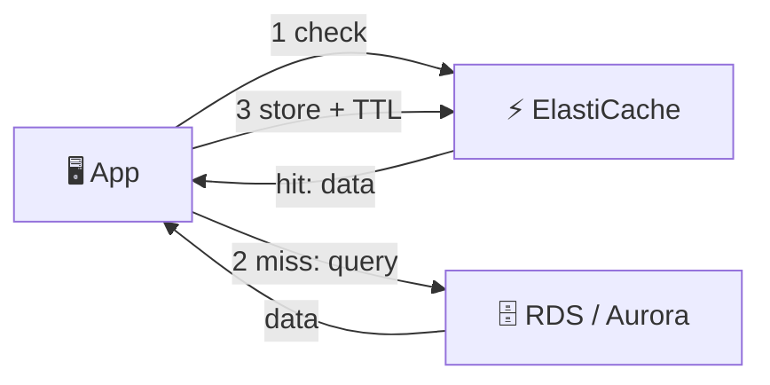
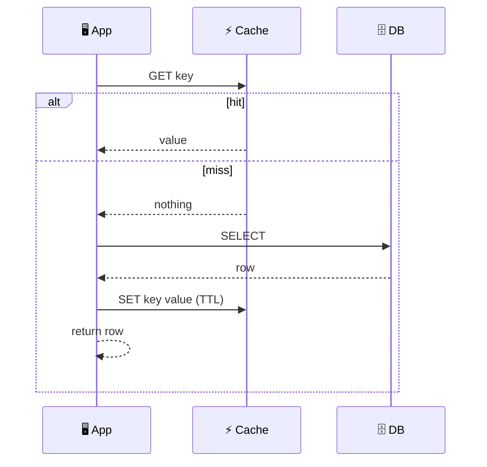
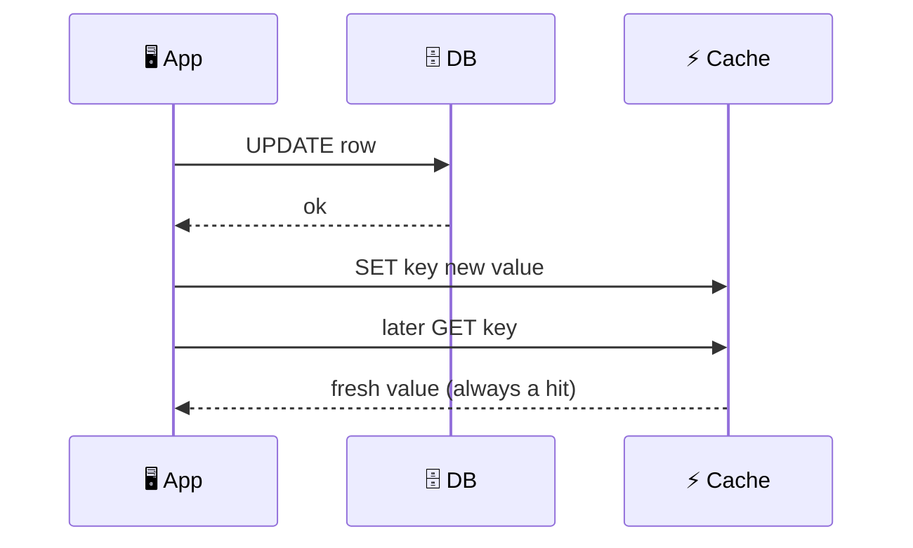
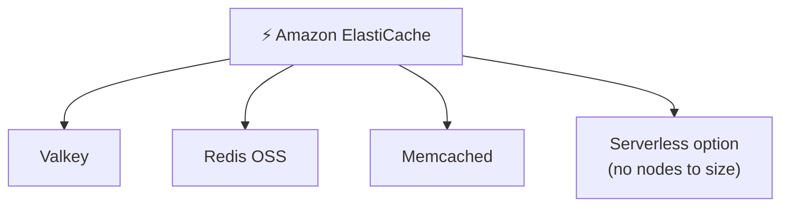
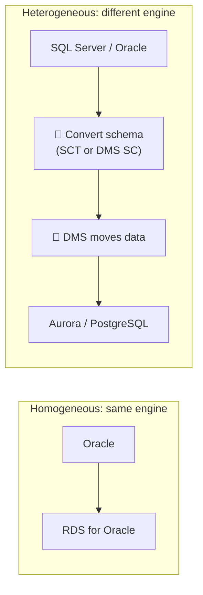
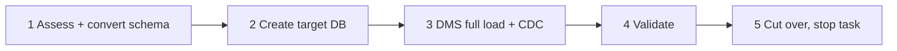

## What it is

A cache keeps hot data in memory so the app does not hit the database for every read. Amazon ElastiCache is the managed in-memory cache; reads take well under a millisecond and the database load drops. AWS DMS (Database Migration Service) is the managed tool to move a database into AWS while the source keeps running.

*A cache sits between the app and the database and answers repeated reads from memory.*

**Use a cache when** reads are repeated and the data can be slightly old. **Use DMS when** you move a database to AWS, or between engines, with little downtime.

## Key concepts

### Lazy loading

*Lazy loading (cache-aside): the cache is filled only when someone asks.*

- Only requested data is cached, so memory is not wasted.
- A cache node failure is not fatal: the app falls back to the database and refills.
- Downsides: the first read is slow (miss = 3 trips), and cached data can be stale if the database changes.

### Write-through

*Write-through: every database write also updates the cache.*

- Cache is always fresh and reads rarely miss.
- Writes are slower (two writes) and the cache fills with data nobody reads.
- A new or restarted empty node has nothing in it until data is written, so you still need lazy loading as a fallback.

### Lazy loading vs write-through, and TTL

| | Lazy loading | Write-through |
|---|---|---|
| Cache filled | On a read miss | On every write |
| Stale data | Possible | Rare |
| Wasted memory | Low | Higher |
| Empty/failed node | Fine, refills itself | Misses until data is rewritten |
| Cost of a miss | Slow first read | Few misses |

**TTL** (time to live) is a number of seconds after which a key expires; an expired key counts as a miss and is reloaded from the database. Add a TTL to either strategy: it limits staleness and clutter. The usual best practice is lazy loading everywhere, write-through for specific hot data, and a TTL on all keys. Add a little random jitter to TTLs so many keys do not expire at once.

### AWS caching services

*ElastiCache offers three engines, deployed as node-based clusters or serverless.*

- ElastiCache is a managed in-memory key-value service: AWS handles setup, patching, failover and backups (Valkey/Redis).
- Valkey is an open-source, Redis-compatible engine (a fork of Redis OSS 7.2.4), so Redis clients work with it.
- ElastiCache Serverless scales capacity for you; you do not pick node sizes.
- Other caches exist for other jobs (for example DAX for DynamoDB, covered with DynamoDB).

### Migration tools and the two kinds of migration

*Same engine: move the data. Different engine: convert the schema first, then move the data.*

- **AWS DMS** moves data. The source stays online. Either the source or the target must be on AWS.
- A DMS **task** is one of: full load (copy existing data), CDC only (replay ongoing changes from the source logs), or full load plus CDC (copy, then keep in sync until you cut over).
- DMS runs on a replication instance or as DMS Serverless. CDC is not real time and has no latency SLA.
- **Homogeneous**: the same engine (Oracle to Oracle). Use the engine's native tools for the schema.
- **Heterogeneous**: different engines (Oracle to PostgreSQL). Data types, schema and code differ, so convert first.

## X vs Y

### Redis (Valkey) vs Memcached

| | Valkey / Redis OSS | Memcached |
|---|---|---|
| Data types | Strings, hashes, lists, sets, sorted sets, more | Simple objects |
| Replication / Multi-AZ failover | Yes | No |
| Snapshots / persistence | Yes | No |
| Pub/Sub, transactions, Lua | Yes | No |
| Multithreaded | No (per the AWS comparison) | Yes |
| Scale | Shards and replicas | Add or remove nodes in a pool |

Pick **Valkey/Redis** when you need failover, persistence, leaderboards, sessions or rich data types. Pick **Memcached** for the simplest object cache you can scale out by adding nodes. You can upgrade an engine version but not downgrade.

### DMS vs SCT vs DMS Schema Conversion

| Tool | Job | Where it runs |
|---|---|---|
| **AWS DMS** | Moves data, replicates changes (CDC) | Replication instance or serverless in AWS |
| **AWS SCT** | Converts schema and code (views, procedures, functions); can scan app code for embedded SQL | Software you download and run locally |
| **DMS Schema Conversion** | Same conversion job, fully managed in the DMS console | AWS console |

Pick **same engine** (homogeneous): DMS plus native schema tools. Pick **different engine** (heterogeneous): SCT or DMS Schema Conversion first, then DMS. Objects that cannot be converted automatically are flagged for manual work.

## Job notes

- Cost of caching: ElastiCache is billed per node-hour or, for Serverless, by data stored and compute used. Check current prices on the pricing page.
- **Database Savings Plans**: commit to a steady hourly spend for 1 year, no upfront, for up to 35% off across several database services (Aurora, RDS, DynamoDB, ElastiCache for Valkey, DMS and more). They apply across engines, sizes and Regions. Only newer-generation instances are covered, and you cannot combine them with RDS Reserved Instances for the same usage. Check the current terms.
- **Cost estimate for an RDS example**: use the AWS Pricing Calculator. List engine, instance class, Multi-AZ, storage size and type, backup storage, and data transfer. Then add a cache node and DMS during the migration window. Never trust a remembered price.
- Mistakes: no TTL (stale data), caching data that is never re-read, treating the cache as the only copy, forgetting to enable CDC prerequisites (for example row-level binary logging on MySQL, supplemental logging on Oracle).
- Security: put the cache in private subnets and limit the security group to your app tier.

*A typical heterogeneous migration workflow. Skip step 1 for a homogeneous move.*

## Cheat sheet

- Cache = fast memory in front of the database; fewer DB reads, lower latency.
- Lazy loading: read, miss, load DB, fill cache. Write-through: write DB and cache together. Use both plus TTL.
- ElastiCache engines: Valkey, Redis OSS, Memcached; serverless or node-based.
- Need failover, persistence, rich types: Valkey/Redis. Simple, multithreaded, scale-out: Memcached.
- DMS = move data + CDC; source stays online. Task types: full load, CDC, both.
- Homogeneous = same engine. Heterogeneous = convert schema first (SCT or DMS SC).
- Database Savings Plans: up to 35%, 1-year, no upfront; check current terms.
- Estimate costs with the AWS Pricing Calculator.
- Related: [RDS](/chapters/20-aws-database-services-amazon-rds/).

## AWS docs

- [Caching strategies for ElastiCache](https://docs.aws.amazon.com/AmazonElastiCache/latest/dg/Strategies.html)
- [Comparing Valkey, Memcached and Redis OSS](https://docs.aws.amazon.com/AmazonElastiCache/latest/dg/SelectEngine.html)
- [Ongoing replication (CDC) with AWS DMS](https://docs.aws.amazon.com/dms/latest/userguide/CHAP_Task.CDC.html)
- [Heterogeneous database migration tools](https://docs.aws.amazon.com/prescriptive-guidance/latest/migration-oracle-database/heterogeneous-migration.html)
- [Savings Plans types](https://docs.aws.amazon.com/savingsplans/latest/userguide/plan-types.html)
