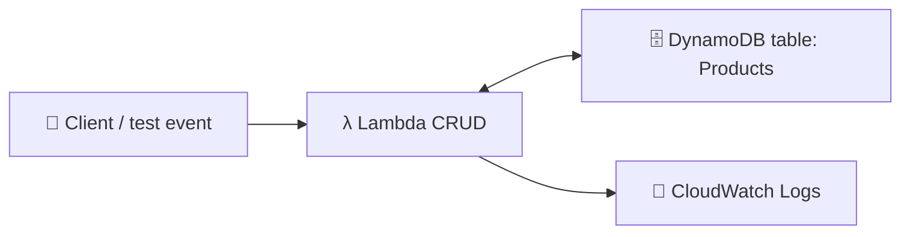
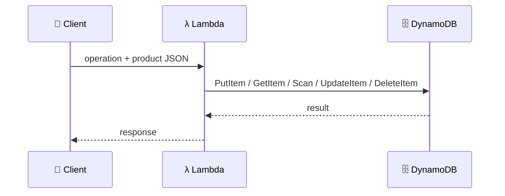

## What you build

A small product catalogue: Lambda functions that add, read, update and delete products stored in a DynamoDB table. The lab's walkthrough has no code in this text, so the steps below are generic; your handler names and attributes will differ.


*Lambda is the only thing that talks to the table; the role decides what it may do.*

## Architecture


*One request, one table call.*

DynamoDB has four basic CRUD operations, all atomic, and each needs the item's primary key (AWS docs):

| CRUD | Lab step | DynamoDB call |
|---|---|---|
| Create | Add Product | `PutItem` |
| Read one | Read Products | `GetItem` |
| Read all | Read Products | `Scan` |
| Update | Update Product | `UpdateItem` |
| Delete | Delete Product | `DeleteItem` |

- **Table**: needs a primary key (partition key, optionally a sort key), for example `productId`.
- **Capacity mode**: on-demand (pay per request) is AWS's default recommendation for most workloads; provisioned bills for capacity you set.
- **Execution role**: Lambda calls DynamoDB with it, so it must allow those actions on the table ARN.
- **Lambda**: one function per operation, or one function that switches on an `operation` field (the pattern in the AWS Lambda tutorial).

## Steps

1. **Intro**: pick a Region and use it for both the table and the functions.
2. **Create the table**: DynamoDB > Tables > Create table, name `Products`, partition key `productId` (String), keep on-demand capacity.
3. **Create the function**: Lambda > Create function > Author from scratch, a Node.js or Python runtime. Set the table name in code or an environment variable.
4. **Give permissions**: add `dynamodb:PutItem`, `GetItem`, `Scan`, `UpdateItem`, `DeleteItem` for the table ARN to the execution role.
5. **Add Product**: test event with a product JSON, handler calls `PutItem`. Check Explore table items.
6. **Read Products**: `GetItem` by `productId`, `Scan` for the full list.
7. **Update Product**: `UpdateItem` with the key and an update expression for the changed attribute (for example the price).
8. **Delete Product**: `DeleteItem` by key; read again to confirm it is gone.

```bash
aws dynamodb put-item --table-name Products \
  --item '{"productId":{"S":"p1"},"name":{"S":"Mug"},"price":{"N":"9"}}'
aws dynamodb scan --table-name Products
```

Expected result: each Lambda test returns success and the table's items view matches what you did.

## Common mistakes

| Mistake | Fix |
|---|---|
| `AccessDeniedException` | Add the action on the table ARN to the execution role |
| Function Region differs from table Region | Use the same Region everywhere |
| `Key` does not match the table schema | Send exactly the primary key attributes |
| Numbers sent as strings | Use the right attribute type (`N` vs `S`) |
| Surprise: `PutItem` overwrote data | Add a condition expression to block overwrites |

## Cleanup

1. Delete the Lambda function.
2. Delete the DynamoDB table `Products` (Tables > Delete).
3. Delete the execution role and its policy in IAM.
4. Delete the log group `/aws/lambda/<name>` in CloudWatch.

```bash
aws lambda delete-function --function-name products-crud
aws dynamodb delete-table --table-name Products
```

## On the job

- Lambda + DynamoDB is the standard serverless data backend; put API Gateway in front to expose it over HTTP.
- Prefer `Query` over `Scan` on big tables; design the key around your access pattern.
- Scope IAM to the exact table and only the needed actions.
- Default to on-demand capacity unless traffic is steady and predictable.

## AWS docs

- [Working with items and attributes in DynamoDB](https://docs.aws.amazon.com/amazondynamodb/latest/developerguide/WorkingWithItems.html)
- [Tutorial: Using Lambda with API Gateway](https://docs.aws.amazon.com/lambda/latest/dg/services-apigateway-tutorial.html)
- [DynamoDB on-demand and provisioned capacity](https://docs.aws.amazon.com/wellarchitected/latest/serverless-applications-lens/capacity.html)
