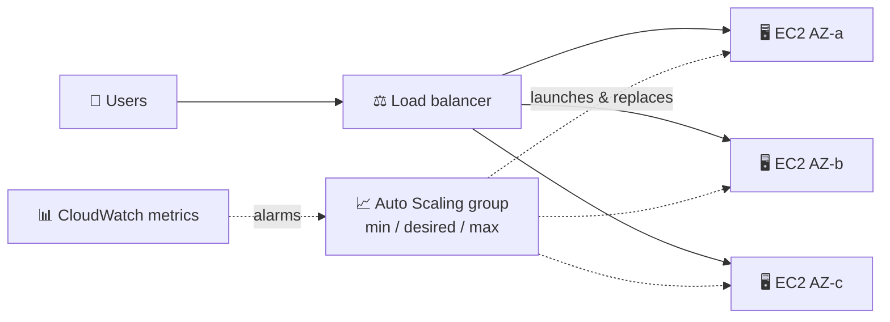
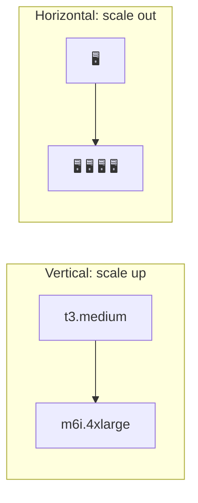
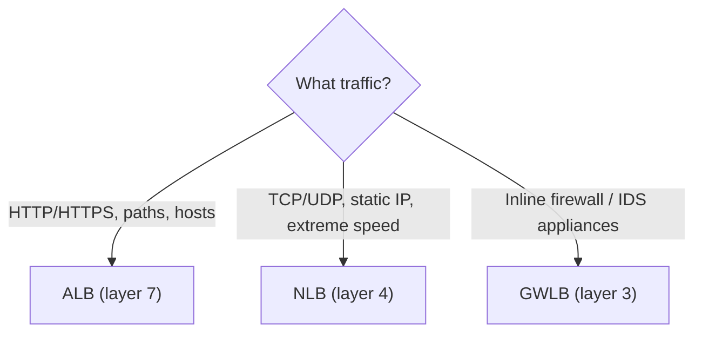
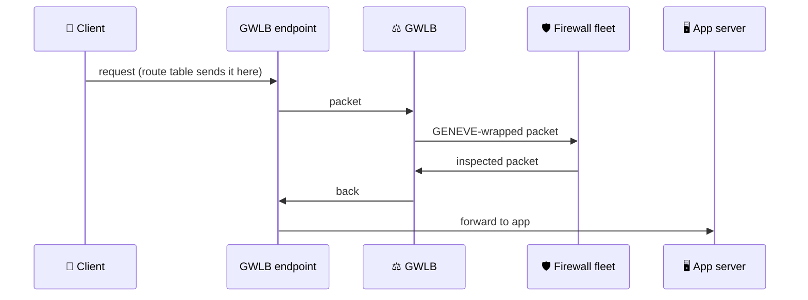
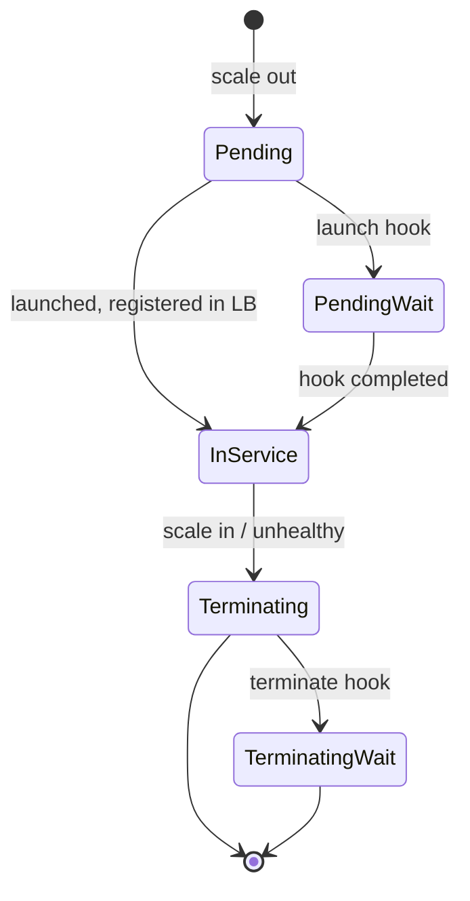
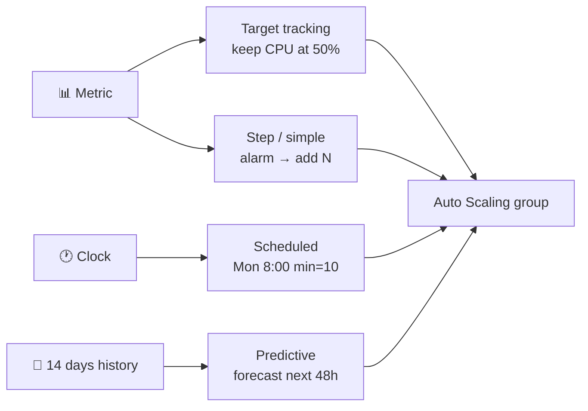
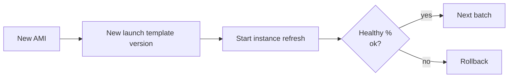

## What it is

An **Auto Scaling group (ASG)** keeps a fleet of identical EC2 instances at the right size. It launches instances from a **launch template**, replaces unhealthy ones, and adds or removes instances as load changes. Put it behind an **Elastic Load Balancer (ELB)** and users see one stable endpoint while the fleet grows and shrinks.

The problem it solves: a single server is a single point of failure, and a fixed fleet is either too small at peak or wasted at night.

*The load balancer spreads traffic; the ASG decides how many instances exist.*

Use it when: the app is stateless (or keeps state outside the instance) and load varies or you need self-healing.

## Key concepts

### Vertical vs horizontal scaling

*Vertical makes one box bigger; horizontal adds more boxes.*

| | Vertical | Horizontal |
|---|---|---|
| How | Bigger instance type | More instances |
| Downtime | Stop and start needed | None |
| Limit | Largest instance size | Much higher |
| Failure | Single point of failure | Survives losing one |

Auto Scaling is horizontal. Pair it with a load balancer so traffic reaches every new instance.

### Load balancer types: ALB, NLB, GWLB

*Choose by the protocol layer you need to understand.*

| | ALB | NLB | GWLB |
|---|---|---|---|
| Layer | 7 (HTTP/HTTPS) | 4 (TCP/UDP) | 3 (IP packets) |
| Routing | Path, host, header rules | By address and port | To appliance fleet |
| Client IP / address | Behind DNS name | Keeps source IP; fixed IP per AZ | Transparent |
| Typical target | Web apps, containers, Lambda | Games, IoT, TCP services | Third-party firewalls |

- **When to use ALB**: websites, REST APIs, microservices; path-based routing like `/api` to one group and `/img` to another.
- **When to use NLB**: non-HTTP protocols, clients that need a fixed IP, sudden traffic bursts, or when the target must see the client IP.
- **Both in one app**: yes. A common pattern is NLB in front (fixed IPs for partners) forwarding to an ALB (HTTP routing) as its target.
- Classic Load Balancer is the old generation; do not pick it for new work.

### Gateway Load Balancer (GWLB)

GWLB lets you run a fleet of virtual appliances (firewalls, intrusion detection) as a transparent "bump in the wire". It listens for all IP packets on all ports and forwards them to appliances using the **GENEVE** protocol on port 6081. Traffic is steered to it through **GWLB endpoints** and route tables.

*Traffic detours through the appliance fleet, which scales behind the GWLB.*

### How an ASG works

*Lifecycle hooks add wait states where you can run custom actions.*

- **Capacity**: you set min, desired and max. Scaling never goes outside min and max.
- **Launch template**: defines AMI, instance type, security groups, user data, IAM profile. Version it; the group uses the version you choose.
- **Subnets**: give the group subnets in several AZs and it spreads instances across them.
- **Health checks**: EC2 status checks always apply. Turn on the **ELB** health check type so app-level failures (bad HTTP response) also trigger replacement. A **grace period** delays checks on new instances so they can boot.
- **Lifecycle hooks**: pause an instance in `Pending:Wait` or `Terminating:Wait` (default timeout one hour; heartbeat extends it) to install software, register, or drain logs.
- **Instance refresh**: rolls a new launch template version across the fleet in batches, with a minimum healthy percentage; options include auto rollback and checkpoints.
- **ELB integration**: attach the group to a target group; new instances register automatically and terminating ones are deregistered first (connection draining if enabled).

### Scaling policies

*Four ways to change capacity: react to a metric, follow the clock, or forecast.*

- **Cooldown**: after a simple-scaling action, the group waits (default 300 seconds) before another. Scale-in policies can use a shorter cooldown of their own.
- **Instance warmup**: time a new instance needs before its metrics count, so the group does not over-scale.

### ELB pricing

You pay per load balancer-hour plus **LCUs** (load balancer capacity units). An LCU is measured on several dimensions (for ALB: new connections, active connections, processed bytes, rule evaluations) and you are billed only on the highest one. Prices differ by type and Region; check the current ELB pricing page. EC2 instance costs are billed separately.

## X vs Y

### Scaling policies

| | Target tracking | Step | Simple | Scheduled | Predictive |
|---|---|---|---|---|---|
| Trigger | Metric vs target | CloudWatch alarm, size of breach | CloudWatch alarm | Date/time | Forecast from history |
| You define | Metric + target | Alarm + steps | Alarm + one adjustment | Time + capacity | Metric + mode |
| Alarms | Managed for you | You create | You create | None | None |
| Scales in? | Yes | Via policy | Via policy | Yes (set capacity) | No, scale-out only |
| Cooldown | No (uses warmup) | No (uses warmup) | Yes | No | No |

Pick **target tracking** as the default for web apps. Pick **step** when you want bigger reactions to bigger breaches. Pick **simple** only for legacy setups. Pick **scheduled** for known events (a 9:00 office start, a sale). Pick **predictive** for recurring daily/weekly cycles, and combine it with a dynamic policy so the group can also scale in.

### ELB vs Auto Scaling group

| | ELB | Auto Scaling group |
|---|---|---|
| Job | Distribute traffic | Control instance count |
| Decides | Which instance gets a request | How many instances exist |
| Health | Stops sending traffic to bad targets | Replaces bad instances |
| Alone | Cannot add servers | Cannot spread traffic |

Use them together: ELB routes, ASG sizes.

## Job notes

- Build the launch template first, then the ASG with 2+ AZs, attach the target group, set health check type to ELB with a realistic grace period.
- Keep instances stateless: store sessions, uploads and data in ElastiCache, S3, EFS or a database. Instance data is lost when the group terminates it.
- Set min to at least 2 for high availability; set max as a cost guard.
- Predictive scaling needs at least 24 hours of metric data, starts in forecast-only mode, and does not scale in.
- Cost trap: a max set too high plus a runaway metric means a large bill. Add a billing alarm.
- Rollout flow for a new AMI:

*Instance refresh swaps instances batch by batch.*

- Troubleshooting: instance stuck in `Pending:Wait` means a lifecycle hook is waiting; complete it or wait for the timeout. Instances replaced in a loop usually mean a too-short grace period or a failing health check path.
- Quotas and exact limits change; check the current Auto Scaling quotas page.

## Cheat sheet

- ASG = min / desired / max + launch template + subnets across AZs.
- Horizontal scaling adds instances; vertical makes one bigger and needs a restart.
- ALB = HTTP layer 7; NLB = TCP/UDP layer 4, fixed IPs; GWLB = layer 3, GENEVE, firewalls.
- ALB and NLB can be chained in one application.
- Health check type ELB catches app failures; grace period protects booting instances.
- Lifecycle hooks: `Pending:Wait` and `Terminating:Wait`, default one hour.
- Default for web apps: target tracking. Scheduled for known peaks. Predictive for cycles, plus a dynamic policy.
- Simple scaling uses cooldown (default 300 s); others use instance warmup.
- Instance refresh = rolling update to a new launch template.
- ELB cost = hours + LCUs; EC2 billed separately.

## AWS docs

- [Target tracking scaling policies](https://docs.aws.amazon.com/autoscaling/ec2/userguide/as-scaling-target-tracking.html)
- [Step and simple scaling policies](https://docs.aws.amazon.com/autoscaling/ec2/userguide/as-scaling-simple-step.html)
- [How predictive scaling works](https://docs.aws.amazon.com/autoscaling/ec2/userguide/predictive-scaling-policy-overview.html)
- [How lifecycle hooks work](https://docs.aws.amazon.com/autoscaling/ec2/userguide/lifecycle-hooks-overview.html)
- [Using Elastic Load Balancing with your Auto Scaling group](https://docs.aws.amazon.com/autoscaling/ec2/userguide/autoscaling-load-balancer.html)
