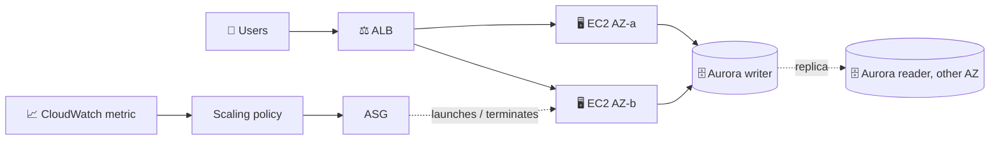
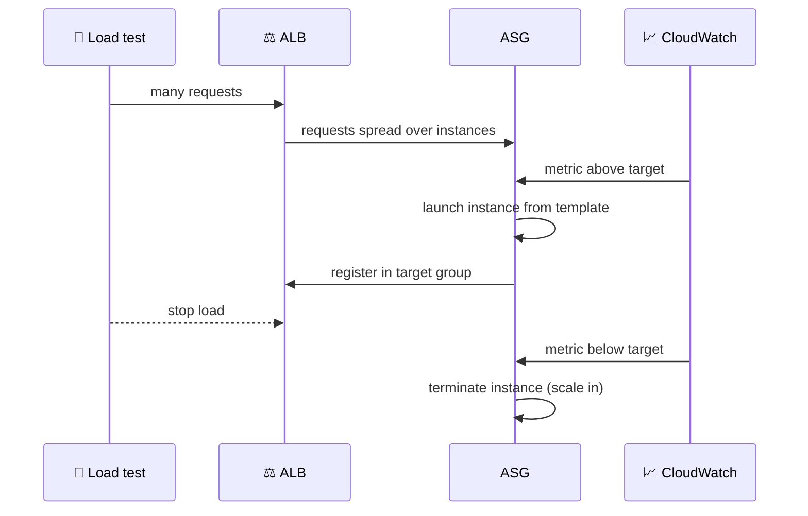

## What you build

A web tier that grows and shrinks by itself: an Application Load Balancer (ALB) spreads traffic over EC2 instances in an Auto Scaling group (ASG), and the instances talk to an Aurora database. Load makes the ASG add instances (scale out); when load stops, it removes them (scale in).


*The ASG is the controller; the ALB and the launch template are what it plugs into.*

Note: the lab's own app (what runs on the instances) is not described in the syllabus. Steps below are generic; use the course's user-data script or your own simple web page.

## Architecture


*Scale out and scale in are the same loop: metric, policy, change desired capacity.*

- **Launch template**: the recipe for each instance (AMI, instance type, security group, user data). Versioned.
- **ASG**: keeps min to max instances across AZs, replaces unhealthy ones, and is attached to the ALB target group.
- **ALB + target group**: spreads requests and runs health checks. Routing algorithm and stickiness are target group settings.
- **Scaling policy**: target tracking is the simplest. You pick a metric (average CPU or ALB request count per target) and a target value, and Auto Scaling manages the alarms for you. Step scaling uses alarms you create.
- **Aurora**: provisioned instance or Serverless v2. For high availability add a reader in a second AZ.

| Database choice | Good for | Note |
|---|---|---|
| Provisioned instance | Steady, predictable load | Fixed size you pick |
| Serverless v2 | Spiky or unknown load | Capacity scales with load |

| ALB routing algorithm | Behaviour |
|---|---|
| Round robin (default) | Even, in order; fine for similar requests |
| Least outstanding requests | Favours the least busy target; good for uneven requests |
| Weighted random | Random; cannot be used with sticky sessions |

## Steps

1. **Database**: RDS > Create database > Aurora. Choose a provisioned instance or Serverless v2, and add a reader in a different AZ for HA.
2. **Security groups**: ALB group allows 80 from anywhere; instance group allows 80 only from the ALB group; DB group allows the DB port only from the instance group.
3. **Launch template**: EC2 > Launch Templates > Create. Set AMI, instance type, instance security group, and user data that starts a web server (and points to the DB endpoint if your app uses it).
4. **Target group and ALB**: EC2 > Target Groups (instances, HTTP 80, health check path `/`), then Load Balancers > Create ALB (internet-facing, at least two AZs, listener 80 forwards to the target group).
5. **Auto Scaling group**: EC2 > Auto Scaling Groups > Create from the launch template, pick two or more subnets in different AZs, attach the target group, turn on ELB health checks. Set min 1 or 2, desired 2, max 4 (example numbers).
6. **Verify**: open the ALB DNS name and refresh. The target group should show all instances healthy.
7. **Scaling policy**: ASG > Automatic scaling > Create dynamic scaling policy > Target tracking, metric Average CPU utilization (or ALB request count per target), target for example 50.
8. **Optional alarm**: for step scaling, create CloudWatch alarms yourself and map them to add/remove steps. Target tracking needs none.
9. **Load test and scale out**: run a load tool against the ALB DNS name (for example `ab` or `hey`). Watch ASG > Activity and Monitoring; new instances appear and register.
10. **Scale in**: stop the load. After the metric stays low, the ASG terminates instances back toward the minimum.
11. **Stickiness**: Target group > Attributes > Stickiness on (load balancer cookie, set a duration). Re-test: one client now hits one instance. Try changing the routing algorithm too.
12. **Verify database HA**: RDS > select the cluster > Actions > Fail over. The reader is promoted; the app should reconnect through the cluster endpoint.
13. **Purchase options**: in the ASG, switch to a mixed instances policy to blend On-Demand and Spot, with several instance types. Needs a launch template.

```bash
aws autoscaling put-scaling-policy --auto-scaling-group-name web-asg \
  --policy-name cpu50 --policy-type TargetTrackingScaling \
  --target-tracking-configuration '{"PredefinedMetricSpecification":{"PredefinedMetricType":"ASGAverageCPUUtilization"},"TargetValue":50.0}'
```

Expected result: under load the instance count rises above the minimum and then falls back after the load ends.

## Common mistakes

| Mistake | Fix |
|---|---|
| Targets unhealthy, ASG keeps replacing instances | Health check path must return 200; instance SG must allow the ALB SG |
| Scaling never triggers | Metric has no data or target is too high; check the policy and ASG min/max |
| Instances flap in and out | Set instance warmup so new instances are not judged before they are ready |
| ASG max equals desired | Raise max; policies cannot go beyond the min-max range |
| Sticky sessions hide the load balancing | Expected: one client sticks to one target; test with many clients |
| Spot instance disappears | Spot can be interrupted; the ASG launches a replacement, so keep the app stateless |

## Cleanup

Delete in this order so nothing relaunches or keeps billing:

1. ASG: set min, desired to 0 or delete the ASG (this terminates its instances). Delete scaling policies and your CloudWatch alarms.
2. ALB: delete the load balancer, then the target group.
3. Launch template: delete it.
4. Aurora: delete the reader, then the writer instance, then the cluster (choose whether to keep a final snapshot; delete snapshots you do not need).
5. Security groups: delete instance, ALB and DB groups (instances and DB first, otherwise they are in use).
6. Check EC2 > Instances and RDS show nothing left, and delete the Elastic IPs or log groups you created.

```bash
aws autoscaling delete-auto-scaling-group --auto-scaling-group-name web-asg --force-delete
aws elbv2 delete-load-balancer --load-balancer-arn <alb-arn>
aws elbv2 delete-target-group --target-group-arn <tg-arn>
aws ec2 delete-launch-template --launch-template-name web-lt
```

## On the job

- Keep instances stateless: store sessions and files outside the instance so scale-in and replacement are harmless.
- Prefer target tracking; use step scaling only for special spike handling.
- Spread the ASG over at least two AZs and use ELB health checks.
- Use Spot only for fault-tolerant capacity; keep a base of On-Demand.
- The Aurora cluster endpoint, not an instance endpoint, is what the app should use so failover is automatic.

## AWS docs

- [Target tracking scaling policies for Amazon EC2 Auto Scaling](https://docs.aws.amazon.com/autoscaling/ec2/userguide/as-scaling-target-tracking.html)
- [Edit target group attributes for your Application Load Balancer](https://docs.aws.amazon.com/elasticloadbalancing/latest/application/edit-target-group-attributes.html)
- [How Aurora Serverless works](https://docs.aws.amazon.com/AmazonRDS/latest/AuroraUserGuide/aurora-serverless-v2.how-it-works.html)
