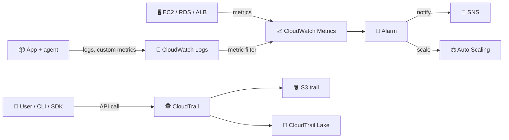
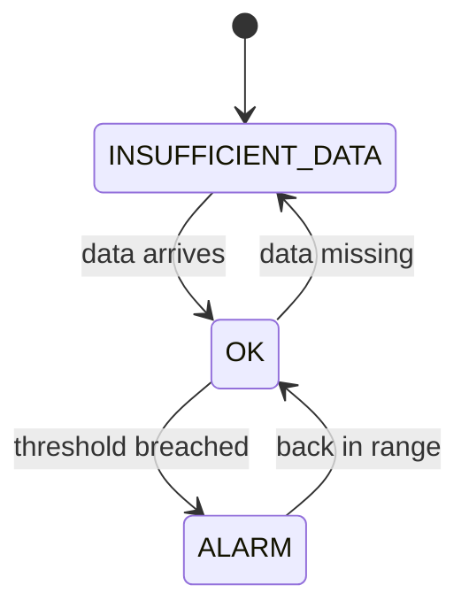
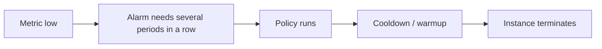
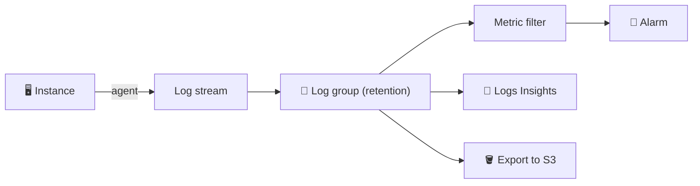
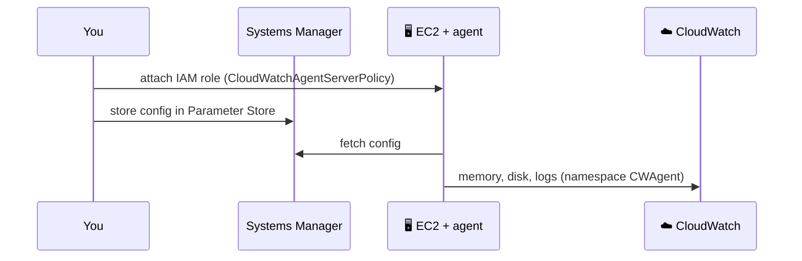
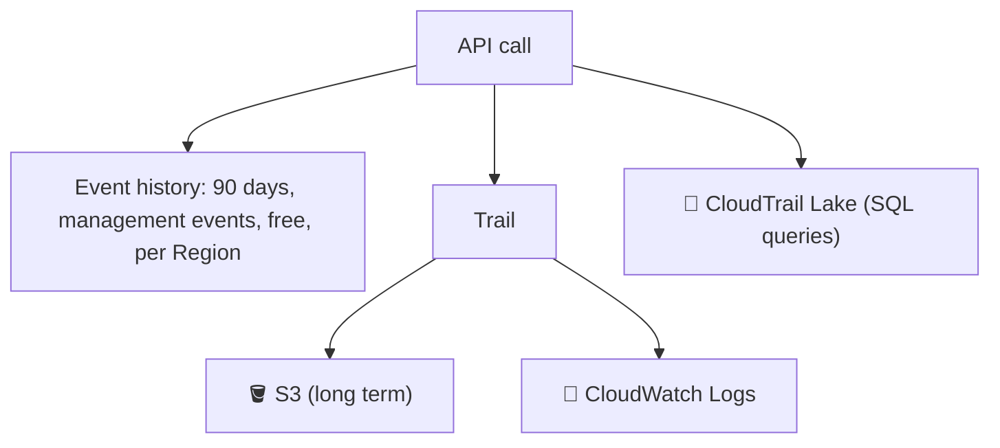
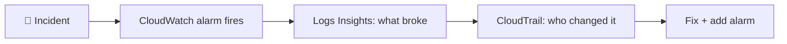

## What it is

**CloudWatch** answers "how is it running?" (metrics, logs, alarms). **CloudTrail** answers "who did what, and when?" (a record of API calls). Both are on by default in a basic form, and you will use both on every job.


*Monitoring (left, CloudWatch) vs auditing (bottom, CloudTrail).*

Use CloudWatch when you need to watch health and react. Use CloudTrail when you need to prove or find who changed something.

## Key concepts

### Metrics, console and detailed monitoring

A **metric** is a time series (for example `CPUUtilization`) with a namespace, a name and dimensions (such as `InstanceId`). A statistic (Average, Max, Sum) is computed over a period.

| EC2 monitoring | Period | Cost |
|---|---|---|
| Basic (default) | 5 minutes (status checks 1 minute) | Free |
| Detailed | 1 minute | Charged per metric sent |

- Console: **CloudWatch > Metrics > All metrics**, pick a namespace (`AWS/EC2`), add to a graph, change the period. Dashboards pin graphs for the team.
- Detailed monitoring is a checkbox at launch or on a running instance. Use it when scaling must react within a minute.
- EC2 does not send memory or disk-used by default; you need the agent (below).
- Check the CloudWatch pricing page for current numbers.

### Alarms


*An alarm is always in one of three states; actions fire on transitions.*

- An alarm watches one metric (or a math expression), compares it to a threshold over N periods, and runs actions: SNS notification, Auto Scaling policy, EC2 stop/terminate/reboot/recover.
- Actions run on state change, not repeatedly while the state persists.
- A new alarm starts in INSUFFICIENT_DATA until the first evaluation.
- Auto Scaling target-tracking policies create and manage their own alarms for you.

### Why is ASG scale-in slow?


*Every step adds delay before an instance disappears.*

- Basic monitoring gives 5-minute data points, so the alarm sees the drop late. Detailed monitoring (1 minute) speeds this up.
- Scale-in is intentionally more cautious than scale-out so capacity is not removed on a short dip. Check the Auto Scaling docs for the exact evaluation rules.
- Cooldowns, instance warmup and lifecycle hooks also delay termination. See [Auto Scaling](/chapters/26-aws-auto-scaling/).

### CloudWatch Logs and Logs Insights


*Streams live inside a group; the group holds retention and access settings.*

- **Log group** = one app or service; **log stream** = one source (an instance or container).
- Default retention is never expire; set a retention period (1 day to 10 years). Expired logs cannot be recovered.
- **Metric filter** turns a text pattern (e.g. `ERROR`) into a metric you can alarm on.
- **Logs Insights** is an interactive query language over groups:

```
fields @timestamp, @message
| filter @message like /ERROR/
| sort @timestamp desc
| limit 20
```

### CloudWatch agent (unified agent)


*Install, give a role, give a config, and data flows out.*

1. Attach an IAM instance profile that lets the agent write to CloudWatch.
2. Install the package (or via Systems Manager) and create the config (wizard or JSON).
3. Start the agent; new metrics appear under the `CWAgent` namespace, logs in the groups you named.

```json
{ "metrics": { "metrics_collected": {
  "mem":  { "measurement": ["mem_used_percent"] },
  "disk": { "measurement": ["disk_used_percent"], "resources": ["*"] } } } }
```

- Default Linux config path: `/opt/aws/amazon-cloudwatch-agent/etc/amazon-cloudwatch-agent.json`. After editing, restart the agent.
- Keeping the config in Parameter Store lets new instances pick it up at boot.
- The agent works on EC2, on-premises servers, Linux and Windows. Memory and disk metrics are custom metrics and are billed as such.

### EventBridge integration

CloudWatch alarm state changes and many AWS service events (for example EC2 state change) arrive on EventBridge, where a rule can invoke Lambda, SNS, SSM and more. CloudTrail API calls can also trigger rules, so "when someone changes a security group, run a function" is possible.

### CloudTrail: event history, trails, event types, Lake


*Event history is automatic; trails and Lake are what you set up for more.*

| Concept | What it is |
|---|---|
| Event history | Last 90 days of management events, searchable and downloadable, no setup |
| Trail | Delivers events to S3 (optionally CloudWatch Logs); needed to keep records beyond 90 days or to capture data events |
| Management events | Control-plane actions: create/delete a bucket, change IAM, edit a route table. Logged by default |
| Data events | High-volume resource operations (such as S3 object reads/writes, Lambda invokes). Off by default, must be enabled, extra cost |
| CloudTrail Lake | Managed event store you query with SQL; retention and pricing are separate (check the pricing page) |

- One copy of management events delivered to S3 by a trail is free; extra copies and data events are charged.
- Event history is per Region and shows management events only.
- Demo steps: Event history > filter `Event name = ConsoleLogin` or `TerminateInstances` > open the event > see user, source IP, time. Then **Trails > Create trail**, pick an S3 bucket, all Regions.

## X vs Y

CloudWatch vs CloudTrail vs Config.

| | CloudWatch | CloudTrail | AWS Config |
|---|---|---|---|
| Question | How is it performing? | Who made which API call? | What does the resource configuration look like, and did it change? |
| Data | Metrics, logs, events | API activity | Configuration items and compliance |
| Typical use | Alarms, dashboards, scaling | Audit, security investigation | Compliance rules, drift history |

- Pick **CloudWatch** when you want to alert on CPU, errors or latency.
- Pick **CloudTrail** when you ask "who deleted this?".
- Pick **Config** when you ask "is this resource compliant, and what did it look like last week?" (I did not verify Config details in the docs for this chapter.)

## Job notes


*A typical investigation uses both services in order.*

- Set log retention on every log group; the default is forever and storage grows quietly.
- Create an organisation-wide trail to S3 and protect the bucket; event history alone loses data after 90 days.
- Enable data events only for the buckets or functions you need; they are high volume.
- No memory graph for EC2? Install the agent. Alarm stuck at INSUFFICIENT_DATA? Check the metric name, dimensions and that data is arriving.
- Always point alarms at an SNS topic someone reads.
- Custom metrics, detailed monitoring, log ingestion and queries are billed: check current pricing.

## Cheat sheet

- CloudWatch = metrics, logs, alarms, dashboards. CloudTrail = API audit. Config = resource configuration history.
- EC2 basic metrics every 5 minutes (free); detailed 1 minute (paid).
- No memory or disk-used metric without the CloudWatch agent (`CWAgent`).
- Alarm states: OK, ALARM, INSUFFICIENT_DATA; actions fire on change.
- Log groups keep logs forever unless you set retention.
- Logs Insights queries logs; metric filters turn logs into alarms.
- CloudTrail event history: 90 days, management events, per Region, free.
- Trail to S3 for long-term; data events need explicit opt-in.
- CloudTrail Lake = SQL over events.

## AWS docs

- [Monitor your instances using CloudWatch](https://docs.aws.amazon.com/AWSEC2/latest/UserGuide/using-cloudwatch.html)
- [Manage detailed monitoring for EC2 instances](https://docs.aws.amazon.com/AWSEC2/latest/UserGuide/manage-detailed-monitoring.html)
- [Collect metrics, logs and traces with the CloudWatch agent](https://docs.aws.amazon.com/AmazonCloudWatch/latest/monitoring/Install-CloudWatch-Agent.html)
- [Working with CloudTrail event history](https://docs.aws.amazon.com/awscloudtrail/latest/userguide/view-cloudtrail-events.html)
