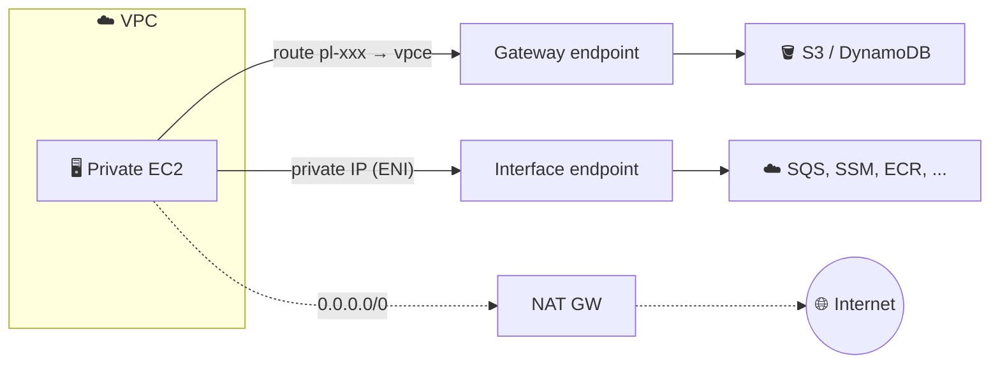
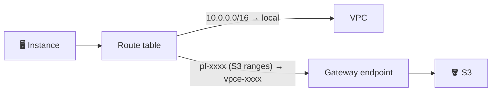
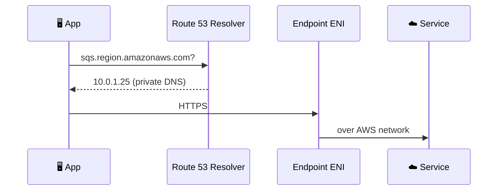
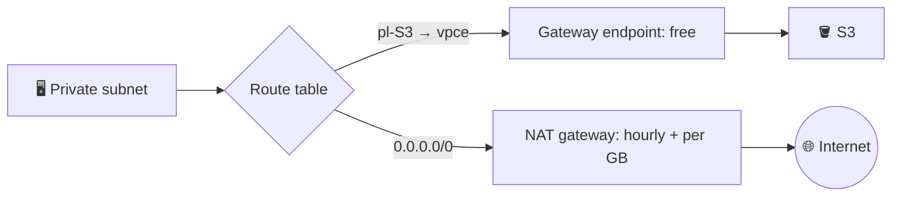

## What it is

A **VPC endpoint** lets resources in your VPC reach an AWS service over the AWS network, with no internet gateway, NAT gateway or public IP. There are two main kinds: **gateway** (S3 and DynamoDB only) and **interface** (many services, powered by AWS PrivateLink). For VPC basics see [Networking Basic](/chapters/05-networking-basic/).


*Two private paths to AWS services (solid) versus the NAT path via the internet (dotted).*

Use it when: private instances call AWS services and you want more security, or less NAT cost.

## Key concepts

### Types of endpoint

| | Gateway | Interface |
|---|---|---|
| Services | S3, DynamoDB | Many AWS services, your own or partner services |
| How it works | Route in route table (prefix list to endpoint) | ENI with private IP in each chosen subnet |
| Security group | No (your instance SG must allow the prefix list) | Yes, on the endpoint ENI |
| Reach from on-premises/peering | No | Yes (private IP) |

- Both kinds are Regional. Create the endpoint in the same Region as the service.
- A third kind, Gateway Load Balancer endpoint, is for traffic inspection appliances; not covered here.

### Gateway endpoint: route tables


*Creating the endpoint adds a prefix-list route to the route tables you pick.*

- You select the route tables (subnets) that get the route. Subnets with other route tables do not use it.
- The instance still calls the normal S3 name; the route sends matching traffic through the endpoint.
- Security groups on instances must allow outbound to the S3 prefix list; NACLs need the IP ranges (they cannot use prefix lists).
- VPC needs DNS resolution and DNS hostnames enabled when using Amazon DNS.
- Creating or changing the endpoint resets open TCP connections, so do it off-peak.

### Interface endpoint: ENIs and DNS


*With private DNS on, the normal service name resolves to the endpoint's private IP.*

- One ENI per subnet you select; use one subnet per AZ for high availability.
- Two DNS names: the default service name (works with **Private DNS** enabled, so no code change) and an endpoint-specific `vpce-...vpce.amazonaws.com` name.
- Private DNS works only inside the VPC with the endpoint. For other VPCs or on-premises you need Route 53 Resolver rules or private hosted zones.
- Attach a **security group** to the endpoint: allow inbound 443 from your clients.

### Endpoint policies

- A resource policy on the endpoint that limits which principals, actions and resources can pass through it.
- The default policy allows full access. It does not replace IAM or bucket policies; all must allow.
- Typical use: allow only your S3 buckets, or require the VPC endpoint in a bucket policy.

```json
{
  "Statement": [{
    "Effect": "Allow",
    "Principal": "*",
    "Action": ["s3:GetObject", "s3:PutObject"],
    "Resource": "arn:aws:s3:::my-app-bucket/*"
  }]
}
```

### Pricing

| | Gateway | Interface |
|---|---|---|
| Hourly | Free | Per endpoint, per AZ, per hour |
| Data | Free | Per GB processed |

- Interface endpoints bill for each hour provisioned in each AZ plus data processed; gateway endpoints have no hourly or data charge.
- Rates change and differ by Region: check the current [PrivateLink pricing](https://aws.amazon.com/privatelink/pricing/).

## X vs Y

### Gateway vs interface endpoint (S3 and DynamoDB)

S3 supports both types; DynamoDB is covered here with the gateway type.

| | Gateway | Interface |
|---|---|---|
| Cost | Free | Hourly + per GB |
| From on-premises / peered VPC | No | Yes |
| Needs route table change | Yes | No (DNS) |
| Security group | No | Yes |

Pick gateway when workloads are inside the VPC and the service is S3 or DynamoDB. Pick interface for every other service, or when on-premises or other VPCs need private access.

### Endpoint vs NAT gateway


*The more specific prefix-list route wins over 0.0.0.0/0, so S3 traffic bypasses NAT.*

| | VPC endpoint | NAT gateway |
|---|---|---|
| Reaches | One AWS or PrivateLink service | Any internet destination |
| Traffic path | AWS network only | Via the internet gateway |
| Cost | Gateway free; interface hourly + GB | Hourly + per GB processed |
| Policy control | Endpoint policy | None |

Pick endpoints for AWS service traffic. Pick NAT for third-party internet destinations (patches, SaaS APIs).

## Job notes

### Saving cost with endpoints

- NAT data processing is charged per GB even for traffic going to S3 in the same Region; AWS docs suggest endpoints for such traffic.
- First move: add S3 and DynamoDB gateway endpoints to every VPC. It is free.
- Check Cost Explorer or VPC Flow Logs to find which services dominate NAT traffic; add interface endpoints only if the saved NAT GB cost beats the endpoint hourly cost (times AZs).
- Keep NAT clients in the same AZ as the NAT gateway to avoid cross-AZ charges.

### Demo steps (console, merged)

1. VPC console > **Endpoints** > **Create endpoint**.
2. Pick the service (for example `com.amazonaws.<region>.s3`); the type shows as Gateway or Interface.
3. Gateway: choose route tables. Interface: choose subnets, security group, keep **Enable DNS name** on.
4. Optionally edit the policy, then create.
5. Test from a private instance: `aws s3 ls`, with the NAT route removed, still works for the gateway endpoint.

### Troubleshooting

- S3 times out: check the route table has the prefix-list route, and SG/NACL allow S3.
- Interface endpoint timeouts: endpoint SG must allow 443 from the client; check DNS resolves to a private IP.
- Access denied: check the endpoint policy first, then IAM and bucket policy.
- Gateway endpoint does not help from on-premises, VPN, peering or Transit Gateway.

## Cheat sheet

- Gateway endpoint: S3 + DynamoDB, route table, free, VPC-only.
- Interface endpoint: ENI + private IP, many services, hourly + per GB, usable from on-premises.
- Private DNS makes the normal service name resolve to the endpoint ENI.
- Endpoint policy: default allow-all; add least privilege; works with IAM and bucket policies.
- Endpoints cut NAT cost; NAT is still needed for the public internet.
- Prices and quotas change: check the current pages.

## AWS docs

- [Gateway endpoints for Amazon S3](https://docs.aws.amazon.com/vpc/latest/privatelink/vpc-endpoints-s3.html)
- [Access an AWS service using an interface VPC endpoint](https://docs.aws.amazon.com/vpc/latest/privatelink/create-interface-endpoint.html)
- [Control access to VPC endpoints using endpoint policies](https://docs.aws.amazon.com/vpc/latest/privatelink/vpc-endpoints-access.html)
- [Pricing for NAT gateways](https://docs.aws.amazon.com/vpc/latest/userguide/nat-gateway-pricing.html)
