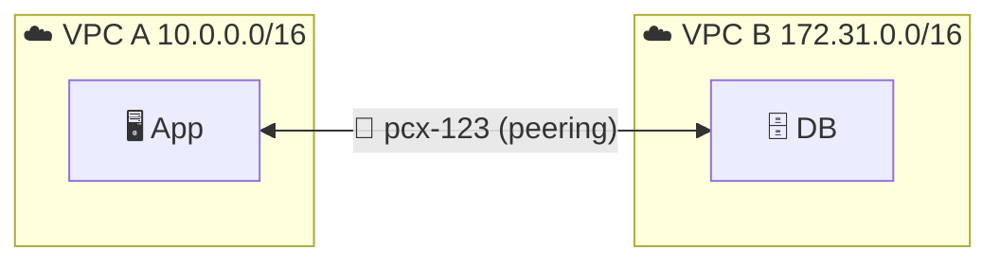
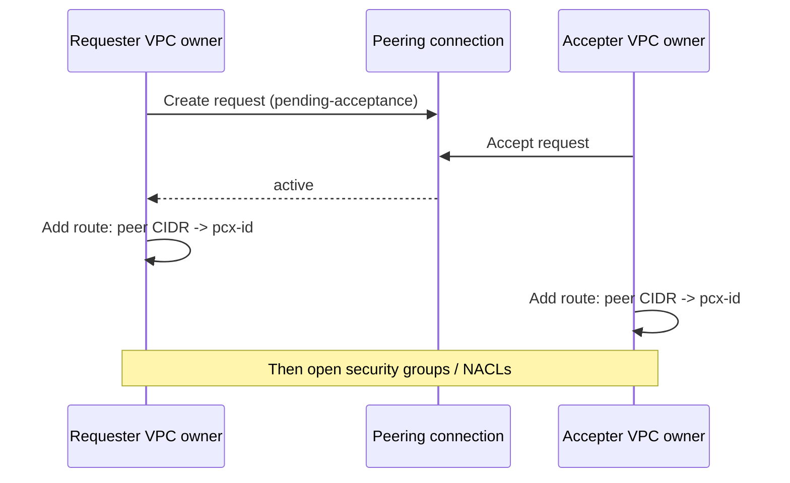
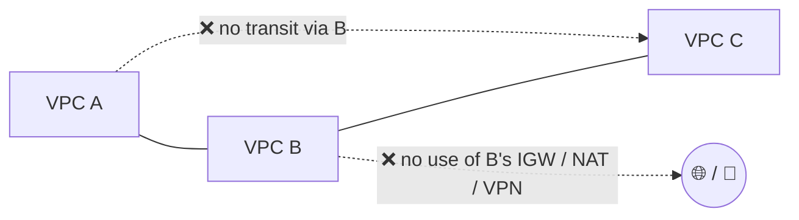
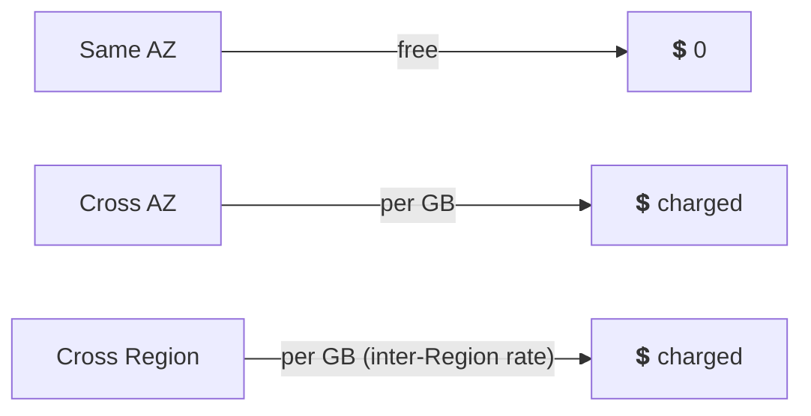

## What it is

A **VPC peering connection** is a private, direct link between two VPCs. Instances talk using private IP addresses as if on one network, over the AWS network, not the internet. The VPCs can be in the same account or different accounts, and in the same Region or different Regions. VPC basics are in [Networking Basic](/chapters/05-networking-basic/).


*Two VPCs, one peering connection, private IPs end to end.*

Use it when you have a few VPCs that must talk directly and you control both sides.

## Key concepts

### Request, accept, route

The **requester** VPC owner sends the request; the **accepter** VPC owner accepts it. In one account you do both yourself. A request left alone expires after 7 days.


*Active peering carries no traffic until both sides have routes and firewall rules.*

- **Route tables:** add a route on BOTH sides, destination = the other VPC's CIDR, target = the `pcx-...` connection. Do it for every route table whose subnets need access.
- **Security groups and NACLs** still apply. Allow the peer CIDR, or, where supported, reference the peer's security group (check the docs for same-Region and cross-account rules).
- **Cross-account:** the accepter account must accept (and see the trust warning below). **Cross-Region:** works, traffic stays on the AWS backbone; you accept in the accepter's Region.

### Rules that bite


*Peering is point-to-point: no transitive routing and no edge-to-edge routing.*

| Rule | Meaning |
|---|---|
| Non-overlapping CIDR | Matching or overlapping IPv4/IPv6 ranges cannot be peered (request goes `failed`) |
| Not transitive | A-B and B-C does not give A-C; add A-C |
| No edge-to-edge | A peer cannot use your IGW, NAT, VPN or Direct Connect |
| One connection per pair | Not more than one peering between the same two VPCs |
| Quota | Active peerings per VPC are limited; check the current quota |

### DNS resolution

By default a peer's private DNS name may not resolve to the private IP. Turn on **DNS resolution** for the peering connection (each side's owner does their own side) and make sure DNS hostnames and DNS support are on in both VPCs. The docs say this option is not available for peered VPCs in different accounts or Regions for the "local VPC query" modify option, so for those cases test it, or use your own private DNS records. You cannot query the Amazon DNS server of a peer VPC directly.

### Pricing and data transfer

- No charge to create a peering connection.
- Data transfer within one Availability Zone is free, even across accounts.
- Cross-AZ and cross-Region traffic is charged per GB; check current EC2 data transfer pricing.


*Keep chatty services in the same AZ ID to cut cost.*

### Demo and speed tests (lab recap)

1. Create two VPCs with non-overlapping CIDRs, each with a public subnet and a web server (EC2).
2. VPC console: Peering connections, Create, pick requester and accepter, then Actions, Accept request.
3. Add a route in each VPC route table to the other CIDR via `pcx-...`; allow ICMP/HTTP from the peer CIDR.
4. Test from one server to the other's **private IP** (ping, `curl`, or `iperf3` for speed).

```bash
aws ec2 create-vpc-peering-connection --vpc-id vpc-aaa --peer-vpc-id vpc-bbb
aws ec2 accept-vpc-peering-connection --vpc-peering-connection-id pcx-123
aws ec2 create-route --route-table-id rtb-aaa \
  --destination-cidr-block 172.31.0.0/16 --vpc-peering-connection-id pcx-123
```

Speed results: same-Region peering behaves like the same network, so latency is lowest. Cross-Region adds distance latency, so expect higher latency than in-Region (measure with your own test; the numbers depend on the Regions).

### Pros and cons

| Pros | Cons |
|---|---|
| Simple, no extra device or hourly fee | Not transitive: many VPCs means a mesh (n(n-1)/2 connections) |
| Lowest latency, no single bottleneck | CIDRs must not overlap |
| Works cross-account and cross-Region | No sharing of VPN/Direct Connect/IGW/NAT |
| Security groups and NACLs control access | Each connection and route is managed by hand |

## X vs Y

VPC peering vs Transit Gateway vs PrivateLink:

| | VPC peering | Transit Gateway | PrivateLink |
|---|---|---|---|
| Model | Point-to-point, full VPC to VPC | Hub-and-spoke | One service exposed to consumers |
| Transitive | No | Yes | n/a |
| Overlapping CIDR | Not allowed | Not allowed in routing | Allowed |
| On-prem sharing | No | Yes (VPN/DX attached once) | No |
| Direction | Both ways | Both ways | Consumer to provider |
| Cost | No hourly fee | Hourly per attachment plus data (check pricing) | Hourly per endpoint plus data (check pricing) |
| Scale | Fewer than about 10 VPCs is comfortable | Thousands of VPCs | Many consumers |

Pick **VPC peering** when a few VPCs need full, cheap, low-latency connectivity. Pick **Transit Gateway** when you have many VPCs or need on-premises sharing and transitive routing. Pick **PrivateLink** when you expose one service to others, or the VPC CIDRs overlap.

## Job notes

- **Plan CIDRs first.** Overlap is the one thing you cannot fix without re-creating a VPC.
- **Do not accept** peering requests from accounts you do not know (peer phishing); reject or let them expire.
- **Troubleshoot in order:** peering is `active`, routes on both sides, security group, NACL, DNS.
- Use specific routes (peer CIDR), not `0.0.0.0/0`, to the peering connection.
- Hybrid traffic: attach VPN or Direct Connect to each VPC, or move to Transit Gateway.
- Cost trap: cross-AZ and cross-Region data. Check current pricing.

## Cheat sheet

- Peering = private, direct, 1:1 link between two VPCs (cross-account and cross-Region OK).
- Request, accept (7-day expiry), route both sides, open firewalls.
- CIDRs must not overlap. No transitive routing. No edge-to-edge (IGW/NAT/VPN/DX).
- Turn on DNS resolution for private names.
- Same-AZ data free; cross-AZ and cross-Region charged.
- Many VPCs or hybrid: Transit Gateway. One service or overlapping CIDR: PrivateLink.

## AWS docs

- [What is VPC peering?](https://docs.aws.amazon.com/vpc/latest/peering/what-is-vpc-peering.html)
- [How VPC peering connections work](https://docs.aws.amazon.com/vpc/latest/peering/vpc-peering-basics.html)
- [Accept or reject a VPC peering connection](https://docs.aws.amazon.com/vpc/latest/peering/accept-vpc-peering-connection.html)
- [Building a scalable, secure multi-VPC network: VPC peering](https://docs.aws.amazon.com/whitepapers/latest/building-scalable-secure-multi-vpc-network-infrastructure/vpc-peering.html)
