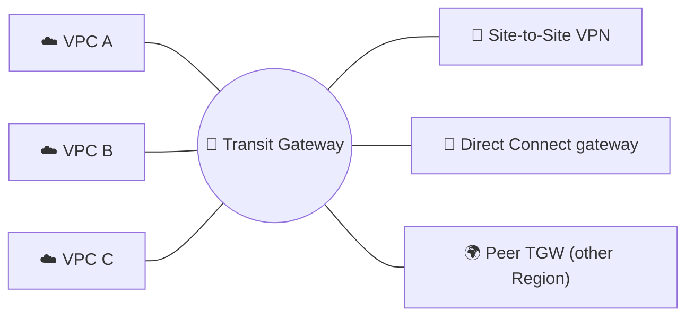
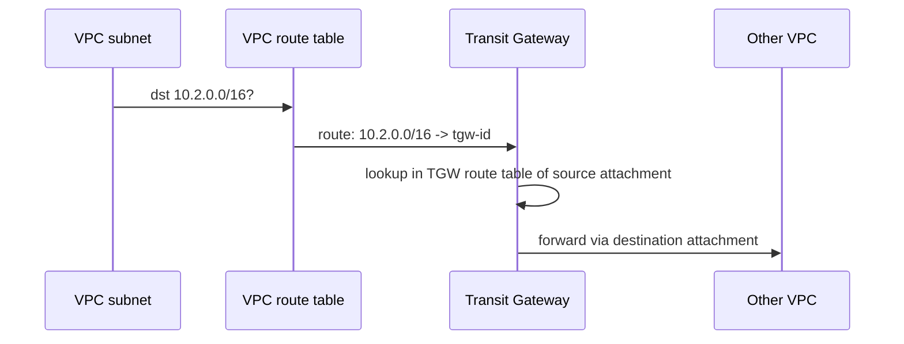
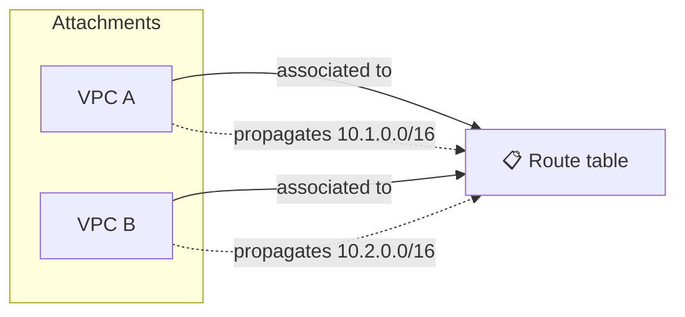
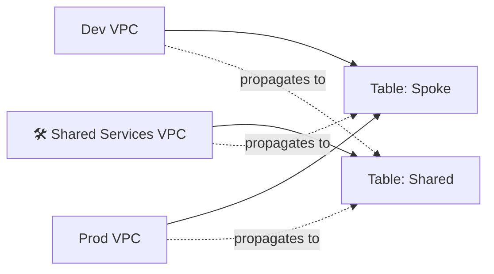
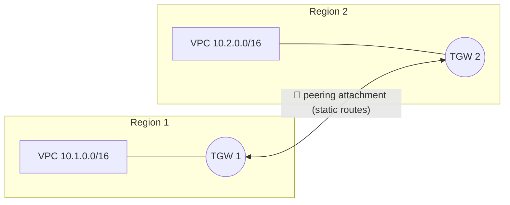

## What it is

**AWS Transit Gateway (TGW)** is a managed, regional router that connects many VPCs and on-premises networks through one hub. Each network is plugged in once with an **attachment**, instead of being linked to every other network. It supports transitive routing, which VPC peering ([previous chapter](/chapters/30-aws-networking-services-vpc-peering/)) does not. VPC basics are in [Networking Basic](/chapters/05-networking-basic/).


*Hub and spoke: every network attaches once, the hub routes between them.*

Use it when you have many VPCs, need on-premises shared by all, or need to control who can talk to whom.

## Key concepts

### Attachments

An attachment is the plug between a network and the TGW. Supported types include VPC, VPN, Direct Connect gateway, peering with another TGW, Connect (SD-WAN appliance), and Client VPN.

- **VPC attachment:** you pick one subnet per Availability Zone. The TGW places a network interface (one IP) in each chosen subnet. Use at least two AZs for availability. An AZ with no subnet in the attachment cannot reach the TGW.
- Attachments in another account need to be shared (via AWS RAM) and accepted, unless auto-accept is on.
- Attaching is only half the job: the **VPC route tables** still need routes whose target is the TGW.


*Two route lookups: first the VPC table, then the TGW table.*

### Route tables, association, propagation

A TGW has a default route table and can have more. Two verbs control everything:

| Term | Meaning |
|---|---|
| **Association** | An attachment is tied to exactly one route table. That table decides where its traffic goes. A table can have many associations |
| **Propagation** | An attachment advertises its routes (VPC CIDRs, BGP routes from VPN/DX) into a table. One attachment can propagate to many tables |
| **Static route** | Added by hand, for example to a peering attachment. Wins over a propagated route with the same destination |


*Association = "which table do I use"; propagation = "which tables learn my routes".*

### Segmentation

With the default table (all attachments associated and propagating) everything reaches everything. For isolation, create several tables and control propagation. You do not need one table per VPC.


*Dev and Prod are associated to the Spoke table, which only knows Shared Services. They cannot see each other.*

### Peering and inter-Region

TGWs in the same or different Regions (and accounts) can be peered. The owner of the other TGW must accept the request. Then add a **static route** in the TGW route table that points to the peering attachment, on both sides.


*Inter-Region: one TGW per Region, joined by peering; routes are static.*

- Use a unique ASN per TGW (recommended in the docs).
- Inter-Region traffic is encrypted and stays on the AWS backbone.
- DNS name resolution of private names across a TGW peering is not supported by Route 53 Resolver in the other Region; use IPs or other DNS design.
- Use blackhole routes for prefixes the other side must not reach.

### Demo recap (VPC attachments, then peering)

1. Create the TGW (VPC console, Transit gateways, Create). Note the ASN and the default association/propagation options.
2. Create a VPC attachment per VPC: pick the VPC and one subnet per AZ. Wait for `available` (accept if cross-account).
3. In each VPC route table, add the other CIDRs with target the TGW.
4. Allow ICMP/HTTP in security groups from the peer CIDRs; ping private IPs.
5. For the peering demo: create a TGW in a second Region, create a **peering attachment**, accept it there, then add static routes in both TGW route tables.
6. **Clean up** in this order: delete VPC routes to the TGW, delete peering attachment, delete VPC attachments (wait until `deleted`), then delete the TGW and the test instances.

```bash
aws ec2 create-transit-gateway --description lab
aws ec2 create-transit-gateway-vpc-attachment \
  --transit-gateway-id tgw-123 --vpc-id vpc-aaa --subnet-ids subnet-a subnet-b
aws ec2 create-route --route-table-id rtb-aaa \
  --destination-cidr-block 10.2.0.0/16 --transit-gateway-id tgw-123
```

## X vs Y

Transit Gateway vs VPC peering vs PrivateLink:

| | Transit Gateway | VPC peering | PrivateLink |
|---|---|---|---|
| Model | Hub and spoke | Point to point | One service to consumers |
| Transitive routing | Yes | No | n/a |
| On-premises sharing | Yes (VPN/DX attached once) | No | No |
| Segmentation | TGW route tables | Security groups, routes | Per service |
| Overlapping CIDR | No | No | Yes |
| Cost | Hourly per attachment plus per-GB processing (check pricing) | No hourly fee; cross-AZ/Region data charged | Hourly per endpoint plus data (check pricing) |
| Latency | Extra hop | Lowest | Test it |
| Scale | Very large, regional quota on attachments (check quota) | Mesh gets hard to manage | Many consumers |

Pick **Transit Gateway** when you have many VPCs, hybrid links to share, or need segmentation. Pick **VPC peering** when two or a few VPCs need cheap, fast, direct links. Pick **PrivateLink** to expose one service, or when CIDRs overlap. They can be combined: peering for a high-throughput pair, TGW for shared services.

## Job notes

- **Plan CIDRs first**: a TGW cannot route overlapping ranges.
- **Troubleshoot in order:** attachment `available`, VPC route table to TGW, association, TGW route table has the destination (propagation on?), security groups/NACLs, return path.
- **Centralised egress or inspection:** route through a shared VPC with NAT or a firewall. For inspection set appliance mode on that VPC attachment to keep traffic symmetric.
- **Cost traps:** you pay per attachment-hour and per GB processed, so chatty VPC pairs may be cheaper with peering. Check current pricing.
- **Multi-account:** create the TGW in a network account and share it with AWS RAM.
- **Prefer segmentation by propagation** over many tables; remember static routes beat propagated ones.

## Cheat sheet

- TGW = regional hub router; attach VPC, VPN, DX gateway, peering, Connect.
- VPC attachment: one subnet per AZ; still add routes to the TGW in VPC route tables.
- Association: one table per attachment. Propagation: advertise routes into tables.
- Default table = everything talks; extra tables + propagation = segmentation.
- Peering (same or other Region/account): accept, then static routes both sides.
- No overlapping CIDRs. Not for DNS across peering.
- Clean up: routes, peering, attachments, then the TGW.

## AWS docs

- [What is AWS Transit Gateway?](https://docs.aws.amazon.com/vpc/latest/tgw/what-is-transit-gateway.html)
- [Transit gateway route tables](https://docs.aws.amazon.com/vpc/latest/tgw/tgw-route-tables.html)
- [Transit gateway peering attachments](https://docs.aws.amazon.com/vpc/latest/tgw/tgw-peering.html)
- [Communicating across VPCs and Regions (peering vs TGW)](https://docs.aws.amazon.com/prescriptive-guidance/latest/secure-outbound-network-traffic/vpc-region-communication.html)
