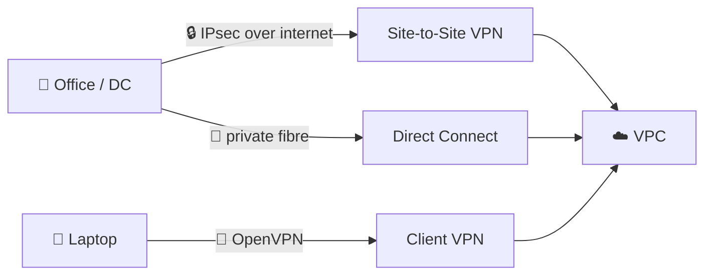
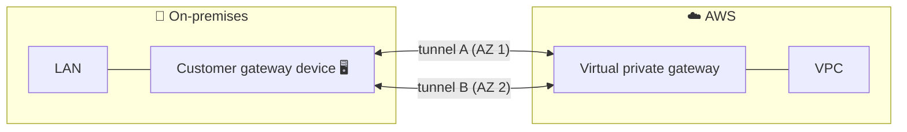
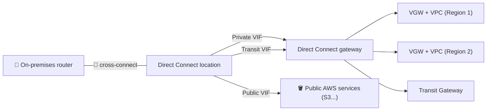
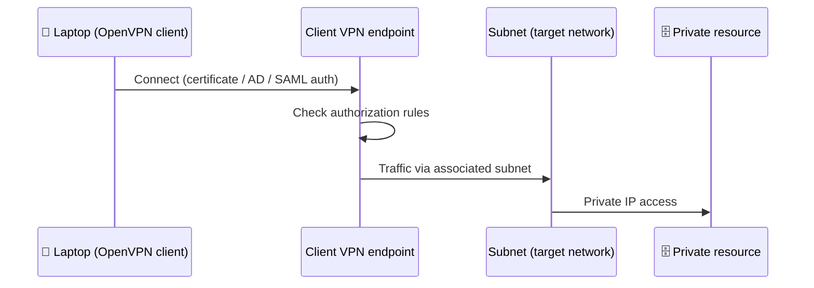
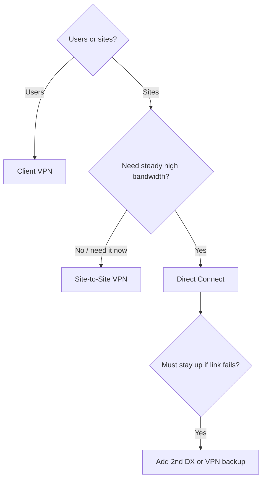

## What it is

**Hybrid connectivity** joins your on-premises network (data center, office, laptops) to your VPCs. AWS offers three tools: **Site-to-Site VPN** (encrypted tunnels over the internet), **Direct Connect** (a dedicated private circuit) and **Client VPN** (single users, from anywhere). VPC basics are in [Networking Basic](/chapters/05-networking-basic/).


*Three ways in: site by VPN, site by dedicated line, user by client.*

Use them when workloads span on-premises and AWS, or staff need private access to VPC resources.

## Key concepts

### Site-to-Site VPN

A VPN connection has two tunnels between AWS and your side. The pieces:


*One VPN connection = two encrypted tunnels from your device to the virtual private gateway.*

- **Virtual private gateway (VGW):** the AWS-side VPN endpoint, attached to one VPC. A **transit gateway** can be the AWS side instead, to serve many VPCs.
- **Customer gateway (CGW):** an AWS resource that tells AWS about your device (mainly its public IP). The **customer gateway device** is the real router or firewall you configure yourself.
- **Tunnels:** two per connection, in different Availability Zones. If one fails or AWS does maintenance, traffic moves to the other, so configure both.
- **Routing:** use **dynamic (BGP)** if your device supports it (better failure detection, automatic routes); otherwise **static** routes. Enable route propagation in the VPC route table.
- **Bandwidth:** standard tunnel is about 1.25 Gbps; larger tunnels exist on Transit Gateway or Cloud WAN. ECMP across tunnels needs Transit Gateway and BGP. Check current quotas.

Setup steps: create VGW and attach to VPC, create CGW with your public IP, create VPN connection, download the config for your device, apply it, enable route propagation.

```bash
aws ec2 create-customer-gateway --type ipsec.1 --public-ip 203.0.113.12 --bgp-asn 65000
aws ec2 create-vpn-gateway --type ipsec.1
aws ec2 attach-vpn-gateway --vpn-gateway-id vgw-123 --vpc-id vpc-123
aws ec2 create-vpn-connection --type ipsec.1 --customer-gateway-id cgw-123 --vpn-gateway-id vgw-123
```

### Direct Connect

Direct Connect is a physical link from your network to AWS at a Direct Connect location. You then create **virtual interfaces (VIFs)**, each a VLAN with a BGP session.


*One physical link, several VIFs, one Direct Connect gateway to reach many VPCs and Regions.*

| Connection type | Who provides it | Speeds | Notes |
|---|---|---|---|
| Dedicated | AWS gives you a port; you or a provider run the cross-connect | Whole ports (check current options) | Many VIFs allowed; can group into a LAG |
| Hosted | A Direct Connect Partner | From 50 Mbps up to 25 Gbps, partner-dependent | Exactly one VIF per hosted connection; set up in a short time |

| VIF | Reaches |
|---|---|
| Private | A VPC by private IP (via VGW or Direct Connect gateway) |
| Public | Public AWS services by public IP |
| Transit | Transit Gateways via a Direct Connect gateway |

- **Direct Connect gateway:** a global resource; one private VIF can reach VPCs in many Regions (not China). It does not allow VPC-to-VPC traffic through it, and the VPC CIDRs cannot overlap.
- **Hosted VIF:** lets another AWS account use your connection; they must accept it.
- **Not encrypted by default.** Add **MACsec** (layer 2, selected high-speed dedicated connections) or run a Site-to-Site VPN over Direct Connect for end-to-end encryption.
- **Resilience:** one link is a single point of failure. Use a second connection at another location, or a VPN as backup.

### Client VPN

A managed, OpenVPN-based service so individual users reach VPC and on-premises resources.


*Users authenticate at the regional endpoint, rules decide what they reach.*

- **Endpoint:** regional; you associate it with subnets (target networks) and add routes and authorization rules.
- **Authentication:** mutual certificates, directory, or federated (SAML).

## X vs Y

VPN vs Direct Connect:

| | Site-to-Site VPN | Direct Connect |
|---|---|---|
| Path | Internet (encrypted IPsec) | Dedicated private circuit |
| Encryption | Yes, built in | No by default (MACsec or VPN over it) |
| Setup time | Minutes | Slower: circuit, partner, cross-connect |
| Performance | Varies with the internet; about 1.25 Gbps per standard tunnel | Consistent, higher bandwidth |
| Cost | Hourly per connection plus data out (check pricing) | Port-hours plus data out; usually cheaper per GB at volume (check pricing) |
| Redundancy | Two tunnels built in | You must build it (second link) |
| Best for | Quick start, small sites, backup | Steady, large or latency-sensitive traffic |

Pick **VPN** when you need connectivity fast, bandwidth is modest, or as a backup. Pick **Direct Connect** when you need steady throughput and low jitter, or move lots of data. Pick **Client VPN** for people, not sites.


*Decision path for hybrid connectivity.*

## Job notes

- **Backup pattern:** Direct Connect primary, VPN backup; BGP prefers the Direct Connect path in the common design, so test failover.
- **Encryption needed over Direct Connect:** run IPsec VPN on top, or use MACsec where supported.
- **Many VPCs:** attach VPN or Direct Connect to a Transit Gateway (transit VIF) instead of one link per VPC. See [VPC peering](/chapters/30-aws-networking-services-vpc-peering/) for why peering cannot share these links.
- **VPN troubleshooting:** tunnel DOWN means check IKE settings and public IP on the CGW; tunnel UP but no traffic means routes (propagation, BGP advertisements), security groups, NACLs.
- **Overlapping CIDRs** between on-premises and VPC break routing; plan ranges first.
- **Cost traps:** idle Client VPN endpoints and VPN connections bill by the hour; Direct Connect ports bill even when idle. Check current pricing.

## Cheat sheet

- Site-to-Site VPN = VGW (or TGW) + customer gateway + device; 2 tunnels in different AZs; BGP preferred.
- Direct Connect = dedicated or hosted connection + VIFs (private, public, transit); hosted = 1 VIF each.
- Direct Connect gateway = one VIF to VPCs in many Regions; no VPC-to-VPC through it, no overlapping CIDRs.
- Direct Connect is private, not encrypted by default: MACsec or VPN over it.
- Client VPN = managed OpenVPN for users; endpoint + target subnets + auth rules.
- Fast and cheap start: VPN. Steady and big: Direct Connect. Resilient: both.

## AWS docs

- [What is AWS Site-to-Site VPN?](https://docs.aws.amazon.com/vpn/latest/s2svpn/VPC_VPN.html)
- [AWS Site-to-Site VPN customer gateway devices](https://docs.aws.amazon.com/vpn/latest/s2svpn/your-cgw.html)
- [Direct Connect virtual interfaces](https://docs.aws.amazon.com/directconnect/latest/UserGuide/WorkingWithVirtualInterfaces.html)
- [Direct Connect gateways](https://docs.aws.amazon.com/directconnect/latest/UserGuide/direct-connect-gateways-intro.html)
- [What is AWS Client VPN?](https://docs.aws.amazon.com/vpn/latest/clientvpn-admin/what-is.html)
