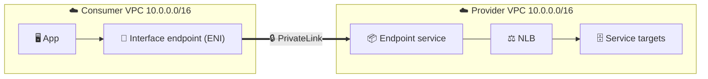
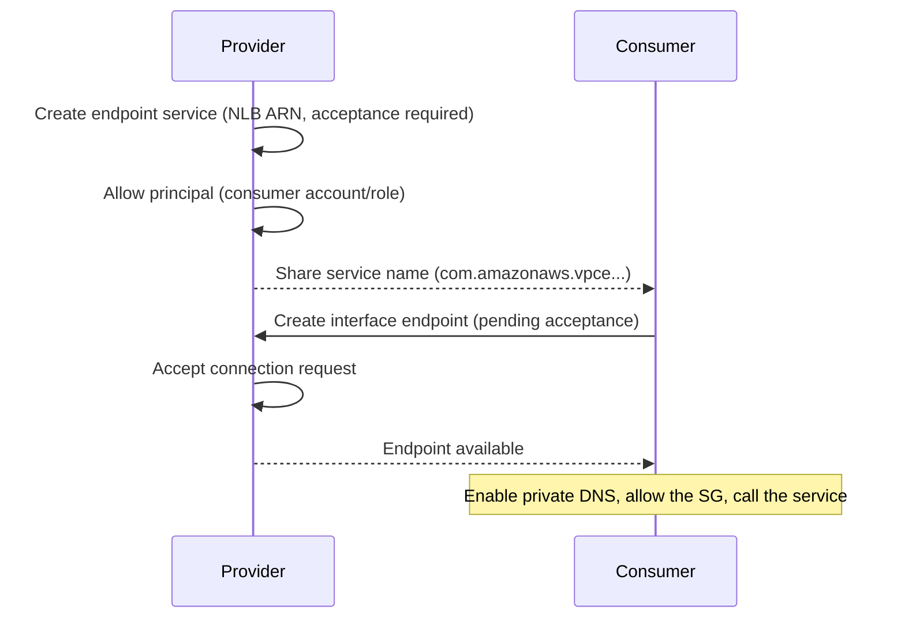
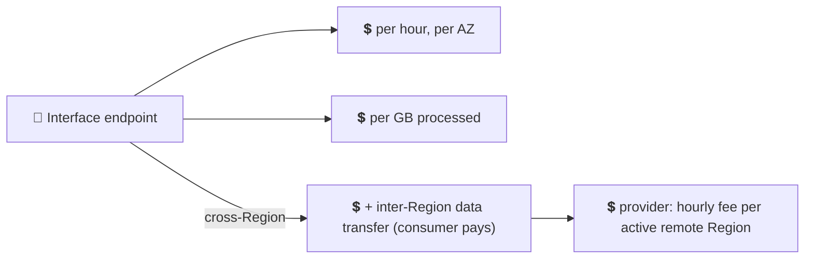

## What it is

**AWS PrivateLink** lets a consumer VPC reach one service in a provider VPC using private IPs, over the AWS network, with no internet gateway, NAT, peering or route between the VPCs. The provider publishes an **endpoint service**; each consumer creates an **interface endpoint**, which is a set of network interfaces in their own subnets. For AWS service endpoints see [VPC endpoints](/chapters/29-aws-networking-services-vpc-endpoints/).


*One direction only: the consumer calls the provider. The identical CIDRs do not matter.*

Use it when you expose one service to many VPCs or accounts, or when the CIDR ranges overlap.

## Key concepts

### Provider and consumer roles

| Side | Creates | Needs |
|---|---|---|
| Provider | Endpoint service | A Network Load Balancer (or Gateway Load Balancer) in front of the service |
| Consumer | Interface endpoint | The service name, subnets, a security group |

- **NLB** is the normal choice for a service. **GWLB** is for traffic inspection through security appliances (firewalls); GWLB endpoint connections are accepted automatically per the CLI docs.
- The consumer sees the provider's NLB node IPs as the source of traffic, not the consumer IPs. Enable Proxy Protocol v2 on the NLB if the app needs the client address.
- A consumer's endpoint is a normal ENI, so **security groups** on it control who in the consumer VPC can use it.

### Connection flow: allow, request, accept


*The provider controls who may connect; the consumer starts the connection.*

- **Allowed principals** list who may request a connection (accounts, users or roles).
- **Acceptance required** makes the provider approve each request. Private DNS cannot be turned on until the request is accepted.
- The provider can get SNS notifications for accepted and rejected requests.

CLI the provider runs:

```bash
aws ec2 create-vpc-endpoint-service-configuration \
  --network-load-balancer-arns <nlb-arn> --acceptance-required
```

### DNS

Every endpoint gets its own regional and zonal DNS names that resolve to the endpoint ENI IPs. If the provider sets a **private DNS name** on the service (after verifying domain ownership), consumers can enable private DNS and keep using that name.

- The consumer VPC needs DNS support and DNS hostnames enabled.
- Private DNS names do not resolve outside the VPC (for example from on-premises) unless you forward queries or use the endpoint's own names.

### Demo recap: same account, then cross account

1. **Provider:** create a VPC, instances running a web app, a target group and an internal NLB. Test the NLB inside the VPC.
2. **Provider:** VPC console, Endpoint services, Create; pick the NLB; set Acceptance required; copy the service name. Cross account: add the consumer's account ARN to Allow principals.
3. **Consumer:** Endpoints, Create; type "Endpoint services that use NLBs and GWLBs"; paste the name, Verify, choose VPC, subnets (one per AZ), security group.
4. **Provider:** Endpoint services, Endpoint connections, Accept (needed when acceptance is on).
5. **Consumer:** from an instance, `curl` the endpoint DNS name. Expected: the provider's page.
6. **Clean up (reverse order):** delete the consumer endpoint; delete the endpoint service; delete the NLB and target group; terminate instances; delete the VPCs. The endpoint and NLB charge by the hour until deleted.

### Pricing


*Same Region: hours plus GB. Cross-Region adds transfer for the consumer and a per-Region fee for the provider.*

- Same Region: the consumer pays an hourly charge per endpoint per AZ (including while pending) plus per-GB data processing. Check the current pricing page for rates.
- Cross-Region (NLB-based services, interface endpoints): no premium, but standard PrivateLink charges plus inter-Region data transfer apply to the endpoint owner. The provider pays an hourly fee for each active remote Region. Check current pricing.

## X vs Y

PrivateLink vs VPC peering vs Transit Gateway. Peering details are in [VPC peering](/chapters/30-aws-networking-services-vpc-peering/).

| | PrivateLink | VPC peering | Transit Gateway |
|---|---|---|---|
| Exposes | One service | Whole VPC | Whole VPC, via a hub |
| Direction | Consumer to provider | Both ways | Both ways |
| Overlapping CIDR | Allowed | Not allowed | Not allowed in routing |
| Transitive | n/a | No | Yes |
| Routing needed | None, uses ENI + DNS | Route tables both sides | Route tables + attachments |
| Fits | SaaS, shared services, many consumers | A few VPCs, full access | Many VPCs, hybrid |
| Cost | Hourly + per GB | No hourly fee, data transfer | Hourly + per GB (check pricing) |

Pick **PrivateLink** to expose one service, to limit consumers to that one port, or when ranges overlap. Pick **VPC peering** for a few trusted VPCs needing full access. Pick **Transit Gateway** for many VPCs or on-premises sharing.

## Job notes

- Multi-AZ: place the NLB and the endpoint in the same AZs; AZ names can map to different locations between accounts, so compare AZ IDs.
- Services cannot be tagged and a provider should use allowed principals instead of leaving access open.
- Stuck in pending: provider has not accepted; check Endpoint connections.
- Timeouts after available: consumer security group, then NLB target health and the provider's targets.
- Quotas such as interface endpoints per VPC (default listed in the docs, adjustable) matter in large estates; check the current quota.
- Cost trap: one endpoint per AZ per service per VPC adds up; delete unused endpoints.
- Cross-Region access only for NLB-based services, same partition.

## Cheat sheet

- PrivateLink = private access to one service, one-way, no routing between VPCs.
- Provider: NLB or GWLB + endpoint service (+ allowed principals, acceptance).
- Consumer: interface endpoint (ENIs, security group) + private DNS.
- Overlapping CIDRs are fine; cross-account is the main use.
- Cost: per hour per AZ + per GB; cross-Region adds transfer and a provider per-Region fee.
- Whole-VPC access: peering or Transit Gateway instead.

## AWS docs

- [AWS PrivateLink concepts](https://docs.aws.amazon.com/vpc/latest/privatelink/concepts.html)
- [Share your services through AWS PrivateLink](https://docs.aws.amazon.com/vpc/latest/privatelink/privatelink-share-your-services.html)
- [AWS PrivateLink quotas](https://docs.aws.amazon.com/vpc/latest/privatelink/vpc-limits-endpoints.html)
- [AWS PrivateLink pricing](https://aws.amazon.com/privatelink/pricing/)
