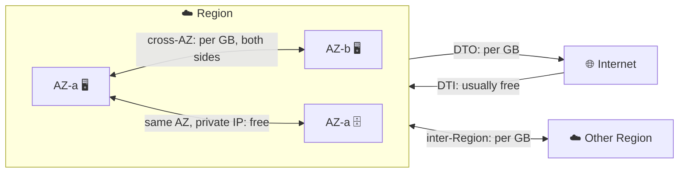
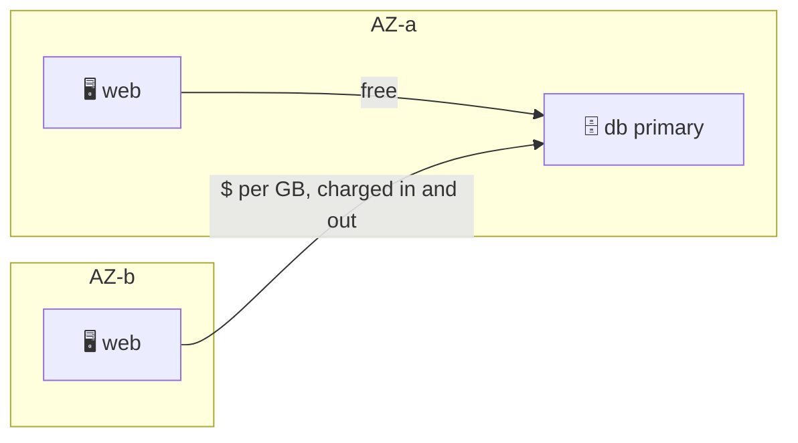
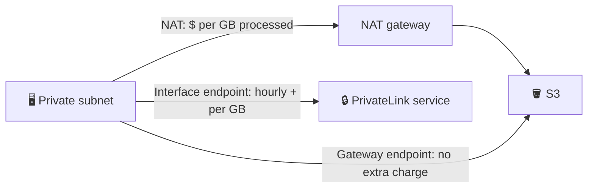
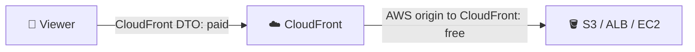
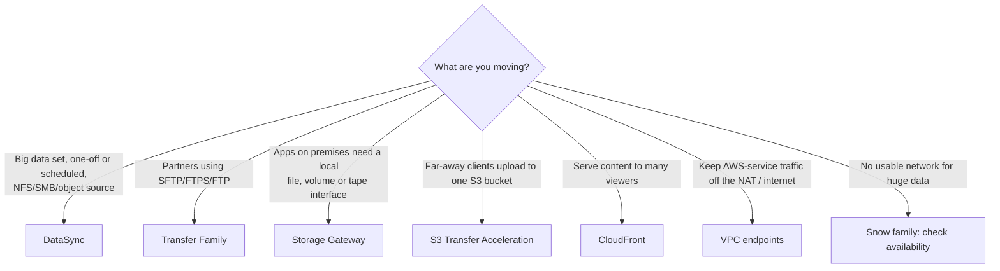

---

section: 34
title: "AWS Data Transfer"
part: "Advanced Networking & Data Transfer"
kind: concept
status: done
readingTime: 8
lectures: ["Intro","DTI vs DTO","Data Transfer in Same AZ vs Cross AZ","Data Transfer Cross Region","Data Transfer with VPC Endpoints","Data Transfer via Amazon CloudFront","Resources"]
quiz:
  - question: "Your team uploads 2 TB a day from on-premises to S3, and also serves downloads to customers. Which direction is normally free on AWS?"
    options:
      - "Outbound to the internet"
      - "Inbound from the internet into AWS"
      - "Between two Regions"
      - "Between two Availability Zones"
    answer: 1
    explanation: "Correct: data transfer in (DTI) from the internet is not charged in the usual cases, while data transfer out (DTO) to the internet is. Inter-Region and inter-AZ transfers are wrong because both carry per-GB charges."
  - question: "A chatty app has a web tier and a database in different AZs of one Region, and the bill shows many DataTransfer-Regional-Bytes lines. Why?"
    options:
      - "Traffic between AZs of a Region is billed, on both sides of the transfer"
      - "Traffic inside one VPC is always free"
      - "Private IPs are billed per hour"
      - "Only Multi-AZ RDS creates this line"
    answer: 0
    explanation: "Correct: cross-AZ traffic inside a Region is charged per GB for both the sender and the receiver. Saying VPC traffic is always free is wrong because the VPC spans AZs and the AZ boundary is what is billed."
  - question: "EC2 instances in private subnets download lots of data from S3 through a NAT gateway, and the NAT data processing bill is high. What is the cheapest fix?"
    options:
      - "Add a second NAT gateway"
      - "Create an S3 gateway VPC endpoint and add it to the route tables"
      - "Create an S3 interface endpoint in every AZ"
      - "Move the instances to a public subnet"
    answer: 1
    explanation: "Correct: a gateway endpoint for S3 has no additional charge and removes the S3 traffic from the NAT gateway. An interface endpoint is wrong because it has hourly and per-GB charges, so it is only worth it when you need access from on premises or other Regions."
  - question: "You serve large video files from S3 straight to the internet and want to lower the data transfer cost and latency. What helps?"
    options:
      - "Put CloudFront in front of the bucket"
      - "Replicate the bucket to every Region"
      - "Use a NAT gateway"
      - "Use S3 Transfer Acceleration for downloads only"
    answer: 0
    explanation: "Correct: data from an AWS origin to CloudFront is free, and you pay CloudFront's own transfer-out rate, which is usually lower, with caching on top. Replicating the bucket is wrong because it adds inter-Region transfer and storage cost without caching."
  - question: "A partner must send you files nightly with an SFTP client and the files must land in S3, with no servers for you to run. Which service?"
    options:
      - "AWS Transfer Family"
      - "AWS DataSync agent on the partner side"
      - "S3 Transfer Acceleration"
      - "Amazon CloudFront"
    answer: 0
    explanation: "Correct: Transfer Family is a managed SFTP, FTPS and FTP endpoint that writes to S3 or EFS. DataSync is wrong because it copies between storage systems you control, not for external partners using FTP clients."
---

## What it is

Every GB that moves has a direction and a boundary it crosses, and AWS bills by that boundary. Data **in** (DTI) is usually free; data **out** (DTO) to the internet, between Regions, and between AZs costs money. This chapter is a cost map, plus the AWS services that move large data sets.

*Where the meter runs: boundaries, not services.*

Use it when you design for cost: keep chatty traffic in one AZ, keep data in one Region, and put a cache or a private path in front of expensive routes. Check the current rates on the pricing pages; they differ by Region.

## Key concepts

### DTI vs DTO

| | Data transfer in (DTI) | Data transfer out (DTO) |
|---|---|---|
| Direction | Internet or on premises into AWS | AWS to internet or on premises |
| Cost | Usually free | Per GB, tiered, varies by Region |
| Watch out | Nothing to tune | Biggest line on many bills |

- Inbound from the internet is not charged; outbound to the internet is (see the SAP-on-AWS cost table in the docs list).
- Over VPN or Direct Connect, outbound to on premises is still charged per GB; Direct Connect rates depend on location.
- Shrink DTO with compression, caching (CloudFront), and by keeping consumers in AWS.

### Same AZ vs cross AZ

*Same-AZ traffic is free; crossing AZs is billed.*

- Inside one AZ, private-IP traffic has no charge.
- Between AZs of one Region you pay per GB, on both the sending and the receiving resource (usage type `DataTransfer-Regional-Bytes`).
- You still want multiple AZs for availability; just avoid needless cross-AZ chatter (for example, prefer same-AZ routing where the service offers it).

### Cross Region

- Traffic between Regions is billed as inter-Region transfer: out on the sender, in on the receiver.
- It applies to replication (S3 CRR, DB read replicas), VPC peering and Transit Gateway across Regions, and plain EC2 traffic.
- Same Region over VPC peering is free in the same AZ and billed across AZs. See [VPC peering](/chapters/30-aws-networking-services-vpc-peering/).

### VPC endpoints

*Gateway endpoints are the free path to S3 and DynamoDB.*

| | Gateway endpoint | Interface endpoint (PrivateLink) |
|---|---|---|
| Services | S3 and DynamoDB only | Many AWS services and partners |
| Cost | No additional charge | Hourly per AZ plus per GB |
| How it works | Route-table entry | ENI with a private IP in your subnet |
| From on premises / other VPCs | No | Yes |

- A NAT gateway bills a per-GB processing fee on top; sending S3 traffic through a gateway endpoint avoids it. See [PrivateLink](/chapters/33-aws-networking-services-aws-privatelink/).

### CloudFront

*You pay CloudFront's own transfer-out instead of the origin's.*

- Transfer from an AWS origin (S3, ELB, EC2, API Gateway) to CloudFront is free; you pay CloudFront's transfer out and requests.
- A monthly free tier exists (check the current amount on the pricing page).
- Caching also cuts origin load. For uploads, S3 can use CloudFront edge locations via Transfer Acceleration (extra charge).

## X vs Y

### Which transfer service for which situation

*Pick by who sends, what protocol, and where the data lands.*

| Need | Service | Notes |
|---|---|---|
| Move data between on-premises or other-cloud storage and S3, EFS, FSx | DataSync | Managed, scheduled, validates integrity |
| SFTP, FTPS, FTP, AS2 into S3 or EFS | Transfer Family | Managed endpoints, no servers to run |
| Hybrid access: S3 File, Volume, Tape gateways | Storage Gateway | VM or EC2 appliance, SMB/NFS/iSCSI/VTL |
| Faster uploads over long distances to S3 | S3 Transfer Acceleration | Uses edge locations, extra fee, helps most with large objects over long distance |
| Offline petabyte-scale move | Snow family | Snowball Edge is no longer available to new customers; docs point to DataSync or Data Transfer Terminal. Check current status |
| Cheaper downloads and caching | CloudFront | See above |

**Pick DataSync** when you own both ends and want a managed copy job. **Pick Transfer Family** when the sender is a partner with a fixed FTP-style client. **Pick Storage Gateway** when an on-premises app must keep using local protocols while data lives in AWS. For S3 basics see [Amazon S3](/chapters/14-aws-storage-services-amazon-s3/).

## Job notes

- Read the bill by usage type: `DataTransfer-Regional-Bytes` is cross-AZ, `DataTransfer-Out-Bytes` is internet out. See the Cost and Usage Report page below.
- First fixes for a high bill: add an S3 gateway endpoint, put CloudFront in front of public content, and keep chatty tiers in one AZ.
- Cost trap: centralised interface endpoints reached over Transit Gateway or peering add processing and cross-AZ charges.
- Cost trap: NAT gateway per-GB processing on S3 or DynamoDB traffic that could use a free gateway endpoint.
- Gateway endpoints do not work from on premises, other Regions or through Transit Gateway; use an interface endpoint there.
- Security default: endpoint policies and bucket policies can limit which buckets an endpoint reaches.
- Treat all rates as changing: check the pricing pages instead of copying numbers from a course.

## Cheat sheet

- In: free. Out to internet: paid. Same AZ private IP: free.
- Cross-AZ and cross-Region: paid, both sides.
- S3 and DynamoDB from a VPC: gateway endpoint, no extra charge.
- Other AWS services privately: interface endpoint (hourly plus per GB).
- AWS origin to CloudFront: free; you pay CloudFront out.
- DataSync copies, Transfer Family gives SFTP, Storage Gateway gives local file/volume/tape, Transfer Acceleration speeds S3 uploads.
- Snow family: not offered to new customers per AWS docs; verify current status.

## AWS docs

- [Understanding data transfer charges (Cost and Usage Report)](https://docs.aws.amazon.com/cur/latest/userguide/cur-data-transfers-charges.html)
- [SAP on AWS cost estimation (data transfer scenarios table)](https://docs.aws.amazon.com/sap/latest/general/sap-on-aws-pricing-guide.html)
- [Gateway endpoints](https://docs.aws.amazon.com/vpc/latest/privatelink/gateway-endpoints.html)
- [What is Amazon CloudFront? (pricing)](https://docs.aws.amazon.com/AmazonCloudFront/latest/DeveloperGuide/Introduction.html)
- [What is AWS Transfer Family?](https://docs.aws.amazon.com/transfer/latest/userguide/what-is-aws-transfer-family.html)
- [AWS Snowball Edge availability change](https://docs.aws.amazon.com/snowball/latest/developer-guide/snowball-edge-availability-change.html)
