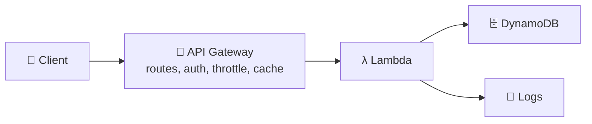
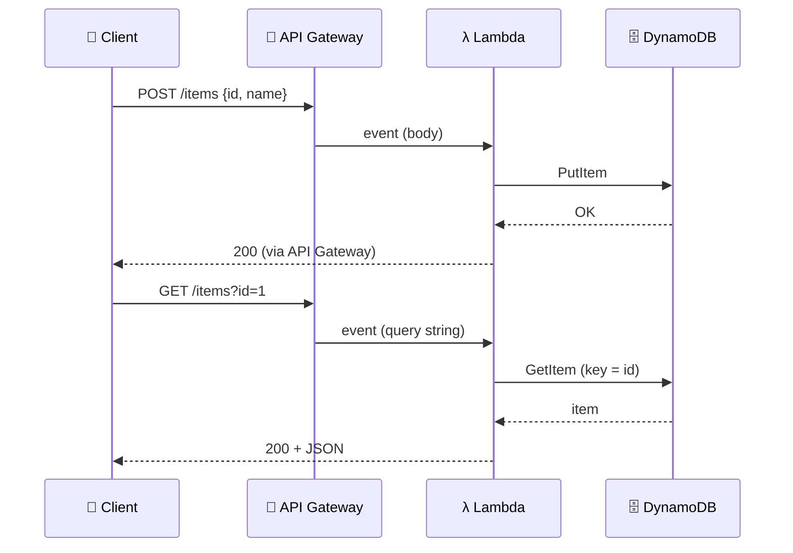
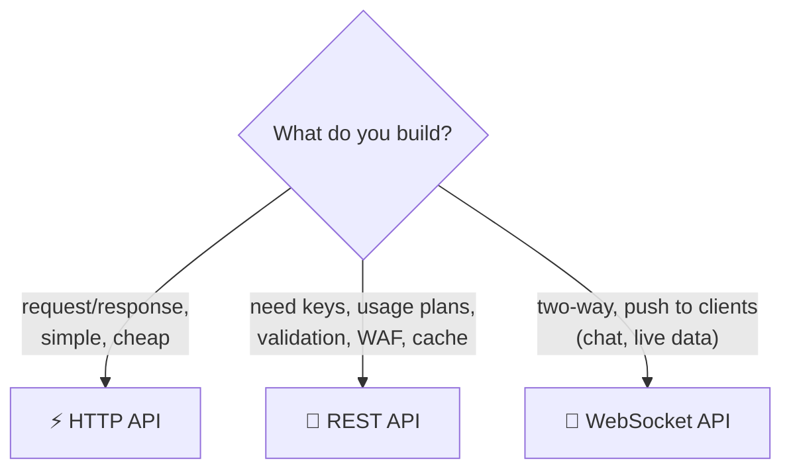
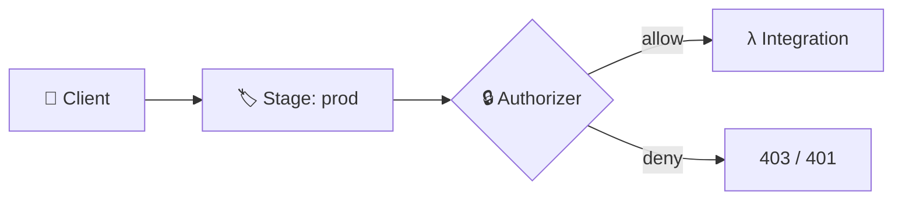
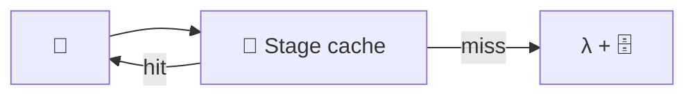

## What it is

**Serverless** means you run code and store data without managing servers: the provider scales it and you pay per use. The classic AWS stack is **API Gateway** (the HTTP front door) + **Lambda** (code) + **DynamoDB** (data). See [Lambda](/chapters/08-aws-computes-aws-lambda-and-containers/) and [DynamoDB](/chapters/23-aws-database-services-amazon-dynamodb/) for the building blocks.


*A request enters API Gateway, Lambda runs the logic, DynamoDB stores the item.*

Use it when traffic is spiky or unknown and you want no servers to patch.

## Key concepts

### The demo scenario: PutItem and GetItem over HTTP


*Write path with POST, read path with GET; Lambda is the only thing that talks to the table.*

- Create a table with a partition key (for example `id`). **PutItem** creates or replaces a whole item; **GetItem** reads one item by its full primary key.
- "Dynamic" means the values come from the request, not hard-coded: read `event["body"]` for POST and `event["queryStringParameters"]` for GET.
- Lambda's execution role needs `dynamodb:PutItem` / `dynamodb:GetItem` on that table.
- GetItem is **eventually consistent** by default; set `ConsistentRead=true` for the latest write (costs twice as much, not supported on global secondary indexes).

```python
import boto3, json
t = boto3.resource("dynamodb").Table("Items")

def lambda_handler(event, context):
    if event["requestContext"]["http"]["method"] == "POST":   # HTTP API payload v2
        t.put_item(Item=json.loads(event["body"]))
        return {"statusCode": 200, "body": "saved"}
    item = t.get_item(Key={"id": event["queryStringParameters"]["id"]}).get("Item")
    return {"statusCode": 200, "body": json.dumps(item, default=str)}
```

### Three API types


*Choose the product from the features you need.*

- **WebSocket API**: a persistent two-way connection. You define **routes**; special routes are `$connect`, `$disconnect` and `$default`, and a route selection expression (such as `${request.body.action}`) picks a custom route per message.
- Integrations: Lambda, any HTTP endpoint, or AWS services (REST API). HTTP APIs proxy to Lambda or HTTP backends.

### Endpoint types: edge-optimized vs regional

| | Edge-optimized | Regional |
|---|---|---|
| Path | Client, nearest CloudFront edge, API | Client directly to the Region |
| Best for | Clients spread across the world | Clients in the same Region |
| Own CloudFront | No (managed one) | Yes, you can attach yours |

- Edge-optimized APIs use a CloudFront distribution that API Gateway manages for you.

### Stages, authorizers, CORS


*A stage is a named deployment of your API; authorizers run before the integration.*

- **Stage** (`dev`, `prod`): a named snapshot of the API with its own URL, throttling and cache settings. HTTP APIs support automatic deployments.
- **Authorizers**: IAM (SigV4), **Lambda authorizer** (your code returns allow/deny; the result can be cached, keyed by identity sources), and for HTTP APIs **JWT/OIDC and OAuth 2.0**.
- **CORS**: needed when a browser app on another origin calls your API. HTTP APIs have built-in CORS settings.

### Throttling

- Throttling is a token bucket: a steady rate plus burst. The default account-level quota is per Region and shared by all APIs (check the current quota; it can be raised).
- Over the limit, clients get **429 Too Many Requests**.
- Order applied: per-client usage plan, per-method stage setting, account level, then AWS Regional limits.

### Caching (REST API)


*A cache hit skips Lambda and DynamoDB.*

- You provision a cache of a chosen size (GB) **per stage**; billed hourly by size (check pricing).
- You control the cache key and the TTL per method (default 300 seconds), and can invalidate per stage.
- Caching is a REST API feature, not an HTTP API one.

### Pricing

- You pay per API call and data out, with no minimum. Caching adds an hourly charge; WebSocket bills messages and connection minutes.
- Free tier covers 1M HTTP and 1M REST calls per month for 12 months (check current terms).
- Lambda adds its own invocation and duration cost; DynamoDB adds read/write cost.

### EC2 vs container vs Lambda

| | EC2 | Containers (ECS/EKS) | Lambda |
|---|---|---|---|
| You manage | OS, scaling, patching | Images, cluster/tasks | Code only |
| Scaling | Auto Scaling groups | Service scaling | Automatic per request |
| Billing | Per instance time | Per task or node time | Per request and duration |
| Fits | Steady, custom workloads | Long-running services | Spiky, short, event-driven |

## X vs Y

### API Gateway REST vs HTTP API

| Feature | REST API | HTTP API |
|---|---|---|
| Price | Higher | Lower |
| API keys, usage plans, per-client throttling | Yes | No |
| Request validation, WAF, private endpoints | Yes | No |
| Stage caching | Yes | No |
| JWT / OIDC / OAuth 2.0 authorizer | Via Lambda or Cognito | Built in |
| Built-in CORS, auto-deploy | Manual | Yes |

Pick **HTTP API** when you only proxy to Lambda or HTTP and want it cheap and fast. Pick **REST API** when you need API management features (keys, usage plans, validation, WAF, cache).

### Lambda function URL vs API Gateway

| | Function URL | API Gateway |
|---|---|---|
| Setup | One endpoint per function | Full API with routes |
| Extra features | Few | Auth options, throttling, monitoring, traffic control |
| Cost | No charge beyond Lambda | Per call, plus cache |

Pick a **function URL** for a quick webhook or a single-function endpoint. Pick **API Gateway** for a production API with many routes and controls.

## Job notes

- Start with HTTP API; move to REST API only when a missing feature blocks you.
- Use the **Lambda proxy integration** so the whole request arrives as the event and your code builds the response.
- Common errors: 403 (authorizer or missing permission), 429 (throttled), 502 (bad Lambda response format), CORS errors in the browser (missing headers).
- Cost traps: a forgotten cache cluster bills every hour; strongly consistent reads double read cost.
- Never open an API without an authorizer unless it is truly public; add WAF on REST APIs.
- A cache or authorizer cache can serve one user's result to another if the key is too coarse; include route and identity in the key.

## Cheat sheet

- API Gateway + Lambda + DynamoDB = serverless web backend.
- PutItem writes or replaces; GetItem reads by full key; reads are eventually consistent unless `ConsistentRead`.
- HTTP API: cheap, JWT, auto CORS. REST API: keys, usage plans, WAF, validation, cache. WebSocket: two-way routes.
- Edge-optimized: global clients via CloudFront. Regional: same-Region clients.
- Stage = named deployment. Throttle over limit = 429.
- Cache is per stage, REST only, billed hourly.
- Function URL for simple, API Gateway for full APIs.
- Check current quotas and prices on the AWS pages.

## AWS docs

- [Choose between REST APIs and HTTP APIs](https://docs.aws.amazon.com/apigateway/latest/developerguide/http-api-vs-rest.html)
- [Throttle requests to your REST APIs](https://docs.aws.amazon.com/apigateway/latest/developerguide/api-gateway-request-throttling.html)
- [Select a method to invoke your Lambda function using an HTTP request](https://docs.aws.amazon.com/lambda/latest/dg/furls-http-invoke-decision.html)
- [Create routes for WebSocket APIs](https://docs.aws.amazon.com/apigateway/latest/developerguide/websocket-api-develop-routes.html)
