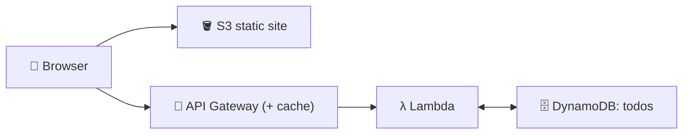
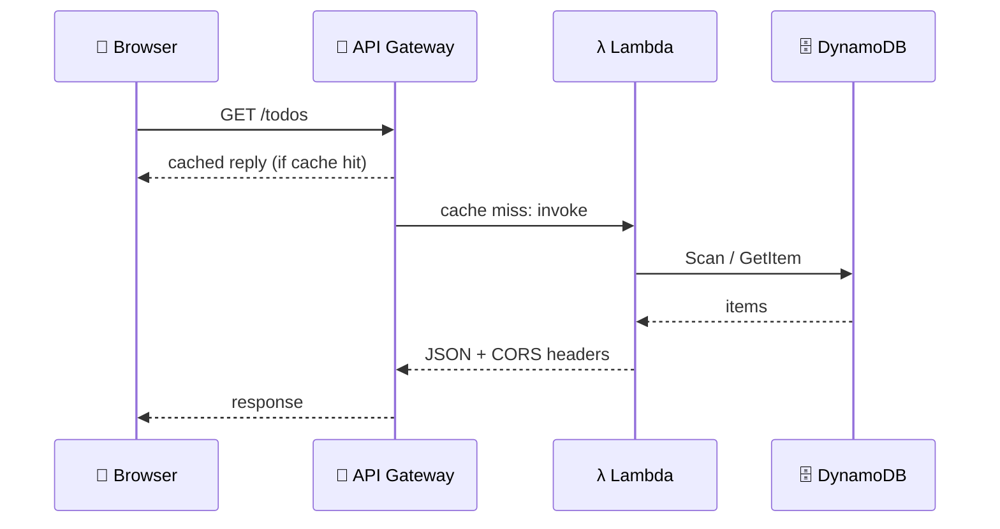

## What you build

A todo app: a static page on S3 calls an API Gateway REST API, which runs Lambda functions that read, add and delete todos in DynamoDB. The course provides a GitHub repo with the front end and code; its contents are not in this text, so the steps are generic and names will differ.


*S3 serves the page; the page calls the API; Lambda is the only thing touching the table.*

## Architecture


*A cache hit never reaches Lambda or DynamoDB.*

| Lab step | HTTP route (typical) | DynamoDB call |
|---|---|---|
| GetItem | `GET /todos/{id}` | `GetItem` (by key) |
| PutItem | `POST /todos` | `PutItem` |
| DeleteItem | `DELETE /todos/{id}` | `DeleteItem` (by key) |

- **Table**: needs a primary key, for example `todoId`. Listing all todos would need `Scan` (not in the lab list, so unverified for this lab).
- **Lambda proxy integration**: API Gateway passes the whole request to Lambda; the function must return the status, headers and body.
- **CORS**: the page and the API are on different origins, so the API must send CORS headers.
- **S3 static hosting**: enable it on the bucket, set an index document, and allow public read for the site files.
- **API caching**: API Gateway can cache REST API responses per stage for a TTL, so repeated reads skip the backend.

## Steps

1. **Intro and repo**: clone the course GitHub repo; note the front-end files and Lambda code (contents not verified here).
2. **Resources**: pick one Region; you will create a table, Lambda functions, an API and a bucket.
3. **Create the table**: DynamoDB > Create table, partition key `todoId` (String), on-demand capacity.
4. **GetItem**: create a Lambda function, give its execution role `dynamodb:GetItem` on the table ARN; test with a sample event.
5. **PutItem**: same for `dynamodb:PutItem`; add an item and check Explore table items.
6. **DeleteItem**: same for `dynamodb:DeleteItem`; confirm the item disappears.
7. **API**: API Gateway > Create API (REST) > add resources and methods, each with Lambda proxy integration; enable CORS; deploy to a stage and copy the invoke URL.
8. **Front end**: put the API URL in the page's config, create an S3 bucket, enable Static website hosting (index `index.html`), upload the files, allow public read, open the website endpoint.
9. **Caching**: on the stage, enable the cache and set a TTL for the read method; deploy again and compare repeat GET calls.

```bash
aws dynamodb put-item --table-name todos \
  --item '{"todoId":{"S":"t1"},"text":{"S":"learn AWS"}}'
curl "$API_URL/todos/t1"
```

Expected result: you can add, fetch and delete a todo from the web page, and the data shows in the table.

## Common mistakes

| Mistake | Fix |
|---|---|
| Browser CORS error | Enable CORS on the API and return the headers from Lambda |
| Changed the API but nothing changes | Deploy the API to the stage again |
| `AccessDeniedException` | Add the action on the table ARN to the execution role |
| Lambda proxy returns raw JSON, API gives 502 | Return an object with `statusCode` and a string `body` |
| S3 site shows 403 | Turn off block public access for the site and add a public-read policy |
| Stale list after a write | Lower the TTL or invalidate the cache |

## Cleanup

Delete in this order so no charges remain:

1. Disable the stage cache (API Gateway > Stage settings), because the cache is a provisioned resource (check current pricing).
2. Delete the API Gateway API.
3. Delete the Lambda functions.
4. Empty, then delete the S3 bucket.
5. Delete the DynamoDB table.
6. Delete the execution roles and the log groups `/aws/lambda/<name>`.

```bash
aws apigateway delete-rest-api --rest-api-id <id>
aws lambda delete-function --function-name <name>
aws s3 rb s3://<bucket> --force
aws dynamodb delete-table --table-name todos
```

## On the job

- S3 + API Gateway + Lambda + DynamoDB is the standard serverless web stack: no servers to patch.
- Put CloudFront in front of S3 for HTTPS and a custom domain; the S3 website endpoint alone is HTTP.
- Cache only reads that tolerate stale data; never cache writes.
- Scope each function's role to one action on one table.

## AWS docs

- [Lambda integrations for REST APIs in API Gateway](https://docs.aws.amazon.com/apigateway/latest/developerguide/set-up-lambda-integrations.html)
- [CORS for REST APIs in API Gateway](https://docs.aws.amazon.com/apigateway/latest/developerguide/how-to-cors.html)
- [Tutorial: Configuring a static website on Amazon S3](https://docs.aws.amazon.com/AmazonS3/latest/userguide/HostingWebsiteOnS3Setup.html)
- [Enabling API caching in API Gateway](https://docs.aws.amazon.com/apigateway/latest/developerguide/api-gateway-caching.html)
