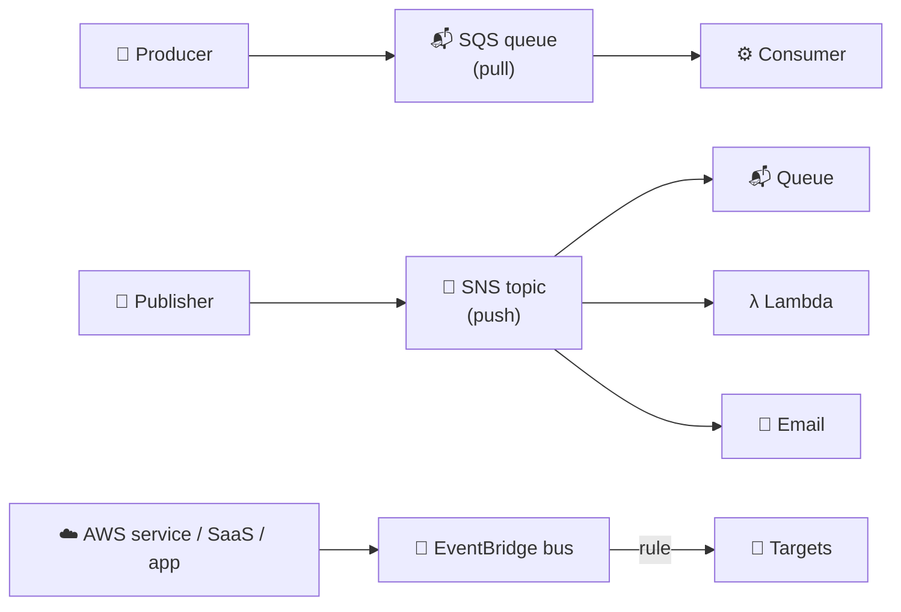
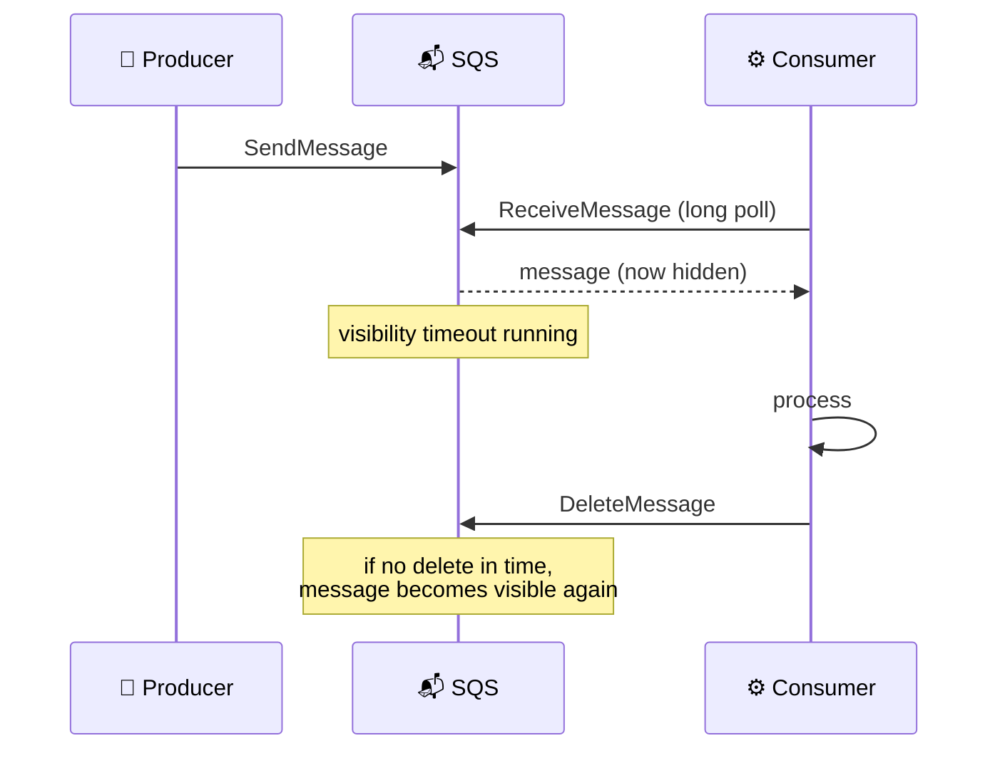
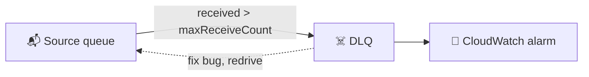
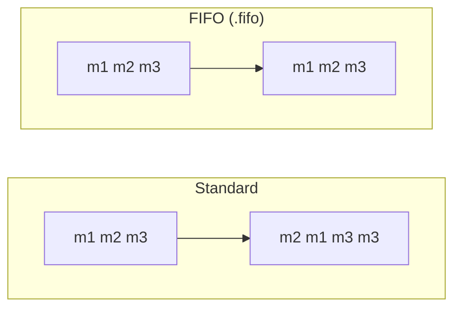
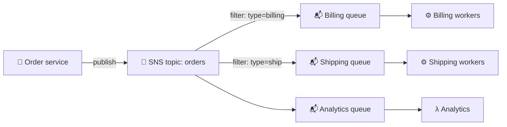
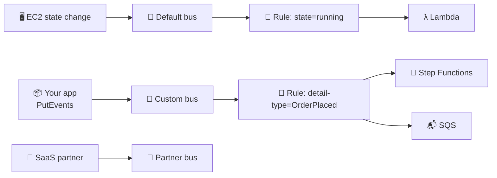
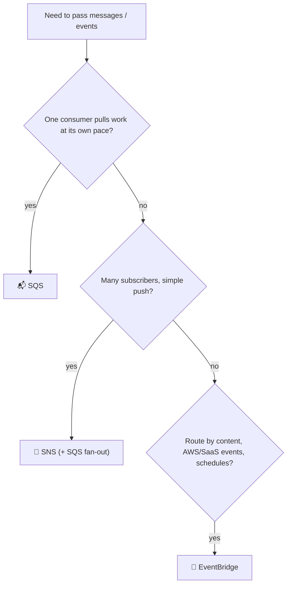
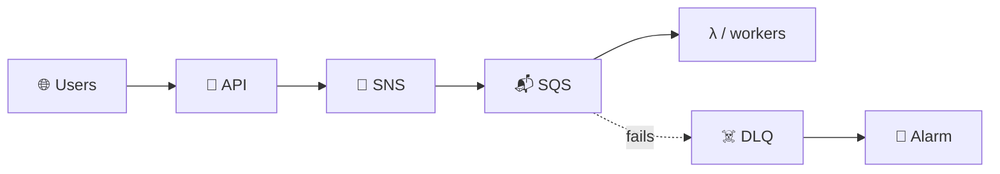

## What it is

Messaging services let one part of your system hand work to another **without waiting for it**. The sender drops a message; the receiver picks it up when ready. That is called *decoupling*, and it is how you survive traffic spikes and failures.



*Three tools: SQS holds messages for a consumer to pull, SNS pushes to many subscribers, EventBridge routes events by rules.*

Use it when two components should not be tightly connected: web tier to workers, one event to many reactions, or AWS events to automation.

## Key concepts

### SQS basics (intro and key concepts)

A **queue** stores messages until a consumer deletes them. The consumer polls, processes, then deletes. If it does not delete in time, the message reappears.



*The message is hidden, not removed, while a consumer works on it.*

| Setting | What it does | Range / default (from API docs) |
|---|---|---|
| Visibility timeout | Hides a received message | 0 s to 12 h, default 30 s |
| Long polling (`ReceiveMessageWaitTimeSeconds`) | Waits for a message, fewer empty calls | 0 to 20 s, default 0 |
| Retention | How long unconsumed messages live | 1 min to 14 days, default 4 days |
| Delay (`DelaySeconds`) | Hides new messages before first delivery | 0 to 900 s, default 0 |
| Max message size | Per message | up to 1 MiB per current docs; check current quota |

- Set the visibility timeout longer than your processing time. For Lambda consumers, AWS advises at least six times the function timeout.
- Larger payloads: store the file in S3 and send a pointer.
- A **delay queue** applies the delay to every message; per-message delay can also be set on standard queues. Use it to give a downstream system time to be ready.

### Dead-letter queues

A **DLQ** is a second queue that catches messages that keep failing, so one bad message does not loop forever.



*Failed messages move to the DLQ after `maxReceiveCount` receives; you alarm on it and redrive later.*

- Set via a redrive policy: `deadLetterTargetArn` and `maxReceiveCount`.
- A FIFO queue needs a FIFO DLQ; a standard queue needs a standard DLQ.

### Standard vs FIFO, at-least-once vs exactly-once



*Standard may reorder and repeat; FIFO keeps order and drops duplicates.*

- **At-least-once** (standard): every message arrives one or more times, so your consumer must be **idempotent** (safe to run twice).
- **Exactly-once processing** (FIFO): no duplicates enter the queue. It relies on a **deduplication ID** (or content-based dedup) within a 5-minute window, and a **message group ID**; order holds inside each group.
- FIFO queue names must end in `.fifo`. Throughput: standard is nearly unlimited; FIFO is limited by default (300 requests/s, or 3,000 messages/s with batching), and high throughput mode raises it. Check the current quota.

### Create and use a queue (demos)

1. Console: SQS, Create queue, pick **Standard** or **FIFO**, name it (`.fifo` suffix), accept defaults.
2. Send a message in the console ("Send and receive messages"); for FIFO add a group ID and dedup ID.
3. Poll: messages show as "in flight" while hidden. Delete after processing.
4. Send the same FIFO dedup ID twice within 5 minutes: only one message arrives.

```bash
aws sqs create-queue --queue-name orders
aws sqs send-message --queue-url $URL --message-body '{"id":1}'
aws sqs receive-message --queue-url $URL --wait-time-seconds 20
aws sqs delete-message --queue-url $URL --receipt-handle "$HANDLE"
```

### SQS pricing

- You pay per **request**; each 64 KB chunk of a payload counts as one request, and a request can carry 1 to 10 messages.
- FIFO requests have a different rate than standard. Same-region data transfer to and from SQS is free.
- Empty receives are billed too, which is why long polling saves money. There is a monthly free tier. Check the [pricing page](https://aws.amazon.com/sqs/pricing/) for current rates.

### SNS: topics, subscriptions, filtering, fan-out

**SNS** is pub/sub. A publisher sends once to a **topic**; SNS pushes a copy to every **subscription**. Endpoints include SQS, Lambda, HTTP(S), email and mobile/SMS.



*Fan-out: one publish, many independent queues; each queue buffers for its own consumer.*

- **Create a topic and subscribe:** SNS, Create topic (Standard or FIFO), Create subscription, pick protocol and endpoint. Email subscribers must click a confirmation link. An SQS queue also needs a queue policy that lets the topic send to it.
- **Filtering:** a subscription can have a **filter policy** (JSON) matched against message attributes or the message body. No policy means the subscriber gets everything.
- **Fan-out with SQS (topic-queue chaining):** the queue in front of each subscriber absorbs spikes and keeps messages if the consumer is down for hours.
- **FIFO topics** keep order per message group, and can deliver only to SQS queues (standard or FIFO), not email, SMS or HTTP.

```json
{ "type": ["billing"], "amount": [{ "numeric": [">", 100] }] }
```

*Example filter policy: only billing messages above 100.*

### SNS pricing

- You pay for publishes, deliveries (rate depends on endpoint type), and extra API calls. There is a free tier. Check the [SNS FAQ](https://aws.amazon.com/sns/faqs/) and pricing page for current rates.

### EventBridge

**EventBridge** is an event router. Sources (AWS services, your apps, SaaS partners) send events to an **event bus**; **rules** match events with an **event pattern** and send them to **targets**.



*Rules decide which events go where; one event can match several rules.*

```json
{ "source": ["aws.ec2"],
  "detail-type": ["EC2 Instance State-change Notification"],
  "detail": { "state": ["running"] } }
```

- The **default bus** receives events from AWS services automatically; create **custom buses** for your own apps.
- A rule can have up to five targets (per the docs; check the current quota) and can reshape the event before delivery.
- Rules can also run on a **schedule** (cron/rate); the next lab covers that.
- **Pricing:** you pay per event published to a bus (custom, SaaS, and cross-account events); events from AWS services on the default bus are not billed as custom events per the knowledge-center article. Check the [EventBridge pricing page](https://aws.amazon.com/eventbridge/pricing/).

## X vs Y



*Decision flow for choosing a messaging service.*

| | SQS | SNS | EventBridge |
|---|---|---|---|
| Model | Queue, consumer **pulls** | Pub/sub, SNS **pushes** | Event bus + rules, pushes to targets |
| Consumers per message | One (competing) | Every subscriber | Every matching rule target |
| Stores messages | Yes (up to 14 days) | No (retries delivery) | No (retries to targets) |
| Filtering | None (use separate queues) | Filter policy on attributes/body | Rich event patterns |
| AWS service events | No | Some | Native, default bus |
| Ordering | FIFO option | FIFO topic option | Not ordered by default |

| Standard vs FIFO | Standard | FIFO |
|---|---|---|
| Delivery | At least once | Exactly-once processing |
| Order | Best effort | Strict within message group |
| Throughput | Nearly unlimited | Limited, high throughput mode available |

Pick **SQS** when you must buffer work and let consumers scale at their own speed. Pick **SNS** when one event must reach many systems (pair each with an SQS queue). Pick **EventBridge** when you route by event content, react to AWS or SaaS events, or schedule things. Pick **FIFO** only when order or duplicates truly matter; otherwise standard.

## Job notes

- Make consumers idempotent even on FIFO; retries and redeliveries still exist after a crash.
- Always attach a DLQ with an alarm on its depth. Messages in it are failures nobody sees otherwise.
- Cost trap: tight short-polling loops. Use long polling (20 s).
- Scaling pattern: ASG or Lambda scales on queue depth (`ApproximateNumberOfMessagesVisible`).
- Security: restrict the queue policy to the topic ARN or account; encrypt with SQS-managed keys or KMS (KMS calls are billed).
- Subscription "not receiving": check the confirmation, the SQS queue policy, and the filter policy.



*A common production shape: SNS fan-out, SQS buffer, workers, DLQ with alarm.*

## Cheat sheet

- SQS: pull, stores up to 14 days (default 4), visibility timeout default 30 s, long poll up to 20 s, delay up to 15 min.
- Standard: at-least-once, unordered; FIFO: ordered per group, dedup in 5 min, name ends `.fifo`.
- DLQ: redrive policy with `maxReceiveCount`; same queue type as the source.
- SNS: topic, subscriptions, filter policies, fan-out to queues; FIFO topics only to SQS.
- EventBridge: bus, rule (event pattern), target; default bus gets AWS events.
- Pricing: SQS per 64 KB request, SNS per publish and delivery, EventBridge per event published. Check current rates.
- Pull = SQS; push to many = SNS; route by content = EventBridge.

## AWS docs

- [Configuring visibility timeouts in Amazon SQS](https://docs.aws.amazon.com/AWSSimpleQueueService/latest/SQSDeveloperGuide/working-with-visibility-timeouts.html)
- [Using dead-letter queues in Amazon SQS](https://docs.aws.amazon.com/AWSSimpleQueueService/latest/SQSDeveloperGuide/sqs-dead-letter-queues.html)
- [Amazon SNS message filtering](https://docs.aws.amazon.com/sns/latest/dg/sns-message-filtering.html)
- [Amazon SNS message delivery for FIFO topics](https://docs.aws.amazon.com/sns/latest/dg/fifo-message-delivery.html)
- [Amazon EventBridge event bus](https://docs.aws.amazon.com/eventbridge/latest/userguide/eb-event-bus.html)
