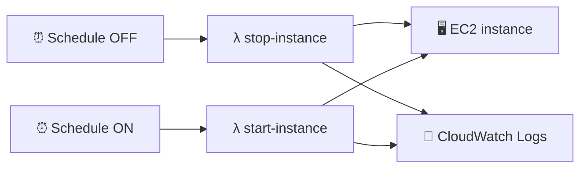
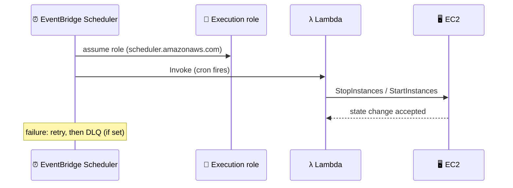

## What you build

Two schedules that turn an EC2 instance off in the evening and on in the morning (to save money), each calling a small Lambda function. Then a third automation that resizes the instance. The lab's walkthrough has no code in this text, so steps are generic; names, times and handler code will differ.


*EventBridge Scheduler calls Lambda on a timetable; Lambda calls the EC2 API.*

## Architecture


*Two roles are involved: the scheduler's execution role and the Lambda's own role.*

Schedule types (AWS docs):

| Type | Use for | Example |
|---|---|---|
| Rate | Fixed interval | every 10 minutes |
| Cron | Calendar times, with a time zone | weekdays at 08:00 |
| One-time | Run once at a date/time | a planned resize |

- **Target**: either a templated target (for example Lambda invoke) or the universal target, which can call over 6,000 API operations across 270+ services. So a schedule could call EC2 `StopInstances` directly, without Lambda. The lab uses Lambda.
- **Execution role**: the role the scheduler assumes. Trust principal `scheduler.amazonaws.com`, plus permission for the target (for example `lambda:InvokeFunction`). The console can create it for you; CLI, SDK and IaC need an existing role.
- **Lambda role**: must allow `ec2:StopInstances` / `ec2:StartInstances` (and `ec2:DescribeInstances` if you look instances up).
- **Flexible time window**: spreads the invocation over a window instead of exact time. Leave it off for "exactly 08:00".
- **Failures**: a retry policy (retry count, event retention) then an optional SQS dead-letter queue. By default the scheduler retries for 24 hours, up to 185 times (AWS blog); check the current docs.
- **Precision**: invocation happens within the minute you set (60 second precision).

## Steps

1. **Intro / Github Repo**: pick one Region. Download the course repo for the function code (its contents are not in this text, so write or copy a minimal handler yourself).
2. **Prepare an EC2 instance** (small, tagged for example `AutoStop=True`). Note its instance ID.
3. **Turn-OFF function**: Lambda > Create function > Author from scratch, Python. Handler calls `ec2.stop_instances(InstanceIds=[...])`.
4. **Turn-ON function**: same, with `ec2.start_instances(...)`.
5. **Permissions**: add `ec2:StopInstances`, `ec2:StartInstances`, `ec2:DescribeInstances` to each function's role. Test each function once with an empty test event and watch the instance state.
6. **Schedule ON**: EventBridge > Scheduler > Schedules > Create schedule. Recurring, cron, your time zone (for example 08:00 Mon-Fri), flexible time window Off, target Lambda invoke (turn-on function), let the console create the execution role.
7. **Schedule OFF**: same with the evening time and the turn-off function.
8. **Modify instance type automatically**: add a function that stops the instance, waits until `stopped`, calls `modify_instance_attribute` for the new type, then starts it. Trigger it with a one-time schedule. The instance must be stopped for the type change.
9. **Compare CloudFormation, CDK, SAM** (see table below). Optional: recreate the lab as code.

```bash
aws scheduler create-schedule --name ec2-off \
  --schedule-expression "cron(0 19 ? * MON-FRI *)" \
  --schedule-expression-timezone "Europe/Berlin" \
  --flexible-time-window Mode=OFF \
  --target '{"Arn":"<lambda-arn>","RoleArn":"<scheduler-role-arn>"}'
```

Expected result: at the set time the instance changes state (stopping/stopped, pending/running) and the function's log group shows the run.

### CloudFormation vs CDK vs SAM

| Tool | You write | Best for |
|---|---|---|
| CloudFormation | JSON/YAML templates | Any AWS resource; the base engine |
| SAM | Short YAML for serverless (Lambda, API, schedule events) | Serverless apps |
| CDK | Code (TypeScript, Python, ...) that produces templates | Reusable, loop-heavy infrastructure |

All three deploy through CloudFormation stacks. Pick SAM for pure serverless, CDK when you want real code, plain CloudFormation when you need a template with no extra tooling.

## Common mistakes

| Mistake | Fix |
|---|---|
| Schedule fires at the wrong hour | Set the time zone on the schedule; the default is not your local zone |
| Nothing happens | Check execution role trust (`scheduler.amazonaws.com`) and `lambda:InvokeFunction` |
| Lambda `UnauthorizedOperation` | Add the EC2 actions to the Lambda role |
| Resize fails | Stop the instance first; wait for `stopped` before changing type |
| Lost failed runs | Configure a DLQ and retry policy |
| Schedule in a different Region than the Lambda | Use one Region |

## Cleanup

1. Delete both schedules (Scheduler > Schedules), and the one-time resize schedule if present.
2. Delete the Lambda functions (off, on, resize).
3. Delete the scheduler execution role(s) and the Lambda role(s) in IAM.
4. Delete the log groups `/aws/lambda/<name>`.
5. Terminate the EC2 instance (stopped instances still pay for their EBS volume), then delete leftover volumes.
6. Delete the DLQ if you created one.

```bash
aws scheduler delete-schedule --name ec2-off
aws scheduler delete-schedule --name ec2-on
aws lambda delete-function --function-name stop-instance
```

## On the job

- Stop dev/test instances outside working hours: a classic cost saver. Stopped instances still bill for EBS storage.
- Choose EventBridge Scheduler over EventBridge rules for scale; it supports up to 1 million schedules per account (AWS blog; check the current quota).
- A schedule can call EC2 directly via a universal target; use Lambda only when you need logic (tag filters, waiting).
- Least privilege: scope the roles to specific instance ARNs or tags.
- Remember tasks may be delivered at least once, so keep functions idempotent (stopping a stopped instance is harmless).

## AWS docs

- [Schedule types in EventBridge Scheduler](https://docs.aws.amazon.com/scheduler/latest/UserGuide/schedule-types.html)
- [Managing a schedule in EventBridge Scheduler](https://docs.aws.amazon.com/scheduler/latest/UserGuide/managing-schedule.html)
- [Setting up Amazon EventBridge Scheduler (execution role)](https://docs.aws.amazon.com/scheduler/latest/UserGuide/setting-up.html)
