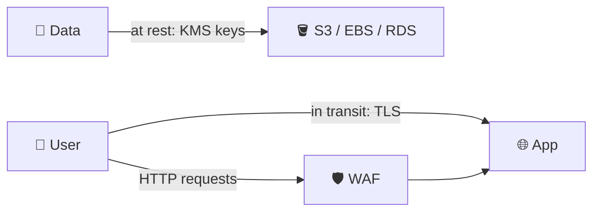
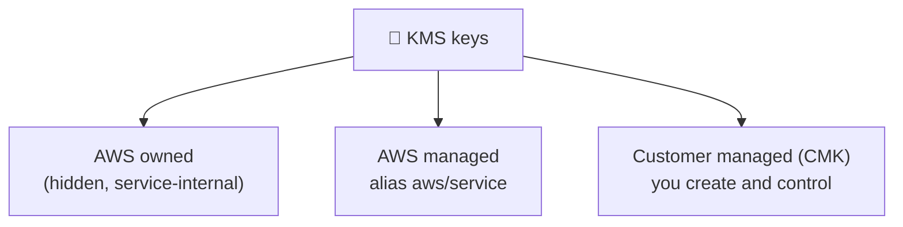
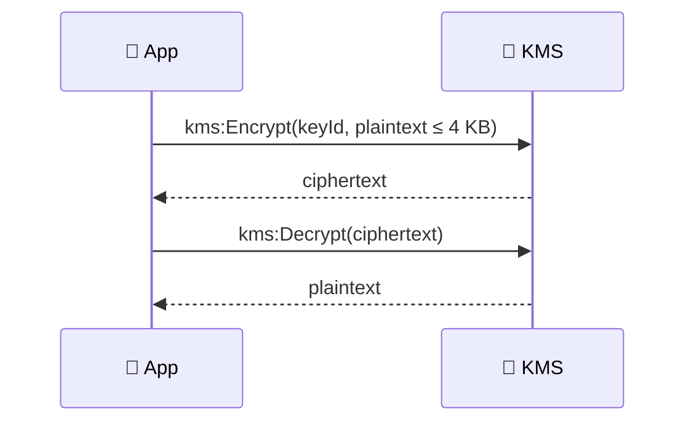
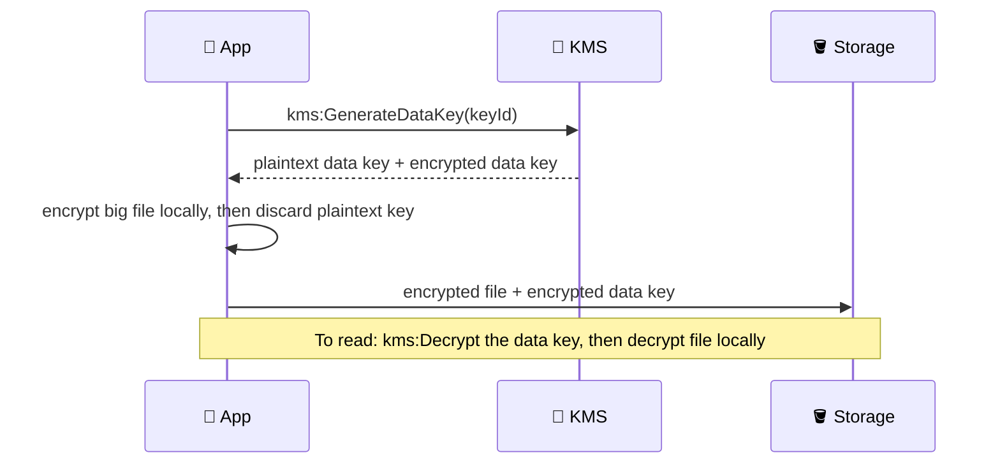
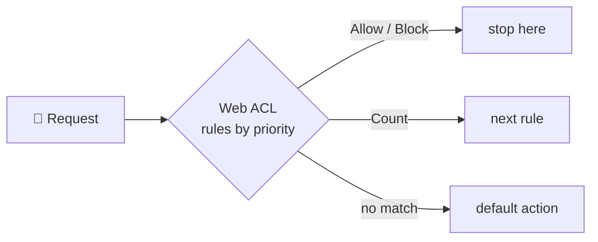
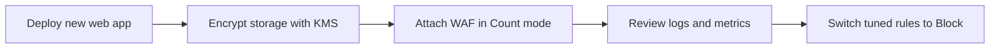

## What it is

Security on AWS has two jobs: protect your data (encryption) and protect your entry points (filtering and detection). This chapter covers **AWS KMS**, which manages the keys for encryption, and **AWS WAF**, a firewall for HTTP requests. A final table maps the other common security services to the threat each one handles.

*Encryption protects stored and moving data; WAF filters what reaches the app.*

Use KMS when data must be encrypted and you must control or audit the key. Use WAF when a public web app or API needs protection from bad HTTP requests.

## Key concepts

### Encryption at rest vs in transit

| | At rest | In transit |
|---|---|---|
| Protects | Data stored on disk | Data moving over the network |
| Typical tool | KMS keys (S3, EBS, RDS use them) | TLS/HTTPS with certificates |
| Threat | Stolen disk, snapshot, or bucket | Eavesdropping on the wire |

- Do both. They protect different moments.
- Most AWS storage services have an "encrypt with KMS" checkbox; you pick the key.

### KMS key types

*Three kinds of key; you only control the last one.*

| | AWS managed | Customer managed |
|---|---|---|
| Created by | The AWS service, in your account | You |
| Key policy | You cannot change it | You write it |
| Rotation | Automatic every year, fixed | You choose to enable it and set it |
| Cross-account use | No | Yes, via key policy |
| Monthly fee | None, you pay for use | Yes, plus usage (check KMS pricing) |

- AWS managed keys are the easy default: free to exist, auditable in CloudTrail.
- Pick a customer managed key when you need sharing, your own policy, rotation control, or compliance evidence.
- Every KMS key has a key policy. IAM policies alone are not enough unless the key policy allows IAM to control access (see [IAM](/chapters/04-aws-identity-and-access-management-iam/)).

### Small data: direct Encrypt and Decrypt

*Small secrets go to KMS directly; the key never leaves KMS.*

- Direct calls accept up to 4 KB of data. Good for passwords and small tokens.
- The caller needs `kms:Encrypt` and/or `kms:Decrypt` on that key (plus the key policy must allow it).
- Decrypt does not need the key ID for symmetric keys; the ciphertext carries it.

### Large data: envelope encryption

*Only the small data key travels to KMS; the large file stays local.*

- `GenerateDataKey` returns two copies of one key: plaintext (use once, then drop it) and encrypted (store it with the data).
- Why: sending gigabytes to KMS is slow; sending a 32-byte key is not.
- This is what S3, EBS and others do for you behind the checkbox. The caller needs `kms:GenerateDataKey` to write and `kms:Decrypt` to read.

### AWS WAF: web ACL and rules

*Rules run from the lowest priority number; Allow and Block end the evaluation.*

- A **web ACL** is the set of rules you attach to a resource: CloudFront, ALB, API Gateway REST API, AppSync, Cognito user pool, and others.
- Actions: Allow, Block, Count (non-terminating, for testing), plus CAPTCHA and Challenge for bots.
- Rule types you will meet:

| Rule type | Matches on |
|---|---|
| IP set / geo match | Source IP list or country |
| String, regex, size, SQLi, XSS | Content of headers, URI, query string, body |
| Rate-based | Too many requests from one source in a time window |
| Managed rule groups | Ready-made sets from AWS or Marketplace sellers |
| Your own rule groups | Reusable rules you maintain |

- WAF works at layer 7 (HTTP/HTTPS). It does not stop network-level floods.

### AWS WAF pricing

- You pay per web ACL, per rule, and per million requests inspected. Each rule group you add also has a monthly fee. Fees are prorated hourly.
- Extras cost more: Bot Control, Fraud Control, CAPTCHA attempts, Challenge responses, large request bodies, and web ACLs above the default capacity.
- WAF is billed on top of CloudFront, ALB or API Gateway. Check the [WAF pricing page](https://aws.amazon.com/waf/pricing/) for current numbers.

## X vs Y

### Which security service for which threat

| Threat | Service | One-line job |
|---|---|---|
| Stolen or exposed data | KMS | Create and control encryption keys |
| SQL injection, XSS, bad bots, HTTP floods | WAF | Filter HTTP requests at layer 7 |
| Network DDoS (layer 3/4) | Shield | Absorb volumetric and protocol attacks |
| Compromised account or instance | GuardDuty | Detect threats from logs and behaviour |
| Vulnerable software | Inspector | Scan for known vulnerabilities |
| PII in S3 buckets | Macie | Find sensitive data with ML |
| Leaked passwords and DB credentials | Secrets Manager | Store and rotate secrets |
| Unencrypted traffic | ACM | Issue and renew TLS certificates |
| Too many alerts | Security Hub | Collect findings in one place |
| Who called which API | CloudTrail | Audit log (see [CloudWatch and CloudTrail](/chapters/28-aws-monitoring-amazon-cloudwatch-and-aws-cloudtrai/)) |

### WAF vs Shield

| | WAF | Shield Standard | Shield Advanced |
|---|---|---|---|
| Layer | 7 (HTTP) | 3 and 4 (plus common attacks) | 3, 4 and 7 |
| Cost | Pay per ACL, rule, request | Free, always on | Extra subscription |
| Extras | Your own rules | None to configure | Response team, attack visibility |

Pick WAF when the attack looks like web requests. Pick Shield Advanced when downtime from DDoS is costly and you want expert help; Standard is already on.

### Secrets Manager vs Parameter Store

| | Secrets Manager | Parameter Store |
|---|---|---|
| Built-in rotation | Yes (Lambda-driven) | No |
| Cross-Region replication | Yes | No |
| Best for | DB passwords, API keys | Config values, plain or encrypted |

Pick Secrets Manager for credentials that must rotate. Pick Parameter Store for general configuration. Check current pricing for both.

### GuardDuty vs Inspector vs Macie

| | GuardDuty | Inspector | Macie |
|---|---|---|---|
| Question | "Is someone attacking me?" | "Is my software vulnerable?" | "Where is my sensitive data?" |
| Looks at | Account activity and logs | Compute workloads | S3 objects |

### AWS managed key vs customer managed key

Pick AWS managed when you only need encryption and an audit trail. Pick customer managed when you must share the key, set its policy, or control rotation.

## Job notes

*Safe rollout: encrypt, observe, then enforce.*

- Access denied on an encrypted resource is often missing KMS permission (`kms:Decrypt`, `kms:GenerateDataKey`) or a key policy that does not allow the role.
- A KMS key cannot be deleted at once; deletion is scheduled with a waiting period, so mistakes can be undone.
- Never block with a new managed rule group straight away; start in Count and look at what it matches.
- Put cheap rules first. Terminating matches stop evaluation, which also avoids charges for later paid rule groups.
- Every KMS call lands in CloudTrail, which gives you proof of who used the key.
- Check the current KMS and WAF quotas and prices before sizing a design.

## Cheat sheet

- At rest: KMS. In transit: TLS (certificates from ACM).
- Key types: AWS owned, AWS managed (`aws/...`), customer managed.
- AWS managed keys: auto-rotate yearly, no edits, same account only.
- Encrypt/Decrypt directly: up to 4 KB.
- Big data: `GenerateDataKey`, encrypt locally, store the encrypted key with the data.
- WAF: layer 7, attaches to CloudFront, ALB, API Gateway, AppSync, Cognito and more.
- Actions: Allow, Block (terminating); Count (test); CAPTCHA, Challenge.
- Rules run by priority; default action applies if nothing terminates.
- WAF cost: per web ACL + per rule + per million requests (+ extras).
- Shield Standard is free; Advanced is a paid subscription.

## AWS docs

- [AWS KMS cryptography essentials](https://docs.aws.amazon.com/kms/latest/developerguide/kms-cryptography.html)
- [AWS KMS keys (AWS managed and customer managed)](https://docs.aws.amazon.com/kms/latest/developerguide/concepts.html)
- [What is AWS WAF](https://docs.aws.amazon.com/waf/latest/developerguide/what-is-aws-waf.html)
- [How AWS WAF handles rule actions](https://docs.aws.amazon.com/waf/latest/developerguide/web-acl-rule-actions.html)
- [How Shield and Shield Advanced work](https://docs.aws.amazon.com/waf/latest/developerguide/ddos-overview.html)
