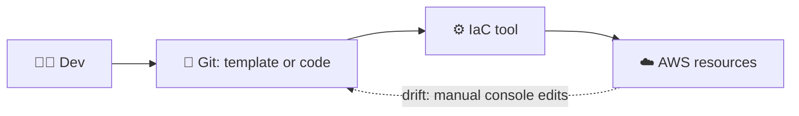
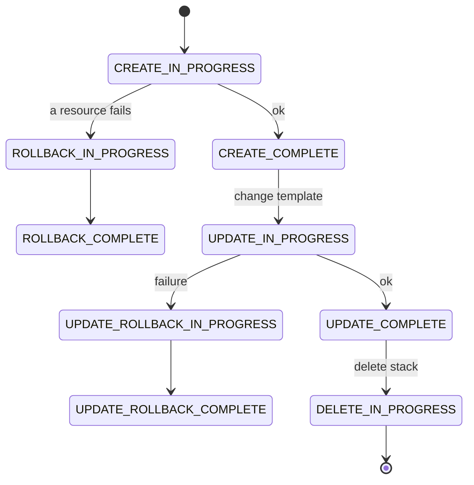
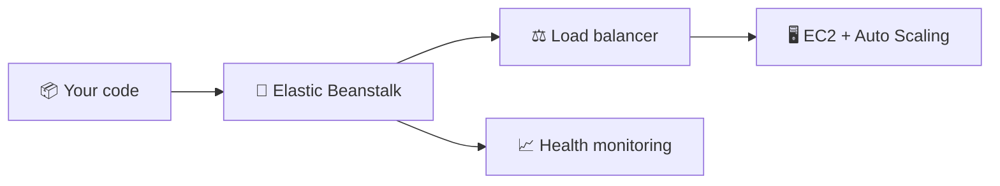
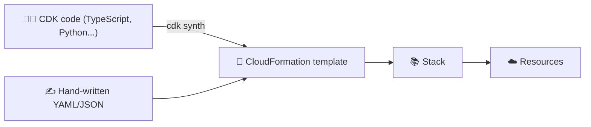

## What it is

**Infrastructure as Code (IaC)** means you describe AWS resources in text files, keep them in Git, and let a tool create them. The same file gives the same result every time, and a change is a reviewable diff instead of a forgotten click. Employers expect it: "can you deploy this with CloudFormation, CDK or Terraform?" is a standard interview question.


*Files in Git are the source of truth; manual console edits cause drift.*

Use it when: more than one person, environment or region needs the same setup.

## Key concepts

**Declarative vs imperative.** Declarative says *what* should exist; imperative says *how* to build it step by step.

| Style | You write | Example |
|---|---|---|
| Declarative | Desired end state | CloudFormation template |
| Imperative | Ordered commands | Shell script of `aws` CLI calls |

**Template, stack, resource.** A *template* (YAML or JSON) lists resources; the only required section is `Resources`. A *stack* is one deployed copy of a template, and CloudFormation creates, updates or deletes its resources together.

A minimal template you could actually deploy:

```yaml
Resources:
  LogsBucket:
    Type: AWS::S3::Bucket
```

```bash
aws cloudformation deploy --template-file t.yaml --stack-name demo
```

**Stack lifecycle.** Status names come from the CloudFormation stack status codes.


*A failed create or update rolls back; read the stack events to see why.*

**Elastic Beanstalk (the second lecture).** Not IaC in the strict sense: you upload your app and Beanstalk provisions EC2 (or EKS), load balancing, health monitoring and scaling. An *application* groups *environments*; each environment runs on a *platform* (OS plus language runtime). Demo steps: console, Elastic Beanstalk, Create application, pick a platform, upload code or use the sample, wait for the environment to turn healthy, open the URL.


*You supply code; Beanstalk builds the infrastructure around it.*

## X vs Y


*CloudFormation vs CDK vs console/CLI: CDK is a layer on top of CloudFormation: both end as a stack.*

| | Console | CLI script | CloudFormation | CDK | Terraform |
|---|---|---|---|---|---|
| Style | Clicks | Imperative | Declarative YAML/JSON | Real code, produces templates | Declarative HCL |
| Repeatable | No | Partly | Yes | Yes | Yes |
| Rollback on failure | No | No | Yes | Yes (via CloudFormation) | No built-in stack rollback |
| Provider | AWS | AWS | AWS | AWS | Third party, multi-cloud |

Pick **CloudFormation** when you want plain, AWS-native templates. Pick **CDK** when your team prefers a programming language, loops and reuse. Use the **console/CLI** only to explore or for one-off tests. Terraform is common in jobs, but it is not an AWS service; this course covers the AWS tools next.

## Job notes

- Never edit stack resources by hand in the console; the template and reality drift apart.
- Keep templates in Git and review changes like application code.
- `cdk synth` shows the template CDK will deploy; run it before deploying to catch errors.
- Delete the whole stack for cleanup instead of removing resources one by one.
- A stack in a failed state: open the **Events** tab first, the error is on the failed resource.
- Hands-on next: [Lab 13: CloudFormation](/chapters/41-lab-13-infrastructure-as-code-aws-cloudformation/).

## Cheat sheet

- IaC = infrastructure described in files, versioned in Git.
- Declarative = desired state; imperative = ordered steps.
- Template (YAML/JSON, `Resources` required) → stack → resources.
- Failed create or update rolls back automatically.
- CDK code → `cdk synth` → CloudFormation template.
- Beanstalk = upload code, AWS runs EC2, load balancer, scaling.

## AWS docs

- [Working with CloudFormation templates](https://docs.aws.amazon.com/AWSCloudFormation/latest/UserGuide/template-guide.html)
- [View CloudFormation stack events and status codes](https://docs.aws.amazon.com/AWSCloudFormation/latest/UserGuide/view-stack-events.html)
- [cdk synthesize](https://docs.aws.amazon.com/cdk/v2/guide/ref-cli-cmd-synth.html)
- [What is AWS Elastic Beanstalk?](https://docs.aws.amazon.com/elasticbeanstalk/latest/dg/Welcome.html)
