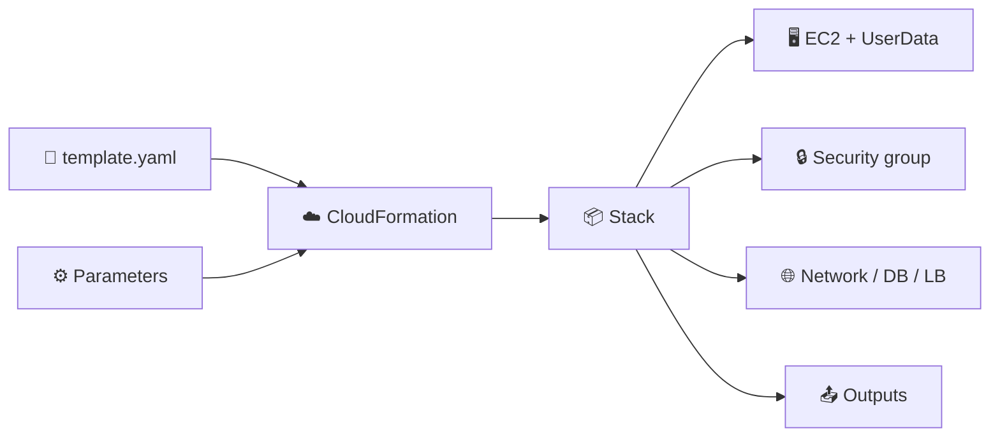
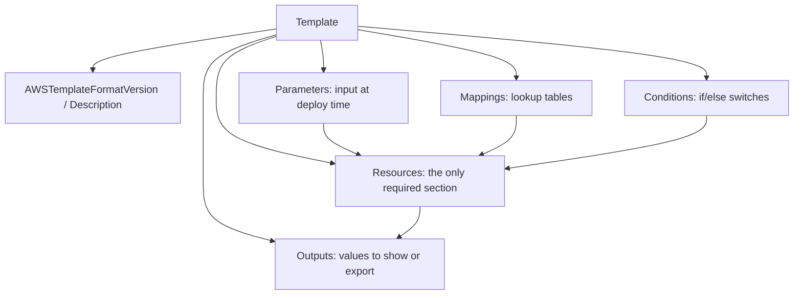
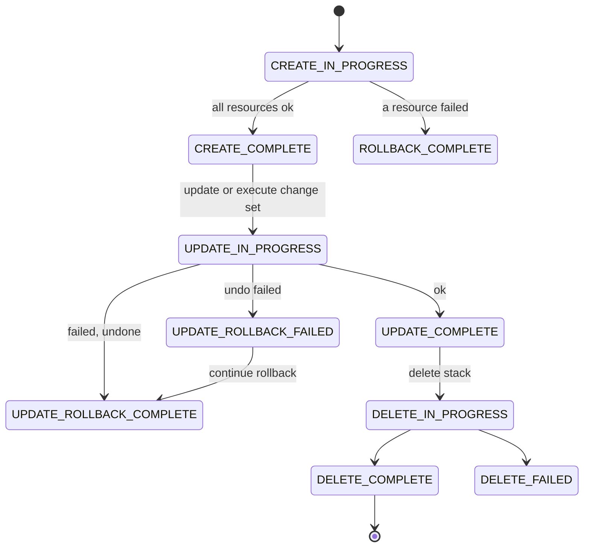

## What you build

You write one YAML template that grows from a single EC2 instance into a small 3-tier app, then deploy, update, preview, split and delete it as a CloudFormation stack. Background on the service is in [chapter 40](/chapters/40-aws-operation-services-iac/).


*A template plus parameters becomes one stack that owns all its resources.*

The lab's repo files and exact app are not in the docs I checked, so steps stay generic. Use the lab repo's templates where I say "your template".

## Architecture


*Template anatomy: Resources is required; the rest feed it or read from it.*


*Stack lifecycle. A failed update returns to the last working state; a failed create ends in ROLLBACK_COMPLETE and must be deleted.*

| Piece | Role |
|---|---|
| Stack | One deployed copy of a template; all its resources live and die together |
| Change set | Preview of what an update will add, modify, replace or remove |
| Drift detection | Finds resources changed outside CloudFormation |
| Stack policy | JSON rules that block chosen update actions on chosen resources |
| Nested / cross stack | Split big templates: nested = child stack inside a parent; cross = one stack exports, another imports |

Intrinsic functions you will use most:

| Function | Short form | Use |
|---|---|---|
| Ref | `!Ref X` | Parameter value, or the ID of a resource |
| GetAtt | `!GetAtt X.Attr` | A resource attribute, e.g. `Web.PublicIp` |
| Sub | `!Sub "${AWS::Region}-app"` | Insert variables into a string |
| FindInMap | `!FindInMap [Map, Key1, Key2]` | Read a Mappings table |
| ImportValue | `!ImportValue Name` | Read another stack's export |
| If / Equals | `!If [Cond, a, b]` | Choose a value by Condition |

Pseudo parameters like `AWS::Region` and `AWS::StackName` are built in; you do not declare them.

## Steps

Stages follow the lecture order.

**Stage 1: Skeleton and first resource**

1. Intro and repo: clone the lab's GitHub repo and open the starter template.
2. Skeleton: a template needs only `Resources`. Add `AWSTemplateFormatVersion` and `Description` for clarity.
3. Console: CloudFormation > Create stack > Upload a template file > give a stack name > Submit. Watch the Events tab until `CREATE_COMPLETE`.
4. Update: edit the file, then Stack > Update > Replace current template. CloudFormation changes only what differs.
5. Add an EC2 instance (`AWS::EC2::Instance`) with an AMI, instance type and a tag.

```yaml
AWSTemplateFormatVersion: "2010-09-09"
Resources:
  Web:
    Type: AWS::EC2::Instance
    Properties:
      InstanceType: t3.micro
      ImageId: ami-xxxxxxxx   # replace; AMI IDs differ per Region
```

6. Deletion policy: on data resources add `DeletionPolicy: Retain` (or `Snapshot` where supported) so deleting the stack keeps them.

**Stage 2: Parameters, Ref, Outputs, UserData**

7. Parameters: let the user pick instance type and environment at deploy time.
8. SSM AMI parameter: use a parameter of type `AWS::SSM::Parameter::Value<AWS::EC2::Image::Id>` that points at an AWS public SSM path, so the template always gets a current AMI and works in any Region. Look up the exact path in the docs.
9. Use `!Ref` to read parameters and to wire resources together (the instance's security group). Use pseudo parameters (`AWS::Region`, `AWS::AccountId`) instead of hard-coded values.
10. Outputs: print the public IP or URL after deploy.
11. UserData: install and start a web server on boot, using `!Sub` or `Fn::Base64`.

```yaml
Parameters:
  EnvName:
    Type: String
    AllowedValues: [dev, prod]
    Default: dev
  LatestAmi:
    Type: AWS::SSM::Parameter::Value<AWS::EC2::Image::Id>
    Default: /aws/service/ami-amazon-linux-latest/al2023-ami-kernel-default-x86_64
Resources:
  Web:
    Type: AWS::EC2::Instance
    Properties:
      ImageId: !Ref LatestAmi
      InstanceType: t3.micro
      UserData:
        Fn::Base64: !Sub |
          #!/bin/bash
          dnf install -y httpd
          systemctl enable --now httpd
          echo "env=${EnvName} region=${AWS::Region}" > /var/www/html/index.html
Outputs:
  WebIp:
    Value: !GetAtt Web.PublicIp
```

Treat the SSM path above as an example to verify; I could not confirm it in the docs.

**Stage 3: Grow the template**

12. Add infrastructure in two parts (P1, P2): for example security groups, then the load balancer, database or other tiers your lab repo uses. Deploy after each part and read the Events tab on failure.
13. Mappings: a lookup table keyed by environment or Region, read with `!FindInMap`.
14. Multiple environments: deploy the same template as `dev` and `prod` stacks; Mappings pick sizes per environment.
15. Intrinsic functions tour: practice `Sub`, `Join`, `Select`, `GetAtt`, `FindInMap`.
16. Conditions: define `IsProd: !Equals [!Ref EnvName, prod]` and attach it to a resource (`Condition: IsProd`) or use `!If`.

```yaml
Mappings:
  Size:
    dev:  { Type: t3.micro }
    prod: { Type: t3.large }
Conditions:
  IsProd: !Equals [!Ref EnvName, prod]
Resources:
  Replica:
    Type: AWS::EC2::Instance
    Condition: IsProd
    Properties:
      ImageId: !Ref LatestAmi
      InstanceType: !FindInMap [Size, !Ref EnvName, Type]
```

**Stage 4: Configure instances after launch**

17. UserData runs once at first boot. `cfn-init` reads the resource's `Metadata` and installs packages, writes files and starts services; `cfn-hup` watches that metadata and re-runs hooks when you update the stack.
18. Demo: put a package and a file in `AWS::CloudFormation::Init`, call `cfn-init` from UserData, run `cfn-hup`, update the file contents in the template, update the stack, and see the instance change without replacement. Exact syntax: copy it from the lab repo.

**Stage 5: Safe change management**

19. Change sets: Stack > Create change set > upload the new template > review Add/Modify/Replace > Execute (or delete it).
20. Drift: change a resource by hand (for example add a security group rule), then Stack actions > Detect drift > View drift results.
21. Stack policy: set a policy that denies `Update:Replace` or `Update:Delete` on the database, then try an update that would replace it; it is blocked.

```bash
aws cloudformation create-change-set --stack-name demo \
  --change-set-name v2 --template-body file://template.yaml
aws cloudformation describe-change-set --stack-name demo --change-set-name v2
aws cloudformation execute-change-set --stack-name demo --change-set-name v2
aws cloudformation detect-stack-drift --stack-name demo
```

**Stage 6: Split and combine**

22. Cross-stack reference: stack A adds `Export: Name:` to an output; stack B uses `!ImportValue`. A stack cannot be deleted while another still imports its export.
23. Nested stack: a parent uses `AWS::CloudFormation::Stack` with `TemplateURL` (an S3 URL) and passes parameters; child outputs are read with `!GetAtt Child.Outputs.Name`.
24. Capstone: deploy the 3-tier app (network, web, database) from your lab's templates. Compare with the console-built version from [lab 01](/chapters/07-lab-01-build-first-3-tiers-web-application-on-amaz/).
25. Resources: open the resource-type reference and learn to read a type's properties and return values.
26. Deploy everything with the CLI: `aws cloudformation deploy --template-file template.yaml --stack-name demo --parameter-overrides EnvName=dev`.

Expected result: stacks reach `CREATE_COMPLETE`, outputs show the web URL, change sets list only the diffs, and drift shows `IN_SYNC` until you edit by hand.

## Common mistakes

| Mistake | Fix |
|---|---|
| Stack stuck in `ROLLBACK_COMPLETE` | A failed create cannot be updated; read Events for the first failed resource, delete the stack, fix, redeploy |
| `UPDATE_ROLLBACK_FAILED` | Fix the cause, then use Continue update rollback (optionally skip resources) |
| Stack delete fails on S3 bucket | Empty the bucket first (or set Retain) |
| Hard-coded AMI ID | Use an SSM public parameter; AMI IDs differ per Region |
| Editing resources by hand | Causes drift; change the template instead |
| Export cannot be deleted or changed | Remove the importing stacks first |
| YAML indentation errors | Validate the template before deploying |
| Replacement surprise | Always review a change set before executing |

## Cleanup

Order matters. Cross-stack imports and retained resources block deletion.

1. Delete any open change sets you do not need.
2. Delete stacks that import exports first (the consumers), then the stacks that export.
3. Delete the parent of a nested stack; it removes the children. Do not delete children directly.
4. Empty any S3 buckets the stacks created, then delete the stacks. Failed deletes can be retried.
5. Manually delete resources kept by `DeletionPolicy: Retain` or `Snapshot` (buckets, EBS or RDS snapshots).
6. Delete the S3 bucket holding nested-stack templates, and any key pair or role you made by hand.
7. Confirm in Cost Explorer next day that no EC2, load balancer, NAT gateway or RDS charge remains.

```bash
aws cloudformation delete-stack --stack-name app-web
aws cloudformation wait stack-delete-complete --stack-name app-web
aws cloudformation delete-stack --stack-name app-network
```

## On the job

- Keep templates in Git and deploy through a pipeline; review change sets in pull requests.
- Never change stack resources by hand; run drift detection regularly.
- Set `DeletionPolicy` on databases and buckets, and use stack policies on critical resources.
- Use parameters and Mappings for environments, not copy-pasted templates.
- Keep one stack per lifecycle (network, data, app) and link with exports or nested stacks.
- Lint templates before deploy (cfn-lint is a common tool).

## AWS docs

- [CloudFormation template sections](https://docs.aws.amazon.com/AWSCloudFormation/latest/UserGuide/template-anatomy.html)
- [DeletionPolicy attribute](https://docs.aws.amazon.com/AWSCloudFormation/latest/TemplateReference/aws-attribute-deletionpolicy.html)
- [Detect unmanaged changes with drift detection](https://docs.aws.amazon.com/AWSCloudFormation/latest/UserGuide/using-cfn-stack-drift.html)
- [Prevent updates to stack resources (stack policies)](https://docs.aws.amazon.com/AWSCloudFormation/latest/UserGuide/protect-stack-resources.html)
- [View CloudFormation stack events and stack status codes](https://docs.aws.amazon.com/AWSCloudFormation/latest/UserGuide/view-stack-events.html)
