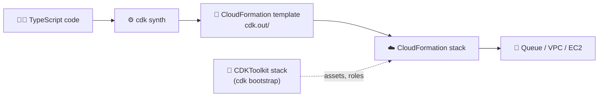
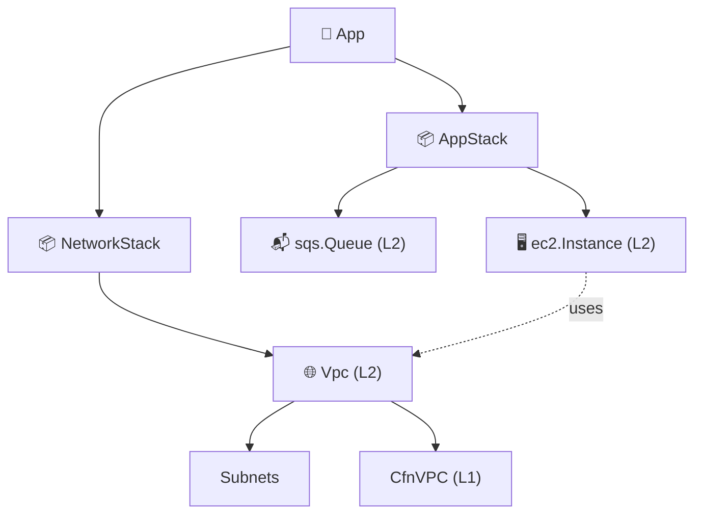

## What you build

A CDK project in TypeScript that creates an SQS queue, then a network stack (VPC and subnets), then an app stack (EC2 instance) in the same app, and finally destroys it all. The lab repo's exact resource names and the AMI type are not in the docs I checked, so steps stay generic.


*CDK is a code layer: your code becomes a CloudFormation template, and CloudFormation creates the resources.*

## Architecture


*The construct tree: App holds stacks, stacks hold constructs, an L2 wraps L1 resources.*

| Level | What it is | Example |
|---|---|---|
| L1 | One-to-one with a CloudFormation resource, names start with `Cfn` | `CfnBucket` |
| L2 | Friendly class with sensible defaults and helper methods | `s3.Bucket`, `sqs.Queue` |
| L3 | Pattern: several resources working together | `ApplicationLoadBalancedFargateService` |

- `App` and `Stack` create no resources themselves; every resource construct must sit inside a `Stack`, and stacks sit inside an `App`.
- One App can hold several stacks. Each stack becomes one CloudFormation stack.
- Lab 41 did the same job in raw templates: see [/chapters/41-lab-13-infrastructure-as-code-aws-cloudformation/](/chapters/41-lab-13-infrastructure-as-code-aws-cloudformation/). Theory is in [/chapters/40-aws-operation-services-iac/](/chapters/40-aws-operation-services-iac/).

## Steps

1. Clone the lab's GitHub repo (the first lecture) and keep it for reference. Install Node.js, then the CLI and check the version.
2. Configure credentials (`aws configure` or SSO) so the CLI knows the account and Region.

```bash
npm install -g aws-cdk
cdk --version
```

3. Create an empty project folder and initialise it. This generates `bin/` (the App), `lib/` (stacks), `cdk.json`.

```bash
mkdir cdk-lab && cd cdk-lab
cdk init app --language typescript
```

4. Bootstrap once per account and Region. It deploys the `CDKToolkit` stack that stores assets and roles.

```bash
cdk bootstrap aws://ACCOUNT_ID/REGION
```

5. Add an SQS queue to the default stack, then check, preview, deploy.

```ts
import * as sqs from 'aws-cdk-lib/aws-sqs';
import { Duration } from 'aws-cdk-lib';
new sqs.Queue(this, 'LabQueue', { visibilityTimeout: Duration.seconds(300) });
```

```bash
cdk synth     # print the CloudFormation template
cdk diff      # what will change
cdk deploy    # create or update the stack
```

6. Create `NetworkStack` (a new class in `lib/`): a `ec2.Vpc` with subnet groups. Public and private subnets are set in `subnetConfiguration`.

```ts
this.vpc = new ec2.Vpc(this, 'LabVpc', {
  maxAzs: 2,
  subnetConfiguration: [
    { name: 'public', subnetType: ec2.SubnetType.PUBLIC, cidrMask: 24 },
    { name: 'private', subnetType: ec2.SubnetType.PRIVATE_WITH_EGRESS, cidrMask: 24 },
  ],
});
```

7. Register both stacks in `bin/*.ts`. `cdk ls` lists them; `cdk deploy StackName` deploys one, `--all` deploys all.

```ts
const net = new NetworkStack(app, 'NetworkStack');
new AppStack(app, 'AppStack', { vpc: net.vpc });
```

8. Create `AppStack`: take the VPC as a prop and add an `ec2.Instance`. Choose the AMI with `ec2.MachineImage.latestAmazonLinux2023()` or another image type the lab picks.
9. Deploy and verify: `cdk deploy --all`, then check the Console under CloudFormation > Stacks and EC2 > Instances.
10. Update: change one property (for example the instance type), run `cdk diff`, then `cdk deploy`. Some changes replace the resource; read the diff.
11. Tear down with `cdk destroy` (see Cleanup).

Expected result: two CloudFormation stacks, a queue, a VPC with subnets and one running instance; after destroy they are gone. Note: a cross-stack VPC reference makes CDK create stack exports, so deploy and destroy order matters.

## Common mistakes

| Mistake | Fix |
|---|---|
| Deploy fails, toolkit missing | Run `cdk bootstrap` for that account and Region |
| Wrong account or Region | Pass `env` to the stack or check `aws sts get-caller-identity` |
| Skipping `cdk diff` | Always diff; replacements delete data |
| Destroying NetworkStack first | CloudFormation refuses while AppStack uses its exports |
| Editing resources in the console | Next deploy may conflict; change code instead |
| NAT gateway left on | Private-with-egress subnets create NAT gateways with hourly cost |

## Cleanup

Order matters: dependent stack first.

1. `cdk destroy AppStack` (deletes the instance).
2. `cdk destroy NetworkStack` (VPC, subnets, NAT gateways if any).
3. Any other stack from the project, such as the SQS stack (`cdk destroy --all` handles order for you).
4. Check CloudFormation > Stacks: only `CDKToolkit` should remain.
5. Optional: delete `CDKToolkit` in CloudFormation and empty then delete its staging S3 bucket (bootstrap resources can retain the bucket); do this only if you will not use CDK in that Region again.
6. Next day, confirm in Cost Explorer that no EC2, NAT or VPC charges remain.

```bash
cdk destroy --all
```

## On the job

- Commit the whole project; `cdk.out/` is generated and is not committed.
- Prefer L2 constructs; drop to L1 only for missing properties.
- Run `cdk diff` in the pull request, `cdk deploy` in a pipeline.
- Split stacks by lifecycle (network rarely changes, apps change often).
- Do not rename a construct ID casually: it can change the logical ID and replace the resource.

## AWS docs

- [Deploy AWS CDK applications](https://docs.aws.amazon.com/cdk/v2/guide/deploy.md)
- [AWS CDK constructs](https://docs.aws.amazon.com/cdk/v2/guide/constructs.md)
- [AWS CDK CLI command reference](https://docs.aws.amazon.com/cdk/v2/guide/ref-cli-cmd.md)
- [Bootstrapping environments for AWS CDK](https://docs.aws.amazon.com/cdk/v2/guide/bootstrapping-env.md)
