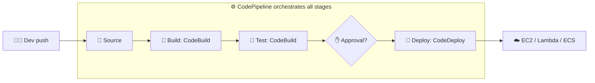
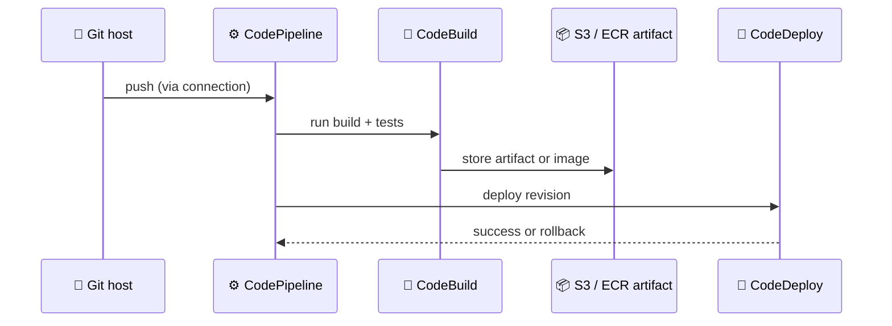

## What it is

**CI/CD** automates the path from a code change to running software. *Continuous integration* builds and tests every change; *continuous delivery* also prepares and releases it, often with an approval before production. AWS offers a family of managed "Code" services, each covering one step.

*CodePipeline is the conveyor belt; CodeBuild and CodeDeploy do the work in the stages.*

Use it when: releases are manual, slow or different every time.

## Key concepts

| Need | Service | What it does |
|---|---|---|
| Orchestrate stages | **CodePipeline** | Models and automates the release workflow on every code change |
| Compile and test | **CodeBuild** | Managed build service; you pay for build time, no servers |
| Release to targets | **CodeDeploy** | Deploys to EC2/on-premises, Lambda or ECS |
| Store packages | **CodeArtifact** | Private repo for npm, Maven, pip and similar; can proxy public registries |
| Link to Git hosts | **CodeConnections** | Connects pipelines to third-party repos such as GitHub or Bitbucket |
| Store container images | **Amazon ECR** | Registry that build stages push to and ECS pulls from |
| Host Git repos | **CodeCommit** | See the status note below |

*Each stage passes an artifact to the next; a failed stage stops the pipeline.*

- **Config files you will meet in the labs.** CodeBuild reads `buildspec.yml`; CodeDeploy reads `appspec.yml`.
- **CodeDeploy strategies.** On EC2 it does in-place or blue/green; on Lambda and ECS it shifts traffic with canary, linear or all-at-once settings.
- **Roles.** Every service needs an IAM role: CodeBuild to reach S3, ECR and logs, CodePipeline to start the other services. For ECS, the pipeline pushes images to ECR and the task pulls them.
- **CodeCommit status: check current status.** AWS closed it to new customers on July 25, 2024; its docs history lists it as available to new customers again on November 25, 2025, while other pages still show the older notice. Many teams use GitHub or GitLab through CodeConnections instead.
- **Naming.** CodeConnections was formerly called CodeStar Connections; old `codestar-connections` resources still work.

The labs build exactly this flow: start with [CI/CD Part 1 on EC2](/chapters/44-lab-14-ci-cd-part-1-amazon-ec2/), then [ALB and ASG](/chapters/45-lab-14-ci-cd-part-2-alb-and-asg/), [ECS rolling update](/chapters/46-lab-14-ci-cd-part-3-amazon-ecs-rolling-update/) and [ECS blue/green](/chapters/47-lab-14-ci-cd-part-3-amazon-ecs-blue-green-deployme/).

## Cheat sheet

- Pipeline = source, build, test, (approval), deploy.
- CodePipeline orchestrates; CodeBuild builds and tests; CodeDeploy releases.
- CodeArtifact = packages; ECR = container images; CodeConnections = third-party Git.
- `buildspec.yml` for CodeBuild, `appspec.yml` for CodeDeploy.
- CodeDeploy targets: EC2/on-premises, Lambda, ECS.
- Check current status and pricing pages before choosing CodeCommit.

## AWS docs

- [What is AWS CodePipeline?](https://docs.aws.amazon.com/codepipeline/latest/userguide/welcome.html)
- [What is AWS CodeBuild?](https://docs.aws.amazon.com/codebuild/latest/userguide/welcome.html)
- [What is CodeDeploy?](https://docs.aws.amazon.com/codedeploy/latest/userguide/welcome.html)
- [What is AWS CodeArtifact?](https://docs.aws.amazon.com/codeartifact/latest/ug/welcome.html)
- [What are connections?](https://docs.aws.amazon.com/dtconsole/latest/userguide/welcome-connections.html)
