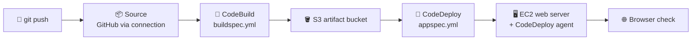
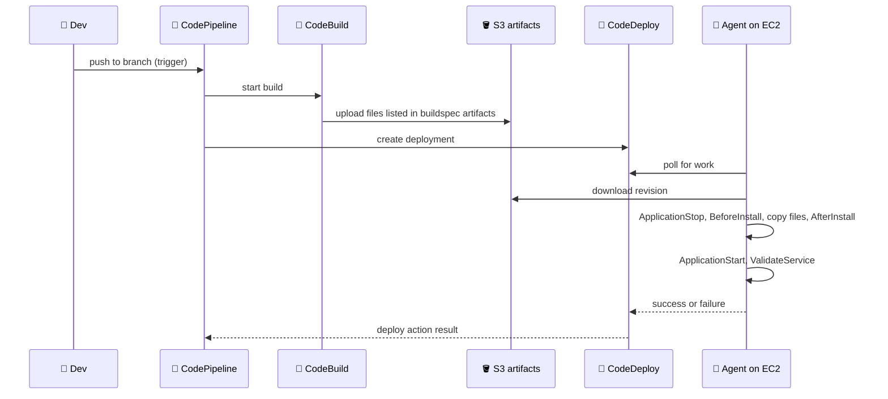
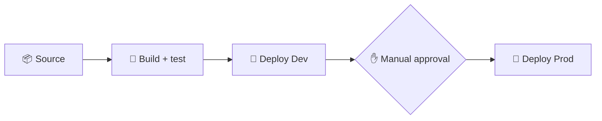

## What you build

A pipeline that takes code from a repository, builds and tests it with CodeBuild, and deploys it to an EC2 web server with CodeDeploy. Later you split it into Dev and Prod with a manual approval between them.


*CodePipeline moves one artifact through source, build and deploy.*

This chapter follows [AWS DevOps services](/chapters/43-aws-devops-services/) from the previous chapter. The lab's own app (language, repo, test command) is not in the docs, so the steps below stay generic: replace the commands with the ones from the lab repo.

## Architecture


*One deployment, from push to validated server.*

- **CodeBuild**: managed build machine; reads `buildspec.yml` from the source root. Compute size ("hardware") is chosen on the project and only affects build speed and price.
- **CodeDeploy**: application + deployment group (which EC2 instances, found by tag) + deployment (one release).
- **Agent**: a small program on the instance that fetches the bundle and runs your scripts. No agent, no deployment.
- **appspec.yml**: says which files go where and which script runs at each lifecycle hook.
- **CodePipeline**: stages in order; the artifact flows through an S3 artifact bucket it creates for you.

## Steps

Stages follow the lecture order (intro and overview are concept only).

**Stage 1: Source and server**

1. EC2: launch a Linux instance (Amazon Linux), open port 80 (and 22 or use Session Manager), install the web server in user data. Tag it, for example `Name=web-dev`.
2. Create an IAM role for the instance (instance profile) so the agent can read the artifact bucket, and a CodeDeploy service role for the deployment group. Exact managed policies: take them from the lab and the docs below.
3. Put the app code in a Git repo (GitHub). In CodePipeline or CodeBuild you will connect it through a **connection** (CodeConnections): console > Settings > Connections > Create > authorize GitHub in the popup. The connection must show Available before use.

**Stage 2: Build with CodeBuild**

4. CodeBuild > Create project: source = your repo, environment = managed image, choose the compute type (smallest is fine for the lab), a new service role, buildspec = "Use a buildspec file".
5. Add `buildspec.yml` at the repo root. Keep your real test command in `build`:

```yaml
version: 0.2
phases:
  install:
    commands:
      - echo "install dependencies here"
  build:
    commands:
      - echo "run tests here, for example: npm test"
artifacts:
  files:
    - appspec.yml
    - scripts/**/*
    - app/**/*
```

6. Start build and read the logs. A failing test command in `build` fails the build: that is how the "Run Test Case" lecture works. Fix the code or command and rebuild.

**Stage 3: Deploy with CodeDeploy**

7. SSH or Session Manager into the instance and install the agent (Amazon Linux / RHEL, version 2.0.x installer path; use the bucket for your region from the docs).

```bash
sudo yum update
sudo yum install wget
cd /home/ec2-user
wget https://aws-codedeploy-REGION.s3.REGION.amazonaws.com/latestv2/install
chmod +x ./install
sudo ./install auto
sudo systemctl status codedeploy-agent
```

8. CodeDeploy > Applications > Create application (compute platform EC2/On-premises) > Create deployment group: service role, deployment type In-place, environment = Amazon EC2 instances matched by your tag, no load balancer for now.
9. Add `appspec.yml` at the repo root (and in the build artifacts). Scripts live in `scripts/`:

```yaml
version: 0.0
os: linux
files:
  - source: /app
    destination: /var/www/html
hooks:
  ApplicationStop:
    - location: scripts/stop_server.sh
      timeout: 60
      runas: root
  BeforeInstall:
    - location: scripts/install_deps.sh
      runas: root
  ApplicationStart:
    - location: scripts/start_server.sh
      timeout: 60
      runas: root
  ValidateService:
    - location: scripts/validate.sh
      timeout: 60
      runas: root
```

10. Create a first deployment by hand (source = S3 artifact from the CodeBuild run). It will likely fail: this is the "Fix buildspec and appspec" lecture. Open the deployment's failed event, read the script error, and check the usual causes in Common mistakes. Fix, rebuild, redeploy until the page loads.

**Stage 4: Pipeline, trigger, verify**

11. CodePipeline > Create pipeline (V2). Source: GitHub through your connection, repo and branch. Build: your CodeBuild project. Deploy: CodeDeploy, your application and deployment group.
12. Push a visible change (text on the home page). The push triggers the pipeline; watch each stage turn green, then refresh the server's public IP in a browser.

**Stage 5: Dev and Prod with approval**

13. Launch or tag a second instance as prod; install the agent on it. Create two deployment groups in the same CodeDeploy application: `dev` (tag web-dev) and `prod` (tag web-prod).
14. Edit the pipeline: Deploy stage = deploy to `dev`; add a stage with a **Manual approval** action (optionally with an SNS topic for notification); add a last stage deploying to `prod`.


*Dev is automatic; Prod waits for a person.*

15. Push a change: it deploys to Dev, then pauses. Approve in the console (the approving IAM user needs approval permission) and watch Prod update.

Expected result: a `git push` updates Dev automatically, and Prod updates only after approval.

## Common mistakes

| Mistake | Fix |
|---|---|
| Deployment never starts | Install and start the agent; attach an instance profile; make sure the tag matches the deployment group |
| appspec.yml not found | List it under `artifacts: files:` in buildspec so it is at the bundle root |
| Hook script fails with permission denied | `chmod +x` scripts in the repo, use `runas: root` if needed |
| YAML breaks the build | Check spaces; YAML is indentation-sensitive. Use `buildspec.yml` and `appspec.yml` exactly (not `.yaml` unless the project points to it) |
| `ValidateService` always passes | Make `validate.sh` return a non-zero exit code on failure (for example `curl -f`) |
| Connection pending | Finish GitHub authorization; the status must be Available |
| Script runs on first deploy only | First deployment has no previous `ApplicationStop` script on the instance; write it to tolerate a missing server |

## Cleanup

Delete in this order so nothing keeps running or billing.

1. CodePipeline: delete the pipeline (stops triggers).
2. CodeDeploy: delete the deployment groups, then the application.
3. CodeBuild: delete the build project (and its report groups or logs if you made any).
4. EC2: terminate the dev and prod instances; release any Elastic IP.
5. S3: empty and delete the pipeline artifact bucket (named `codepipeline-<region>-...`).
6. CodeConnections: delete the GitHub connection.
7. SNS: delete the approval topic if you made one.
8. IAM: delete the roles and instance profile created for CodeBuild, CodeDeploy, CodePipeline and EC2.
9. CloudWatch Logs: delete the CodeBuild log group.

## On the job

| Service | You pay for (check the current pricing pages) |
|---|---|
| CodeDeploy | No extra charge for deployments to EC2; on-premises instances are charged per update |
| CodeBuild | Build minutes by compute type (this is why the lab asks you to pick hardware) |
| CodePipeline | Per active pipeline (V2 pipelines are billed by action execution minutes); I could not verify exact rates |
| EC2, S3, logs | Normal rates; the instances are the real cost if you forget cleanup |

- In-place deploys stop the app on the same instance; for zero downtime use a load balancer or blue/green (next chapters).
- Put tests in CodeBuild so a failing test stops the pipeline before deploy.
- Keep hook scripts small and idempotent: they may run twice.
- Use one artifact and many environments: build once, deploy the same bundle to Dev then Prod.

## AWS docs

- [AppSpec 'hooks' section](https://docs.aws.amazon.com/codedeploy/latest/userguide/reference-appspec-file-structure-hooks.html)
- [Build specification reference for CodeBuild](https://docs.aws.amazon.com/codebuild/latest/userguide/build-spec-ref.html)
- [Install the CodeDeploy agent for Amazon Linux or RHEL](https://docs.aws.amazon.com/codedeploy/latest/userguide/codedeploy-agent-operations-install-linux.html)
- [Tutorial: Deploy to Amazon EC2 instances with CodePipeline](https://docs.aws.amazon.com/codepipeline/latest/userguide/tutorials-ec2-deploy.html)
- [Add a manual approval action to a pipeline](https://docs.aws.amazon.com/codepipeline/latest/userguide/approvals-action-add.html)
