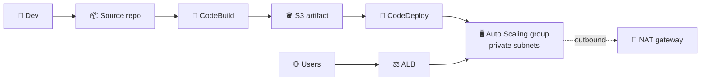
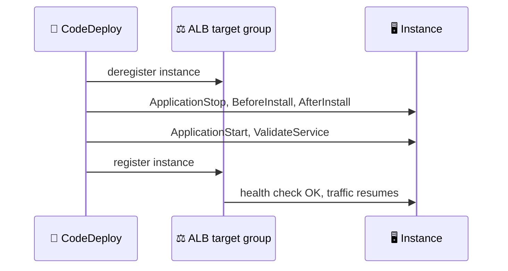
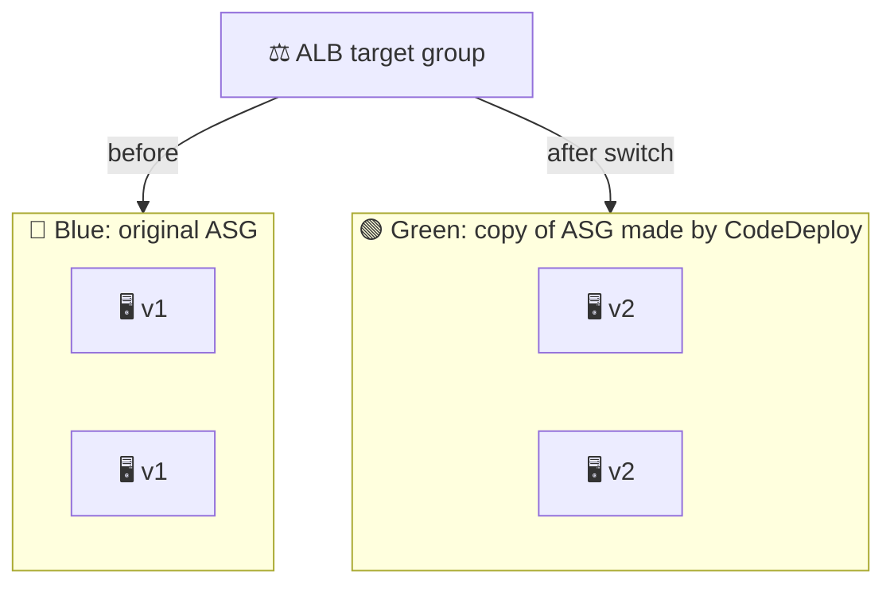
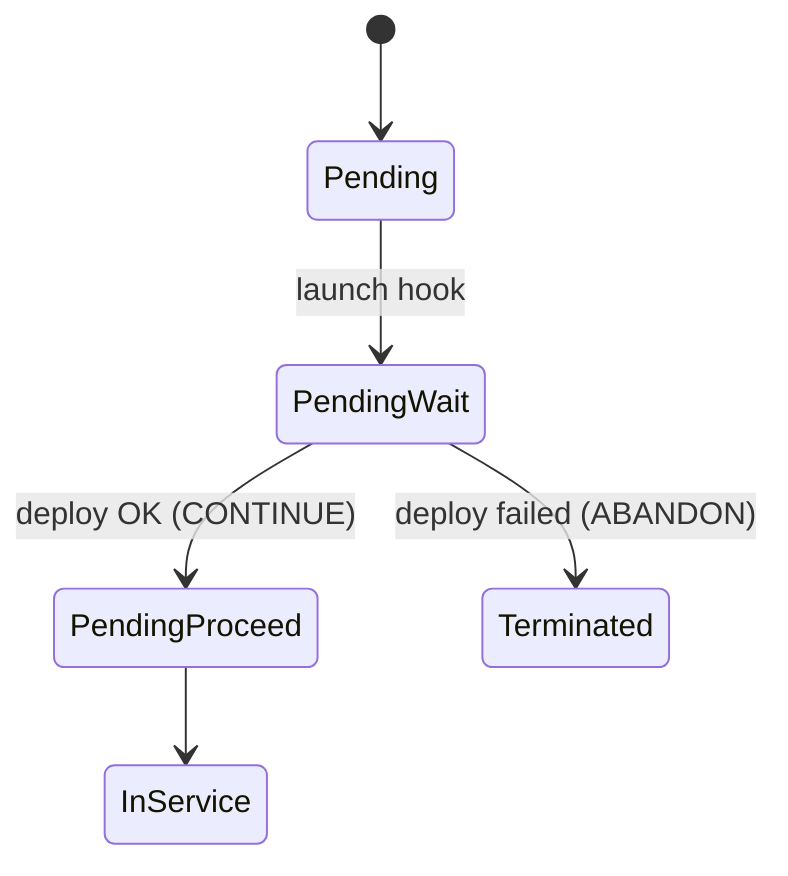

## What you build

Part 1 deployed to a single EC2 instance (see [Part 1](/chapters/44-lab-14-ci-cd-part-1-amazon-ec2/)). Here the same pipeline deploys to a fleet: an Application Load Balancer in front of an Auto Scaling group, updated first in place, then blue/green.


*CodePipeline chains build and deploy; users only ever talk to the ALB.*

I only have the lecture titles for this lab, not the app code or repo. Steps below stay generic: replace app names, ports and health-check paths with the lab's.

## Architecture


*In-place, one instance at a time: the ALB never sends users to the instance being updated.*


*Blue/green: CodeDeploy builds a new ASG, deploys v2, moves the ALB to it, then removes blue.*

| Component | Role |
|---|---|
| ALB + target group | Single entry point; health checks decide who gets traffic |
| Auto Scaling group | Keeps N instances running; see [Auto Scaling](/chapters/26-aws-auto-scaling/) |
| CodeDeploy deployment group | Links the app, the ASG, the target group and a deployment configuration |
| NAT gateway | Lets private instances reach the internet for the agent, packages and CodeDeploy endpoints (a VPC endpoint is an alternative; not verified in the lab) |
| CodeBuild | Builds the artifact; one project per strategy in this lab |

Deployment configurations (EC2/ASG):

| Configuration | Updates at once | Use |
|---|---|---|
| `CodeDeployDefault.OneAtATime` | 1 instance (the default) | Safest, slowest |
| `CodeDeployDefault.HalfAtATime` | Half the instances | Balance |
| `CodeDeployDefault.AllAtOnce` | All instances | Fast; downtime is possible |

## Steps

Stages follow the lecture order.

**Stage 1: Intro, requirements, base app**

1. Read the lab repo and the requirements: a VPC with public and private subnets, and IAM roles for EC2 (instance profile) and for CodeDeploy (service role).
2. Launch one instance with the base app (version 1) via user data or a launch template; install the CodeDeploy agent as in Part 1.
3. Open the instance and confirm the app responds. This is your baseline for "verify base application".

**Stage 2: ALB and ASG**

4. EC2 > Load Balancers > Create ALB in public subnets, with a target group (HTTP, health check path of the app).
5. Create a launch template from the base setup (agent installed) and an ASG in private subnets, attached to the target group, min 2.
6. Create a NAT gateway in a public subnet and route the private subnets to it, so new instances can fetch the agent and packages.
7. Browse the ALB DNS name; refresh to see both instances answer.

**Stage 3: In-place pipeline**

8. CodeBuild > Create project (in-place) with a `buildspec.yml` that outputs the app files plus `appspec.yml`.
9. CodeDeploy > Create application (EC2/On-Premises) > Create deployment group: type In-place, select the ASG, enable the load balancer target group, choose `CodeDeployDefault.OneAtATime`.
10. Create a deployment manually from the S3 revision; watch instances drop out of the target group and return one by one.
11. Wire CodePipeline: Source, Build (CodeBuild), Deploy (CodeDeploy). Push a change and confirm the new version on the ALB.

```bash
aws deploy create-deployment --application-name MyApp \
  --deployment-group-name MyApp-InPlace \
  --s3-location bucket=my-artifacts,key=app.zip,bundleType=zip
```

**Stage 4: Rollback**

12. Deploy a broken version, let it fail (or stop it), then redeploy the previous revision from Deployments > Retry/Redeploy. Optionally turn on automatic rollback on failure in the deployment group.

**Stage 5: Blue/green**

13. Create a second deployment group (or edit the first): type Blue/green, environment configuration "Automatically copy Amazon EC2 Auto Scaling group", same target group, choose how long to keep the original instances.
14. Run CodeBuild for the green version (v2), then run CodeDeploy for it: a new ASG appears, v2 is installed, the ALB switches, the old instances are deregistered and later terminated.

Expected result: the ALB URL shows v2 with no gap, and a new ASG named `CodeDeploy_<group>_<deployment-id>` exists.

## Common mistakes

| Mistake | Fix |
|---|---|
| Deployment hangs on new instances | No outbound path: add NAT or endpoints; confirm the agent runs |
| Launch and terminate loop | A broken revision fails every new instance; stop and fix the revision, or detach the ASG from the deployment group |
| Editing ASG lifecycle hooks by hand | Let CodeDeploy manage them |
| AllAtOnce on a live service | Use OneAtATime or HalfAtATime; keep healthy hosts up |
| Health check path wrong | Instance never returns to the target group; fix the path |
| Forgetting appspec or agent | Same fixes as Part 1 |

## Cleanup

Order matters; the ASG and NAT gateway bill by the hour.

1. CodePipeline: delete the pipeline.
2. CodeDeploy: delete deployment groups, then the application. This removes the hooks it added to the ASG.
3. Auto Scaling: delete the original ASG and the green ASG made by CodeDeploy (set desired to 0 first if you want to watch it drain).
4. EC2: terminate leftover instances; delete the launch template.
5. Load balancing: delete the ALB, then the target group.
6. VPC: delete the NAT gateway, then release its Elastic IP.
7. CodeBuild: delete the projects. S3: empty and delete the artifact bucket.
8. IAM: delete the roles and instance profile you created.

```bash
aws deploy delete-deployment-group --application-name MyApp --deployment-group-name MyApp-InPlace
aws autoscaling delete-auto-scaling-group --auto-scaling-group-name my-asg --force-delete
aws elbv2 delete-load-balancer --load-balancer-arn <arn>
aws ec2 delete-nat-gateway --nat-gateway-id <id>
```

## On the job

- Scale-out is covered: a new instance waits in `Pending:Wait`, CodeDeploy deploys the last successful revision, then the instance goes `InService`. A failed deploy terminates it and Auto Scaling retries.


*CodeDeploy answers the ASG launch hook with CONTINUE or ABANDON.*

| | In-place | Blue/green |
|---|---|---|
| Capacity | Existing instances | New instances, then old removed |
| Rollback | Redeploy old revision | Redeploy, or move traffic back to blue while it still exists |
| Cost | None extra | Double capacity during the switch |
| Pick when | Cheap, tolerant of rolling updates | You want fast cutover and fresh instances |

- A rollback is a new deployment of an earlier revision, with its own ID.
- Pricing of the code services: the lab has a pricing lecture in Part 1; I could not verify it here. Check the CodeDeploy pricing page.

## AWS docs

- [Integrating CodeDeploy with Elastic Load Balancing](https://docs.aws.amazon.com/codedeploy/latest/userguide/integrations-aws-elastic-load-balancing.html)
- [Integrating CodeDeploy with Amazon EC2 Auto Scaling](https://docs.aws.amazon.com/codedeploy/latest/userguide/integrations-aws-auto-scaling.html)
- [Redeploy and roll back a deployment with CodeDeploy](https://docs.aws.amazon.com/codedeploy/latest/userguide/deployments-rollback-and-redeploy.html)
- [Deployments on an EC2/On-Premises compute platform](https://docs.aws.amazon.com/codedeploy/latest/userguide/deployment-steps-server.html)
