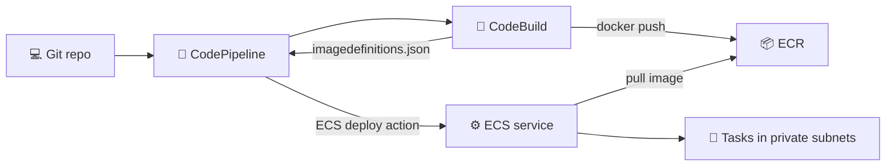
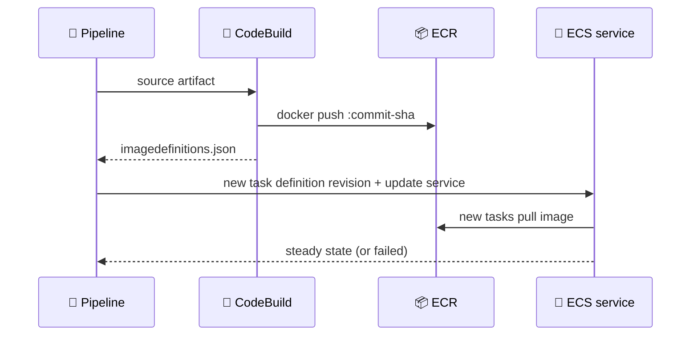
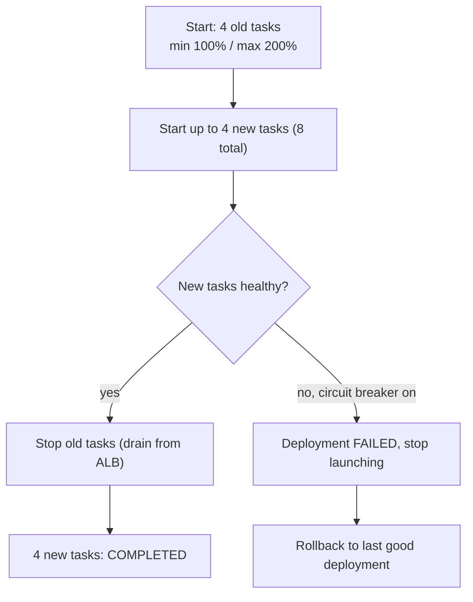

## What you build

A pipeline that takes your Git commit, builds a Docker image, pushes it to ECR and updates an ECS service in private subnets with a rolling update. It follows [Lab 02](/chapters/09-lab-02-build-your-first-container-cluster-with-ama/) (ECS, ECR basics) and [Lab 14 Part 2](/chapters/45-lab-14-ci-cd-part-2-alb-and-asg/) (CodeBuild, CodePipeline, ALB).


*Source, build and push, then deploy: the image is the artifact.*

The lab app is not described here, so build and run steps stay generic. Replace names such as `my-app` with yours.

## Architecture


*The deploy action registers a new task definition revision, then updates the service.*

- **ECR repo**: private registry for the image.
- **ECS cluster, task definition, service**: the service runs in private subnets, so tasks need a route to ECR (NAT gateway or VPC endpoints).
- **CodeBuild**: needs Docker privileged mode and a role allowed to push to ECR.
- **CodePipeline**: Source, Build, Deploy (Amazon ECS action).
- **Task execution role**: lets ECS pull the image and write logs.

## Steps

The lectures group into five stages.

**Stage 1. Build and test the image locally**

1. Write a `Dockerfile` and run `docker build -t my-app .` then `docker run -p 8080:80 my-app`. Test before automating: a broken image breaks every later stage.
2. Optional lecture "fix type:module": if a Node.js app fails with an ES module error, the cause is the `"type": "module"` setting in `package.json` clashing with `require()` code. Fix it by changing the setting or the code style. The exact fix in the lab is not verified here.

**Stage 2. Push to ECR by hand**

3. ECR > Create repository, then **View push commands**:

```bash
aws ecr get-login-password --region $REGION | docker login --username AWS --password-stdin $ACCOUNT.dkr.ecr.$REGION.amazonaws.com
docker tag my-app:latest $ACCOUNT.dkr.ecr.$REGION.amazonaws.com/my-app:latest
docker push $ACCOUNT.dkr.ecr.$REGION.amazonaws.com/my-app:latest
```

**Stage 3. Infra, cluster, task definition, service**

4. Infra: a VPC with public and private subnets, a NAT gateway (or endpoints) for private pulls, security groups, and an ALB if you want traffic. Exact values depend on the lab files.
5. ECS > Clusters > Create (Fargate). Create a task definition with the ECR image URI and note the **container name**: it must match `imagedefinitions.json` later.
6. Create the service in the **private subnets**, desired count 2 or more, deployment type **Rolling update**. Set the numbers from the rolling-update section below.
7. Check: tasks RUNNING, target group healthy, app reachable.

**Stage 4. CodeBuild builds and pushes**

8. Create a CodeBuild project (source: your repo, environment with **privileged** on so Docker can run). Add env vars `REPOSITORY_URI` and `CONTAINER_NAME`. Attach ECR push permissions to its role.
9. Put `buildspec.yml` in the repo root. The shape below follows the AWS tutorial for an ECS standard deployment; the phases are the same for your app.

```yaml
version: 0.2
phases:
  pre_build:
    commands:
      - aws ecr get-login-password --region $AWS_DEFAULT_REGION | docker login --username AWS --password-stdin $REPOSITORY_URI
      - COMMIT_HASH=$(echo $CODEBUILD_RESOLVED_SOURCE_VERSION | cut -c 1-7)
      - IMAGE_TAG=${COMMIT_HASH:=latest}
  build:
    commands:
      - docker build -t $REPOSITORY_URI:latest .
      - docker tag $REPOSITORY_URI:latest $REPOSITORY_URI:$IMAGE_TAG
  post_build:
    commands:
      - docker push $REPOSITORY_URI:latest
      - docker push $REPOSITORY_URI:$IMAGE_TAG
      - printf '[{"name":"%s","imageUri":"%s"}]' $CONTAINER_NAME $REPOSITORY_URI:$IMAGE_TAG > imagedefinitions.json
artifacts:
  files: imagedefinitions.json
```

10. Run the build. Expected: a new image tagged with the commit in ECR and an `imagedefinitions.json` artifact.

**Stage 5. Pipeline and rolling update**

11. CodePipeline > Create: Source (your repo), Build (the CodeBuild project), Deploy provider **Amazon ECS** with cluster, service and image definitions file `imagedefinitions.json`.
12. The lecture titles say "CodeDeploy" and "fix imagedefinition.json for CodeDeploy". In AWS docs a rolling update uses the ECS deploy action with `imagedefinitions.json`; CodeDeploy with ECS is the blue/green path and uses `imageDetail.json`. If the lab shows a CodeDeploy step, follow the lab, but know which file each action expects.
13. The common "fix": the container `name` in the file must equal the container name in the task definition, and the file must be listed in the build `artifacts`.
14. Commit a visible change, watch the pipeline go green, reload the app. Expected: new version served, no downtime.


*Rolling update with a breaker: never below the minimum, never above the maximum.*

| Setting | Meaning |
|---|---|
| `minimumHealthyPercent` | Lower limit of RUNNING tasks during a deploy, as percent of desired |
| `maximumPercent` | Upper limit of tasks (running or pending) during a deploy |
| Circuit breaker + rollback | Fail the deployment if it cannot reach steady state, then return to last completed one |

AWS suggests 100 and 200 for zero downtime. With 100 and 200, you need spare capacity for double the tasks. With a lower minimum, deploys are cheaper but capacity drops.

```bash
aws ecs update-service --cluster my-cluster --service my-svc \
  --deployment-configuration "maximumPercent=200,minimumHealthyPercent=100,deploymentCircuitBreaker={enable=true,rollback=true}"
```

## Common mistakes

| Mistake | Fix |
|---|---|
| Build fails at `docker build` or login | Enable privileged mode and add ECR permissions to the CodeBuild role |
| Deploy stage cannot update service | Container name in `imagedefinitions.json` must match the task definition |
| Tasks in private subnets stay PENDING, image pull fails | Add NAT gateway or ECR/S3 endpoints, check the task execution role |
| Service rolls forever with new tasks failing | Check logs and health check path; enable circuit breaker with rollback |
| Deploy hangs at min 100 / max 100 | No room to start new tasks; raise maximumPercent |
| Always deploying `latest` | Tag with the commit so you can trace and roll back |

## Cleanup

Order matters, and NAT gateways and ALBs bill by the hour.

1. CodePipeline: delete the pipeline.
2. CodeBuild: delete the project (and any CodeDeploy application you created).
3. ECS service: set desired count 0, then delete the service.
4. Load balancer: delete the ALB, then the target group.
5. ECS cluster: delete it, then deregister the task definition revisions.
6. ECR: delete the images, then the repository.
7. NAT gateway: delete it, then release its Elastic IP; delete VPC endpoints.
8. VPC: delete the VPC and subnets if made for the lab.
9. Delete the pipeline artifact S3 bucket, CloudWatch log groups and IAM roles you created.

```bash
aws ecs update-service --cluster my-cluster --service my-svc --desired-count 0
aws ecs delete-service --cluster my-cluster --service my-svc
aws ecs delete-cluster --cluster my-cluster
aws ecr delete-repository --repository-name my-app --force
```

## On the job

- Tag images with the commit hash; `latest` hides what is running.
- Always turn on the circuit breaker with rollback for rolling services.
- Rolling update is simple and cheap. For fast traffic shifting and instant rollback, use blue/green.
- CloudWatch alarms can also trigger a rollback during a rolling deploy.
- Keep buildspec in the repo, secrets in Secrets Manager or Parameter Store, never in the image.
- Needs unverified here: lab-specific app, VPC values and the CodeDeploy wording in the lecture titles.

## AWS docs

- [Tutorial: Amazon ECS standard deployment with CodePipeline](https://docs.aws.amazon.com/codepipeline/latest/userguide/ecs-cd-pipeline.html)
- [Image definitions file reference](https://docs.aws.amazon.com/codepipeline/latest/userguide/file-reference.html)
- [Amazon ECS deploy action reference](https://docs.aws.amazon.com/codepipeline/latest/userguide/action-reference-ECS.html)
- [Publish a Docker image to Amazon ECR sample for CodeBuild](https://docs.aws.amazon.com/codebuild/latest/userguide/sample-docker.html)
