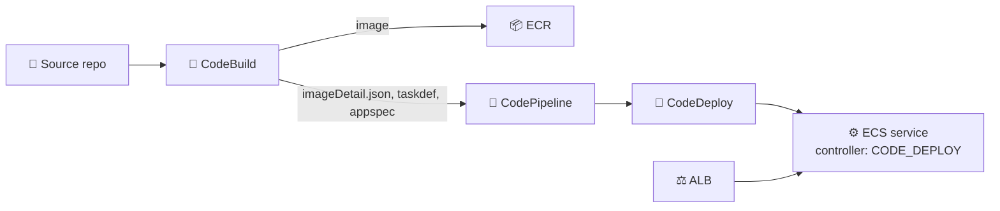
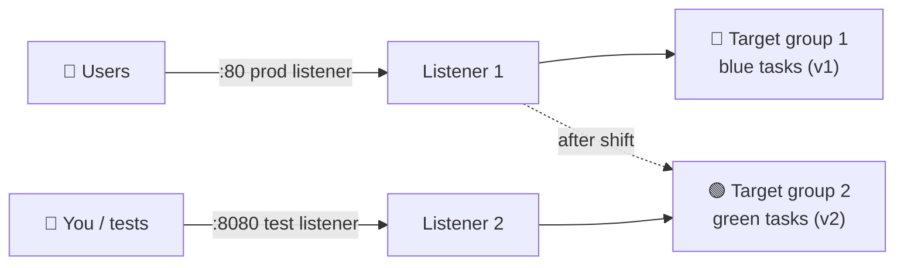
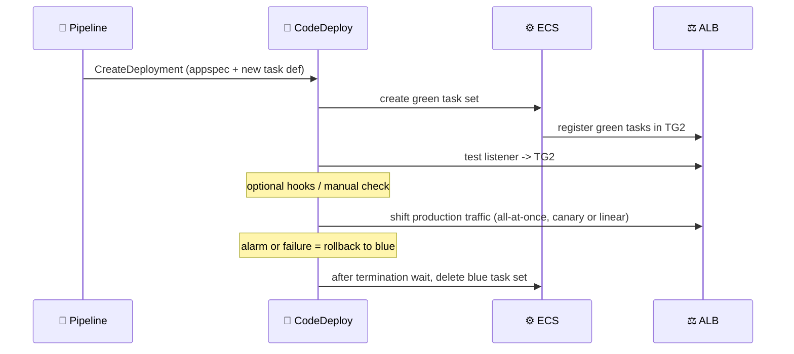
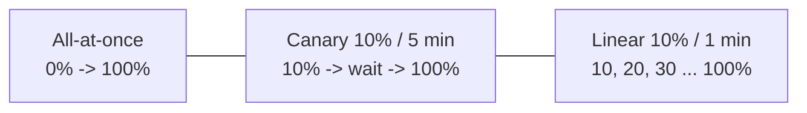

## What you build

An ECS Fargate service behind an Application Load Balancer that is updated with a **blue/green** deployment: CodeDeploy starts the new version (green) next to the old one (blue), moves traffic, and can move it back. It continues [the rolling-update lab](/chapters/46-lab-14-ci-cd-part-3-amazon-ecs-rolling-update/), so reuse its ECR repo, cluster and CodeBuild project. The lab's exact app, names and ports are not shown here, so steps stay generic.


*Pipeline from commit to a blue/green deployment.*

## Architecture


*Two target groups; the production listener moves from blue to green. The test listener always points at green.*


*Order of events in one deployment.*

- **Two target groups** (type `ip` for Fargate): CodeDeploy swaps which one the listener uses.
- **Test listener** (optional): a second port to try green before real users see it.
- **ECS service** must use the `CODE_DEPLOY` deployment controller.
- **CodeDeploy application + deployment group**: names the cluster, service, listeners, target groups, traffic config, rollback and termination wait.
- **AppSpec**: tells CodeDeploy which task definition, container name and port to use.


*The three traffic-shift styles.*

Predefined ECS configurations in CodeDeploy:

| Name | Behavior |
|---|---|
| `CodeDeployDefault.ECSAllAtOnce` | All traffic at once |
| `CodeDeployDefault.ECSCanary10Percent5Minutes` | 10 percent, rest 5 min later |
| `CodeDeployDefault.ECSCanary10Percent15Minutes` | 10 percent, rest 15 min later |
| `CodeDeployDefault.ECSLinear10PercentEvery1Minutes` | +10 percent every minute |
| `CodeDeployDefault.ECSLinear10PercentEvery3Minutes` | +10 percent every 3 minutes |

### CodeDeploy vs ECS built-in blue/green

ECS now also has its own blue/green strategy, set on the service (no CodeDeploy).

| | CodeDeploy (this lab) | ECS built-in |
|---|---|---|
| Service controller | `CODE_DEPLOY` | `ECS`, strategy `BLUE_GREEN` |
| Where config lives | CodeDeploy app + deployment group + AppSpec | The ECS service itself |
| Traffic shift | Listener switches target group | Listener rule weights change |
| Validation | Lambda hooks, test listener | Lambda lifecycle hooks, bake time |
| Rollback | Alarms or failure, redeploy | CloudWatch alarms, bake time |
| Extras | Needs ALB or NLB | Also Service Connect, VPC Lattice, headless |

An AWS migration post said built-in blue/green supported only all-at-once, while newer docs and posts describe canary and linear too. Check the current Developer Guide before choosing.

## Steps

Generic: use your own names. Assume the rolling-update lab's cluster, ECR repo and CodeBuild project exist.

1. **Load balancer**: EC2 > Load balancers: ALB with listener `80` (production) and listener `8080` (test). Create two target groups, type `ip`, same health check. Listener 80 and 8080 each start on a target group. Open the ports in the security group.
2. **Fix the service controller**: the lab's rolling-update service uses the ECS controller. Create a new Fargate service in the cluster with deployment type **Blue/green using AWS CodeDeploy** (controller `CODE_DEPLOY`), the ALB, listener 80, test listener 8080, and target group 1. Whether an existing service can be switched was not verified; the lab recreates it.
3. **CodeDeploy application**: CodeDeploy > Applications > Create, compute platform **Amazon ECS**.
4. **Service role**: create a role for CodeDeploy with the AWS managed policy for ECS deployments (`AWSCodeDeployRoleForECS`, verify the name in the console).
5. **Deployment group**: pick the cluster, service, production listener, test listener, both target groups, a traffic config such as `ECSCanary10Percent5Minutes`, termination wait (for example 5 minutes for the lab), and enable rollback on failure and on alarms.
6. **Files in the source repo**: `taskdef.json` with `"image": "<IMAGE1_NAME>"`, and `appspec.yaml`:

```yaml
version: 0.0
Resources:
  - TargetService:
      Type: AWS::ECS::Service
      Properties:
        TaskDefinition: <TASK_DEFINITION>
        LoadBalancerInfo:
          ContainerName: "web"   # your container name
          ContainerPort: 80      # your container port
```

7. **Manual run first**: CodeDeploy > Deployments > Create deployment, paste the AppSpec with a real task definition ARN. Watch the steps: green tasks start, test traffic, production traffic, blue terminated.
8. **Pipeline**: CodePipeline > Create. Source: your repo and/or ECR. Build: your CodeBuild project. Deploy: **Amazon ECS (Blue/Green)** (CodeDeployToECS) with application, deployment group, `taskdef.json`, `appspec.yaml`, and image placeholder `IMAGE1_NAME`.
9. **Make CodeBuild output `imageDetail.json`**. This is the usual failure point.

```json
{ "ImageURI": "<account>.dkr.ecr.<region>.amazonaws.com/<repo>@sha256:<digest>" }
```

   Add it, plus `taskdef.json` and `appspec.yaml`, to the buildspec `artifacts: files:` list. The file name must be exactly `imageDetail.json`.
10. **Verify**: push a visible change (text or colour). Open the test listener (`:8080`) to see v2 before production, then the production DNS name. During canary, refresh and see a mix of v1 and v2.
11. **Rollback**: stop the deployment from the console, or ship a bad version, or trip the alarm. CodeDeploy moves the production listener back to blue.

Expected result: a new deployment per push; both versions visible during the shift; after the termination wait, only green remains; rollback restores v1.

## Common mistakes

| Mistake | Fix |
|---|---|
| Deployment group cannot use the service | Service controller must be `CODE_DEPLOY` |
| Pipeline fails on `imageDetail.json` | Name is case-sensitive; output it as a build artifact |
| Task definition not updated | Keep `<IMAGE1_NAME>` and `<TASK_DEFINITION>` placeholders literal |
| Green tasks unhealthy | Target type `ip`, correct container port, matching health check path |
| Test listener unreachable | Open its port in the ALB security group |
| Rollback not possible later | Blue task set is deleted after the termination wait; redeploy an old revision |
| Targets never register | Task needs a route to ECR (NAT, public IP or endpoints) |

## Cleanup

Order matters; load balancers and Fargate tasks bill by the hour.

1. CodePipeline: delete the pipeline and its artifact S3 bucket contents.
2. CodeDeploy: delete the deployment group, then the application.
3. ECS: set desired count to 0, delete the service (this stops blue and green tasks).
4. ALB: delete both listeners and the load balancer, then both target groups.
5. CodeBuild project, ECR images and repository, CloudWatch log groups.
6. IAM roles created for the lab and any alarms.
7. If part of the lab's VPC or NAT gateway: delete them last.

```bash
aws ecs update-service --cluster my-cluster --service web --desired-count 0
aws ecs delete-service --cluster my-cluster --service web --force
aws codedeploy delete-deployment-group --application-name my-app --deployment-group-name my-dg
aws codedeploy delete-application --application-name my-app
```

## On the job

- Blue/green costs double capacity during the shift and the termination wait; keep the wait short for lab, longer for production.
- Prefer canary or linear plus CloudWatch alarms over all-at-once; all-at-once can disrupt users.
- Use the test listener and Lambda hooks to run smoke tests before production traffic.
- For new projects, compare ECS built-in blue/green with CodeDeploy; keep CodeDeploy if you already depend on AppSpec hooks.
- Database schema changes must work with both versions at once.

## AWS docs

- [Amazon ECS blue/green deployments](https://docs.aws.amazon.com/AmazonECS/latest/developerguide/deployment-type-blue-green.html)
- [Required resources for Amazon ECS blue/green deployments](https://docs.aws.amazon.com/AmazonECS/latest/developerguide/blue-green-deployment-implementation.html)
- [Migrate CodeDeploy blue/green deployments to Amazon ECS blue/green](https://docs.aws.amazon.com/AmazonECS/latest/developerguide/migrate-codedeploy-to-ecs-bluegreen.html)
- [CodeDeploy AppSpec file reference](https://docs.aws.amazon.com/codedeploy/latest/userguide/reference-appspec-file.html)
- [Amazon ECS and CodeDeploy blue/green deploy action reference](https://docs.aws.amazon.com/codepipeline/latest/userguide/action-reference-ECSbluegreen.html)
