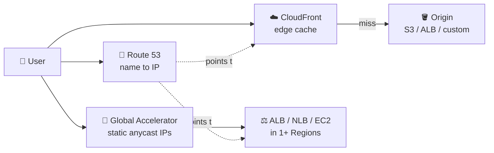
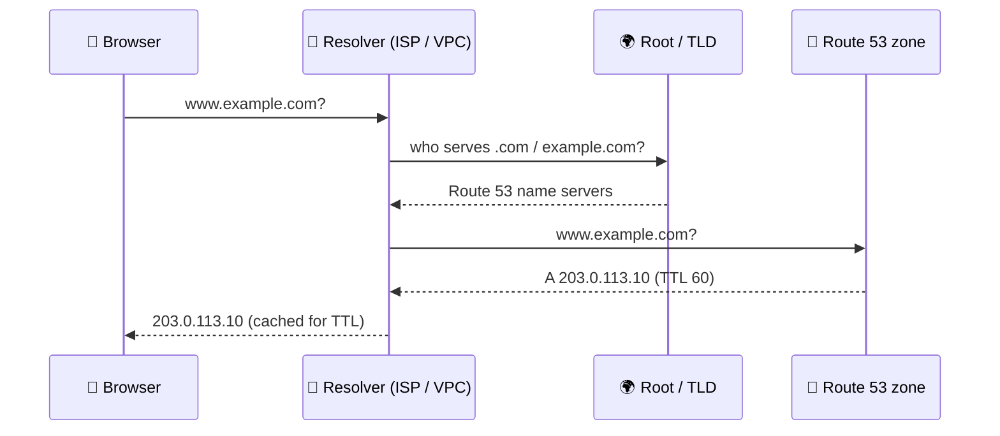
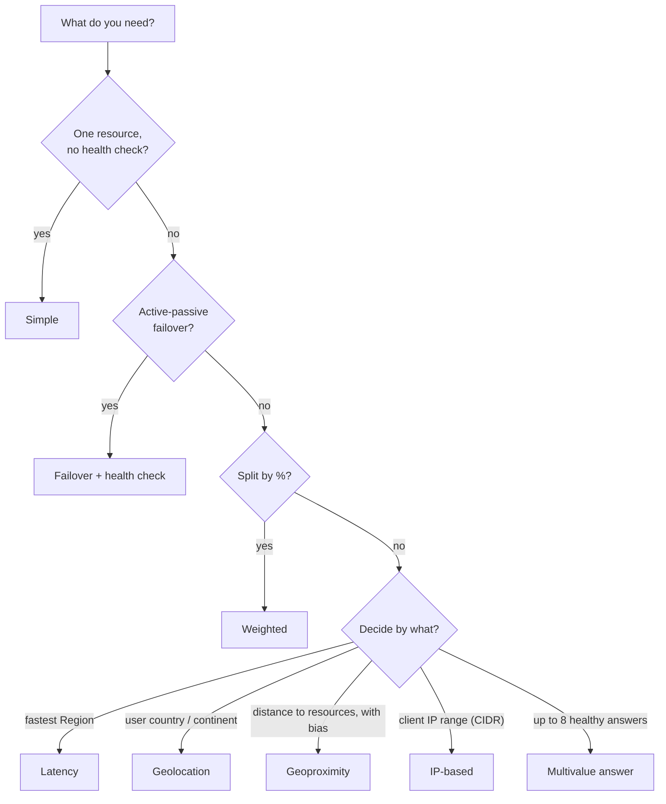
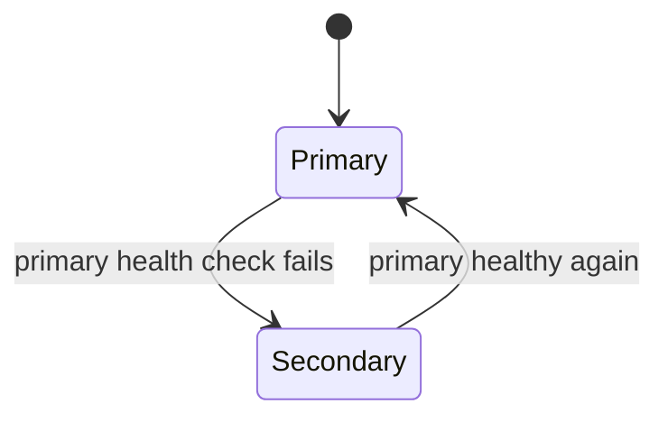
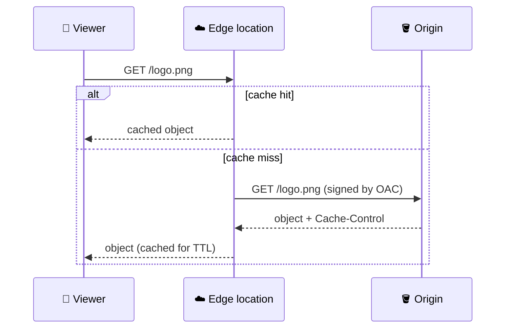
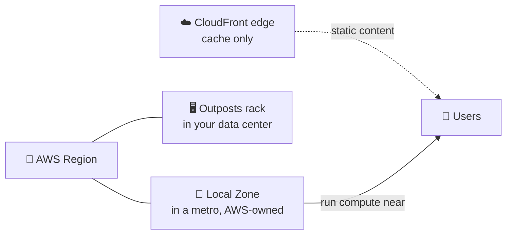
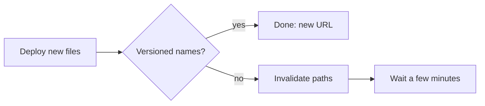

## What it is

"Edge" means serving users from places close to them instead of from one Region. Three services do the job: **Route 53** answers DNS questions, **CloudFront** caches content at edge locations, and **Global Accelerator** speeds up traffic to your apps over the AWS network.



*Route 53 finds the door, CloudFront serves cached content, Global Accelerator speeds the road to your Regions.*

Use it when users are spread out, you need failover between Regions, or the same files are requested again and again.

## Key concepts

### DNS resolution and Route 53 basics (intro, domain, hosted zone, pricing)

A **hosted zone** is the container of DNS records for one domain. A **public** zone answers the internet; a private zone answers inside a VPC. Registering a domain in Route 53 (or transferring one) and creating a public zone gives you four name servers; set them at the registrar if the domain was bought elsewhere.



*The resolver does the walking and caches the answer for the record's TTL.*

| Record | Maps | Note |
|---|---|---|
| A / AAAA | name to IPv4 / IPv6 | most common |
| CNAME | name to another name | not allowed at the zone apex |
| MX / TXT | mail routing / text (verification) | |
| NS / SOA | zone's name servers / zone info | created automatically |
| **Alias** | name to an AWS resource | Route 53 only; works at the apex; no charge for queries to some AWS targets such as CloudFront |

- Alias targets include CloudFront, load balancers, API Gateway, Elastic Beanstalk, S3 static websites, Global Accelerator and VPC interface endpoints.
- Pricing is per hosted zone per month plus per million queries, plus health checks and domain registration. Check the current pricing page.

### Routing policies and health checks (all the policy demos)

Every record has a routing policy. The decision flow:



*Pick the policy by the question you are answering, then add health checks where failure matters.*

- **Simple**: standard DNS; one record can hold several values, returned in random order. No health check.
- **Weighted**: send, say, 10 percent to a new version. Weight 0 stops traffic to a record.
- **Latency**: resources must be in AWS Regions; picks the lowest-latency Region.
- **Geolocation**: by user location. Add a **Default** record for users who match nothing.
- **Geoproximity**: by distance between user and resource; a bias shifts traffic toward or away from a location.
- **IP-based**: by the client's CIDR block, for example send a known ISP to a given endpoint.
- **Multivalue**: up to eight healthy records at random; client-side load spreading, not a load balancer.

**Health checks** are Route 53 probes from outside. Types: HTTP/HTTPS, with optional string match on the first 5,120 bytes, TCP, CloudWatch alarm based, and calculated (combines other checks). For private resources, use the CloudWatch alarm type because probes come from the internet.



*Failover: a primary record and a secondary record; Route 53 answers with the secondary only while the primary is unhealthy.*

Demo recipe used in the course: launch EC2 web servers in two or more Regions (each page shows its Region), create records with each policy, then test with `dig` or `nslookup`.

```bash
dig +short app.example.com
```

Keep TTL low (about 60 seconds) on failover records, because clients cache answers for the TTL.

### CloudFront (intro, demo, price class, pricing)

CloudFront is a content delivery network. A **distribution** has **origins** (S3, ALB, any HTTP server) and **cache behaviors** that match path patterns.



*Hits are served at the edge; only misses travel to the origin.*

- **TTL**: the origin's `Cache-Control: max-age` wins within the behavior's Minimum and Maximum TTL. With no header, the Default TTL applies (24 hours if no cache policy is used).
- **Invalidation**: forces objects out of the cache (`/images/*` counts as one path). It takes minutes and extra paths beyond a monthly free amount are billed. Prefer **versioned file names**.
- **OAC (origin access control)**: keeps the S3 bucket private; CloudFront signs requests and the bucket policy allows only your distribution. Use the S3 REST endpoint, not the website endpoint. OAC replaces the legacy OAI.
- **Signed URLs / cookies**: private content. A URL grants one file; cookies grant many files under a path. Sign with a key pair in a trusted key group.
- **Edge code**: **CloudFront Functions** are tiny JavaScript functions on viewer request/response (redirects, header edits, cache-key tweaks, JWT checks). **Lambda@Edge** runs Node.js or Python on viewer and origin events for heavier work such as network calls or third-party libraries.
- **Price class**: by default all edge locations serve you. A cheaper class limits which Regions' edges are used; users outside them may see higher latency. Check the pricing page for what each class contains.
- **Pricing**: mainly data transfer out and request counts by Region, plus invalidation and edge-function charges. Check the current pricing page, including any flat-rate plans.
- HTTPS on a custom domain needs an ACM certificate in us-east-1.

### Local Zones and Outposts (Vietnam Local Zone lectures)



*Local Zone and Outposts run your compute; CloudFront only caches content.*

- **Local Zone**: an extension of a parent Region near a big city. You opt in, create a subnet in it, and launch supported resources (compute, storage, some databases) for low latency. It uses normal VPC rules and connects to the Region over AWS's network.
- **Local Zone service and resource support** is a short list, not every service. Check the Local Zones docs for the exact list for Vietnam (Hanoi or Ho Chi Minh City) and its current status.
- **Outposts**: AWS-built racks in your own site, managed by AWS, for workloads that must stay on-premises (latency, data residency). You handle facility, power and connectivity.
- **CloudFront vs Local Zone**: CloudFront caches and delivers content (static files, video, accelerated APIs). A Local Zone runs your servers or databases near users. Many designs use both.

## X vs Y

### Route 53 routing policies

| Policy | Decides by | Health check | Typical use |
|---|---|---|---|
| Simple | nothing | no | one server |
| Weighted | your percentages | yes | canary, A/B |
| Latency | lowest latency Region | yes | multi-Region app |
| Geolocation | user country/continent | yes | content law, language |
| Geoproximity | distance + bias | yes | shift load between sites |
| IP-based | client CIDR | yes | known ISP or network |
| Failover | primary health | required for primary | active-passive DR |
| Multivalue | random healthy set | yes | simple spreading |

Pick **Latency** for speed, **Geolocation** for rules about where users are, **Weighted** for gradual rollouts, **Failover** for a standby.

### CloudFront vs Global Accelerator

| | CloudFront | Global Accelerator |
|---|---|---|
| Job | Cache and deliver content | Route traffic over AWS backbone |
| Protocols | HTTP/HTTPS (and WebSocket) | TCP and UDP |
| Caching | Yes | No |
| Entry point | Domain name (IPs vary) | Two static anycast IPv4 addresses (plus two IPv6 if dual-stack) |
| Endpoints | S3, ALB, custom origins | ALB, NLB, EC2, Elastic IP |
| Failover | Origin groups | Health-based between endpoints and Regions |

Pick **CloudFront** when content is cacheable or you need edge code and signed URLs. Pick **Global Accelerator** when you need fixed IPs, non-HTTP traffic, or fast failover without waiting for DNS TTLs.

## Job notes

- Put the S3 bucket behind CloudFront with OAC and keep Block Public Access on. See [S3](/chapters/14-aws-storage-services-amazon-s3/).
- Point `example.com` to CloudFront with an alias A record, not a CNAME.
- Cache bug after deploy: use versioned file names; invalidate only when you must.
- Failover not happening: check health check status, that the record has the health check attached, and the TTL.
- Health checks cannot reach private IPs; use a CloudWatch alarm based check.
- Cost traps: invalidating many paths, high-volume DNS queries on non-alias records, forgotten health checks and hosted zones.
- Clean up: delete records (not the default NS/SOA), hosted zones, health checks, disable then delete the distribution, terminate EC2 test servers, release Elastic IPs.



*Versioning beats invalidating.*

## Cheat sheet

- Hosted zone = records of a domain; alias = Route 53 record to an AWS resource, works at the apex.
- Policies: simple, weighted, latency, geolocation, geoproximity, IP-based, failover, multivalue.
- Health checks: endpoint, calculated, CloudWatch alarm.
- CloudFront: distribution, origin, behavior, TTL, OAC, signed URL/cookie, invalidation.
- CloudFront Functions: light, viewer events. Lambda@Edge: heavier, viewer and origin events.
- Price class limits edge locations to lower cost.
- Global Accelerator: static anycast IPs, TCP/UDP, no cache.
- Local Zone: your compute near a city. Outposts: AWS rack in your site.
- For prices and quotas, check the current pricing and quota pages.

## AWS docs

- [Choosing a routing policy](https://docs.aws.amazon.com/Route53/latest/DeveloperGuide/routing-policy.html)
- [Choosing between alias and non-alias records](https://docs.aws.amazon.com/Route53/latest/DeveloperGuide/resource-record-sets-choosing-alias-non-alias.html)
- [Types of Route 53 health checks](https://docs.aws.amazon.com/Route53/latest/DeveloperGuide/health-checks-types.html)
- [Restrict access to an S3 origin (OAC)](https://docs.aws.amazon.com/AmazonCloudFront/latest/DeveloperGuide/private-content-restricting-access-to-s3.html)
- [CloudFront Functions vs Lambda@Edge](https://docs.aws.amazon.com/AmazonCloudFront/latest/DeveloperGuide/edge-functions-choosing.html)
