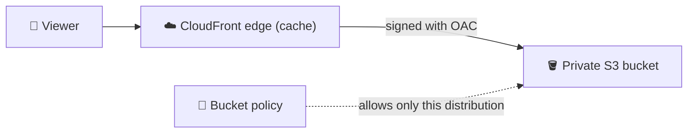
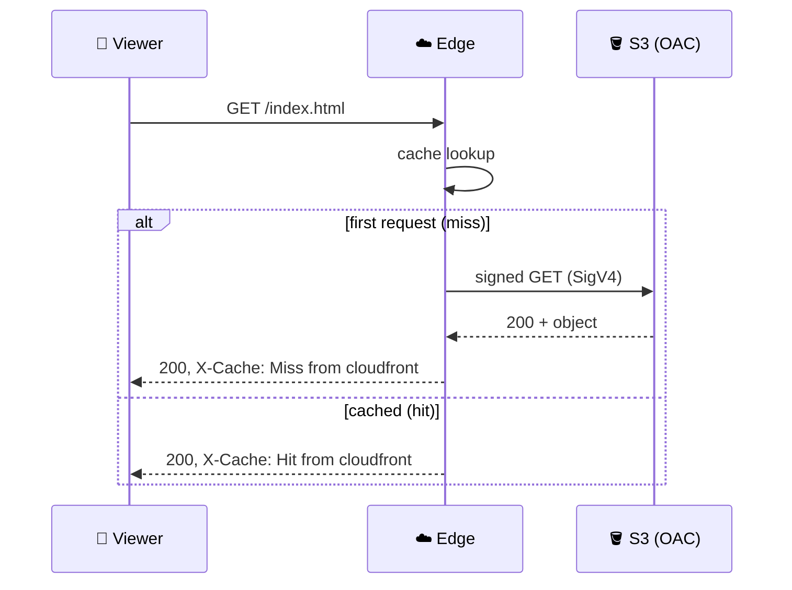

## What you build

A private S3 bucket holds your static files (for example a website or the front end of the todo app). CloudFront serves them worldwide, and S3 accepts requests only from your distribution.


*Viewers never touch the bucket; CloudFront signs every request it sends to S3.*

## Architecture


*The second request is answered at the edge and never reaches S3.*

- **Origin**: the bucket's REST endpoint (`bucket.s3.<region>.amazonaws.com`), not the S3 website endpoint. OAC does not work with website endpoints.
- **Origin access control (OAC)**: a setting that makes CloudFront sign requests to S3. Keep the default "Sign requests".
- **Bucket policy**: allows the service principal `cloudfront.amazonaws.com` to `s3:GetObject`, with a condition on your distribution ARN.
- **Default root object**: the file returned for `/` (usually `index.html`). Without it, the root URL returns an error.
- **Cache behaviour**: path pattern plus cache policy. The cache policy holds minimum, maximum and default TTL.

| Setting | Effect |
|---|---|
| Use origin cache headers | CloudFront honours `Cache-Control` from the origin, clamped by min/max TTL |
| Default TTL | Used when the origin sends no cache header (24 hours in the AWS getting-started example) |
| Invalidation | Removes cached copies early; later requests miss and refetch |

## Steps

Course specifics (the repo layout, the todo app code, the EC2 app) are not known to this chapter, so these steps are generic. Follow the repo README for exact file names.

1. **Get the code**: clone the course GitHub repo and note the static front-end folder (and the EC2 app, if the lab includes one).
2. **Create the bucket**: S3 > Create bucket, keep Block Public Access on and Object Ownership on "Bucket owner enforced" (the default).
3. **Upload the files**, including `index.html`.

```bash
aws s3 sync ./site s3://my-cf-lab-<id>/
```

4. **Create the distribution**: CloudFront > Create distribution > origin = your bucket (REST endpoint). For origin access choose "Origin access control settings" and create a new OAC with "Sign requests". Set the default root object to `index.html`.
5. **Copy the bucket policy**: the console offers a policy to copy. Paste it in S3 > bucket > Permissions > Bucket policy. Shape of the policy:

```json
{
  "Version": "2012-10-17",
  "Statement": [{
    "Sid": "AllowCloudFrontServicePrincipalReadOnly",
    "Effect": "Allow",
    "Principal": { "Service": "cloudfront.amazonaws.com" },
    "Action": "s3:GetObject",
    "Resource": "arn:aws:s3:::my-cf-lab-<id>/*",
    "Condition": { "StringEquals": {
      "AWS:SourceArn": "arn:aws:cloudfront::<account-id>:distribution/<distribution-id>" } }
  }]
}
```

6. **Wait for deployment**: distribution status changes to Deployed (a few minutes).
7. **Test a miss then a hit**: request the same URL twice and read the `X-Cache` header.

```bash
curl -sI https://dxxxxxxxx.cloudfront.net/index.html | grep -i x-cache
# x-cache: Miss from cloudfront   (first request)
# x-cache: Hit from cloudfront    (second request)
```

8. **Check privacy**: open the direct S3 object URL. It must return AccessDenied.
9. **Tune the cache behaviour**: Behaviors tab > Edit > choose a cache policy, or create one with your own min, default and max TTL.
10. **Update and invalidate**: upload a changed `index.html`, then Invalidations > Create > path `/index.html` (or `/*`). Request again: the header shows a Miss and the new content.

```bash
aws cloudfront create-invalidation --distribution-id <id> --paths "/index.html"
```

11. **Todo app variant**: for the serverless todo app, serve the front end from this distribution; the API (for example API Gateway) is a separate origin or called directly. How the repo wires it is not covered here.
12. **EC2 origin variant**: add the EC2 app or its Application Load Balancer as a custom origin. In the origin's security group, allow inbound HTTP or HTTPS only from the AWS managed prefix list `com.amazonaws.global.cloudfront.origin-facing`, then remove other inbound rules so nobody bypasses CloudFront.

```bash
aws ec2 describe-managed-prefix-lists \
  --query 'PrefixLists[?PrefixListName==`com.amazonaws.global.cloudfront.origin-facing`]' \
  --region <region>
```

Expected result: the site loads from the `cloudfront.net` domain, the second request shows a Hit, and the direct S3 URL is denied.

## Common mistakes

| Mistake | Fix |
|---|---|
| Used the S3 website endpoint as origin | Use the REST endpoint; OAC does not support website endpoints |
| 403 from CloudFront | Bucket policy missing or has the wrong distribution ARN or bucket name |
| Root URL `/` gives an error | Set the default root object |
| Old content after upload | Invalidate the path or use versioned file names; wait for TTL otherwise |
| Always Miss | Query strings, headers or cookies in the cache key make each request unique |
| Prefix list rule fills the security group | The CloudFront prefix list counts as many rules (the AWS blog says 55); check the current quota |

## Cleanup

Order matters: CloudFront first, then what it points to.

1. CloudFront: disable the distribution (Settings > Edit > Enable = off). Wait until the status is Deployed.
2. CloudFront: delete the distribution. It cannot be deleted while enabled, and deletion cannot be undone.
3. CloudFront: Origin access > delete the OAC (it must no longer be attached to a distribution).
4. S3: empty the bucket, then delete it. The docs say to delete the distribution before the origin bucket.
5. EC2 variant: terminate the instance or ALB and delete the security group rules or group.
6. Todo app variant: delete any Lambda, API Gateway and database from the repo.

```bash
aws s3 rb s3://my-cf-lab-<id> --force   # only after the distribution is deleted
```

## On the job

- Private bucket plus OAC plus CloudFront is the default for static sites; never make the bucket public for this.
- Prefer versioned file names (`app.3f2a.js`) over frequent invalidations; check pricing for invalidation paths.
- Use `X-Cache` and `curl -I` first when debugging stale or slow content.
- For EC2 or ALB origins, combine the managed prefix list with an HTTPS-only origin protocol policy, and consider a custom secret header as extra protection.
- Associate AWS WAF and signed URLs at CloudFront, not at the origin.

Related: [AWS edge services](/chapters/48-aws-edge-services/) and [Amazon S3](/chapters/14-aws-storage-services-amazon-s3/).

## AWS docs

- [Restrict access to an Amazon S3 origin](https://docs.aws.amazon.com/AmazonCloudFront/latest/DeveloperGuide/private-content-restricting-access-to-s3.html)
- [Specify a default root object](https://docs.aws.amazon.com/AmazonCloudFront/latest/DeveloperGuide/DefaultRootObject.html)
- [Invalidate files to remove content](https://docs.aws.amazon.com/AmazonCloudFront/latest/DeveloperGuide/Invalidation.html)
- [Delete a distribution](https://docs.aws.amazon.com/AmazonCloudFront/latest/DeveloperGuide/HowToDeleteDistribution.html)
- [CloudFront managed prefix list](https://docs.aws.amazon.com/AmazonCloudFront/latest/DeveloperGuide/LocationsOfEdgeServers.html)
